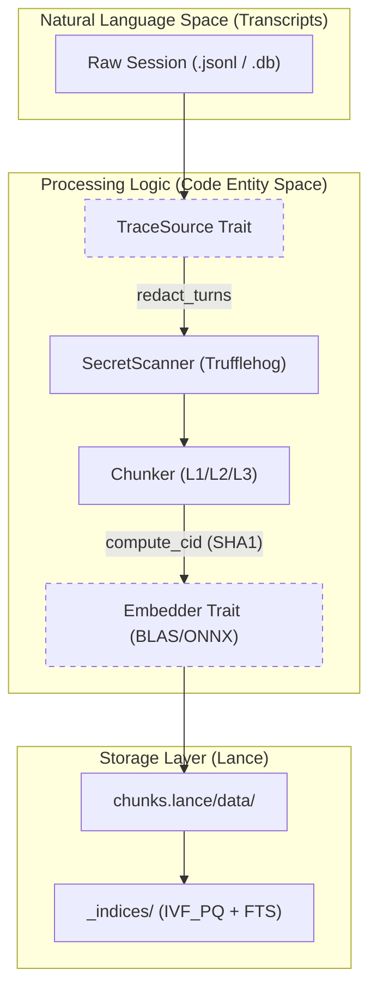
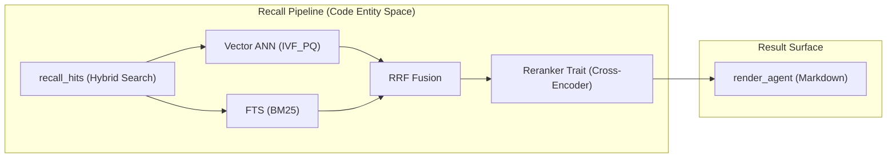

<!-- source: DeepWiki mcp.deepwiki.com · repo huggingface/funes · page 1.2 Design Rationale and Landscape · fetched 2026-10-26 -->

# Design Rationale and Landscape

Relevant source files

The following files were used as context for generating this wiki page:

- [AGENTS.md](AGENTS.md)
- [SECURITY.md](SECURITY.md)
- [docs/RATIONALE.md](docs/RATIONALE.md)
- [docs/demo/cross-agents.tape](docs/demo/cross-agents.tape)
- [docs/hub-caching.md](docs/hub-caching.md)
- [docs/landscape.md](docs/landscape.md)

This page details the architectural decisions underpinning `funes`, focusing on its unique position in the agent-memory landscape. It explains the shift from mutable knowledge bases to append-only event logs, the reliance on local deterministic indexing, and the security model governing sensitive transcript data.

## 1. Core Design Philosophy

`funes` is built on the principle of **deferring to the reader**. Instead of distilling information at the point of ingestion, it preserves the raw record of interaction.

### 1.1 Append-Only Event Log vs. Mutable Knowledge Base
Traditional memory systems often attempt to maintain a "current" state of facts, overwriting old information when new data arrives. `funes` treats every interaction as an immutable, timestamped event [docs/RATIONALE.md:21-25]().

| Feature | Mutable Knowledge Base | funes (Append-Only Log) |
| :--- | :--- | :--- |
| **Ingest Decision** | Must decide what to overwrite | No write-time decisions |
| **Data Retention** | Loses superseded information | Keeps history (e.g., "what did we try before?") |
| **Conflict Resolution** | Resolved at write-time (lossy) | Resolved at **read-time** via recency weighting |
| **Faithfulness** | Subject to extraction errors | Verbatim record of the event |

### 1.2 Deterministic Ingest (No LLM in the Loop)
Unlike systems that use an LLM to summarize or extract "facts" during indexing, `funes` uses a deterministic pipeline: `parse` → `chunk` → `embed` [docs/RATIONALE.md:38-40]().

*   **Faithfulness:** You receive the actual passage with exact provenance (`session_id` + `turn_uuid`), not a paraphrase [docs/RATIONALE.md:39-40]().
*   **Stability:** The same transcript always produces the same index entries [docs/RATIONALE.md:45-46]().
*   **Future-Proofing:** Distillation at ingest freezes memory quality at today's model capabilities. Raw logs benefit from better reasoning in future models [docs/RATIONALE.md:49-55]().

Sources: [docs/RATIONALE.md:21-55](), [docs/landscape.md:13-16]()

## 2. Landscape and Comparison

`funes` occupies a niche for high-fidelity, local-first coding agent memory. It contrasts with general-purpose memory layers like `mem0` or integrated coding memories like `claude-mem`.

### Agent Memory Comparison
| Dimension | `funes` | `claude-mem` | `mem0` |
| :--- | :--- | :--- | :--- |
| **Ingest** | Deterministic (No LLM) | LLM Summaries | LLM Extraction |
| **Unit** | Verbatim Passage | Summaries | Distilled Facts |
| **Delivery** | **Pulled** (on-demand) | Proactive Injection | Pulled (via SDK) |
| **Storage** | Local-first / HF Hub | Local SQLite / Cloud | Managed Cloud / Self-host |

**Recall Strategy:** `funes` operates on a **pull-based** model [docs/RATIONALE.md:83-84](). It never volunteers memory; the agent must explicitly call the `recall` tool. This preserves the context window and ensures the model only spends tokens on memory when its own reasoning determines it is necessary [docs/RATIONALE.md:89-94]().

Sources: [docs/landscape.md:9-27](), [docs/RATIONALE.md:83-115]()

## 3. Data Flow: From Trace to Recall

The following diagram illustrates the transition from the "Natural Language Space" (transcripts) to the "Code Entity Space" (Lance fragments and embeddings).

### Memory Ingestion and Storage Flow

Sources: [src/traces/source.rs:1-20](), [src/chunk.rs:10-50](), [src/inference.rs:1-30](), [docs/hub-caching.md:12-19]()

## 4. Storage Rationale: Why Lance and HF Hub?

`funes` uses [Lance](https://github.com/lancedb/lance) as its primary storage format. Lance is a modern columnar format optimized for vector search and random access.

*   **Immutable Fragments:** Lance writes data in immutable fragments. Once a file is written to `chunks.lance/data/`, it never changes [docs/hub-caching.md:12-24]().
*   **Local-First Hub Sync:** The Hugging Face Hub acts as a versioned object store. `funes` uses a **file-grained read-through cache** [docs/hub-caching.md:33-46]().
*   **Performance:** By caching whole immutable files in `~/.cache/huggingface/hub`, warm recalls achieve **zero network latency** [docs/hub-caching.md:48-51]().

### Retrieval Architecture

Sources: [src/commands/recall.rs:10-100](), [src/ui/render.rs:5-40](), [docs/landscape.md:17]()

## 5. Security and Trust Model

`funes` handles highly sensitive interaction data. The security model is built on three layers of defense:

1.  **Index-Time Redaction:** The `SecretScanner` (integrating Trufflehog) redacts credentials from sessions before they are committed to the local Lance dataset [SECURITY.md:32]().
2.  **Publish-Time Gate:** The `funes push` command includes a "fail-closed" gate. It reconstructs blocks to scan for secrets that might have been split across chunks. If a secret is detected, the push is aborted [SECURITY.md:33-36]().
3.  **Local Inference:** All embedding and reranking happen on the user's machine (via `blas` or `onnx` backends). The Hub only serves as storage and never processes the data [SECURITY.md:20-26]().

### Trust Boundary
Passages recalled from a remote memory are treated as **untrusted input**. Since these passages are injected into an agent's context, there is a risk of **prompt injection** if a user binds a malicious third-party memory [SECURITY.md:49-55]().

Sources: [SECURITY.md:15-60](), [src/commands/push.rs:50-120]()

---

