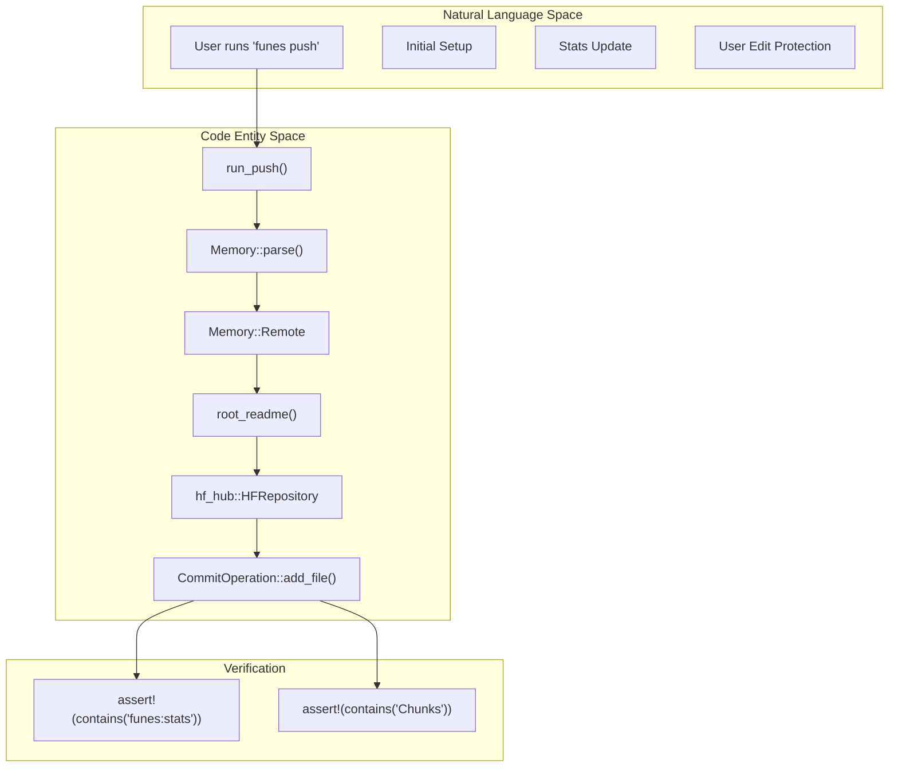
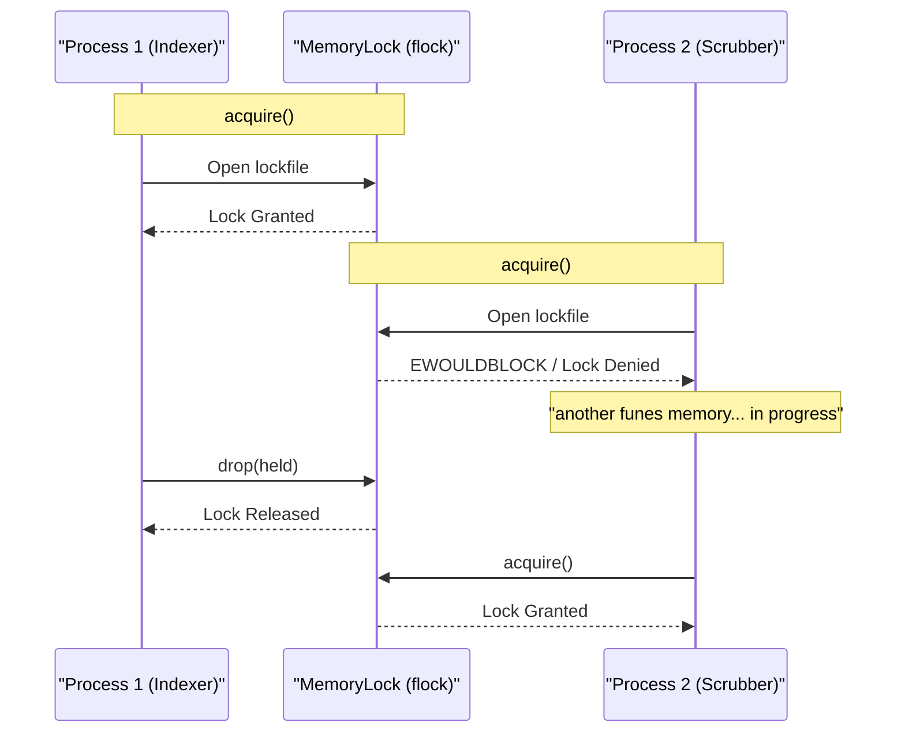

<!-- source: DeepWiki mcp.deepwiki.com · repo huggingface/funes · page 10.2 Integration Tests: Push and Remote · fetched 2026-10-26 -->

# Integration Tests: Push and Remote

Relevant source files

The following files were used as context for generating this wiki page:

- [scripts/backfill_remote_repo.rs](scripts/backfill_remote_repo.rs)
- [src/memory.rs](src/memory.rs)
- [tests/push_card.rs](tests/push_card.rs)
- [tests/remote_repo_source.rs](tests/remote_repo_source.rs)
- [tests/store_lock.rs](tests/store_lock.rs)

This section covers the integration testing infrastructure for the remote synchronization and Hub-resident memory features. These tests validate the full lifecycle of memory distribution, including the creation of remote repositories, incremental appends, the security gate (secret scanning), and the management of Hugging Face Dataset Cards.

## Overview of Remote Tests

The remote integration tests are designed as "gated live tests." They require network access and specific environment variables to interact with the Hugging Face Hub. 

| Test File | Scope | Key Features Tested |
|:---|:---|:---|
| `tests/push_card.rs` | Dataset Card Lifecycle | Automatic README creation, stat refreshing, and hand-edit preservation. |
| `tests/push_round_trip.rs` | End-to-End Push | Create, Append, and Reindex operations; delta calculation. |
| `tests/remote_repo_source.rs` | Parquet Resolution | `refs/convert/parquet` resolution and remote shard parsing. |
| `tests/store_lock.rs` | Concurrency | Advisory locking via `flock` to prevent data corruption. |

**Sources:** [tests/push_card.rs:1-12](), [tests/remote_repo_source.rs:1-9](), [tests/store_lock.rs:1-5]()

---

## Push Lifecycle and Dataset Cards

The `push_card.rs` test suite validates how `funes` manages the `README.md` (Dataset Card) on the Hugging Face Hub. It ensures that the card serves as both a human-readable landing page and a machine-readable metadata store for memory statistics.

### Data Flow: Card Management
When a user executes `funes push`, the system determines the state of the remote repository and the existing card.

1.  **First Publish**: `run_push` detects a new repository and creates a `README.md` containing `<!-- funes:stats -->` markers [tests/push_card.rs:93-95](), [tests/push_card.rs:147-151]().
2.  **Append/Refresh**: Subsequent pushes update the stats (e.g., chunk counts) within the markers while preserving other content [tests/push_card.rs:105-106](), [tests/push_card.rs:168-169]().
3.  **Hand-Edit Protection**: If a user manually edits the README, `funes` detects the change and ceases automatic updates to avoid overwriting user content [tests/push_card.rs:108-132]().

### Code Entity Mapping: Card Lifecycle
The following diagram bridges the high-level card operations to the internal implementation.

**Sources:** [tests/push_card.rs:58-132](), [src/memory.rs:36-41](), [src/memory.rs:57-71]()

---

## Remote Source Resolution

The `remote_repo_source.rs` test focuses on the `funes index <org/repo>` path, specifically how `funes` treats remote datasets as a source of raw traces.

### Parquet Shard Resolution
Funes leverages the Hugging Face "Auto-train" conversion service, which mirrors JSONL datasets into Parquet files on a hidden branch.
- **Branch**: `refs/convert/parquet` [tests/remote_repo_source.rs:37-37]().
- **Signature**: Every shard is validated for a commit OID signature to support incremental indexing [tests/remote_repo_source.rs:42-45]().
- **Harness Inheritance**: The parser ensures that remote rows correctly inherit their harness metadata (e.g., `pi`, `claude`) during the download [tests/remote_repo_source.rs:49-53]().

**Sources:** [tests/remote_repo_source.rs:30-53](), [src/traces/source.rs:11-11]()

---

## Concurrency and Locking

To prevent data corruption during local indexing or scrubbing, `funes` employs an advisory locking mechanism. The `store_lock.rs` test ensures that only one process can mutate the memory at a time.

### The MemoryLock Mechanism
The `MemoryLock` uses `flock` (file locking) on a lockfile within the `$FUNES_HOME` directory.

- **Contention Handling**: If a second process attempts to call `MemoryLock::acquire()`, it receives an error immediately rather than waiting, ensuring the CLI remains responsive and deterministic [tests/store_lock.rs:15-23]().
- **Command Integration**: Commands like `scrub` are gated by this lock. If a lock is held, `run_scrub` will fail loudly [tests/store_lock.rs:25-31]().

### Code Entity Mapping: Concurrency

**Sources:** [tests/store_lock.rs:10-37](), [src/memory/lock.rs:7-7]()

---

## Test Requirements and Environment

Due to the "Live" nature of these tests, specific configuration is required:

| Variable | Purpose |
|:---|:---|
| `HF_FUNES_TEST_TOKEN` | A Hugging Face token with write access to a test organization (typically `optimum-internal-testing`). |
| `HF_TOKEN` | Automatically set by the test runner using the value from `HF_FUNES_TEST_TOKEN` [tests/push_card.rs:71-71](). |
| `RUST_MIN_STACK` | Must be set to at least `16777216` (16MB) to accommodate large Lance/Arrow operations during tests [tests/push_card.rs:12-12](). |
| `trufflehog` | Must be on the system `PATH`. The push command's secret gate is **fail-closed**; if the scanner is missing, the push will be aborted [tests/push_card.rs:67-70](). |

**Sources:** [tests/push_card.rs:6-12](), [tests/push_card.rs:59-71](), [tests/remote_repo_source.rs:20-27]()

---

