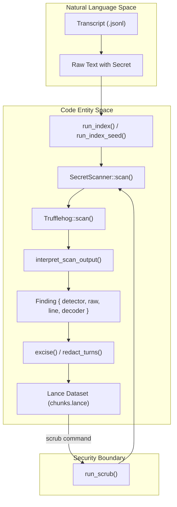
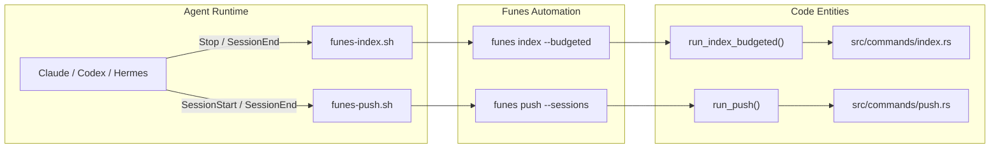

<!-- source: DeepWiki mcp.deepwiki.com · repo huggingface/funes · page 10.3 Integration Tests: Security and Agent Hooks · fetched 2026-10-26 -->

# Integration Tests: Security and Agent Hooks

Relevant source files

The following files were used as context for generating this wiki page:

- [src/scan.rs](src/scan.rs)
- [tests/add_claude_plugin.rs](tests/add_claude_plugin.rs)
- [tests/add_codex_hooks.rs](tests/add_codex_hooks.rs)
- [tests/ask_grounding.rs](tests/ask_grounding.rs)
- [tests/ask_no_agent.rs](tests/ask_no_agent.rs)
- [tests/first_index.rs](tests/first_index.rs)
- [tests/no_index.rs](tests/no_index.rs)
- [tests/redact_on_index.rs](tests/redact_on_index.rs)
- [tests/scrub.rs](tests/scrub.rs)
- [tests/scrub_drops_all.rs](tests/scrub_drops_all.rs)
- [tests/scrub_drops_escaped_key.rs](tests/scrub_drops_escaped_key.rs)

This section covers the integration tests verifying the security boundaries of `funes` and the correctness of its agent automation hooks. These tests ensure that secret redaction is robust against escaping, that the `scrub` command handles edge cases like all-dropped blocks, and that agent installations are idempotent and respect existing user configurations.

## Security and Secret Management Tests

The security suite validates the integration with `Trufflehog` for secret detection. It ensures that sensitive data is either redacted in-place or dropped entirely before it reaches the local memory or the Hugging Face Hub.

### Redaction at Index Time
The `redact_on_index` test verifies that secrets are intercepted during the initial indexing pipeline.
*   **Process**: A throwaway Ed25519 key is generated using `ssh-keygen` and planted in a `.jsonl` transcript [tests/redact_on_index.rs:18-49]().
*   **Verification**: When `run_index` is called, the `SecretScanner` identifies the key and replaces it with a `[REDACTED:PrivateKey]` marker [tests/redact_on_index.rs:52-67](). The test confirms the raw key body is absent from the resulting Lance dataset [tests/redact_on_index.rs:68-69]().

### The Scrub Command
The `scrub` tests exercise the retroactive cleaning of existing memories. This is critical for users who may have indexed secrets before enabling the scanner or who wish to rotate detection patterns.

| Test Case | Scenario | Outcome |
| :--- | :--- | :--- |
| `scrub_redacts_an_existing_secret_in_place` | A memory is built using a no-op scanner (`/usr/bin/true`), then scrubbed with the real scanner [tests/scrub.rs:57-75](). | The secret is replaced by a redaction marker in the Lance table [tests/scrub.rs:83-87](). |
| `scrub_redacts_an_escaped_key_in_place` | A secret is stored with JSON-escaped newlines (`\n`), matching the format of tool inputs [tests/scrub_drops_escaped_key.rs:41-52](). | The scanner's canonical match is byte-matched against the escaped form, successfully redacting the key in-place [tests/scrub_drops_escaped_key.rs:84-105](). |
| `scrub_dropping_every_block_leaves_a_valid_empty_memory` | Every block in the memory contains an unredactable secret (e.g., inside Base64) [tests/scrub_drops_all.rs:37-58](). | The `Overwrite` commit produces a valid Lance dataset with 0 rows, rather than crashing on an empty write [tests/scrub_drops_all.rs:68-79](). |

### Data Flow: Secret Detection and Redaction
The following diagram illustrates how the `SecretScanner` trait mediates between raw transcript data and the stored memory.

**Sources:** [src/scan.rs:47-86](), [tests/redact_on_index.rs:52-69](), [tests/scrub.rs:73-88]()

## Agent Hook Integrations

These tests ensure that `funes add <agent>` correctly modifies agent configuration files and installs the necessary automation scripts (`funes-index.sh` and `funes-push.sh`).

### Codex Hook Installation
The `add_codex_hooks` test validates the lifecycle of the Codex integration [tests/add_codex_hooks.rs:10-11]().
*   **Idempotency**: It verifies that running `codex::install` multiple times does not create duplicate hooks [tests/add_codex_hooks.rs:73-83]().
*   **Preservation**: It ensures that existing user hooks in `~/.codex/hooks.json` are preserved during the merge [tests/add_codex_hooks.rs:22-28, 69-71]().
*   **Cleanup**: It checks that stale skills from older `funes` versions are pruned from the shared `.agents` directory [tests/add_codex_hooks.rs:30-33, 63-67]().

### Claude Code Plugin
The `add_claude_plugin` test checks the generation of the `funes` plugin for Claude Code [tests/add_claude_plugin.rs:12-13]().
*   **Tree Generation**: It verifies that the marketplace and plugin manifests are correctly written to `~/.funes/integrations/claude-plugin` [tests/add_claude_plugin.rs:25-33]().
*   **Script Bundling**: It ensures the index and push scripts are present and marked as executable [tests/add_claude_plugin.rs:35-43]().
*   **Variable Baking**: It confirms that the memory repository name is baked into the `hooks.json` command strings [tests/add_claude_plugin.rs:46-57]().

### Hook Execution Model
Agent integrations use shared automation infrastructure to trigger indexing and pushing.

**Sources:** [tests/add_codex_hooks.rs:38-61](), [tests/add_claude_plugin.rs:35-57]()

## Grounding and Onboarding

### Ask Grounding
The `ask_grounding` test verifies the "grounded" prompt generation logic [tests/ask_grounding.rs:25-26]().
*   **Passage Retrieval**: It confirms that relevant passages from the local memory are successfully retrieved and embedded into the prompt [tests/ask_grounding.rs:35-50]().
*   **Provenance**: It ensures the session ID (provenance) is included in the prompt so the agent can reference its source [tests/ask_grounding.rs:51-52]().

### Onboarding Flow
The `no_index` test ensures that a user who has not yet run `funes add` is guided toward onboarding [tests/no_index.rs:7-8]().
*   **Recall Guard**: Instead of returning an empty result or a raw error, `recall` returns an actionable message pointing to `funes add` [tests/no_index.rs:14-27]().
*   **Status Report**: The `status` command reports "no index yet" and provides the onboarding command [tests/no_index.rs:29-38]().

**Sources:**
*   `tests/add_codex_hooks.rs`: [1-88]()
*   `src/scan.rs`: [1-155]()
*   `tests/add_claude_plugin.rs`: [1-58]()
*   `tests/scrub_drops_escaped_key.rs`: [1-122]()
*   `tests/first_index.rs`: [1-76]()
*   `tests/scrub.rs`: [1-88]()
*   `tests/scrub_drops_all.rs`: [1-97]()
*   `tests/redact_on_index.rs`: [1-69]()
*   `tests/ask_grounding.rs`: [1-52]()
*   `tests/ask_no_agent.rs`: [1-20]()
*   `tests/no_index.rs`: [1-39]()

---

