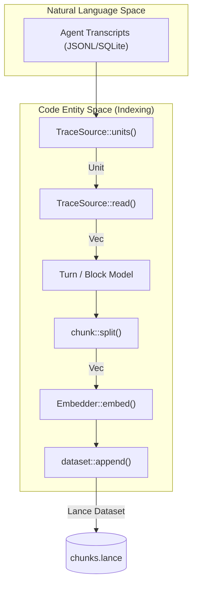
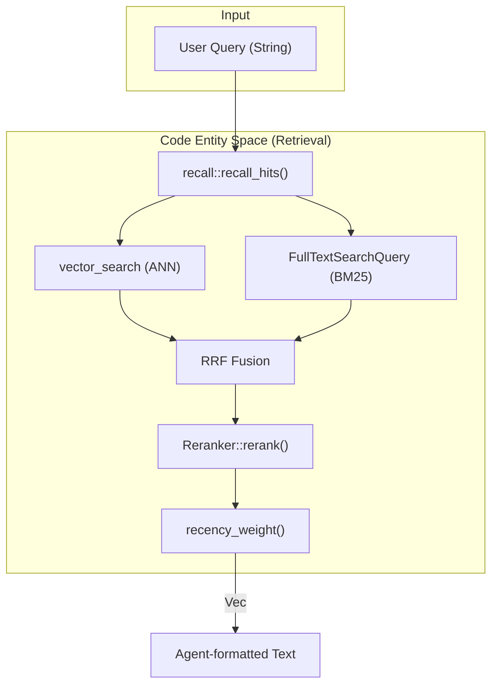

<!-- source: DeepWiki mcp.deepwiki.com · repo huggingface/funes · page 11 Glossary · fetched 2026-10-26 -->

# Glossary

Relevant source files

The following files were used as context for generating this wiki page:

- [Cargo.lock](Cargo.lock)
- [Cargo.toml](Cargo.toml)
- [SECURITY.md](SECURITY.md)
- [benchmark/bench_backends.rs](benchmark/bench_backends.rs)
- [build.rs](build.rs)
- [docs/RATIONALE.md](docs/RATIONALE.md)
- [docs/configuration.md](docs/configuration.md)
- [docs/demo/cross-agents.tape](docs/demo/cross-agents.tape)
- [docs/hub-caching.md](docs/hub-caching.md)
- [docs/index.md](docs/index.md)
- [docs/landscape.md](docs/landscape.md)
- [docs/storage.md](docs/storage.md)
- [src/chunk.rs](src/chunk.rs)
- [src/commands/index.rs](src/commands/index.rs)
- [src/commands/mcp.rs](src/commands/mcp.rs)
- [src/commands/push.rs](src/commands/push.rs)
- [src/commands/recall.rs](src/commands/recall.rs)
- [src/commands/scrub.rs](src/commands/scrub.rs)
- [src/commands/sketch.rs](src/commands/sketch.rs)
- [src/commands/update.rs](src/commands/update.rs)
- [src/hub.rs](src/hub.rs)
- [src/inference.rs](src/inference.rs)
- [src/inference/blas.rs](src/inference/blas.rs)
- [src/lib.rs](src/lib.rs)
- [src/main.rs](src/main.rs)
- [src/memory/dataset.rs](src/memory/dataset.rs)
- [src/session_sketch.rs](src/session_sketch.rs)
- [src/traces/parquet.rs](src/traces/parquet.rs)
- [src/traces/source.rs](src/traces/source.rs)
- [tests/push_round_trip.rs](tests/push_round_trip.rs)

This page defines the core terminology, domain concepts, and technical jargon used within the `funes` codebase. It serves as a reference for onboarding engineers to understand the mapping between conceptual "Natural Language Space" and the underlying "Code Entity Space".

## Core Domain Concepts

### Memory
A **Memory** is the primary unit of storage and retrieval in `funes`. It represents a collection of indexed agent sessions stored as a **Lance** dataset. A memory can be **Local** (stored in `~/.funes`) or **Remote** (hosted on the Hugging Face Hub).
*   **Implementation:** The `Memory` struct [src/memory/mod.rs:38-43]() handles the resolution of memory URIs (e.g., `hf://...` vs local paths) and provides an abstraction for opening the underlying `Dataset` [src/memory/mod.rs:55-59]().
*   **Storage Layout:** Physically, a memory consists of `chunks.lance` and associated Arrow files [docs/storage.md:8-15]().

### Trace / Transcript
The raw input to `funes`. A **Trace** is a historical record of an AI agent session. These are typically stored in JSONL format (Claude, Codex, Pi) or SQLite (Hermes).
*   **Code Entity:** `Turn` and `Block` models [src/traces/mod.rs:11-18]().
*   **Parser Seam:** The `TraceSource` trait [src/traces/source.rs:39-63]() defines how these transcripts are enumerated and read.

### Unit
The smallest granule of incremental indexing. In most harnesses, a `Unit` corresponds to a single transcript file.
*   **Implementation:** Defined in `src/traces/source.rs` [src/traces/source.rs:31-35]().
*   **Signature:** A "size:mtime" stamp used by `state.json` to determine if a unit needs re-indexing [src/traces/source.rs:133-137]().

### Chunk
A segment of a `Block` that has been processed for indexing. Chunks are the atomic units stored in the Lance dataset and are associated with a vector embedding.
*   **Code Entity:** The `Chunk` struct [src/chunk.rs:50-68]().
*   **CID:** A deterministic ID generated by hashing the session, turn, block, and split indices [src/chunk.rs:182-187]().

### Hybrid Recall
The retrieval strategy combining vector search (ANN) and keyword search (BM25/FTS), fused using **Reciprocal Rank Fusion (RRF)** and then refined by a **Cross-Encoder Reranker**.
*   **Logic:** Orchestrated in `recall_hits` [src/commands/recall.rs:1-5]().

---

## Data Flow: From Trace to Recall

The following diagram bridges the gap between natural language concepts (like "a conversation") and the specific code entities that handle them.

### Trace Ingestion Pipeline
"Natural Language Space" (Transcripts) $\rightarrow$ "Code Entity Space" (Lance/Arrow)

**Sources:** [src/traces/source.rs:39-63](), [src/chunk.rs:147-180](), [src/memory/dataset.rs:1-20]().

---

## Retrieval Mechanics

### Recall & Reranking
"Query" $\rightarrow$ "Ranked Passages"

**Sources:** [src/commands/recall.rs:1-5](), [src/inference.rs:8-14](), [src/commands/recall.rs:190-210]().

---

## Technical Jargon & Abbreviations

| Term | Definition | Code Pointer |
| :--- | :--- | :--- |
| **ANN** | Approximate Nearest Neighbor search, used for vector similarity. | [src/memory/dataset.rs]() |
| **BLAS** | Basic Linear Algebra Subprograms. A backend feature for local inference using Accelerate (macOS) or faer (Linux). | [Cargo.toml:59-63](), [src/inference/blas.rs]() |
| **BM25** | The ranking function used by Lance's Full-Text Search (FTS). | [src/commands/recall.rs:17-18]() |
| **CAS** | Check-And-Set. Used in `push` to ensure atomic commits to the Hub by checking the `parent_commit` SHA. | [src/commands/push.rs:9-17]() |
| **FTS** | Full-Text Search. The keyword-based index in Lance. | [src/memory/dataset.rs]() |
| **Harness** | An abstraction for a specific AI agent's environment (e.g., `Claude`, `Codex`, `Pi`, `Hermes`). | [src/traces/harness.rs]() |
| **IVF_PQ** | Inverted File System with Product Quantization. The vector index type used for ANN. | [src/memory/dataset.rs]() |
| **MCP** | Model Context Protocol. The protocol used to expose `funes` tools to agents like Claude Code. | [src/commands/mcp.rs:1-12]() |
| **ONNX** | Open Neural Network Exchange. An alternative inference backend using `fastembed`/`ort`. | [Cargo.toml:64-66]() |
| **RRF** | Reciprocal Rank Fusion. A method to combine multiple ranked result lists into a single ranking. | [src/commands/recall.rs:2-5]() |
| **Stitch** | The process of reassembling `Chunk` objects back into a contiguous `Turn` by resolving overlaps. | [src/chunk.rs:189-210](), [src/commands/recall.rs:143-150]() |
| **Tier** | A classification for block types (`Text`, `ToolUse`, `ToolResult`) determining their indexing priority. | [src/chunk.rs:19-47]() |

---

## Security Terms

### Secret Gate
A fail-closed egress filter in the `push` pipeline that prevents chunks containing secrets (detected via `trufflehog`) from being uploaded to a remote memory.
*   **Logic:** [src/commands/push.rs:4-8]().

### Redaction
The process of masking sensitive information during the indexing phase.
*   **Logic:** Handled via the `SecretScanner` during the indexing pipeline [src/commands/index.rs]().

### Scrub
A command to retroactively and permanently remove passages from a memory, usually following a secret detection.
*   **Logic:** [src/commands/scrub.rs]().

**Sources:** [src/main.rs:1-155](), [Cargo.toml:1-118](), [src/lib.rs:1-42](), [src/hub.rs:1-163](), [src/commands/push.rs:1-156](), [src/commands/mcp.rs:1-149](), [src/chunk.rs:1-190](), [tests/push_round_trip.rs:1-157](), [src/commands/recall.rs:1-190](), [src/traces/source.rs:1-170](), [docs/RATIONALE.md:1-115]().