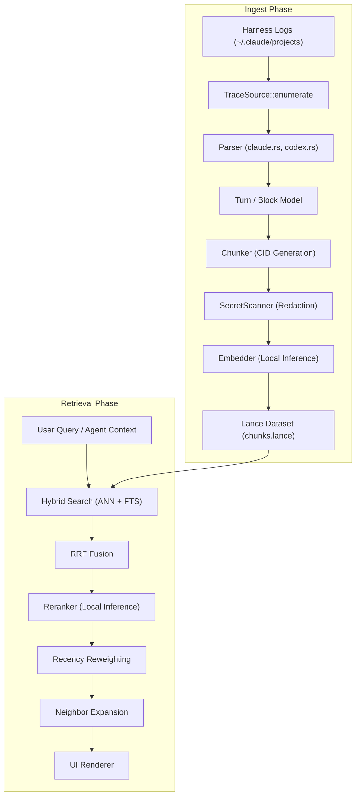
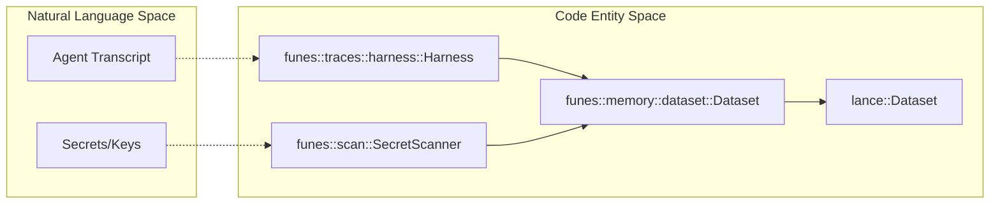
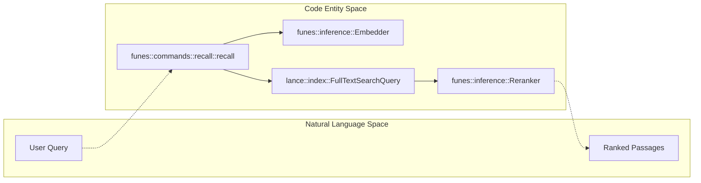

<!-- source: DeepWiki mcp.deepwiki.com · repo huggingface/funes · page 2 Core Architecture · fetched 2026-10-26 -->

# Core Architecture

Relevant source files

The following files were used as context for generating this wiki page:

- [AGENTS.md](AGENTS.md)
- [CONTRIBUTING.md](CONTRIBUTING.md)
- [Cargo.lock](Cargo.lock)
- [Cargo.toml](Cargo.toml)
- [build.rs](build.rs)
- [docs/README.md](docs/README.md)
- [docs/ask.md](docs/ask.md)
- [docs/sessions.md](docs/sessions.md)
- [src/hub.rs](src/hub.rs)
- [src/lib.rs](src/lib.rs)
- [src/main.rs](src/main.rs)

`funes` is designed as a layered, local-first system for indexing and retrieving AI agent session history. It transforms raw transcripts into a structured, searchable memory using a pipeline that emphasizes data integrity, deterministic processing, and efficient retrieval.

The system is organized into distinct directories, each responsible for a single layer of the lifecycle. The binary itself is a thin CLI wrapper over these internal modules [src/lib.rs:5-6]().

### Layered Structure

The codebase follows a strict hierarchy where higher layers orchestrate decisions and lower layers handle mechanics and transport [src/lib.rs:23-25]().

| Layer | Responsibility | Key Code Entities |
|:---|:---|:---|
| **Agents** | Integration hooks for external tools. | `funes::agents` [src/lib.rs:41]() |
| **Commands** | Orchestration, CLI logic, and user decisions. | `funes::commands` [src/lib.rs:35]() |
| **UI** | Rendering results to the terminal/agent. | `funes::ui` [src/lib.rs:42]() |
| **Memory** | Lance storage mechanics and domain state. | `funes::memory` [src/lib.rs:38]() |
| **Inference** | Local embedding and reranking models. | `funes::inference` [src/lib.rs:37]() |
| **Traces** | Transcript parsing and internal data models. | `funes::traces` [src/lib.rs:41]() |
| **Hub** | Transport layer for Hugging Face Hub. | `funes::hub` [src/lib.rs:36]() |

**Sources:** [src/lib.rs:8-25](), [src/main.rs:7-13]()

---

### Data Flow: From Transcript to Recall

The following diagram illustrates how a raw agent transcript (e.g., from Claude Code or Codex) moves through the system to become a searchable memory hit.

**System Data Flow**

**Sources:** [src/lib.rs:3-4](), [src/main.rs:31-56](), [src/main.rs:83-103]()

---

### Key Abstractions

#### 1. TraceSource and the Turn/Block Model
Every supported agent harness (Claude, Codex, Pi, Hermes) implements a parser that converts its specific log format into a shared `Turn` and `Block` model [src/lib.rs:10-11](). This allows the rest of the pipeline to remain harness-agnostic.
*   For details, see [Indexing Pipeline](#2.1).

#### 2. Inference Backends
`funes` performs all embedding and reranking locally. It uses a trait-based system to swap backends at compile time. The default `blas` backend uses a hand-written forward pass (Accelerate on macOS, `faer` on Linux) to minimize dependencies [Cargo.toml:59-66](), [build.rs:5-9]().
*   For details, see [Inference Backends](#2.2).

#### 3. Memory and Lance Storage
The storage layer uses [Lance](https://github.com/lancedb/lance), an Arrow-native format optimized for vector search. `funes` manages the `MemoryState` (e.g., Local, Remote, Missing) and handles the mechanics of IVF_PQ and FTS indexing [src/lib.rs:17-18]().
*   For details, see [Memory Storage Layer](#2.3).

---

### Code Entity Mapping

The following diagrams bridge the gap between high-level architectural concepts and the specific Rust modules and functions that implement them.

**Indexing and Storage Entities**

**Sources:** [src/lib.rs:10-18](), [src/main.rs:12]()

**Recall and Retrieval Entities**

**Sources:** [src/lib.rs:14-19](), [src/main.rs:31-38]()

---

### Subsystems

- **[Indexing Pipeline](#2.1)**: Detailed coverage of the full indexing lifecycle, including unit enumeration, incremental state tracking, secret redaction, and chunking.
- **[Inference Backends](#2.2)**: The `Embedder` and `Reranker` traits, backend selection (BLAS vs ONNX), and model configurations.
- **[Memory Storage Layer](#2.3)**: The Lance dataset layout, schema definitions, IVF_PQ/FTS index construction, and concurrency models.

---

