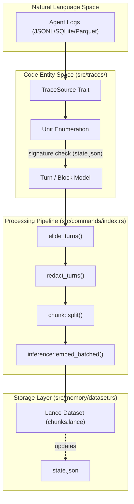
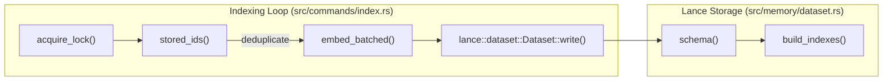

<!-- source: DeepWiki mcp.deepwiki.com · repo huggingface/funes · page 2.1 Indexing Pipeline · fetched 2026-10-26 -->

# Indexing Pipeline

Relevant source files

The following files were used as context for generating this wiki page:

- [docs/index.md](docs/index.md)
- [src/chunk.rs](src/chunk.rs)
- [src/commands/index.rs](src/commands/index.rs)
- [src/commands/update.rs](src/commands/update.rs)
- [src/memory/dataset.rs](src/memory/dataset.rs)
- [src/traces/parquet.rs](src/traces/parquet.rs)
- [src/traces/source.rs](src/traces/source.rs)

The indexing pipeline is the core lifecycle that transforms raw agent transcripts into a structured, searchable, and locally-stored memory. It is designed to be **append-only**, **incremental**, and **deterministic**, ensuring that the same agent interaction always results in the same representation in the knowledge base.

The pipeline is driven by a generic loop in `src/commands/index.rs` which orchestrates several specialized components to handle parsing, security, chunking, and storage.

### Data Flow Overview

The following diagram maps the transition from "Natural Language Space" (raw agent logs) to "Code Entity Space" (internal Rust structures and storage).

**Indexing Data Flow**

**Sources:** [src/commands/index.rs:1-158](), [src/traces/source.rs:1-63](), [src/memory/dataset.rs:1-43]()

---

### 1. Trace Sources and Unit Enumeration
The pipeline begins by identifying transcripts via the `TraceSource` trait [src/traces/source.rs:39-63](). A `Unit` represents the smallest granule of incremental tracking (e.g., a single file or a specific session within a database) [src/traces/source.rs:31-35]().

*   **Discovery**: The `open` function detects the format based on file extensions or directory structure (e.g., `.parquet` for datasets, `state.db` for Hermes) [src/traces/source.rs:69-99]().
*   **Incremental Tracking**: Each unit has a `signature` (usually a "size:mtime" stamp). The `index` command checks this against `state.json` to skip unchanged files [src/traces/source.rs:133-137](), [src/commands/index.rs:143-155]().

For details on how specific agents are parsed, see [Trace Parsers (Harness Support)](#2.1.1).

**Sources:** [src/traces/source.rs:31-137](), [src/commands/index.rs:143-155]()

---

### 2. Pre-Processing: Elision and Redaction
Before text is chunked or embedded, it undergoes two critical cleaning steps to ensure privacy and efficiency.

*   **Data URI Elision**: Large base64-encoded `data:` URIs (like screenshots) are replaced with an `[elided]` marker by `elide_data_uris` [src/chunk.rs:97-118](). This prevents megabytes of non-recallable noise from swamping the index [src/commands/index.rs:74-80]().
*   **Secret Redaction**: If a `SecretScanner` (like Trufflehog) is configured, `redact_turns` scans the text for API keys or credentials *before* they reach the embedding model or the local disk [src/commands/index.rs:89-126]().

**Sources:** [src/chunk.rs:97-118](), [src/commands/index.rs:74-126]()

---

### 3. Chunking and Tiers
Funes uses a tiered indexing strategy to prioritize high-value information while remaining responsive.

| Tier | Block Types | Description |
| :--- | :--- | :--- |
| **L1: Text** | prose, thinking | The rationale and decisions; highest recall value. |
| **L2: ToolUse** | tool_use | Context for actions taken by the agent. |
| **L3: ToolResult** | tool_result | Bulky output; lowest value per byte. |

**Tier Definitions:** [src/chunk.rs:19-47]()

The `split` function breaks blocks into overlapping chunks of `MAX_CHARS` (1200) with an `OVERLAP` of 150 characters [src/chunk.rs:11-14](). Every chunk receives a deterministic `cid` (Chunk ID) based on its session, turn, and split index, allowing for global deduplication [src/chunk.rs:182-187]().

For details on the segmentation logic, see [Chunking and Text Segmentation](#2.1.2).

**Sources:** [src/chunk.rs:11-187](), [docs/index.md:84-98]()

---

### 4. Embedding and Lance Storage
Once chunked, the text is sent to the `Embedder` (typically pinned to `BAAI/bge-small-en-v1.5` [src/memory/dataset.rs:32]()). 

**Indexing Pipeline Architecture**

*   **Deduplication**: The pipeline calls `stored_ids` to fetch all existing `cid`s from the Lance dataset [src/commands/index.rs:54-68](). Only new chunks are embedded, making the process highly efficient for growing sessions.
*   **Vector Storage**: Data is appended to a Lance dataset located at `~/.funes/memory/chunks.lance` [src/memory/dataset.rs:46-61]().
*   **Indexing**: After writing, the system builds an `Inverted` (BM25) index for text search and an `IVF_PQ` index for vector search [src/memory/dataset.rs:125-142]().

**Sources:** [src/commands/index.rs:54-68](), [src/memory/dataset.rs:26-176]()

---

### Child Pages
- [Trace Parsers (Harness Support)](#2.1.1) — Detailed parsing logic for Claude, Codex, Pi, and Hermes.
- [Chunking and Text Segmentation](#2.1.2) — Technical details of the split/stitch mechanics and deterministic ID generation.

---

