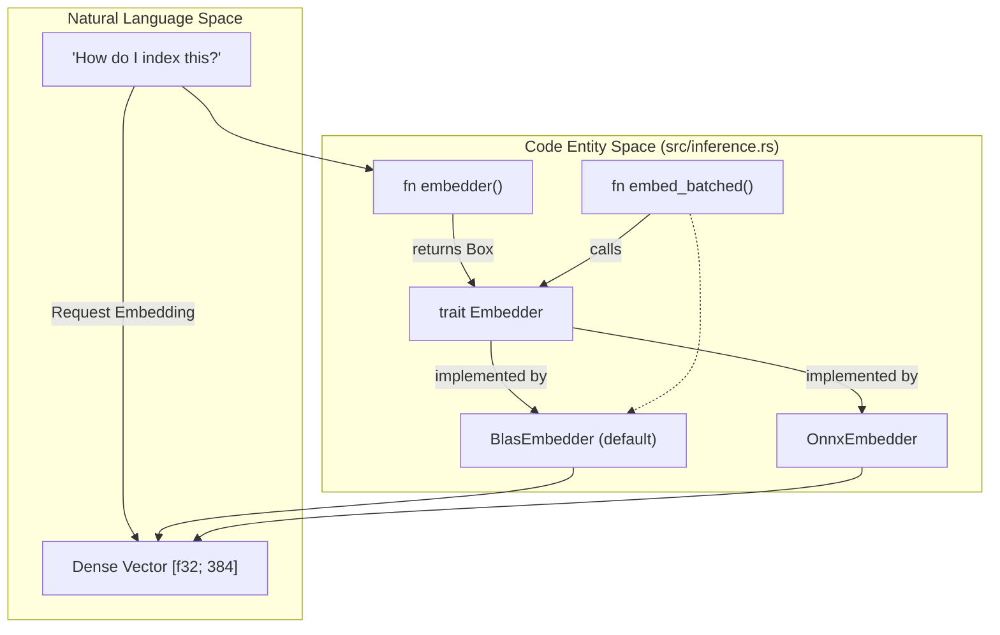
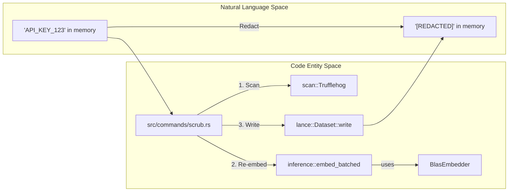

<!-- source: DeepWiki mcp.deepwiki.com · repo huggingface/funes · page 2.2 Inference Backends · fetched 2026-10-26 -->

# Inference Backends

Relevant source files

The following files were used as context for generating this wiki page:

- [Cargo.lock](Cargo.lock)
- [Cargo.toml](Cargo.toml)
- [benchmark/bench_backends.rs](benchmark/bench_backends.rs)
- [build.rs](build.rs)
- [src/commands/scrub.rs](src/commands/scrub.rs)
- [src/inference.rs](src/inference.rs)
- [src/inference/blas.rs](src/inference/blas.rs)

Funes provides a flexible inference architecture designed to support local, high-performance embeddings and cross-encoder reranking. The system abstracts model execution behind the `Embedder` and `Reranker` traits, allowing the specific backend to be selected at compile time via Cargo features [src/inference.rs:1-5]().

## Backend Selection and Traits

The codebase defines two primary traits that all inference backends must implement:
*   **`Embedder`**: Responsible for converting text strings into dense floating-point vectors (typically 384 dimensions for the default BGE model) [src/inference.rs:26-28]().
*   **`Reranker`**: A cross-encoder that scores query-passage pairs jointly to determine relevance [src/inference.rs:31-33]().

The backend is selected using the `DefaultEmbedder` and `DefaultReranker` type aliases. By default, the `blas` feature is enabled. If both `blas` and `onnx` are compiled in, `blas` takes precedence [src/inference.rs:12-20]().

| Feature | Backend Implementation | Libraries Used |
| :--- | :--- | :--- |
| `blas` | From-scratch Rust forward pass | Accelerate (macOS), faer (Linux) |
| `onnx` | ONNX Runtime (ORT) | fastembed-rs, ort |

### Natural Language to Code Entity Space: Inference Flow
The following diagram maps the logical request for an embedding to the specific code entities responsible for fulfilling it.

Sources: [src/inference.rs:26-44](), [src/inference.rs:95-106]()

## BLAS Backend (`blas`)

The BLAS backend is a "from-scratch" implementation that loads model weights from `safetensors` files and performs the transformer forward pass using highly optimized Basic Linear Algebra Subprograms (BLAS).

### Platform Seam
To achieve maximum performance while remaining portable, the BLAS backend utilizes a "platform seam" [src/inference/blas.rs:17-19]():
1.  **macOS**: Wires directly to the **Accelerate** framework. It uses `cblas_sgemm` to target AMX (Apple Matrix Extensions) and `vvexpf` from vForce for vectorized exponentiation [src/inference/blas.rs:20-43](), [build.rs:7-9]().
2.  **Linux**: Uses the **faer** crate for pure-Rust GEMM (General Matrix Multiplication) [src/inference/blas.rs:98-100](). It includes a custom, branch-free polynomial approximation for `exp(x)` that LLVM can auto-vectorize for AVX-512 and AVX2 [src/inference/blas.rs:150-166]().

### Model Configuration
The BLAS backend specifically targets:
*   **Embedder**: `bge-small-en-v1.5` (BERT-based, 384-d).
*   **Reranker**: `bge-reranker-base`.

Sources: [src/inference/blas.rs:1-5](), [src/inference/blas.rs:46-95](), [src/inference/blas.rs:109-144](), [Cargo.toml:61-63]()

## ONNX Backend (`onnx`)

The ONNX backend leverages the `fastembed` crate to run models via the ONNX Runtime (ORT) CPU Execution Provider [src/inference.rs:46-48](). 

*   **`OnnxEmbedder`**: Initializes `EmbeddingModel::BGESmallENV15` [src/inference.rs:52-57]().
*   **`OnnxReranker`**: Initializes `RerankerModel::BGERerankerBase` [src/inference.rs:73-78]().

This backend is primarily used as a reference for accuracy in benchmarks or as a fallback when system BLAS libraries are unavailable [benchmark/bench_backends.rs:1-4]().

Sources: [src/inference.rs:46-91](), [Cargo.toml:10-12](), [Cargo.toml:64-66]()

## Data Flow: Indexing & Scrubbing

The inference backends are heavily utilized during the indexing and scrubbing phases.

### Batched Embedding
The `embed_batched` function manages large-scale embedding tasks by splitting input text into groups of 256 (`EMBED_BATCH`) [src/inference.rs:23](). This prevents memory exhaustion and allows for progress reporting via a callback [src/inference.rs:95-106]().

### The `scrub` Command
The `scrub` command provides a mechanism to retroactively remove secrets from local memory [src/commands/scrub.rs:1-3]().

1.  **Reconstruction**: It reconstructs full blocks from stored chunks to ensure secrets split across chunk boundaries are detected [src/commands/scrub.rs:41-43]().
2.  **Detection**: Uses `Trufflehog` to scan the text [src/commands/scrub.rs:30-46]().
3.  **Redaction & Re-embedding**: If a secret is found, the text is redacted. Because the vector representation of a redacted string differs from the original, the `scrub` command calls `embed_batched` to generate new vectors for the cleaned text [src/commands/scrub.rs:85-103]().
4.  **Atomic Overwrite**: The entire dataset is rewritten in a single `WriteMode::Overwrite` commit to ensure consistency [src/commands/scrub.rs:124-134]().

### Natural Language to Code Entity Space: Scrubbing Pipeline
This diagram shows how the `scrub` command interacts with the inference and storage layers.

Sources: [src/commands/scrub.rs:22-30](), [src/commands/scrub.rs:88-97](), [src/commands/scrub.rs:126-134]()

## Benchmarking Backends

Funes includes a specialized benchmark, `bench_backends.rs`, to compare the performance and mathematical agreement between the BLAS and ONNX implementations [benchmark/bench_backends.rs:1-4]().

It tests two specific workloads:
1.  **16×short**: Stresses tokenization and thread spawn overhead [benchmark/bench_backends.rs:106]().
2.  **30×~500tok**: Stresses GEMM throughput and memory bandwidth at the 512-token truncation limit [benchmark/bench_backends.rs:106]().

The benchmark calculates the **Cosine Similarity** between vectors produced by different backends to ensure that the optimized BLAS implementation remains functionally equivalent to the ONNX reference [benchmark/bench_backends.rs:91-96](), [benchmark/bench_backends.rs:126-137]().

Sources: [benchmark/bench_backends.rs:1-147](), [Cargo.toml:77-81]()

---

