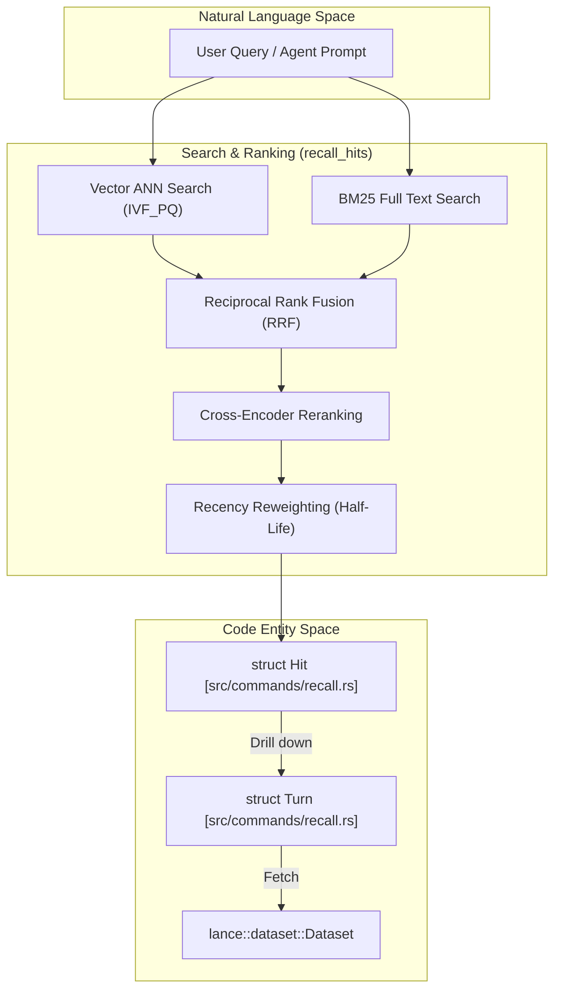
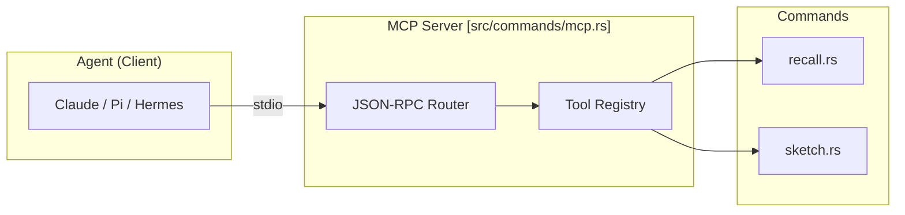

<!-- source: DeepWiki mcp.deepwiki.com · repo huggingface/funes · page 3 Retrieval and Search · fetched 2026-10-26 -->

# Retrieval and Search

Relevant source files

The following files were used as context for generating this wiki page:

- [docs/recall.md](docs/recall.md)
- [src/commands/recall.rs](src/commands/recall.rs)

The retrieval system in `funes` provides the interface for agents and users to query past sessions. It is designed to bridge the gap between high-level natural language questions and the specific, immutable blocks of text stored in the memory layer. The system primarily exposes two read surfaces: **Recall** (semantic and keyword search) and **Session Inspection** (structured reading and literal scanning).

## High-Level Retrieval Flow

The retrieval process transitions from a user's natural language query into specific `Hit` objects that point back to the original session data.

**Sources:** [src/commands/recall.rs:2-5](), [src/commands/recall.rs:49-59](), [docs/recall.md:12-14]()

---

## Hybrid Recall Pipeline

The `recall` command executes a multi-stage pipeline to find the most relevant passages. Unlike simple vector search, `funes` uses **Reciprocal Rank Fusion (RRF)** to combine semantic results (vector ANN) with keyword results (BM25). 

Key characteristics of the pipeline:
- **Hybrid Fusion:** Combines Lance's IVF_PQ vector index and Full-Text Search (FTS) [src/commands/recall.rs:2-5]().
- **Reranking:** A cross-encoder model re-evaluates a pool of candidates (default 30) to provide more accurate top-K results [docs/recall.md:41-50]().
- **Temporal Decay:** Results are reweighted based on a `half-life` parameter (default 30 days), ensuring that recent relevant information is prioritized over stale data [src/commands/recall.rs:189-190]().
- **Neighbor Expansion:** Each hit can optionally pull in adjacent chunks (`neighbors`) to provide immediate context without requiring a separate `get` call [src/commands/recall.rs:41-46]().

For a step-by-step walkthrough of the ranking logic and model caching, see **[Hybrid Recall Pipeline](#3.1)**.

**Sources:** [src/commands/recall.rs:22-32](), [docs/recall.md:12-14](), [docs/recall.md:41-50]()

---

## Session Inspection and Discovery

When a user or agent needs to explore the memory beyond specific search hits, `funes` provides tools for structured inspection:

| Command | Role | Key Data Structure |
| :--- | :--- | :--- |
| `get` | Reassembles turns by stitching splits back together for linear reading. | `struct Turn` [src/commands/recall.rs:144-150]() |
| `scan` | Literal "needle" search within a session with pagination. | `struct ScanResult` [src/commands/recall.rs:91-104]() |
| `sessions` | Lists sessions with filters for repo, workdir, and timeframe. | `struct Session` [src/commands/recall.rs:108-122]() |
| `sketch` | Generates a digest of a session via geometric axis selection. | `src/session_sketch.rs` |

The `get` command is the primary "drill-down" mechanism. Every `recall` hit includes a pre-formatted `→ get` line that the agent can use to fetch the surrounding conversation context [docs/recall.md:25-37]().

For details on reassembly logic and session filtering, see **[Session Inspection: get, scan, sessions, sketch](#3.2)**.

**Sources:** [src/commands/recall.rs:61-88](), [docs/recall.md:54-81](), [docs/recall.md:104-107]()

---

## MCP Server Interface

The Model Context Protocol (MCP) server acts as the gateway between AI agents (like Claude Code or Pi) and the retrieval tools. It registers `recall`, `get`, `sessions`, `scan`, and `sketch` as JSON-RPC tools.

The MCP server ensures that the output is rendered in a stable **Agent Format**, which is a parseable contract rather than a loose presentation [docs/recall.md:35-37]().

For details on the JSON-RPC implementation and tool registration, see **[MCP Server Interface](#3.3)**.

**Sources:** [src/commands/recall.rs:1-5](), [docs/recall.md:16-19](), [docs/recall.md:51-53]()

---

## Child Pages
- **[Hybrid Recall Pipeline](#3.1)**: Vector ANN + BM25, RRF fusion, cross-encoder reranking, and recency decay.
- **[Session Inspection: get, scan, sessions, sketch](#3.2)**: Turn reassembly, literal needle search, and session listing.
- **[MCP Server Interface](#3.3)**: Tool registration, stdio transport, and the agent format contract.

---

