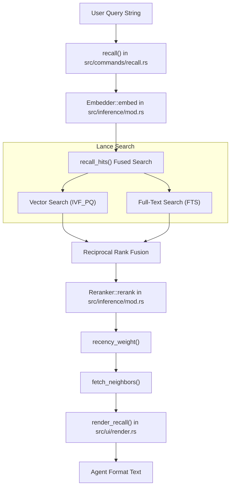
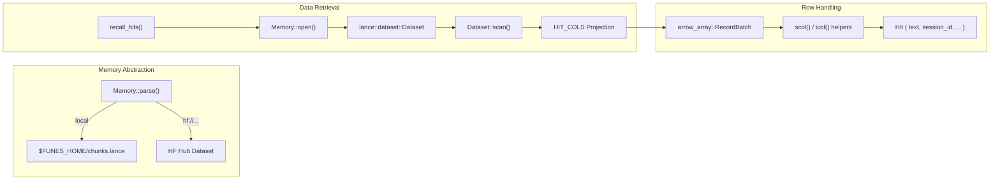

<!-- source: DeepWiki mcp.deepwiki.com · repo huggingface/funes · page 3.1 Hybrid Recall Pipeline · fetched 2026-10-26 -->

# Hybrid Recall Pipeline

Relevant source files

The following files were used as context for generating this wiki page:

- [docs/recall.md](docs/recall.md)
- [src/commands/recall.rs](src/commands/recall.rs)
- [tests/index_recall.rs](tests/index_recall.rs)
- [tests/recall_no_harness_column.rs](tests/recall_no_harness_column.rs)
- [tests/reindex_incremental.rs](tests/reindex_incremental.rs)
- [tests/remote_cache.rs](tests/remote_cache.rs)
- [tests/remote_recall.rs](tests/remote_recall.rs)

The Hybrid Recall Pipeline is the core retrieval mechanism of `funes`, designed to provide high-precision, context-aware memory for AI agents. It combines vector similarity search with traditional full-text keyword matching, further refined by neural reranking and temporal decay models.

The implementation resides primarily in `src/commands/recall.rs` and serves as the backend for the `recall` and `ask` commands, as well as the MCP `recall` tool [src/commands/recall.rs:1-5]().

## Pipeline Architecture

The pipeline follows a multi-stage process to transform a natural language query into a ranked list of relevant conversation blocks.

### 1. Retrieval (Vector + BM25)
`funes` performs a dual-search strategy against the Lance dataset:
*   **Vector ANN**: Uses Approximate Nearest Neighbor (ANN) search on the `embedding` column using cosine similarity [src/commands/recall.rs:2-3]().
*   **Full-Text Search (FTS)**: Uses the `lance` BM25 implementation to find literal keyword matches in the `text` column [src/commands/recall.rs:17]().

### 2. Reciprocal Rank Fusion (RRF)
The results from both search methods are fused into a single candidate pool. RRF ensures that hits appearing high in both lists (or very high in one) are prioritized without requiring score normalization between different scoring systems.

### 3. Cross-Encoder Reranking
The fused pool (default size: 30 candidates) is passed to a cross-encoder reranker [src/commands/recall.rs:48-59](). Unlike the initial vector search which uses bi-encoders, the reranker processes the query and candidate text simultaneously to produce a more accurate relevance score.

### 4. Recency Reweighting
To account for the temporal nature of memory, scores are adjusted using a half-life decay function:
*   **Formula**: $score = score \times 0.5^{(\text{age}/\text{half\_life})}$ [src/commands/recall.rs:189-190]().
*   **Default**: 30 days. A hit from a month ago keeps half its weight [docs/recall.md:45]().
*   **Disabling**: Setting `half_life` to 0 disables decay, which is useful when searching for stable facts or old configuration details [docs/recall.md:51-52]().

### 5. Neighbor Expansion
Once the top-K hits are selected, `funes` fetches adjacent chunks from the same session using the `seq` (sequence) number [src/commands/recall.rs:40-46](). This provides the agent with immediate surrounding context (e.g., the user prompt that preceded a tool result) without requiring a second `get` call [docs/recall.md:25-33]().

### Pipeline Data Flow: Natural Language to Code Entity
The following diagram illustrates how a user query traverses the system's code entities to produce results.

**Diagram: Retrieval Execution Flow**

Sources: [src/commands/recall.rs:1-60](), [docs/recall.md:12-21](), [src/inference/mod.rs:8]().

## Implementation Details

### The MODELS Cache
The pipeline utilizes a global inference cache to minimize model loading latency.
*   **Embedder**: Typically `bge-small-en-v1.5`.
*   **Reranker**: Typically `bge-reranker-base`.
These are managed via `OnceCell` and `Mutex` to ensure thread-safe, lazy initialization [src/commands/recall.rs:20]().

### Prefilter Logic
The `recall` command supports hard filters that are applied at the database level before retrieval:
*   **Block Type**: Restrict results to `thinking`, `tool_use`, `tool_result`, or `text` [docs/recall.md:47]().
*   **Harness**: Restrict results to specific agents like `claude` or `pi` [docs/recall.md:48]().
*   **Implementation**: `build_where` constructs the Lance SQL filter string, ensuring values are escaped via `esc()` [src/commands/recall.rs:168-187]().

### Offline and Remote Degradation
`funes` handles remote memories (via `hf://` URIs) by treating the Hugging Face Hub as a versioned object store.
*   **Cold Start**: The first recall over a remote memory downloads the index and necessary fragments to the local `HF_HUB_CACHE` [tests/remote_cache.rs:65-72]().
*   **Warm Start**: Subsequent calls at the same commit are served entirely from the local cache, allowing offline operation once the data is fetched [tests/remote_cache.rs:74-81]().
*   **Schema Evolution**: The pipeline includes a "dim guard" and projection adaptation to handle older memories that may lack newer columns like `harness` [tests/recall_no_harness_column.rs:35-57]().

### Code Entity Mapping
This table maps conceptual pipeline steps to their specific implementation points in the source.

| Concept | Code Entity | File |
| :--- | :--- | :--- |
| **Candidate Hit** | `struct Hit` | [src/commands/recall.rs:49-59]() |
| **Contextual Neighbor** | `struct Neighbor` | [src/commands/recall.rs:41-46]() |
| **SQL Filter Builder** | `fn build_where` | [src/commands/recall.rs:174-187]() |
| **Time Decay** | `fn recency_weight` | [src/commands/recall.rs:190]() |
| **Result Projection** | `const HIT_COLS` | [src/commands/recall.rs:23-32]() |

**Diagram: Memory Resolution & Data Access**

Sources: [src/commands/recall.rs:22-59](), [src/memory/dataset.rs:9](), [tests/remote_recall.rs:28-31]().

## Inspection and Debugging

### Status Command
The `status` function provides metadata about the current memory, including total chunk counts, which is useful for verifying indexing success [src/commands/recall.rs:41-44](), [tests/index_recall.rs:40-44]().

### Scan and Get
While `recall` is probabilistic, `scan` and `get` provide deterministic access:
*   **Scan**: Performs a literal substring search within a specific session, returning `ScanHit` objects with byte offsets [src/commands/recall.rs:77-88]().
*   **Get**: Reassembles turns by stitching together chunks (splits) in `seq` order, returning a `Turn` object [src/commands/recall.rs:143-150]().

Sources: [src/commands/recall.rs:1-190](), [docs/recall.md:1-107](), [tests/index_recall.rs:1-184](), [tests/remote_recall.rs:1-52](), [tests/remote_cache.rs:1-82](), [tests/reindex_incremental.rs:1-68](), [tests/recall_no_harness_column.rs:1-81]().

---

