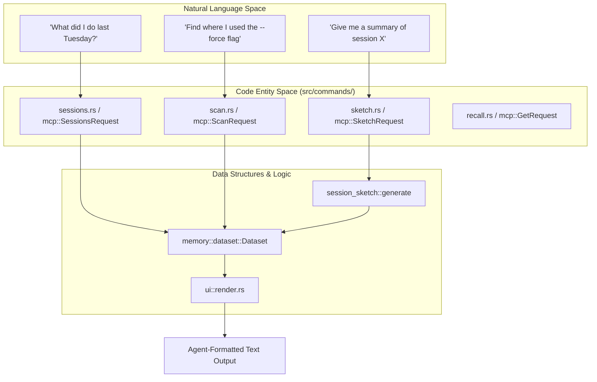
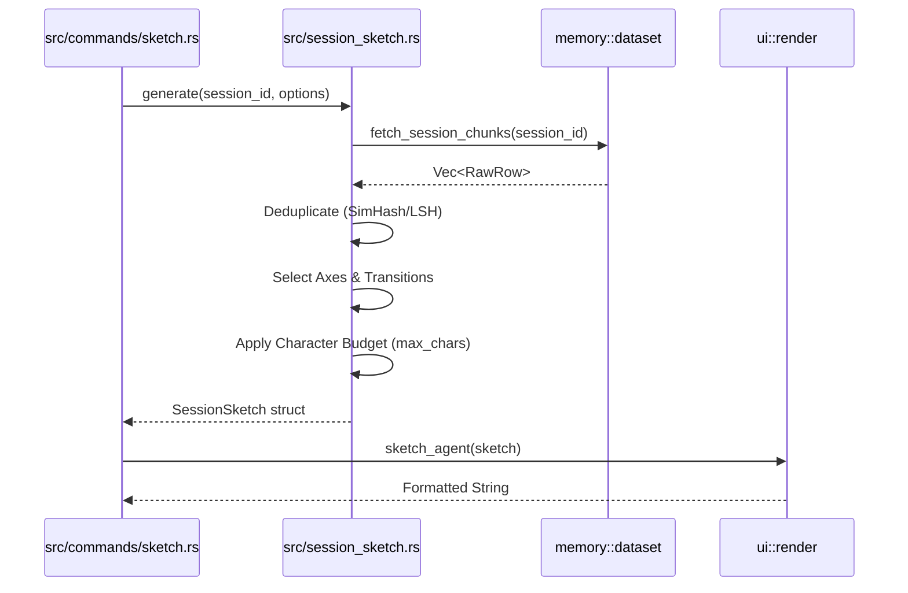

<!-- source: DeepWiki mcp.deepwiki.com · repo huggingface/funes · page 3.2 Session Inspection: get, scan, sessions, sketch · fetched 2026-10-26 -->

# Session Inspection: get, scan, sessions, sketch

Relevant source files

The following files were used as context for generating this wiki page:

- [CONTRIBUTING.md](CONTRIBUTING.md)
- [docs/README.md](docs/README.md)
- [docs/ask.md](docs/ask.md)
- [docs/sessions.md](docs/sessions.md)
- [src/commands/mcp.rs](src/commands/mcp.rs)
- [src/commands/sketch.rs](src/commands/sketch.rs)
- [src/session_sketch.rs](src/session_sketch.rs)

Session inspection commands provide the read-only surface for navigating and analyzing historical interaction data stored within a `funes` memory. While `recall` is optimized for semantic search across all sessions, these tools focus on individual session forensics, literal matching, and structural summarization.

## Overview of Inspection Tools

The inspection suite is designed to move from high-level discovery to granular turn-level reading:
1.  **`sessions`**: Discovery and filtering of available session IDs.
2.  **`sketch`**: Algorithmic digest of a session's content using vector-based distinctive selection.
3.  **`scan`**: Literal string search across a session's blocks with boundary stitching.
4.  **`get`**: High-fidelity reassembly of specific turn ranges.

### Natural Language to Code Entity Space: Inspection Flow

The following diagram maps the conceptual user flow to the internal command implementations and data structures.

**Sources:** [src/commands/mcp.rs:59-126](), [src/commands/sketch.rs:19-58](), [docs/sessions.md:1-14]()

---

## Session Listing (`sessions`)

The `sessions` command lists the contents of a memory, typically sorted by recency [docs/sessions.md:15-24](). It serves as the primary discovery mechanism when a specific `session_id` is unknown.

### Implementation Details
*   **Filtering**: Supports filtering by `repo` (repository owner/name), `since`, and `until` dates [src/commands/mcp.rs:60-65]().
*   **Pagination**: Uses `limit` and `offset` to walk through large memories [src/commands/mcp.rs:69-73]().
*   **Metadata**: Returns the session ID, start timestamp, harness type, and the opening prompt (the first `user` block) to provide context for selection [docs/sessions.md:21-24]().

**Sources:** [src/commands/mcp.rs:59-78](), [docs/sessions.md:15-35]()

---

## Session Sketching (`sketch`)

The `sketch` command produces a deterministic digest of a session by selecting the most "distinctive" passages. Unlike an LLM-based summary, a sketch is generated by selecting existing chunks based on geometric axes and transitions in the vector space [src/session_sketch.rs:1-4]().

### Selection Logic (`src/session_sketch.rs`)
The `session_sketch::generate` function performs the following steps:
1.  **Unit Identification**: Chunks are grouped into "units" (typically turns or blocks) [src/session_sketch.rs:60-73]().
2.  **Deduplication**: Near-duplicate units (cosine similarity > 0.97) are grouped to prevent repetitive command failures from dominating the sketch [src/session_sketch.rs:28-39]().
3.  **Axis Selection**: Identifies units that represent the "extremes" of the session's semantic space [src/session_sketch.rs:181-182]().
4.  **Transition Selection**: Selects units where the semantic direction shifts significantly [src/session_sketch.rs:182-182]().
5.  **Mandatory Anchors**: Always includes the opening prompt and the final turn of the requested range [src/commands/sketch.rs:3-5]().

### Data Flow: Sketch Generation

**Sources:** [src/session_sketch.rs:216-223](), [src/commands/sketch.rs:35-58](), [src/session_sketch.rs:28-41]()

---

## Literal Scanning (`scan`)

`scan` performs a literal string search (`needle`) within a specific session [src/commands/mcp.rs:81-85](). 

### Key Features
*   **Stitch-Aware**: Chunks that were split during indexing are stitched back together before matching, ensuring that a needle straddling a boundary is found [docs/sessions.md:96-97]().
*   **Contextual Snippets**: Returns hits with a configurable amount of surrounding text (`context`) [src/commands/mcp.rs:96-97]().
*   **Pagination**: If a session contains massive amounts of matches, the scan is cut at turn boundaries and provides a `from` sequence number to continue [docs/sessions.md:98-100]().

**Sources:** [src/commands/mcp.rs:81-102](), [docs/sessions.md:79-101]()

---

## Session Reassembly (`get`)

The `get` command is the primary way to read the high-fidelity history of a session. It is often invoked via the `→ get` lines provided in `recall` or `sketch` output [docs/sessions.md:11-13]().

### Functionality
*   **Turn Reassembly**: It fetches raw blocks and reconstructs the original turns, handling the elision and redaction state stored in the memory [src/commands/mcp.rs:41-56]().
*   **Range Selection**: Supports `from` and `to` sequence numbers to read specific segments of a conversation [src/commands/mcp.rs:44-51]().
*   **Agent Format**: The output is rendered in a stable, byte-consistent format that agents can parse to understand the historical context [docs/README.md:33-34]().

**Sources:** [src/commands/mcp.rs:40-56](), [docs/ask.md:12-14]()

---

## Model Context Protocol (MCP) Integration

All inspection commands are exposed via the MCP server in `src/commands/mcp.rs`. This allows AI agents to call these tools natively using JSON-RPC over stdio [src/commands/mcp.rs:1-3]().

| Tool | Request Struct | Purpose |
| :--- | :--- | :--- |
| `sessions` | `SessionsRequest` | List sessions with metadata filters [src/commands/mcp.rs:59]() |
| `get` | `GetRequest` | Retrieve specific turn ranges [src/commands/mcp.rs:41]() |
| `scan` | `ScanRequest` | Literal search within a session [src/commands/mcp.rs:81]() |
| `sketch` | `SketchRequest` | Generate a semantic digest [src/commands/mcp.rs:105]() |
| `status` | `StatusRequest` | Inspect memory health and version [src/commands/mcp.rs:129]() |

**Sources:** [src/commands/mcp.rs:1-134]()

---

