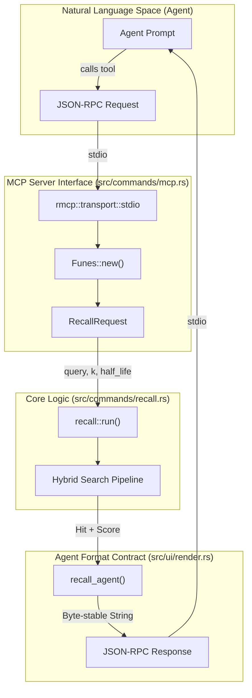
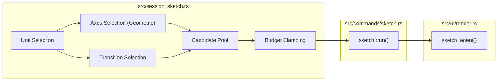

<!-- source: DeepWiki mcp.deepwiki.com · repo huggingface/funes · page 3.3 MCP Server Interface · fetched 2026-10-26 -->

# MCP Server Interface

<details>
<summary>Relevant source files</summary>

The following files were used as context for generating this wiki page:

- [AGENTS.md](AGENTS.md)
- [src/commands.rs](src/commands.rs)
- [src/commands/mcp.rs](src/commands/mcp.rs)
- [src/commands/sketch.rs](src/commands/sketch.rs)
- [src/session_sketch.rs](src/session_sketch.rs)
- [src/ui.rs](src/ui.rs)
- [src/ui/render.rs](src/ui/render.rs)

</details>


The `funes mcp` command implements a Model Context Protocol (MCP) server that exposes retrieval and session inspection capabilities to AI agents (e.g., Claude Code, Cursor, Pi). It uses the JSON-RPC 2.0 protocol over `stdio` to allow agents to call `funes` as a first-class tool [src/commands/mcp.rs:1-12]().

The server enforces a strict "Agent Format" contract, ensuring that tool outputs are deterministic and byte-stable for machine consumption [src/ui/render.rs:3-5]().

## Tool Registration

The MCP server registers a suite of tools that map directly to the `funes` retrieval commands. Each tool is defined with a JSON Schema that provides natural-language descriptions to the calling LLM [src/commands/mcp.rs:13-134]().

| Tool | Request Struct | Purpose |
| :--- | :--- | :--- |
| `recall` | `RecallRequest` | Hybrid vector/FTS search across past sessions [src/commands/mcp.rs:15-38](). |
| `get` | `GetRequest` | Reassemble specific turns from a session [src/commands/mcp.rs:41-56](). |
| `sessions` | `SessionsRequest` | List sessions with filtering by repo, date, or offset [src/commands/mcp.rs:59-78](). |
| `scan` | `ScanRequest` | Literal string search within a specific session [src/commands/mcp.rs:81-102](). |
| `sketch` | `SketchRequest` | Generate a geometric digest of a session's key moments [src/commands/mcp.rs:105-126](). |
| `status` | `StatusRequest` | Inspect memory state and availability [src/commands/mcp.rs:129-134](). |

### Memory Resolution Hierarchy
The server manages memory access through a tiered precedence model. When a tool is called, the memory to use is resolved in the following order [AGENTS.md:28-29]():
1.  **Tool-specific override**: The `memory` field in the JSON-RPC request (e.g., `RecallRequest.memory`) [src/commands/mcp.rs:37]().
2.  **Server-wide pin**: The memory specified when starting the server via `funes mcp <memory>` [src/commands/mcp.rs:140]().
3.  **Local default**: The default local memory if no other specifier is provided.

**Sources:** [src/commands/mcp.rs:1-149](), [AGENTS.md:21-38](), [src/ui/render.rs:1-24]()

## Data Flow: JSON-RPC to Code Entities

The MCP interface bridges the "Natural Language Space" (where agents operate) to the "Code Entity Space" (the internal Rust logic).

### Tool Execution Flow
The following diagram illustrates how an MCP `recall` request is processed through the system.


**Sources:** [src/commands/mcp.rs:1-12](), [src/ui/render.rs:1-24](), [AGENTS.md:13-15]()

## Agent Format Contract

Funes enforces a single, immutable output format for all agents. There are no human-readable vs. machine-readable toggles; the output is designed to be parsed by agents while remaining legible to developers [AGENTS.md:23-25]().

### The `→ get` Line Protocol
The most critical part of the agent contract is the `→ get` line. Every retrieval result (from `recall`, `scan`, or `sketch`) includes a pre-formatted command that the agent can use to fetch more context [src/ui/render.rs:11-17]().

```text
[2024-01-01T12:00:00] claude_code my-project/abc12345 text  score=0.850
  → get abc12345 --from 10 --to 16 --memory local
  ... chunk text ...
```

*   **Implementation**: The `hint_range` function calculates a window around a specific sequence number (`seq`) [src/ui/render.rs:14-17]().
*   **Stability**: This format is pinned by integration tests in `tests/index_recall.rs` to prevent regressions [AGENTS.md:15]().

### Rendering Functions
The `src/ui/render.rs` module contains the dedicated renderers for each MCP tool:

| Function | Associated Command | Key Features |
| :--- | :--- | :--- |
| `recall_agent` | `recall` | Includes provenance header, score, and neighbor snippets [src/ui/render.rs:24-42](). |
| `scan_agent` | `scan` | Collapses matches into whitespace-normalized excerpts with `…` markers [src/ui/render.rs:47-86](). |
| `sketch_agent` | `sketch` | Reports clamping/narrowing of units and character budgets [src/ui/render.rs:91-135](). |

### Geometric Sketching
The `sketch` tool provides a high-level digest of a session by selecting the most distinctive passages. It uses a deterministic selector that balances "axes" (coverage of different topics) and "transitions" (narrative shifts) [src/session_sketch.rs:179-192]().


**Sources:** [src/ui/render.rs:91-135](), [src/session_sketch.rs:139-192](), [src/commands/sketch.rs:19-58]()

## Implementation Details

### Server Initialization
The server is initialized in `src/commands/mcp.rs` using the `rmcp` crate. It defines a `Funes` struct that holds the pinned memory configuration and the `ToolRouter` [src/commands/mcp.rs:136-149]().

### JSON-RPC Transport
The server uses `rmcp::transport::stdio` to communicate. Because `stdout` is reserved for JSON-RPC messages, all internal logging and error reporting within the MCP process must be redirected to `stderr` [src/commands/mcp.rs:1-4]().

**Sources:** [src/commands/mcp.rs:1-12](), [src/commands/mcp.rs:136-149]()

---

