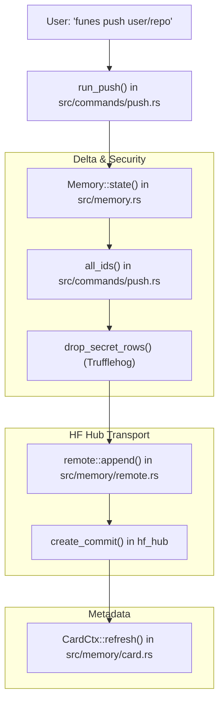
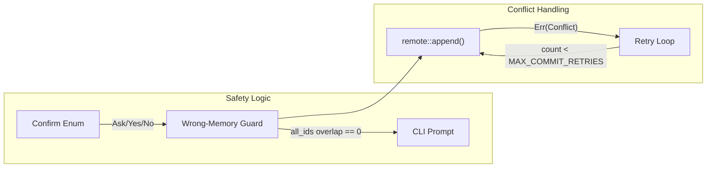

<!-- source: DeepWiki mcp.deepwiki.com · repo huggingface/funes · page 4.1 Push Pipeline · fetched 2026-10-26 -->

# Push Pipeline

Relevant source files

The following files were used as context for generating this wiki page:

- [docs/push.md](docs/push.md)
- [scripts/backfill_remote_repo.rs](scripts/backfill_remote_repo.rs)
- [scripts/backfill_repo.rs](scripts/backfill_repo.rs)
- [src/commands/push.rs](src/commands/push.rs)
- [src/memory.rs](src/memory.rs)
- [tests/push_card.rs](tests/push_card.rs)
- [tests/push_round_trip.rs](tests/push_round_trip.rs)

The `push` command orchestrates the synchronization of local memory fragments to a remote Hugging Face Hub dataset repository [src/commands/push.rs:1-7](). Unlike a full mirror, `funes` calculates the delta of chunks present locally but missing from the remote, ensuring that synchronization is incremental and append-only [src/commands/push.rs:3-4]().

## Push Orchestration Logic

The pipeline operates in three distinct modes based on the state of the remote repository:

| Mode | Trigger | Implementation Detail |
| :--- | :--- | :--- |
| **First Publish** | Remote is empty or missing. | Uploads all local data files and builds initial FTS/IVF indexes in one commit [src/commands/push.rs:9-10](). |
| **Append** | Remote exists and shares history. | Lands new fragments, manifests, and transactions via `remote::append` using a CAS-guarded `create_commit` [src/commands/push.rs:11-13](). |
| **Reindex** | Backlog > `REINDEX_THRESHOLD` (500). | A separate guarded commit (`remote::reindex`) that folds unindexed rows into the global index [src/commands/push.rs:14-17](), [src/commands/push.rs:46-46](). |

### Delta Calculation
The synchronization delta is computed as `local_ids - remote_ids` [src/commands/push.rs:4-5](). The system identifies these IDs by performing a column scan of the `id` field in the Lance dataset [src/commands/push.rs:71-86]().

### Push Receipts
To avoid redundant scans of the remote, `funes` maintains a local "receipt" of IDs observed on a specific remote [src/commands/push.rs:88-92](). These receipts are stored in `$FUNES_HOME/pushed/` and are updated atomically using temporary files and directory-level locks to prevent race conditions between concurrent push attempts [src/commands/push.rs:117-150]().

**Sources:** [src/commands/push.rs:1-50](), [src/commands/push.rs:71-86](), [src/commands/push.rs:88-156]()

## Data Flow: Local to Hub

The following diagram illustrates the transition from natural language commands to the internal Rust entities responsible for the push lifecycle.

### Natural Language to Code Entity Space: Push Lifecycle

**Sources:** [src/commands/push.rs:1-17](), [src/memory.rs:139-151](), [docs/push.md:46-50](), [src/memory/remote.rs:1-26]()

## The Secret Gate (Egress Filter)

While indexing performs best-effort redaction, the **Push Pipeline** serves as a fail-closed egress backstop [docs/push.md:46-50]().

1.  **Requirement:** Push requires TruffleHog to be available on `PATH` or via `FUNES_TRUFFLEHOG` [docs/push.md:64-67]().
2.  **Block Reconstruction:** Because secrets might be split across chunk boundaries, the gate reconstructs complete content blocks before scanning [docs/push.md:47-48]().
3.  **Hold-back Mechanism:** If any chunk within a block contains a secret, the entire block is withheld from the push [docs/push.md:48-49](). Clean rows are allowed to proceed with a warning, but if 100% of rows are held back, the process exits with code `2` [docs/push.md:49-58]().
4.  **Remediation:** Users must run `funes scrub` to repair the local memory before the rows can pass the gate [docs/push.md:71-88]().

**Sources:** [docs/push.md:40-93]()

## Guarding and Conflicts

### The Wrong-Memory Guard
To prevent accidental data leakage or corruption, `funes` implements a "no-overlap" check. If a local memory shares no chunk IDs with the target remote, the system prompts the user for confirmation [docs/push.md:28-32](). This guard is bypassed in non-interactive environments unless `--yes` is provided [docs/push.md:30-31]().

### CAS-Conflict Retries
Remote writes use Compare-And-Swap (CAS) logic. If the Hub branch head moves (due to a concurrent push from another machine) between the time `funes` fetches the head and attempts the commit, the operation is retried against the new head [src/commands/push.rs:11-13]().
*   **Retry Limit:** Capped at 10 attempts (`MAX_COMMIT_RETRIES`) to prevent infinite loops on busy remotes [src/commands/push.rs:48-50]().

### Entity Association: Safety & Conflict Logic

**Sources:** [src/commands/push.rs:48-50](), [docs/push.md:28-32](), [tests/push_round_trip.rs:23-23](), [tests/push_round_trip.rs:90-106]()

## Dataset Card (README.md) Management

`funes` automatically manages the Hugging Face Dataset Card to ensure shared memories are discoverable and documented [docs/push.md:18-21]().

*   **Initialization:** On the first publish, a `README.md` is created with the `funes` tag and usage examples [docs/push.md:18-20]().
*   **Stats Injection:** The card contains a `<!-- funes:stats -->` marker. `funes` injects live statistics (chunk counts, session counts) into this section during every push [tests/push_card.rs:147-155]().
*   **Hand-written Respect:** If a user manually edits the `README.md` (removing the stats markers), `funes` ceases automatic updates to avoid overwriting user content [docs/push.md:20-21](), [tests/push_card.rs:108-118]().

**Sources:** [docs/push.md:13-22](), [src/memory/card.rs:23-23](), [tests/push_card.rs:1-170]()

---

