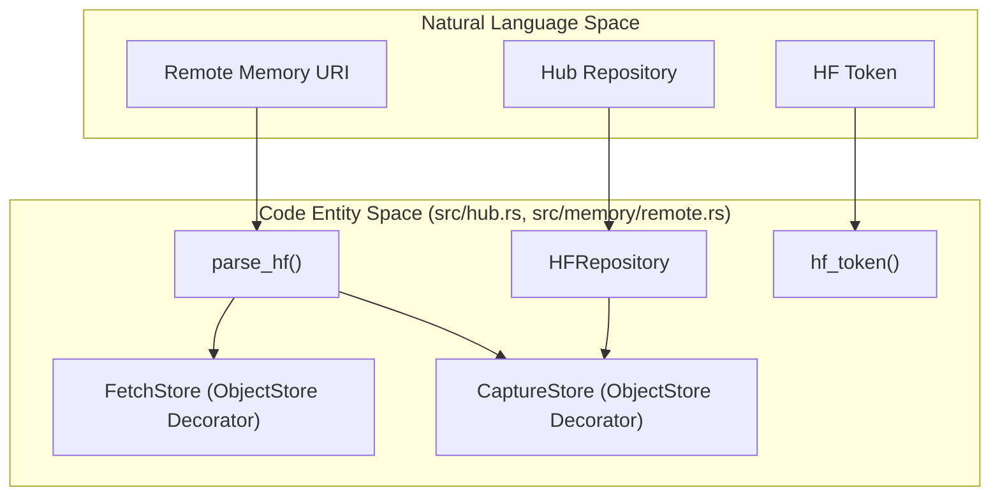
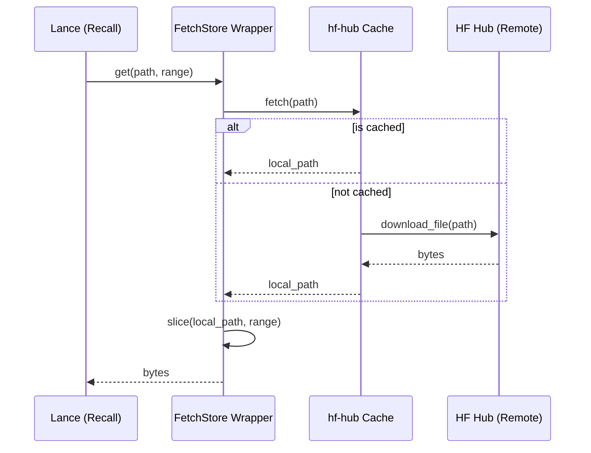

<!-- source: DeepWiki mcp.deepwiki.com · repo huggingface/funes · page 4.2 Hub Transport and Remote Memory · fetched 2026-10-26 -->

# Hub Transport and Remote Memory

Relevant source files

The following files were used as context for generating this wiki page:

- [SECURITY.md](SECURITY.md)
- [docs/RATIONALE.md](docs/RATIONALE.md)
- [docs/demo/cross-agents.tape](docs/demo/cross-agents.tape)
- [docs/hub-caching.md](docs/hub-caching.md)
- [docs/landscape.md](docs/landscape.md)
- [src/hub.rs](src/hub.rs)
- [src/lib.rs](src/lib.rs)
- [src/main.rs](src/main.rs)
- [src/memory/fetch_store.rs](src/memory/fetch_store.rs)
- [src/memory/remote.rs](src/memory/remote.rs)
- [tests/remote_repo_source.rs](tests/remote_repo_source.rs)

The Hub transport layer provides the infrastructure for treating the Hugging Face Hub as a versioned, high-latency object store for memory distribution. It handles authentication, URI parsing, and reachability probing, while providing specialized `object_store` decorators to enable atomic multi-file commits and efficient read-through caching of immutable Lance datasets.

## Hugging Face Authentication

`funes` manages authentication through the `hub.rs` module, which abstracts token resolution and client creation. It follows a strict precedence order for tokens, preferring explicit environment variables over cached credentials [src/hub.rs:105-117]().

| Source | Details |
| :--- | :--- |
| **Environment Variables** | `HF_TOKEN`, `HUGGING_FACE_HUB_TOKEN`, or `HUGGINGFACE_TOKEN` [src/hub.rs:106-113](). |
| **Cached Login** | Reads from `~/.cache/huggingface/token` (populated by `huggingface-cli login`) [src/hub.rs:94-100](). |

The `client` function handles the construction of the `hf_hub::HFClient` [src/hub.rs:41-50](). For reachability probes, it disables retries to prevent the default backoff from causing multi-second delays during offline checks [src/hub.rs:38-45]().

### Identity and Repository Lifecycle
*   **`whoami()`**: Returns the authenticated user's Hub handle. If the token is invalid or missing, it errors, signaling the system to stay in local-only mode [src/hub.rs:61-68]().
*   **`create_dataset_repo(owner, name)`**: An idempotent call that creates a private dataset repository on the Hub [src/hub.rs:73-86](). It is only invoked upon explicit user consent [src/hub.rs:71-72]().

**Sources:** [src/hub.rs:38-117]()

## URI Parsing and Shorthand

The system distinguishes between local paths and remote Hub memories using specific string patterns.

*   **Remote Shorthand**: A string is treated as a remote shorthand if it contains a `/` but does not start with `/`, `.`, or `~` (e.g., `org/repo`) [src/hub.rs:11-13]().
*   **HF URI Scheme**: The `parse_hf` function decomposes `hf://datasets/<owner>/<name>[/<prefix...>]` into its constituent parts [src/hub.rs:17-26](). An empty prefix resolves to the repository root [src/hub.rs:125-130]().

**Sources:** [src/hub.rs:11-26](), [src/hub.rs:125-130]()

## Reachability and Error Classification

To maintain the "local-first" philosophy, `funes` must gracefully degrade when the Hub is unreachable. The `is_offline_error` function classifies `hf_hub::HFError` variants into transient/offline states:
1.  **Transport Failures**: Connection timeouts or refused connections [src/hub.rs:32-32]().
2.  **Server Errors**: HTTP 500, 502, 503, or 504 status codes [src/hub.rs:33-33]().

In these cases, commands like `recall` fall back to the local index rather than failing [src/hub.rs:28-36]().

**Sources:** [src/hub.rs:28-36]()

## Remote Memory Architecture

### Transport Layer Data Flow
The following diagram maps the relationship between Hub transport entities and the Lance storage layer.

**Sources:** [src/hub.rs:17-26](), [src/hub.rs:95-100](), [src/memory/remote.rs:18-22](), [src/memory/fetch_store.rs:47-50]()

### Atomic Writes via CaptureStore
Lance datasets consist of multiple files (fragments, manifests, indices). By default, writing to the Hub via OpenDAL would result in one git commit per file, which is non-atomic [src/memory/remote.rs:9-16]().

`funes` solves this using `CaptureStore`, a `WrappingObjectStore` that intercepts Lance's write calls and buffers them in memory [src/memory/remote.rs:18-22](). Once Lance completes its operation, the entire set of changes is shipped to the Hub as a single `create_commit` guarded by a `parent_commit` OID to detect conflicts (CAS) [src/memory/remote.rs:3-7](), [src/memory/remote.rs:118-126]().

**Sources:** [src/memory/remote.rs:1-37](), [src/memory/remote.rs:118-126]()

## The hf:// Read-Through Cache

Remote recall performance is optimized through a file-grained read-through cache. Instead of performing expensive byte-range requests over the network, `funes` fetches whole immutable files into the standard Hugging Face cache.

### FetchStore Implementation
`FetchStore` is a decorator for the `object_store::ObjectStore` [src/memory/fetch_store.rs:47-50]().
1.  **Read Interception**: Every `get` request is intercepted and passed to a `FileFetcher` [src/memory/fetch_store.rs:67-78]().
2.  **Whole-File Download**: The fetcher uses `hf_hub::download_file` to pull the entire file (e.g., a `.lance` fragment or index) into `~/.cache/huggingface/hub` [docs/hub-caching.md:33-40]().
3.  **Local Slicing**: The requested byte range is served from the local file using `serve_from_file` [src/memory/fetch_store.rs:113-132]().
4.  **Live Delegation**: Operations like `list` (used to discover the latest `_versions/*.manifest`) are always delegated to the live Hub backend to ensure new pushes are detected immediately [src/memory/fetch_store.rs:92-94](), [docs/hub-caching.md:43-46]().

### Caching Rationale
| Feature | Logic |
| :--- | :--- |
| **File-Grained** | Lance files are immutable once written. Caching at the file level matches Lance's read pattern and avoids the overhead of sub-file chunking [docs/hub-caching.md:60-78](). |
| **Latency Reduction** | A single whole-file download avoids the ~0.3s signed-redirect tax imposed by the Hub on every individual range request [docs/hub-caching.md:28-32](). |
| **Zero-Network Warm Reads** | Once a file is cached and pinned to a commit SHA, subsequent reads are pure local filesystem hits [docs/hub-caching.md:48-50](). |

**Sources:** [src/memory/fetch_store.rs:1-132](), [docs/hub-caching.md:1-93]()

---

