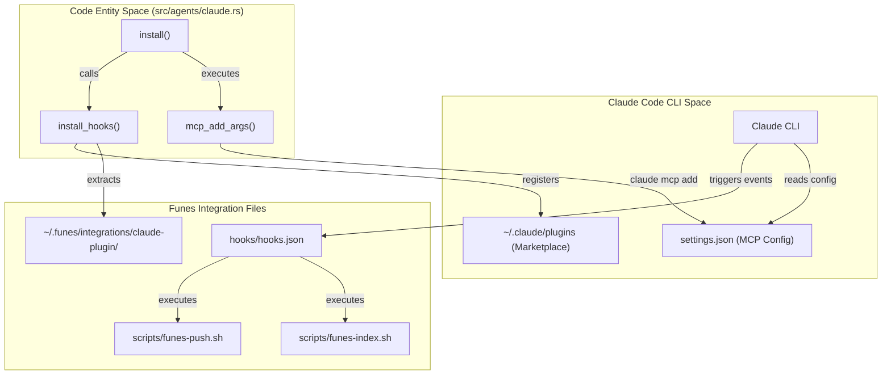
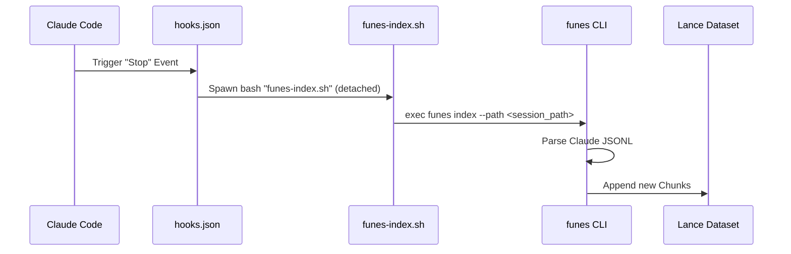

<!-- source: DeepWiki mcp.deepwiki.com · repo huggingface/funes · page 5.1 Claude Code Integration · fetched 2026-10-26 -->

# Claude Code Integration

Relevant source files

The following files were used as context for generating this wiki page:

- [integrations/claude-plugin/.claude-plugin/marketplace.json](integrations/claude-plugin/.claude-plugin/marketplace.json)
- [integrations/claude-plugin/funes/.claude-plugin/plugin.json](integrations/claude-plugin/funes/.claude-plugin/plugin.json)
- [src/agents/claude.rs](src/agents/claude.rs)
- [src/agents/hermes.rs](src/agents/hermes.rs)
- [src/agents/hooks.rs](src/agents/hooks.rs)

The Claude Code integration enables two primary capabilities within the Anthropic Claude Code CLI: **Recall** (via the Model Context Protocol) and **Automation** (via a native Claude plugin). The integration allows Claude to search through past sessions using the `recall` tool and ensures that new interactions are indexed and published to the memory automatically.

## Integration Architecture

The integration is split into a "Read Surface" (MCP) and a "Write Surface" (Hooks).

*   **MCP Server**: Registered at the `user` scope, providing tools like `recall`, `get`, and `sessions` to Claude.
*   **Hooks Plugin**: A local Claude plugin that triggers indexing and pushing scripts at specific lifecycle events.

### Component Relationship

The following diagram illustrates how the `src/agents/claude.rs` installer configures the Claude environment to interact with `funes`.

**Claude Code Integration Map**

Sources: [src/agents/claude.rs:1-12](), [src/agents/claude.rs:39-76](), [src/agents/claude.rs:169-170]()

## MCP Server Registration

Funes is consumed as a stdio-based MCP server. The registration is performed using the `claude mcp add` command.

1.  **Scope**: Registered at the `user` scope to ensure availability across all projects [src/agents/claude.rs:3-6]().
2.  **Command**: The registration command is constructed by `mcp_add_args` [src/agents/claude.rs:28-37](). It points to the `funes` binary (configurable via `FUNES_BIN`) and passes the `mcp` subcommand.
3.  **Memory Binding**: If a specific memory is provided during `funes add claude <memory>`, it is appended to the MCP arguments, pinning the agent's recall to that specific dataset [src/agents/claude.rs:33-35]().

To prevent registration conflicts, `install()` attempts to run `claude mcp remove funes` before adding the new configuration, ensuring that memory binding updates are applied [src/agents/claude.rs:52-56]().

## Automation Hooks Plugin

Claude Code supports a plugin system for lifecycle hooks. Funes utilizes a "hooks-only" plugin located at `~/.funes/integrations/claude-plugin` [src/agents/claude.rs:8-11]().

### Plugin Structure
The plugin is composed of embedded assets extracted at installation time:
*   **Marketplace Metadata**: `marketplace.json` defines the `huggingface` marketplace [integrations/claude-plugin/.claude-plugin/marketplace.json:1-11]().
*   **Plugin Definition**: `plugin.json` defines the `funes@huggingface` plugin [integrations/claude-plugin/funes/.claude-plugin/plugin.json:1-6]().
*   **Hook Logic**: The plugin executes detached shell scripts that handle the actual indexing and pushing.

### Lifecycle Events
The integration maps Claude lifecycle events to `funes` automation scripts via `desired_hooks()` [src/agents/claude.rs:145-165]():

| Claude Event | Funes Script | Purpose |
| :--- | :--- | :--- |
| `Stop` | `funes-index.sh` | Indexes the turn immediately after the LLM stops generating [src/agents/claude.rs:147-150](). |
| `SessionStart` | `funes-push.sh` | Performs a "catch-up" push when a new session begins [src/agents/claude.rs:154-157](). |
| `SessionEnd` | `funes-push.sh` | Publishes the session data to the remote memory [src/agents/claude.rs:159-162](). |

Sources: [src/agents/claude.rs:145-165](), [src/agents/hooks.rs:13-14]()

## Implementation Details

### Drift Detection and Reinstall Logic
The integration uses `write_if_changed` and `write_scripts` from the `hooks` module to maintain the integrity of the plugin files [src/agents/hooks.rs:93-119]().
*   **Idempotency**: Scripts are only rewritten if the embedded content differs from the disk version [src/agents/hooks.rs:111-113]().
*   **Permissions**: The `funes-index.sh` and `funes-push.sh` scripts are explicitly granted executable permissions (`0o755`) during every installation or update check [src/agents/hooks.rs:101-103]().

### Data Flow: Turn Completion to Index
When a turn completes in Claude Code, the following sequence occurs:

**Turn Indexing Data Flow**

Sources: [src/agents/claude.rs:146-150](), [src/agents/hooks.rs:13-18](), [src/agents/hooks.rs:30-36]()

### Uninstallation
The `uninstall()` function performs a clean removal of all integration surfaces [src/agents/claude.rs:80-105]():
1.  **MCP Removal**: Calls `claude mcp remove funes` [src/agents/claude.rs:114-118]().
2.  **Plugin Removal**: Calls `claude plugin uninstall funes@huggingface` [src/agents/claude.rs:122-126]().
3.  **Marketplace Removal**: Calls `claude plugin marketplace remove huggingface` [src/agents/claude.rs:127-131]().
4.  **Filesystem Cleanup**: Deletes the `~/.funes/integrations/claude-plugin` directory [src/agents/claude.rs:135-143]().

If the `claude` CLI is not found on the system PATH during uninstallation, the files are removed, and the user is provided with manual instructions to clean up the Claude configuration [src/agents/claude.rs:94-98]().

Sources: [src/agents/claude.rs:80-143]()

---

