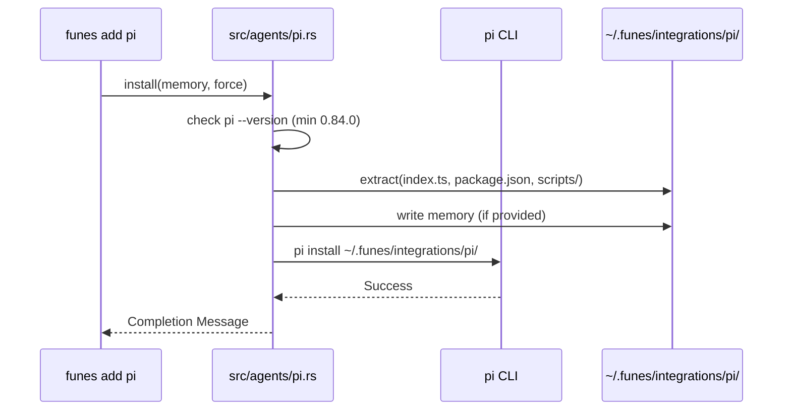

<!-- source: DeepWiki mcp.deepwiki.com · repo huggingface/funes · page 5.3 Pi Integration · fetched 2026-10-26 -->

# Pi Integration

<details>
<summary>Relevant source files</summary>

The following files were used as context for generating this wiki page:

- [integrations/pi/README.md](integrations/pi/README.md)
- [integrations/pi/index.ts](integrations/pi/index.ts)
- [integrations/pi/package.json](integrations/pi/package.json)
- [src/agents/pi.rs](src/agents/pi.rs)

</details>


The Pi integration enables [pi](https://github.com/earendil-works/pi) to access funes memory via the Model Context Protocol (MCP) and automates the indexing of active sessions. Because Pi does not natively include an MCP client, funes provides a TypeScript-based extension that acts as a bridge, spawning a persistent `funes mcp` instance over stdio to serve tools and handle lifecycle hooks [integrations/pi/index.ts:4-8]().

## System Architecture

The integration consists of three primary components:
1.  **Rust Installer (`src/agents/pi.rs`)**: Manages the extraction of embedded assets and registration with the `pi` CLI [src/agents/pi.rs:3-12]().
2.  **TypeScript Bridge (`integrations/pi/index.ts`)**: A minimal MCP client that maintains a "warm" `funes mcp` process to avoid the overhead of reloading embeddings and rerankers on every turn [integrations/pi/index.ts:4-7]().
3.  **Automation Scripts**: Shared shell scripts (`funes-index.sh`, `funes-push.sh`) triggered by Pi lifecycle events to keep the local and remote memories synchronized [integrations/pi/README.md:13-16]().

### Data Flow: Natural Language to Code Entities

The following diagram illustrates how a natural language request from a user in Pi traverses the integration layers to reach the funes memory.

**Pi Tool Execution Flow**
```mermaid
graph TD
    User["User Prompt"] -- "Natural Language" --> PiAgent["Pi Coding Agent"]
    PiAgent -- "Tool Call (JSON-RPC)" --> PiExtension["pi-funes-bridge (integrations/pi/index.ts)"]
    
    subgraph "Bridge Process"
        PiExtension -- "FunesMcp.request()" --> StdIO["Stdio Pipe"]
        StdIO -- "JSON-RPC over Stdio" --> FunesMCP["funes mcp (src/commands/mcp.rs)"]
    }
    
    FunesMCP -- "recall_hits()" --> LanceDB["Lance Dataset (chunks.lance)"]
    LanceDB -- "Recalled Passages" --> FunesMCP
    FunesMCP -- "Tool Result" --> PiExtension
    PiExtension -- "Formatted Context" --> PiAgent
    PiAgent -- "Final Response" --> User
```
**Sources:** [integrations/pi/index.ts:58-64](), [integrations/pi/README.md:6-11](), [src/agents/pi.rs:3-6]()

## The TypeScript Bridge (`FunesMcp`)

The bridge is implemented in `integrations/pi/index.ts` as the `FunesMcp` class. It performs dynamic tool registration by querying the `funes mcp` server's `tools/list` capability and registering those tools within Pi using `pi.registerTool` [integrations/pi/index.ts:10-12]().

### Key Lifecycle Hooks
The extension utilizes Pi's extension API to hook into session events:
*   **`session_start`**: Initializes the MCP connection and ensures the environment is ready.
*   **`turn_end`**: Triggers `funes-index.sh` to parse the latest turn and append it to the local Lance dataset [integrations/pi/README.md:13-16]().
*   **`session_shutdown`**: If a remote memory is bound, triggers `funes-push.sh` to synchronize local changes to the Hugging Face Hub [integrations/pi/README.md:13-16]().

### Memory Resolution Hierarchy
The extension resolves which memory to use (local vs. remote) following this precedence:
1.  **`FUNES_MEMORY`**: Environment variable override [integrations/pi/index.ts:25]().
2.  **Bound Memory**: The memory specified during `funes add pi <memory>`, stored in a `memory` file within the extension directory [integrations/pi/index.ts:26-27]().
3.  **Default**: Local memory if no other configuration is found [integrations/pi/index.ts:28-29]().

**Sources:** [integrations/pi/index.ts:39-48](), [integrations/pi/README.md:46-49]()

## Installation and Management

The `src/agents/pi.rs` module handles the installation lifecycle. It embeds the extension's source code using `include_str!` and extracts it to a fixed location at `~/.funes/integrations/pi` [src/agents/pi.rs:24-25, 42]().

### Version Guarding
The installer enforces a minimum Pi version (`0.84.0`). This is required because funes MCP tools use nullable-union arguments in their JSON schemas, which older versions of Pi fail to validate correctly [src/agents/pi.rs:27-30, 61-69]().

### Asset Extraction
The `extract` function is responsible for:
*   Writing `index.ts` and `package.json` [src/agents/pi.rs:126-131]().
*   Extracting the shared automation scripts into a `scripts/` subdirectory via `hooks::write_scripts` [src/agents/pi.rs:131]().
*   Creating the `memory` binding file if a remote repository is specified [src/agents/pi.rs:121-125]().

**Installation Sequence**

**Sources:** [src/agents/pi.rs:37-89](), [src/agents/pi.rs:126-131]()

## Technical Specifications

| Feature | Implementation Detail |
| :--- | :--- |
| **Communication** | JSON-RPC 2.0 over Stdio [integrations/pi/index.ts:56-57]() |
| **Timeout (Call)** | 120,000 ms [integrations/pi/index.ts:50]() |
| **Timeout (Handshake)** | 10,000 ms [integrations/pi/index.ts:51]() |
| **Protocol Version** | 2024-11-05 [integrations/pi/index.ts:49]() |
| **Binary Override** | `FUNES_BIN` environment variable [integrations/pi/index.ts:36]() |
| **Installation Path** | `~/.funes/integrations/pi` (Fixed) [src/agents/pi.rs:38-42]() |

**Sources:** [integrations/pi/index.ts:36-51](), [src/agents/pi.rs:42]()

---

