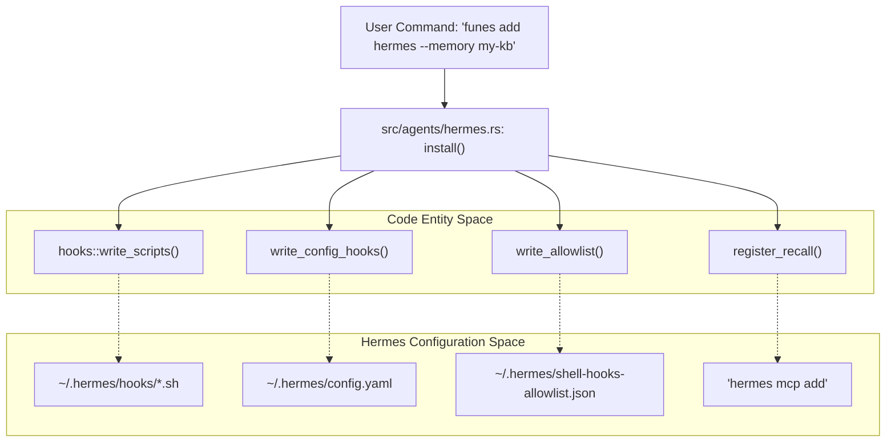
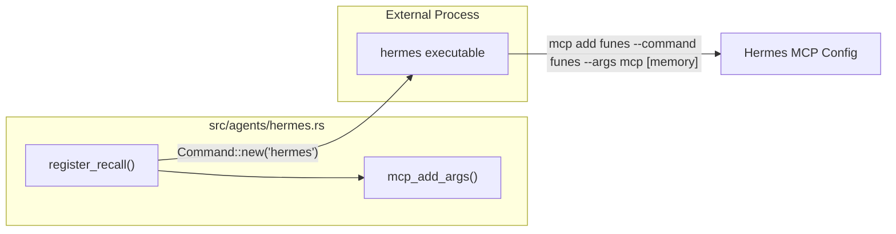

<!-- source: DeepWiki mcp.deepwiki.com · repo huggingface/funes · page 5.4 Hermes Integration · fetched 2026-10-26 -->

# Hermes Integration

Relevant source files

The following files were used as context for generating this wiki page:

- [src/agents/claude.rs](src/agents/claude.rs)
- [src/agents/hermes.rs](src/agents/hermes.rs)
- [src/agents/hooks.rs](src/agents/hooks.rs)

The Hermes integration provides automated indexing and retrieval for the Hermes agent harness. It manages two distinct integration surfaces within the `~/.hermes` directory: a native **Model Context Protocol (MCP) server** for recall and **shell hooks** for automated background indexing and memory publishing [src/agents/hermes.rs:1-17]().

## Integration Architecture

The integration is implemented in `src/agents/hermes.rs` and utilizes shared infrastructure from `src/agents/hooks.rs` to manage lifecycle events.

### Component Overview
| Component | Responsibility | Implementation |
| :--- | :--- | :--- |
| **MCP Server** | Provides `recall`, `get`, `sessions`, `scan`, and `sketch` tools to Hermes. | Registered via `hermes mcp add` [src/agents/hermes.rs:4-6]() |
| **Automation Hooks** | Triggers indexing and publishing scripts on agent events. | Configured in `config.yaml` [src/agents/hermes.rs:7-12]() |
| **Consent Allowlist** | Pre-approves funes scripts to bypass Hermes shell security prompts. | Managed in `shell-hooks-allowlist.json` [src/agents/hermes.rs:10-12]() |
| **Detached Workers** | `funes-index.sh` and `funes-push.sh` run the heavy lifting out-of-process. | Embedded in `src/agents/hooks.rs` [src/agents/hooks.rs:13-14]() |

### Data Flow: Natural Language to Code Entities
The following diagram illustrates how a user command to add Hermes flows through the system to configure the underlying Hermes YAML and JSON files.

**Hermes Setup Flow**

Sources: [src/agents/hermes.rs:31-36](), [src/agents/hermes.rs:84-95]()

## Automation Hooks

Hermes fires shell hooks declared in its `config.yaml`. Funes registers three specific lifecycle events to ensure the memory remains synchronized without blocking the agent's execution.

### Lifecycle Events
1.  **`post_llm_call`**: Fired after every completed turn. Invokes `funes-index.sh` to perform local incremental indexing [src/agents/hermes.rs:7-9]().
2.  **`on_session_start`**: Fired when a session begins. Invokes `funes-push.sh` to catch up with any remote changes [src/agents/hermes.rs:78]().
3.  **`on_session_finalize`**: Fired at the true session boundary. Invokes `funes-push.sh` to publish new turns to the Hugging Face Hub [src/agents/hermes.rs:79]().

### Pre-approval (Allowlist)
Hermes gates shell hooks behind a consent mechanism. To provide a seamless experience, `funes` pre-writes the `(event, command)` pairs into `~/.hermes/shell-hooks-allowlist.json` [src/agents/hermes.rs:10-12](). This ensures the scripts run from the very first turn without interrupting the user with security prompts.

### Atomic Writes
Because Hermes may be running while `funes` modifies its configuration, all file updates to `config.yaml` and `shell-hooks-allowlist.json` are performed atomically using a temporary file and rename strategy [src/agents/hermes.rs:14-17]().

Sources: [src/agents/hermes.rs:7-17](), [src/agents/hermes.rs:73-82]()

## MCP Registration

The recall functionality is provided by registering `funes` as an MCP server.

**Recall Registration Logic**

The registration command uses `hermes mcp add funes`. If a specific memory is bound during `funes add`, it is passed as a variadic argument to the `mcp` subcommand, pinning the agent's recall to that specific memory [src/agents/hermes.rs:4-6]().

Sources: [src/agents/hermes.rs:4-6](), [src/agents/hermes.rs:35-36]()

## Implementation Details

### Shared Hook Infrastructure
The integration relies on `src/agents/hooks.rs` for generating the shell command strings and merging hook groups into existing configurations.

*   **`command(script, args)`**: Constructs a double-quoted bash command string, ensuring that paths and arguments are properly escaped for shell execution while preserving environment variable expansion (e.g., `${HOOK_ROOT}`) [src/agents/hooks.rs:30-36]().
*   **`write_scripts(dir)`**: Extracts the embedded `funes-index.sh` and `funes-push.sh` to the target directory and sets the executable bit (0o755) [src/agents/hooks.rs:95-106]().
*   **`apply_funes_hooks(cfg, desired)`**: An idempotent function that removes existing funes-owned hooks and inserts the new desired set, preserving non-funes hooks [src/agents/hooks.rs:47-75]().

### Idempotency and Uninstallation
The `uninstall` function in `src/agents/hermes.rs` reverses the integration by:
1.  Running `hermes mcp remove funes` to unregister the toolset [src/agents/hermes.rs:43-47]().
2.  Parsing `config.yaml` and removing only the funes-owned mapping entries [src/agents/hermes.rs:116-132]().
3.  Removing the corresponding approvals from `shell-hooks-allowlist.json` [src/agents/hermes.rs:138-141]().
4.  Deleting the extracted hook scripts [src/agents/hermes.rs:38-39]().

The Hermes session database and the underlying Lance memory dataset are deliberately left untouched during uninstallation to prevent data loss [src/agents/hermes.rs:39-40]().

Sources: [src/agents/hooks.rs:30-42](), [src/agents/hooks.rs:47-75](), [src/agents/hermes.rs:38-66]()

---

