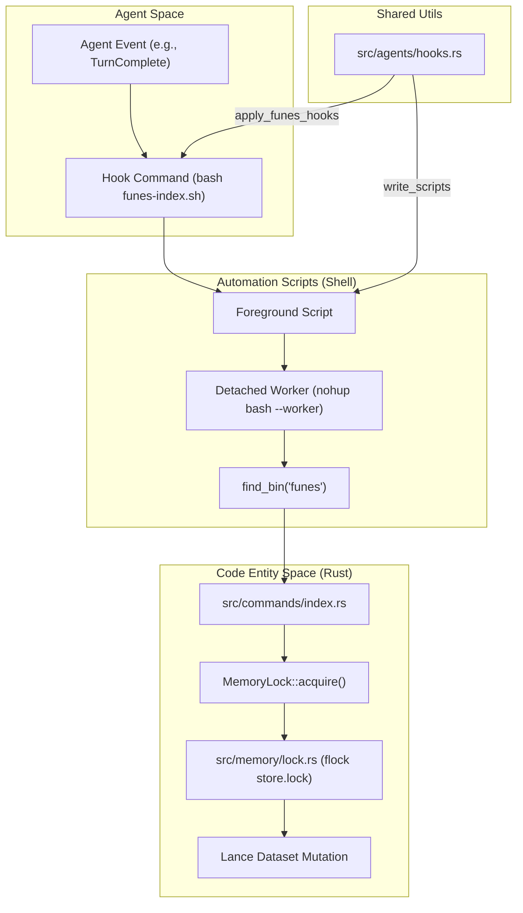
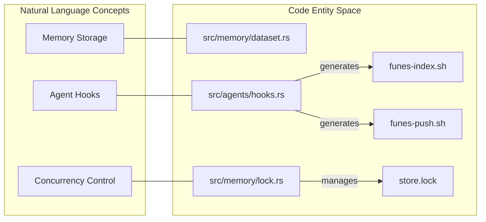

<!-- source: DeepWiki mcp.deepwiki.com · repo huggingface/funes · page 5.5 Automation Hooks and Shared Infrastructure · fetched 2026-10-26 -->

# Automation Hooks and Shared Infrastructure

Relevant source files

The following files were used as context for generating this wiki page:

- [docs/automation.md](docs/automation.md)
- [scripts/automation/funes-index.sh](scripts/automation/funes-index.sh)
- [scripts/automation/funes-push.sh](scripts/automation/funes-push.sh)
- [src/agents/claude.rs](src/agents/claude.rs)
- [src/agents/hermes.rs](src/agents/hermes.rs)
- [src/agents/hooks.rs](src/agents/hooks.rs)
- [src/memory/lock.rs](src/memory/lock.rs)
- [tests/remove.rs](tests/remove.rs)
- [tests/support/mod.rs](tests/support/mod.rs)

Automation in `funes` ensures that memory capture is invisible and continuous. By wiring indexing and synchronization into the lifecycle of AI agents, `funes` maintains a fresh local memory and an updated remote repository without manual intervention. The infrastructure relies on a set of shared shell scripts and Rust utilities that handle background execution, advisory locking, and idempotent configuration management.

## Execution Model and Detached Workers

To prevent memory operations from blocking the agent's UI or tripping hook timeouts, `funes` employs a two-stage execution model. When an agent triggers a hook, it executes a shell script in the foreground which immediately hands off the actual work to a detached background process.

### The Turn vs. Session Boundary Model

The system distinguishes between two types of automation events:
1.  **Per-Turn Indexing**: Triggered after every completed turn (e.g., Claude's `Stop` hook or Hermes' `post_llm_call`). This runs `funes-index.sh`, which performs a local-only, incremental sweep to ensure the memory is fresh even if a session is killed mid-flight [docs/automation.md:19-22]().
2.  **Session-Boundary Publishing**: Triggered at the start and end of sessions (e.g., `SessionStart`, `SessionEnd`). This runs `funes-push.sh`, which first ensures local turns are indexed and then publishes the delta to the Hugging Face Hub [docs/automation.md:23-25]().

### Script Architecture: `funes-index.sh` and `funes-push.sh`

Both scripts share a common "worker re-exec" pattern. The foreground process drains `stdin` (to satisfy hook runners that provide payloads) and launches itself in the background using `nohup` and `disown` [scripts/automation/funes-index.sh:66-73](), [scripts/automation/funes-push.sh:90-97]().

| Script | Purpose | Key Commands |
| :--- | :--- | :--- |
| `funes-index.sh` | Local indexing of a specific harness. | `funes index --harness <agent>` [scripts/automation/funes-index.sh:51]() |
| `funes-push.sh` | Remote synchronization with Hub. | `funes index` (retry loop) + `funes push <remote>` [scripts/automation/funes-push.sh:61-74]() |

**Sources:** [docs/automation.md:14-25](), [scripts/automation/funes-index.sh:1-21](), [scripts/automation/funes-push.sh:1-27]().

## Shared Infrastructure (hooks.rs)

The `src/agents/hooks.rs` module provides the building blocks for installing these scripts into various agent environments.

### Key Utilities
*   **`write_scripts(dir)`**: Extracts the embedded `INDEX_SH` and `PUSH_SH` constants to the filesystem and sets them as executable (0o755) [src/agents/hooks.rs:95-106]().
*   **`command(script, args)`**: Constructs a robust shell command string. It double-quotes paths and arguments while escaping internal quotes, but leaves `$` intact to allow for environment variable expansion by the agent's hook runner [src/agents/hooks.rs:30-36]().
*   **`apply_funes_hooks(cfg, desired)`**: A JSON-aware utility that performs idempotent updates to hook configurations. it removes existing `funes` hooks (identified by script name) and inserts the `desired` set, preserving unrelated user hooks [src/agents/hooks.rs:47-75]().
*   **`write_if_changed(path, content)`**: Atomically writes files only if the content has drifted, preventing unnecessary reloads or plugin reinstalls [src/agents/hooks.rs:110-119]().

**Sources:** [src/agents/hooks.rs:1-124]().

## Advisory Locking

Because multiple automation scripts (or manual CLI commands) might attempt to write to the local memory simultaneously, `funes` uses an advisory locking mechanism to prevent data corruption.

### `MemoryLock` Implementation
The `MemoryLock` struct in `src/memory/lock.rs` utilizes a file-based `flock` on a specific file path: `$FUNES_HOME/store.lock` [src/memory/lock.rs:39-45]().

*   **Exclusive Access**: Only one process can hold the lock at a time.
*   **Non-Blocking**: The `acquire()` function fails immediately with an error message if the lock is held, rather than waiting [src/memory/lock.rs:55-59]().
*   **Automatic Release**: The lock is released when the `MemoryLock` handle is dropped or if the process terminates unexpectedly [src/memory/lock.rs:15-21]().

**Sources:** [src/memory/lock.rs:1-59]().

## Safety Guards

### The Wrong-Memory Guard
During the first push to a remote repository, `funes` performs a safety check. If the local memory shares no history (chunks) with the remote repository, the push is refused unless run interactively. This prevents accidentally overwriting a shared memory with unrelated local data. The `funes-push.sh` script notes that this guard "fails closed" when run off a terminal, requiring the user to run the first push manually [scripts/automation/funes-push.sh:23-24]().

### Secret Gate
The `funes push` command includes a mandatory secret scanner check. If `funes-push.sh` receives exit code `2` from the binary, it logs a warning that secrets were held back and instructs the user to run `funes scrub` [scripts/automation/funes-push.sh:76-80]().

## Integration Flow

The following diagram illustrates how the shared infrastructure bridges the gap between the Agent's lifecycle and the `funes` core.

### Automation Data Flow

**Sources:** [src/agents/hooks.rs:95-106](), [scripts/automation/funes-index.sh:66-73](), [src/memory/lock.rs:55-59]().

### Configuration and Persistence

**Sources:** [src/agents/hooks.rs:13-15](), [src/memory/lock.rs:44](), [scripts/automation/funes-index.sh:1-5]().

---

