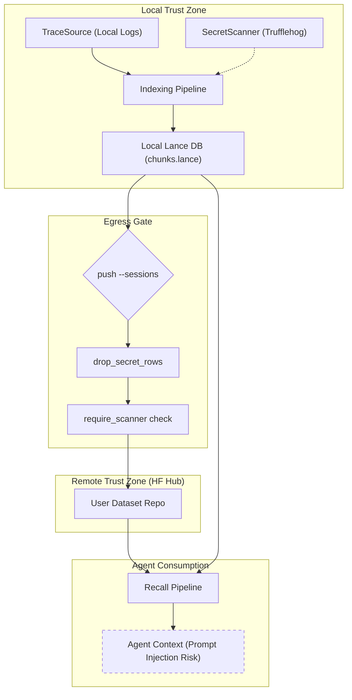
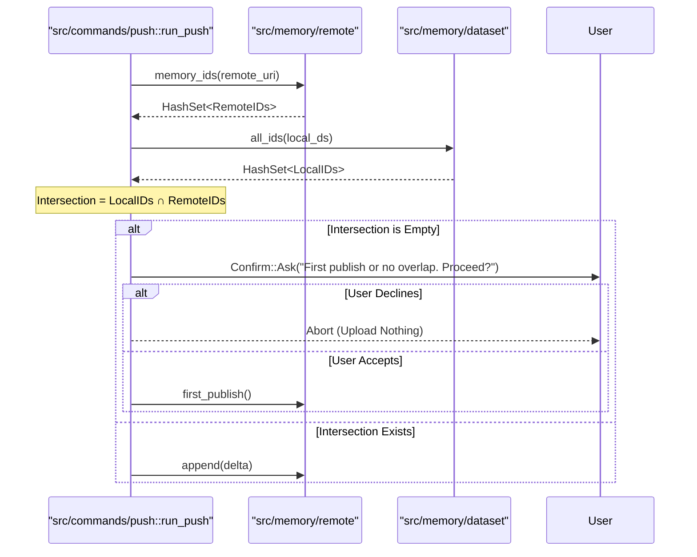

<!-- source: DeepWiki mcp.deepwiki.com · repo huggingface/funes · page 6.2 Trust Model and Prompt Injection Risks · fetched 2026-10-26 -->

# Trust Model and Prompt Injection Risks

Relevant source files

The following files were used as context for generating this wiki page:

- [SECURITY.md](SECURITY.md)
- [docs/RATIONALE.md](docs/RATIONALE.md)
- [docs/demo/cross-agents.tape](docs/demo/cross-agents.tape)
- [docs/hub-caching.md](docs/hub-caching.md)
- [docs/landscape.md](docs/landscape.md)
- [src/commands/push.rs](src/commands/push.rs)
- [tests/push_round_trip.rs](tests/push_round_trip.rs)

The `funes` trust model is designed around **local-first processing**, **user-owned storage**, and **deterministic ingest**. Security is enforced through multi-layer secret redaction and a "wrong-memory" guard that prevents accidental data leakage between distinct projects or identities.

## Security Trust Boundaries

`funes` operates across three primary trust boundaries: the local machine, the Hugging Face Hub (remote storage), and the Agent context (the reader).

1.  **Local-Only Processing**: By default, all indexing, embedding, and reranking occur on the user's machine [SECURITY.md:20-22](). The memory is stored as a local Lance dataset [SECURITY.md:21-22]().
2.  **User-Owned Remote Storage**: Remote synchronization is optional. When enabled, data is pushed to a Hugging Face dataset repository owned by the user and gated by their `HF_TOKEN` [SECURITY.md:23-24]().
3.  **The Reader Boundary**: Recalled passages are injected into the agent's context. The agent (or the user via `funes ask`) is the consumer of these passages and must be treated as the final arbiter of truth [docs/RATIONALE.md:78-82]().

### Trust Model Flow

The following diagram illustrates the data flow and the points where trust is evaluated.

**Trust and Data Flow Architecture**

Sources: [src/commands/push.rs:1-20](), [SECURITY.md:15-28](), [SECURITY.md:49-55]()

---

## Prompt Injection via Recalled Passages

Because `funes` recalls verbatim passages without LLM distillation [docs/RATIONALE.md:36-40](), it is susceptible to **indirect prompt injection**. If a memory contains malicious instructions (e.g., from a compromised session or a third-party memory), those instructions may be executed by the agent upon recall.

*   **Untrusted Memories**: A memory published by a third party is considered **untrusted input** [SECURITY.md:51-52]().
*   **Risk Mitigation**: Users are advised to bind only trusted memories as defaults. For one-off inspections of third-party data, the per-call `--memory` flag is preferred over permanent binding [SECURITY.md:53-55]().

---

## The Wrong-Memory Guard

The "wrong-memory" guard is a safety mechanism in `src/commands/push.rs` that prevents a user from accidentally pushing a local memory into the wrong remote repository (e.g., pushing personal work history into a corporate shared memory).

### Implementation: No-Overlap Confirmation
When performing a `push`, `funes` checks for an intersection between local chunk IDs and remote chunk IDs.

1.  **First Publish**: If the remote is empty or shares no common IDs with the local index, `funes` prompts the user for confirmation [tests/push_round_trip.rs:6-8]().
2.  **Append**: If the local and remote already share history (indicating they are the same logical memory), the push proceeds without prompting [tests/push_round_trip.rs:8-9]().
3.  **Fail-Closed**: If the user declines the confirmation, the process aborts and nothing is uploaded [tests/push_round_trip.rs:145-146]().

**Wrong-Memory Guard Logic**

Sources: [src/commands/push.rs:54-59](), [tests/push_round_trip.rs:144-157]()

---

## Secret Management and the Egress Gate

`funes` employs a multi-layer strategy to prevent secret leakage, centered around the `FUNES_TRUFFLEHOG` environment variable and the `require_scanner` check.

### 1. FUNES_TRUFFLEHOG Variable
This variable specifies the path to the `trufflehog` binary. If not set, `funes` attempts to find `trufflehog` on the system `PATH`.

### 2. Redaction vs. Filtering
*   **Index-Time Redaction**: `SecretScanner` attempts to redact secrets during the initial indexing of traces [SECURITY.md:32]().
*   **Push-Time Filtering**: The `drop_secret_rows` function in `src/commands/push.rs` acts as a final egress backstop. It reconstructs blocks from chunks to ensure secrets that were split across chunk boundaries are detected [src/commands/push.rs:5-7]().

### 3. require_scanner Check
The push pipeline is **fail-closed**. Before any data is transmitted to the Hub, `funes` verifies the presence of the scanner. If `trufflehog` is missing or fails to execute, the push is aborted [SECURITY.md:35-36]().

| Feature | Component | Role |
| :--- | :--- | :--- |
| **Scanner Path** | `FUNES_TRUFFLEHOG` | Env var locating the Trufflehog binary. |
| **Egress Filter** | `drop_secret_rows` | Removes rows containing secrets before they reach `remote::append`. |
| **Retroactive Clean** | `funes scrub` | Atomically overwrites local rows to remove secrets [SECURITY.md:37-38](). |
| **Validation** | `require_scanner` | Ensures the push cannot proceed without an active scanner. |

Sources: [src/commands/push.rs:1-17](), [SECURITY.md:30-39](), [tests/push_round_trip.rs:118-121]()

---

