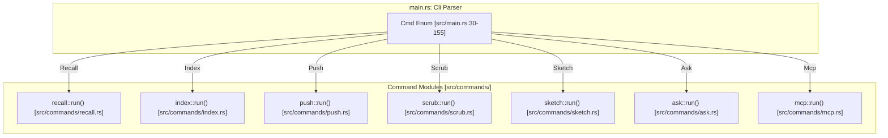
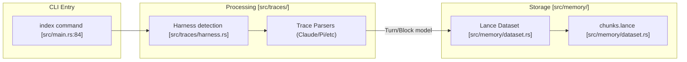

<!-- source: DeepWiki mcp.deepwiki.com · repo huggingface/funes · page 7 CLI Reference · fetched 2026-10-26 -->

# CLI Reference

Relevant source files

The following files were used as context for generating this wiki page:

- [src/commands.rs](src/commands.rs)
- [src/hub.rs](src/hub.rs)
- [src/lib.rs](src/lib.rs)
- [src/main.rs](src/main.rs)
- [src/ui.rs](src/ui.rs)
- [src/ui/render.rs](src/ui/render.rs)

The `funes` CLI is the primary interface for managing and querying AI agent memory. It follows a subcommand pattern where each command maps to a specific operation in the [Core Architecture](#2). The CLI is designed to be "local-first," with many commands supporting a `--memory` flag to target remote Hugging Face Hub datasets.

## Command Overview

The CLI commands are categorized into three functional groups:
1.  **Retrieval and Inspection**: Searching and reading session data (`recall`, `get`, `scan`, `sessions`, `sketch`).
2.  **Memory Management**: Building and synchronizing the index (`index`, `push`, `scrub`, `update`).
3.  **Integration and Utility**: Connecting to agents and status reporting (`mcp`, `ask`, `add`, `remove`, `status`).

### System-to-Code Mapping: CLI Dispatch
The following diagram illustrates how the `Cli` parser in `src/main.rs` dispatches to specific command implementations.

Sources: [src/main.rs:22-155](), [src/lib.rs:19-21](), [src/commands.rs:1-13]()

---

## Retrieval and Retrieval Commands

These commands are used by both human users and AI agents (via the MCP server) to find information within past sessions.

*   **`recall`**: The primary search command. It uses a hybrid pipeline (Vector ANN + BM25 FTS) followed by a cross-encoder reranker and recency decay to find relevant passages [src/main.rs:32-56]().
*   **`get`**: Reassembles and displays a specific range of turns from a session using the session's own sequence IDs [src/main.rs:58-68]().
*   **`scan`**: Performs a literal, unranked needle search across all blocks in a specific session [src/main.rs:105-126]().
*   **`sessions`**: Lists sessions stored in the memory, with support for filtering by repository, date ranges, and offsets [src/main.rs:128-145]().
*   **`sketch`**: Generates a "digest" of a session by selecting the most distinctive passages without requiring a search query [src/main.rs:147-155]().

The output of these commands for agents is "byte-stable," featuring a specific `→ get` line format that agents use to drill down into sessions [src/ui/render.rs:3-5]().

For detailed parameter references and output formats, see **[Recall and Retrieval Commands (#7.1)]**.

---

## Indexing and Memory Management

These commands handle the ingestion of raw traces into the Lance-based memory and the synchronization of that memory with the Hugging Face Hub.

*   **`index`**: Parses session transcripts from supported harnesses (Claude, Codex, Pi, Hermes) or explicit paths/parquets, chunks the text, and appends it to the local dataset [src/main.rs:84-103]().
*   **`push`**: Synchronizes the local memory to a remote Hugging Face dataset repo. It includes a "secret gate" that uses Trufflehog to prevent leaking sensitive information [src/main.rs:157-175]().
*   **`scrub`**: retroactively removes sensitive data from the local memory based on secret scanning results [src/commands/scrub.rs]().
*   **`update`**: Handles self-updating of the `funes` binary [src/commands/update.rs]().
*   **`ask`**: A utility command that allows asking a question to a "borrowed" agent (like Claude) grounded in a specific memory without requiring a full local installation [src/main.rs:69-82]().

### Data Flow: Ingestion to Storage
The diagram below maps the CLI `index` command to the underlying storage and processing entities.

Sources: [src/lib.rs:10-18](), [src/main.rs:84-103](), [src/traces/harness.rs]()

For detailed coverage of budgeted indexing, the `Confirm` enum, and push mechanics, see **[Indexing and Memory Management Commands (#7.2)]**.

---

## Integration and Global Options

*   **`mcp`**: Starts the Model Context Protocol (MCP) server, allowing agents to call `recall`, `get`, and other tools via JSON-RPC over stdio [src/commands/mcp.rs]().
*   **`add` / `remove`**: Manage the registration of `funes` hooks and plugins within specific agent environments (e.g., adding the `funes` plugin to Claude Code) [src/main.rs:188-212]().
*   **`status`**: Displays the current state of the local memory, including the number of sessions, disk usage, and synchronization status with the Hub [src/main.rs:214-221]().

### Common Memory Options
Most read and sync commands share a set of `MemoryOpts` [src/main.rs:55, 67, 125]():
*   `--memory <SPEC>`: Specifies a local path or a remote Hugging Face shorthand (`org/repo`) to target.
*   `--prefix <PATH>`: Restricts the operation to a specific sub-path within a remote memory [src/hub.rs:17-26]().

Sources: [src/main.rs:22-221](), [src/hub.rs:10-26](), [src/ui/render.rs:19-23]()

---

