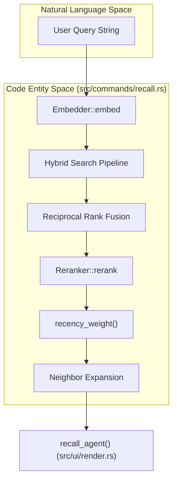
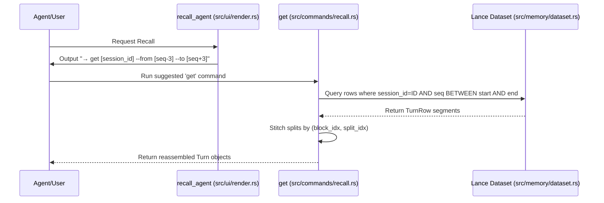

<!-- source: DeepWiki mcp.deepwiki.com · repo huggingface/funes · page 7.1 Recall and Retrieval Commands · fetched 2026-10-26 -->

# Recall and Retrieval Commands

Relevant source files

The following files were used as context for generating this wiki page:

- [CONTRIBUTING.md](CONTRIBUTING.md)
- [docs/README.md](docs/README.md)
- [docs/ask.md](docs/ask.md)
- [docs/recall.md](docs/recall.md)
- [docs/sessions.md](docs/sessions.md)
- [src/commands.rs](src/commands.rs)
- [src/commands/recall.rs](src/commands/recall.rs)
- [src/ui.rs](src/ui.rs)
- [src/ui/render.rs](src/ui/render.rs)

This page details the implementation and interface of the `funes` read surface. Retrieval in `funes` is designed to be deterministic and pull-based, allowing agents and users to navigate historical session data through a hybrid search pipeline and precise session-drilling tools.

## Hybrid Recall Pipeline

The `recall` command is the primary entry point for semantic and keyword-based retrieval. It implements a multi-stage pipeline to transform a natural language query into a ranked list of relevant passages.

### Implementation Flow

1.  **Hybrid Search**: Executes a parallel search using Vector ANN (Approximate Nearest Neighbor) for semantic relevance and BM25 FTS (Full-Text Search) for keyword matching [src/commands/recall.rs:1-15]().
2.  **RRF Fusion**: Combines the results from both search methods using Reciprocal Rank Fusion (RRF) to produce a unified candidate pool [src/commands/recall.rs:12-13]().
3.  **Cross-Encoder Reranking**: Re-evaluates the top candidates (default 30) using a cross-encoder model to refine the ranking based on deep query-passage interaction [src/commands/recall.rs:44-45]().
4.  **Recency Reweighting**: Applies a time-based decay function ($0.5^{\text{age}/\text{half\_life}}$) to prioritize more recent sessions [src/commands/recall.rs:189-190]().
5.  **Neighbor Expansion**: Pulls in adjacent chunks (by `seq` order) for each hit to provide immediate context without requiring a separate `get` call [src/commands/recall.rs:40-59]().

### Recall Logic Diagram

Sources: [src/commands/recall.rs:1-60](), [src/ui/render.rs:24-42](), [docs/recall.md:12-14]()

### Parameters and Flags

| Flag | Default | Code Reference | Description |
| :--- | :--- | :--- | :--- |
| `-k` | 8 | `recall.rs` | Number of final hits returned to the user. |
| `--candidates` | 30 | `recall.rs` | Size of the pool passed to the cross-encoder reranker. |
| `--half-life` | 30 | `recency_weight` | Decay in days; `0` disables recency bias. |
| `--neighbors` | 1 | `Neighbor` struct | Adjacent chunks to attach to each hit. |
| `--memory` | `local` | `Memory` trait | The memory label (local path or `hf://` URI). |

Sources: [docs/recall.md:41-52](), [src/commands/recall.rs:189-190]()

---

## Session Retrieval (`get`)

The `get` command is the "drill-down" tool. While `recall` returns individual chunks, `get` reassembles turns from the underlying Lance storage, stitching split chunks back into their original block format.

### Reassembly Mechanics
The `get_turns` function queries the dataset for a specific `session_id` and a range of sequence numbers (`seq`). It uses the `TurnRow` type to fetch `(seq, turn_uuid, ts, role, block_idx, split_idx, text)` [src/commands/recall.rs:37-38](). The `Turn` struct then holds the reassembled blocks [src/commands/recall.rs:144-150]().

### Data Flow: Hit to Get

Sources: [src/ui/render.rs:11-17](), [src/commands/recall.rs:143-150](), [docs/recall.md:60-71]()

---

## Session Browsing and Inspection

### `sessions` (Listing)
Lists sessions stored in a memory, ordered by start time. It provides high-level provenance including the `harness`, `workdir`, and the `first_prompt` (the session's purpose) [src/commands/recall.rs:108-122]().
*   **Filters**: `--repo`, `--since`, `--until`.
*   **Pagination**: `--limit` (default 50, max 200) and `--offset` [src/commands/recall.rs:137-141]().

### `scan` (Literal Search)
Performs a literal needle search within a single session. Unlike `recall`, it is not semantic; it is used to find exact strings across stitched blocks [src/commands/recall.rs:77-88]().
*   **ScanCut**: If a session is "crowded" (too many hits in one turn) or exceeds the `SCAN_HIT_CAP` (200), it returns a `ScanCut` to allow the user to resume the scan from a specific `seq` [src/commands/recall.rs:61-74]().

### `sketch` (Geometric Digest)
Generates a deterministic digest of a session by selecting the most "distinctive" passages using vector transitions.
*   **Determinism**: Whole-session sketches are cached [docs/sessions.md:72-73]().
*   **Evidence**: Always includes the opening prompt and the final turn [docs/sessions.md:42-45]().

Sources: [src/commands/recall.rs:61-122](), [docs/sessions.md:1-101](), [src/ui/render.rs:47-86]()

---

## Output Formats and Agent Contract

All read commands produce the **Agent Format** via `src/ui/render.rs`. This format is byte-stable and serves as a published contract for agents to parse [src/ui/render.rs:1-5]().

### The `→ get` Line Format
Every hit in `recall`, `scan`, or `sketch` includes a "ready-to-run" drill-down line:
`→ get <session_id> --from <seq> --to <seq> --memory <label>`

The `hint_range` function calculates the `--from` and `--to` values by applying a `HINT_WINDOW` of 3 turns around the target `seq` [src/ui/render.rs:11-17]().

### Rendering Components
| Function | Output Content |
| :--- | :--- |
| `recall_agent` | Provenance header, score, `→ get` line, full chunk text, neighbor snippets [src/ui/render.rs:24-42](). |
| `scan_agent` | Needle match count, `→ get` line per match, text excerpt with context [src/ui/render.rs:47-86](). |
| `sketch_agent` | Digest metadata, evidence blocks with `role` and `block_type`, `→ get` lines [src/ui/render.rs:91-135](). |

Sources: [src/ui/render.rs:1-135](), [docs/recall.md:23-38]()

---

