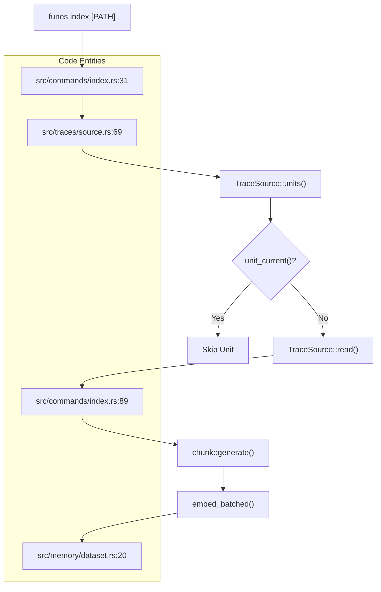
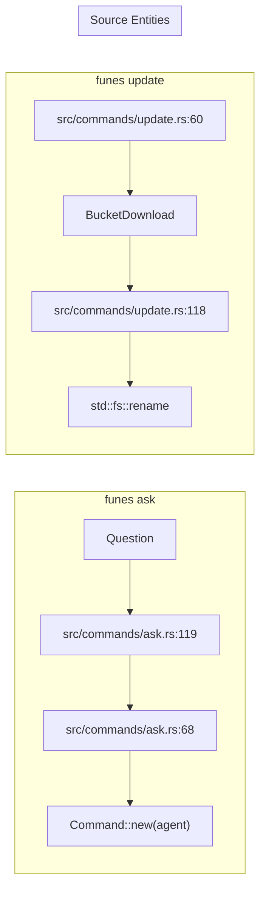

<!-- source: DeepWiki mcp.deepwiki.com · repo huggingface/funes · page 7.2 Indexing and Memory Management Commands · fetched 2026-10-26 -->

# Indexing and Memory Management Commands

Relevant source files

The following files were used as context for generating this wiki page:

- [src/commands/ask.rs](src/commands/ask.rs)
- [src/commands/index.rs](src/commands/index.rs)
- [src/commands/push.rs](src/commands/push.rs)
- [src/commands/update.rs](src/commands/update.rs)
- [src/memory/dataset.rs](src/memory/dataset.rs)
- [src/traces/parquet.rs](src/traces/parquet.rs)
- [src/traces/source.rs](src/traces/source.rs)
- [tests/push_round_trip.rs](tests/push_round_trip.rs)

This section provides a technical reference for the commands and internal subsystems responsible for the lifecycle of funes memory: ingestion (`index`), synchronization (`push`), maintenance (`scrub`, `update`), and transient grounding (`ask`).

## 1. The Indexing Pipeline (`index`)

The `index` command transforms raw agent transcripts into a searchable Lance dataset. It follows a pull-based, incremental model that drives a generic loop across various transcript formats.

### Implementation and Data Flow
The pipeline is orchestrated in `src/commands/index.rs`. It operates by opening a `TraceSource` [src/traces/source.rs:39-63](), which enumerates discrete "units" (files or database entries).

1.  **Lock Acquisition**: The process begins by attempting to acquire a `MemoryLock` [src/commands/index.rs:31-48]().
2.  **State Comparison**: For each `Unit`, the indexer compares its current signature (usually `size:mtime`) against `state.json` [src/commands/index.rs:143-155]().
3.  **Deduplication**: Even if a unit is re-read (e.g., a growing session), only chunk IDs not already present in the Lance dataset are processed [src/commands/index.rs:54-68]().
4.  **Transformation**:
    *   **Elision**: Inline base64 data URIs are stripped to prevent entropy-based false positives in secret scanning [src/commands/index.rs:74-80]().
    *   **Redaction**: If a `SecretScanner` (Trufflehog) is available, it redacts secrets before chunking to ensure long keys aren't split across chunks [src/commands/index.rs:89-126]().
    *   **Embedding**: Text is converted to vectors using the `BAAI/bge-small-en-v1.5` model [src/memory/dataset.rs:32-33]().
5.  **Commit**: New chunks are appended to the local Lance dataset.

### Trace Sources and Parsers
The `TraceSource` trait abstracts different storage layouts:
*   **JsonlTree**: Standard directory of `.jsonl` files (Claude, Codex, Pi) [src/traces/source.rs:142-155]().
*   **HermesDb**: SQLite-based state storage [src/traces/source.rs:85-89]().
*   **ParquetDataset**: Bulk import from HF auto-converted datasets [src/traces/parquet.rs:1-11]().

### Budgeted Indexing
The `--limit` flag in the `index` command bounds the number of sessions processed, allowing for "budgeted" indexing during benchmarks or initial setup [src/traces/source.rs:67-69]().

**Natural Language to Code Entity Mapping: Indexing Flow**

Sources: [src/commands/index.rs:1-158](), [src/traces/source.rs:1-170](), [src/memory/dataset.rs:1-176]()

---

## 2. Remote Synchronization (`push`)

The `push` command publishes local memory to the Hugging Face Hub. It is designed to be streamed and atomic, never requiring a full mirror of the remote dataset.

### Push Logic and Retries
`push` calculates the delta as `local_ids − remote_ids` [src/commands/push.rs:3-4](). 

*   **First Publish**: If the remote is empty, funes builds the full dataset (data + FTS/IVF indexes) and uploads it in a single commit [src/commands/push.rs:9-10]().
*   **Append**: New fragments are landed via `remote::append` using a parent-commit-guarded write. If a concurrent push occurs, the operation is retried up to `MAX_COMMIT_RETRIES` (10) [src/commands/push.rs:11-13, 50]().
*   **Reindex**: When unindexed rows exceed `REINDEX_THRESHOLD` (500), a separate reindexing commit is triggered [src/commands/push.rs:14-17, 46]().

### The Confirmation Gate (`Confirm` Enum)
To prevent accidental pushes to the wrong remote (e.g., pushing a private project to a public global memory), `push` uses a "no-overlap" gate. If the local memory and remote memory share zero common chunk IDs, the user is prompted [tests/push_round_trip.rs:6-9, 144-146]().

### Data Integrity and Receipts
Local receipts of pushed IDs are stored in `$FUNES_HOME/pushed/` to avoid redundant remote scans [src/commands/push.rs:88-92]().

Sources: [src/commands/push.rs:1-156](), [tests/push_round_trip.rs:1-157]()

---

## 3. Maintenance and Grounding

### Scrub
The `scrub` command provides retroactive cleaning of the local memory. While `index` redacts at ingestion, `scrub` is used to remove rows that were already indexed but later found to contain secrets. It performs an in-place atomic overwrite of the Lance dataset.

### Update
The `update` command replaces the running `funes` binary.
*   **Discovery**: It fetches the `VERSION` marker from the `huggingface/funes` bucket [src/commands/update.rs:22-24, 60]().
*   **Verification**: It downloads the asset matching the host's target triple, verifies the SHA256 checksum, and ensures the new binary reports the correct version [src/commands/update.rs:37-45, 118-130]().
*   **Atomic Swap**: It uses a same-filesystem rename to replace the binary, ensuring the live process continues running until restart [src/commands/update.rs:138-146]().

### Ask (Grounding Without Installation)
The `ask` command allows users to query a memory via an AI agent (Claude or Codex) without installing funes as an MCP tool.

1.  **In-Process Recall**: It runs the hybrid recall pipeline locally to gather passages [src/commands/ask.rs:119-130]().
2.  **Prompt Injection**: It constructs a `grounded_prompt` where the recalled passages are baked into the context [src/commands/ask.rs:68-79]().
3.  **Streaming**: It executes the agent CLI with flags to stream JSONL events, which are used to animate the UI banner [src/commands/ask.rs:8-9, 31-63]().

**Natural Language to Code Entity Mapping: Ask & Update**

Sources: [src/commands/ask.rs:1-172](), [src/commands/update.rs:1-149]()

---

