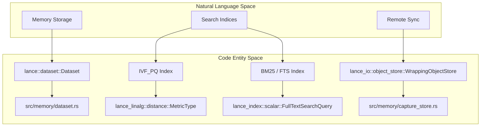
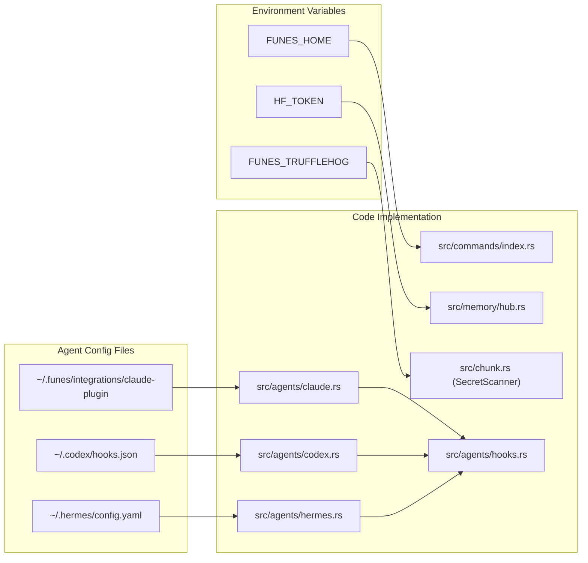

<!-- source: DeepWiki mcp.deepwiki.com · repo huggingface/funes · page 8 Storage and Configuration Reference · fetched 2026-10-26 -->

# Storage and Configuration Reference

Relevant source files

The following files were used as context for generating this wiki page:

- [Cargo.lock](Cargo.lock)
- [Cargo.toml](Cargo.toml)
- [build.rs](build.rs)
- [docs/configuration.md](docs/configuration.md)
- [docs/storage.md](docs/storage.md)

This page provides a technical reference for how `funes` manages data on disk, handles environment configuration, and structures its underlying storage schema. `funes` is designed as a local-first, append-only system that utilizes the Lance columnar format for efficient vector and full-text search.

## The Funes Home Directory

The primary state for `funes` is stored in a directory controlled by the `FUNES_HOME` environment variable. By default, this is located at `~/.funes` [docs/configuration.md:9-9](). This directory contains the local memory, incremental indexing state, and metadata about synchronization with remote repositories.

### Directory Layout

| Path below `$FUNES_HOME` | Purpose |
| --- | --- |
| `memory/chunks.lance/` | The core Lance dataset containing passages, embeddings, and search indices [docs/configuration.md:21-21](). |
| `state.json` | Tracks the high-water mark for incremental indexing per source [docs/configuration.md:22-22](). |
| `index-coverage.json` | A snapshot of indexed data used to populate `funes status` [docs/configuration.md:23-23](). |
| `pushed/` | Contains receipts for successful pushes to Hugging Face Hub [docs/configuration.md:24-24](). |
| `integrations/` | Shared integration assets (e.g., `claude-plugin`, `pi` bridge) [docs/configuration.md:39-42](). |

For a deep dive into the physical file structure and the reaping of old versions, see [Lance Dataset Schema and Layout](#8.1).

---

## Environment Variables

`funes` uses environment variables for authentication, path overrides, and feature toggles.

### Core Configuration
- `FUNES_HOME`: Changes the state directory (default: `~/.funes`) [docs/configuration.md:75-75]().
- `FUNES_TRUFFLEHOG`: Path to the TruffleHog binary for secret scanning [docs/configuration.md:78-78]().
- `FUNES_MEMORY`: Per-run memory override (primarily for the `pi` extension) [docs/configuration.md:77-77]().

### Hugging Face Integration
Authentication follows a strict precedence: `HF_TOKEN` > `HUGGING_FACE_HUB_TOKEN` > `HUGGINGFACE_TOKEN` > `~/.cache/huggingface/token` [docs/configuration.md:52-55]().
- `HF_HOME`: Relocates the broader Hugging Face home, including model weights [docs/configuration.md:80-80]().
- `HF_HUB_CACHE`: Relocates the file-grained cache for remote `hf://` memories [docs/configuration.md:81-81]().

For a complete list of variables and their effects on agent hooks, see [Configuration and Environment Variables](#8.2).

---

## Storage Cost Model

A `funes` memory is composed of four main parts within the Lance dataset: `data/` (rows), `_indices/` (search structures), `_versions/` (manifests), and `_transactions/` [docs/storage.md:33-38]().

### Per-Chunk Breakdown
Based on a planning budget at six-figure scale, each chunk consumes approximately **2.30 KB** [docs/storage.md:88-92]().

| Component | Size per Chunk | Details |
| --- | --- | --- |
| **Vector Embedding** | 1,536 B | Fixed floor for 384-dimension float32 vectors [docs/storage.md:59-59](). |
| **Text & Metadata** | ~500-600 B | Bounded by ~1,200 character split logic [docs/storage.md:61-63](). |
| **BM25 Index** | ~146 B | Sublinear growth following Heaps' Law [docs/storage.md:73-78](). |
| **Vector Index** | ~31 B | IVF_PQ codes and codebook overhead [docs/storage.md:74-81](). |

### Growth Projections
At a heavy development rate (~2,700 chunks/day), a memory grows by roughly **6.2 MB/day** [docs/storage.md:108-111](). 1 million chunks (approx. 2.3 GB) represents roughly one year of sustained heavy use.

Sources: [docs/storage.md:49-111]()

---

## Data Entity Mapping

The following diagrams bridge the gap between high-level storage concepts and the specific Rust entities and file paths that implement them.

### Storage Subsystem Architecture
This diagram maps storage concepts to the `lance` and `object_store` abstractions used in the codebase.

Sources: [Cargo.toml:18-23](), [src/memory/dataset.rs](), [src/memory/capture_store.rs]()

### Configuration and Integration Mapping
This diagram shows how environment variables and agent configurations relate to the underlying hook infrastructure.

Sources: [docs/configuration.md:37-42](), [docs/configuration.md:73-81](), [src/agents/hooks.rs]()

---

## Detailed References

For specific implementation details, refer to the following child pages:

- **[Lance Dataset Schema and Layout](#8.1)**: Details on the Arrow schema, `chunks.lance` physical layout, and the lifecycle of version reaping.
- **[Configuration and Environment Variables](#8.2)**: Comprehensive list of all variables, per-agent config paths, and the model weight caching strategy.

---

