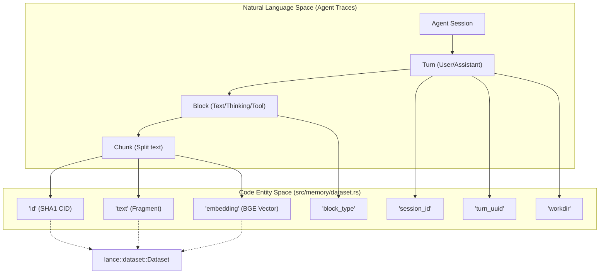
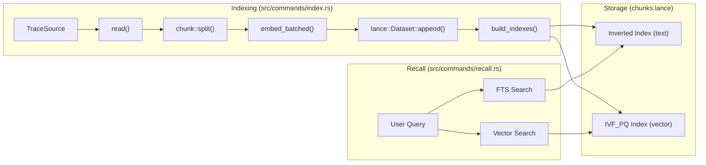

<!-- source: DeepWiki mcp.deepwiki.com · repo huggingface/funes · page 8.1 Lance Dataset Schema and Layout · fetched 2026-10-26 -->

# Lance Dataset Schema and Layout

Relevant source files

The following files were used as context for generating this wiki page:

- [docs/configuration.md](docs/configuration.md)
- [docs/storage.md](docs/storage.md)
- [src/commands/index.rs](src/commands/index.rs)
- [src/commands/update.rs](src/commands/update.rs)
- [src/memory/dataset.rs](src/memory/dataset.rs)
- [src/traces/parquet.rs](src/traces/parquet.rs)
- [src/traces/source.rs](src/traces/source.rs)

This page details the physical and logical structure of the `funes` memory storage layer. `funes` uses **Lance**, a modern columnar data format optimized for high-performance vector search and random access, to store agent transcripts, embeddings, and provenance metadata.

## Physical Layout

The local memory is stored within the `funes` home directory (defaulting to `~/.funes/memory/`) as a single Lance dataset named `chunks.lance` [src/memory/dataset.rs:3-5](). The directory structure follows the standard Lance specification:

| Directory | Content Description | Growth Characteristic |
| :--- | :--- | :--- |
| `data/` | Contains the actual row data: text fragments, provenance metadata, and the raw `float32` embedding vectors [docs/storage.md:35](). | Linear with chunk count and content size. |
| `_indices/` | Holds the specialized search indices: the BM25 inverted index for full-text search and the IVF_PQ index for vector similarity [docs/storage.md:36](). | Sublinear as vocabulary and vector space saturate. |
| `_versions/` | Stores manifests for every committed version of the dataset. Each `funes index` or `funes push` creates a new version [docs/storage.md:37](). | Grows with the number of commits. |
| `_transactions/` | Records of atomic transactions to ensure dataset integrity during concurrent operations [docs/storage.md:38](). | Negligible overhead. |

### Data Storage Cost Model
The embedding vector represents the "storage floor" for every chunk. `funes` uses `BAAI/bge-small-en-v1.5` which produces vectors of dimension 384 [src/memory/dataset.rs:32-33](). At 4 bytes per `float32`, each chunk incurs a fixed **1,536 bytes** of vector data, totaling approximately **2.30 KB/chunk** when including text and indices [docs/storage.md:59-65]().

## Arrow Schema

The `chunks.lance` table uses a fixed Arrow schema. Column order is load-bearing for Lance performance and compatibility [src/memory/dataset.rs:168-169]().

| Column | Type | Purpose |
| :--- | :--- | :--- |
| `id` | `Utf8` | Deterministic SHA1 hash of the chunk content for global deduplication [src/commands/index.rs:50-53](). |
| `text` | `Utf8` | The actual text fragment of the agent transcript. |
| `embedding` | `FixedSizeList<F32, 384>` | The 384-dimensional vector produced by the `Embedder` [src/memory/dataset.rs:33](). |
| `session_id` | `Utf8` | UUID or identifier of the agent session the chunk belongs to. |
| `turn_uuid` | `Utf8` | Identifier for the specific turn within the session. |
| `block_idx` | `Int64` | The index of the block within the turn. |
| `split_idx` | `Int64` | If a block was split into multiple chunks, its sequence number. |
| `seq` | `Int64` | Monotonic sequence number for the turn in the session. |
| `ts` | `Utf8` | ISO8601 timestamp of the turn. |
| `harness` | `Utf8` | The agent harness that produced the trace (e.g., `claude`, `pi`, `hermes`) [src/traces/parquet.rs:145](). |
| `workdir` | `Utf8` | The working directory where the agent was operating [src/traces/parquet.rs:148-151](). |
| `repo` | `Utf8` | The repository name associated with the session. |
| `block_type` | `Utf8` | Type of block (e.g., `text`, `thinking`, `tool_use`, `tool_output`). |

### Schema to Code Mapping
The following diagram bridges the conceptual "Natural Language Space" of agent traces to the physical "Code Entity Space" of the Lance schema.

**Diagram: Trace to Schema Mapping**

Sources: [src/memory/dataset.rs:168-176](), [src/commands/index.rs:50-53](), [src/traces/parquet.rs:1-11]().

## Indexing Implementation

`funes` implements hybrid search by maintaining two distinct index types on the `chunks` table [src/memory/dataset.rs:119-125]().

### 1. Full-Text Search (FTS/BM25)
An `InvertedIndex` is built on the `text` column. This enables literal keyword matching and BM25 ranking, which is fused with vector results during recall [src/memory/dataset.rs:127-135]().

### 2. Vector Index (IVF_PQ)
For semantic search, `funes` constructs an **IVF_PQ** (Inverted File Index with Product Quantization) index on the `vector` column [src/memory/dataset.rs:136-141]().
- **Metric**: L2 distance [src/memory/dataset.rs:162]().
- **Product Quantization (PQ)**: Vectors are compressed into 8-bit codes. The number of sub-vectors is dynamically calculated based on the dimension (typically `384 / 16 = 24` sub-vectors) [src/memory/dataset.rs:152-159]().
- **Training**: Lance requires a minimum of ~256 rows to train the IVF codebook. If the dataset is smaller, recall automatically falls back to brute-force exact search [src/memory/dataset.rs:119-120]().

**Diagram: Indexing and Search Pipeline**

Sources: [src/memory/dataset.rs:125-142](), [src/commands/index.rs:1-8](), [src/traces/source.rs:39-47]().

## Reaping and Lifecycle

Because Lance is an append-only format, re-indexing or scrubbing data creates new data fragments and manifest versions without immediately deleting the old ones.

### The Reaping Process
`funes` manages storage growth by "reaping" superseded generations:
1. **Version Control**: Every commit creates a new entry in `_versions/` [docs/storage.md:37]().
2. **Cleanup**: After a successful local re-index, `funes` identifies orphaned data fragments and old index generations that are no longer referenced by the latest manifest [docs/storage.md:117-119]().
3. **Grace Window**: A short grace period is maintained to ensure that concurrent read operations (e.g., a background `recall` or `mcp` server) are not interrupted by the deletion of data they are currently accessing [docs/storage.md:118-119]().

### Incremental State Tracking
To avoid redundant processing, `funes` maintains a `state.json` file in `$FUNES_HOME`. This file stores a `UnitState` for every indexed artifact [src/commands/index.rs:142-149]():
- **Signature (`sig`)**: A "size:mtime" stamp of the source file [src/traces/source.rs:132-137]().
- **Tier (`level`)**: The highest processing tier (L1/L2/L3) the unit has reached [src/commands/index.rs:148]().

If the signature matches and the stored tier meets the target, the unit is skipped during the next indexing sweep [src/commands/index.rs:151-155]().

Sources: [docs/storage.md:113-121](), [src/commands/index.rs:143-155](), [src/traces/source.rs:26-35]().

---

