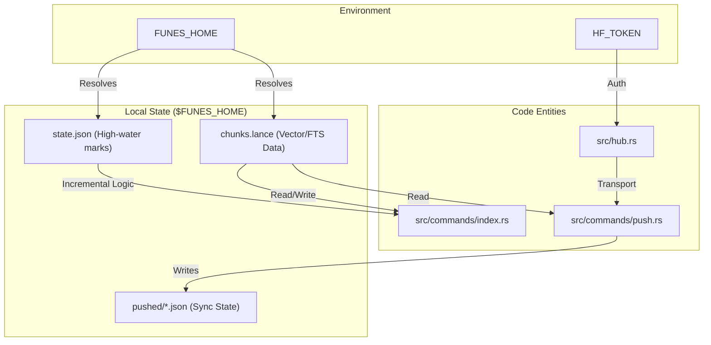
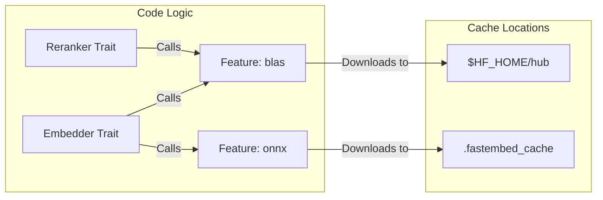

<!-- source: DeepWiki mcp.deepwiki.com · repo huggingface/funes · page 8.2 Configuration and Environment Variables · fetched 2026-10-26 -->

# Configuration and Environment Variables

Relevant source files

The following files were used as context for generating this wiki page:

- [docs/automation.md](docs/automation.md)
- [docs/configuration.md](docs/configuration.md)
- [docs/storage.md](docs/storage.md)

This page provides a technical reference for the configuration mechanisms, environment variables, and filesystem layout used by `funes`. The system follows a **local-first, deterministic** design where global configuration files are avoided in favor of explicit environment overrides and per-agent integration manifests.

## Environment Variables

`funes` utilizes environment variables to control storage locations, authentication, and security scanning behavior.

| Variable | Role | Implementation Detail |
| :--- | :--- | :--- |
| `FUNES_HOME` | Defines the state directory. Default: `~/.funes`. | Used in `Paths::home()` to resolve all local data [docs/configuration.md:7-10](). |
| `HF_TOKEN` | Primary Hugging Face authentication token. | Checked first in the auth precedence chain [docs/configuration.md:49-55](). |
| `FUNES_TRUFFLEHOG` | Path to the TruffleHog binary. | Required for `push` and `scrub` commands to perform secret redaction [docs/configuration.md:78-78](). |
| `HF_HUB_CACHE` | Relocates the Hub file-grained cache. | Affects `hf://` transport for remote memory [docs/configuration.md:81-81](). |
| `RUST_MIN_STACK` | Stack size for the Rust runtime. | Required (typically `8388608`) for deep recursion in some parsers during CI [docs/configuration.md:87](). |
| `FUNES_MEMORY` | Per-run memory override. | Primarily used by the `pi` extension bridge [docs/configuration.md:77-77](). |
| `NO_COLOR` | Disables ANSI terminal styling. | Applied to human-facing CLI output [docs/configuration.md:82-82](). |

### Authentication Precedence
For private memory access or `push` operations, `funes` resolves tokens in the following order:
1. `HF_TOKEN`
2. `HUGGING_FACE_HUB_TOKEN`
3. `HUGGINGFACE_TOKEN`
4. `~/.cache/huggingface/token` (via `hf auth login`)
[docs/configuration.md:49-55]()

**Sources:** [docs/configuration.md:7-17](), [docs/configuration.md:49-55](), [docs/configuration.md:73-84]()

---

## Local Filesystem Layout ($FUNES_HOME)

The `$FUNES_HOME` directory (default `~/.funes`) acts as the primary node for local state. It is designed to be reconstructible from original trace sources.

### Core State Files
- **`memory/chunks.lance/`**: The physical storage layer. Contains the `data/` fragments (Parquet-like), `_indices/` (IVF_PQ and FTS), and `_versions/` (manifests) [docs/storage.md:31-39]().
- **`state.json`**: Tracks the high-water mark for incremental indexing. It maps `TraceSource` identifiers to the last processed byte/line to avoid redundant work [docs/configuration.md:22-22]().
- **`index-coverage.json`**: A summary of the indexed corpus used by `funes status` to report memory health [docs/configuration.md:23-23]().
- **`pushed/`**: Contains "push receipts"—JSON files mapping a remote repository to the local version ID last successfully synchronized [docs/configuration.md:24-24]().

### Integration Assets
- **`integrations/claude-plugin/`**: Extracted source for the Claude Code plugin [docs/configuration.md:39-39]().
- **`integrations/pi/`**: The TypeScript bridge and MCP registration for the `pi` harness [docs/configuration.md:42-42]().

### Data Flow: State Resolution

**Sources:** [docs/configuration.md:19-25](), [docs/storage.md:31-39](), [docs/automation.md:48-56]()

---

## Per-Agent Configuration Paths

When `funes add <agent>` is executed, it modifies specific configuration files belonging to the target harness to inject hooks and MCP tools.

| Agent | Target Configuration File | Injection Method |
| :--- | :--- | :--- |
| **Claude Code** | `~/.funes/integrations/claude-plugin` | Registered via `claude plugin marketplace add` [docs/automation.md:48-52](). |
| **Codex** | `~/.codex/hooks.json` | Keyed append-or-replace in the hooks array [docs/automation.md:57-61](). |
| **Hermes** | `~/.hermes/config.yaml` | YAML merge for `post_llm_call` and `on_session_finalize` [docs/automation.md:66-72](). |
| **Pi** | `~/.funes/integrations/pi/` | Direct extension loading via `pi` lifecycle events [docs/automation.md:53-56](). |

### Security: Hook Allowlists
For Hermes, `funes` also modifies `~/.hermes/shell-hooks-allowlist.json` to pre-approve the `funes-index.sh` and `funes-push.sh` scripts, ensuring automation works without interactive prompts [docs/automation.md:70-72]().

**Sources:** [docs/automation.md:41-72](), [docs/configuration.md:32-46]()

---

## Model Weight Cache Locations

`funes` relies on two distinct cache locations for embedding and reranking models, depending on the compile-time feature flags.

### 1. Hugging Face Hub Cache
Used by the default BLAS/Accelerate backend.
- **Path**: `$HF_HOME/hub` (defaults to `~/.cache/huggingface/hub`).
- **Models**: `bge-small-en-v1.5` (Embedder) and `bge-reranker-base` (Reranker).
- **Relocation**: Controlled by `HF_HOME` or `HF_HUB_CACHE` [docs/configuration.md:62-69]().

### 2. Fastembed Cache
Used by the optional ONNX backend.
- **Path**: `.fastembed_cache` relative to the current working directory.
- **Behavior**: This is a library-specific default that can be overridden by library-level environment variables [docs/configuration.md:63-65]().

### Model Resolution Logic

**Sources:** [docs/configuration.md:60-70](), [docs/storage.md:59-65]()

---

## Storage Cost Model

The physical size of a memory is dominated by the embedding vectors. The following model is derived from production measurements:

- **Data Floor**: ~2.13 KB per chunk.
  - **Vector**: 1,536 bytes (Fixed `384` dimensions × 4-byte `float32`).
  - **Text/Metadata**: ~0.5–0.6 KB [docs/storage.md:53-65]().
- **Index Overhead**: ~0.18 KB per chunk (BM25 + IVF_PQ) [docs/storage.md:69-86]().
- **Growth Rate**: Approximately **6.2 MB per active development day** (~2,700 chunks/day) [docs/storage.md:108-111]().

**Sources:** [docs/storage.md:49-92](), [docs/storage.md:108-112]()

---

