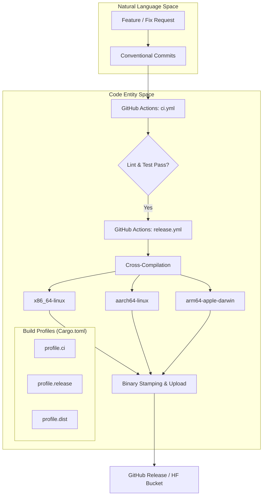
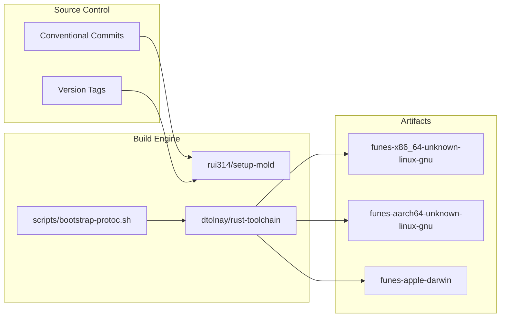

<!-- source: DeepWiki mcp.deepwiki.com · repo huggingface/funes · page 9 CI/CD, Build, and Release · fetched 2026-10-26 -->

# CI/CD, Build, and Release

Relevant source files

The following files were used as context for generating this wiki page:

- [.github/workflows/ci.yml](.github/workflows/ci.yml)
- [.github/workflows/release.yml](.github/workflows/release.yml)
- [Cargo.lock](Cargo.lock)
- [Cargo.toml](Cargo.toml)
- [build.rs](build.rs)

This page provides a high-level overview of the `funes` lifecycle, from continuous integration and cross-compilation to the automated release process and performance benchmarking. The system is designed for high-performance local inference while maintaining a strict glibc floor for broad Linux compatibility.

## System Overview: Build to Release

The `funes` build system bridges the gap between high-level AI agent integration and low-level hardware acceleration. It utilizes specialized Rust profiles to balance developer productivity with optimized distribution binaries.

### Pipeline Relationship Diagram

The following diagram illustrates how code moves from the repository through various validation stages into a release artifact.

"Build and Release Flow"

**Sources:** [.github/workflows/ci.yml:1-150](), [.github/workflows/release.yml:1-150](), [Cargo.toml:93-118]()

---

## Continuous Integration (CI)

The CI pipeline ensures code quality across multiple inference backends. It handles heavy dependencies like `lance` and `protobuf` while managing large model weights for integration testing.

- **Linting & Unit Tests**: Validates code formatting, Clippy warnings for both `blas` and `onnx` features, and runs hermetic unit tests.
- **Integration Testing**: Executes the full indexing and recall pipeline using real model weights. It requires `HF_FUNES_TEST_TOKEN` for Hub-related tests and utilizes a high `RUST_MIN_STACK` (16MB) to prevent stack overflows during complex async operations.
- **Model Caching**: Uses `actions/cache` to store ~1.2 GB of safetensors for the BLAS backend and ONNX models for the `fastembed` variant, significantly reducing runner execution time.

For details, see [Continuous Integration](#9.1).

**Sources:** [.github/workflows/ci.yml:28-77](), [.github/workflows/ci.yml:78-137](), [.github/workflows/ci.yml:141-182]()

---

## Build Profiles and Backends

`funes` uses distinct Cargo profiles and features to optimize the binary for different environments.

| Profile | Purpose | Characteristics |
|:---|:---|:---|
| `dev` | Local development | Debug info, incremental compilation enabled. |
| `ci` | GitHub Actions | Strips dependency debug info to save disk space; keeps line tables for backtraces. |
| `release` | Standard optimization | `opt-level = 3`, default for local builds. |
| `dist` | Distribution | Thin LTO for cross-crate dead-code elimination, stripped symbols. |

The inference backend is selected via features:
- **`blas` (Default)**: Uses `Accelerate` on macOS and `faer` on Linux for high-performance local tensor operations.
- **`onnx`**: Optional backend using `fastembed` and the ONNX Runtime.

For details on cross-compilation and the `dist` profile, see [Release Pipeline and Cross-Compilation](#9.2).

**Sources:** [Cargo.toml:58-67](), [Cargo.toml:93-118](), [build.rs:1-10]()

---

## Release Process

The release pipeline is triggered by `workflow_dispatch` or version tags. It automates versioning based on conventional commits and performs cross-compilation for three primary targets.

### Release Architecture

"Release Component Mapping"

Key release constraints:
- **glibc Floor**: Linux binaries are built in an `ubuntu:22.04` container to enforce a `glibc 2.35` floor, ensuring compatibility with older distributions like Ubuntu 22.04.
- **Linker**: Uses `mold` to handle the heavy linking requirements of the `lance` and `arrow` stacks within CI resource limits.

For details, see [Release Pipeline and Cross-Compilation](#9.2).

**Sources:** [.github/workflows/release.yml:49-99](), [.github/workflows/release.yml:100-165](), [Cargo.toml:11-22]()

---

## Benchmarks

`funes` includes a suite of benchmarks to validate performance across different hardware and backends. These are located in the `benchmark/` directory and run as Cargo examples.

- **`bench_recall`**: Measures latency for local vs. remote search and RRF fusion timing.
- **`bench_index`**: Evaluates indexing throughput and fragment compactness.
- **`bench_backends`**: Performs A/B testing between BLAS and ONNX backends for latency and cosine similarity agreement.

For details, see [Benchmarks](#9.3).

**Sources:** [Cargo.toml:68-82](), [benchmark/bench_recall.rs:1-10](), [benchmark/bench_backends.rs:1-10]()

---

