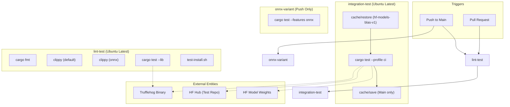
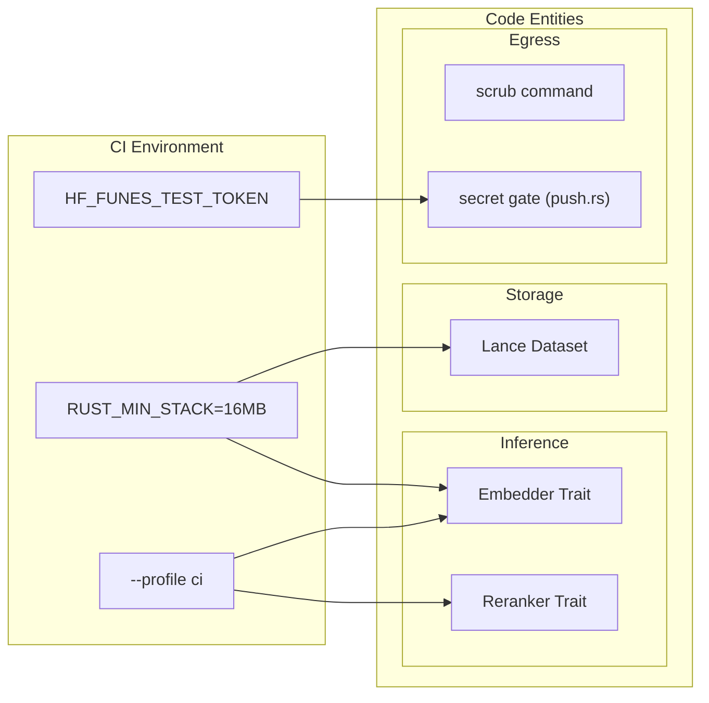

<!-- source: DeepWiki mcp.deepwiki.com · repo huggingface/funes · page 9.1 Continuous Integration · fetched 2026-10-26 -->

# Continuous Integration

Relevant source files

The following files were used as context for generating this wiki page:

- [.github/workflows/ci.yml](.github/workflows/ci.yml)
- [.github/workflows/release.yml](.github/workflows/release.yml)
- [scripts/install.sh](scripts/install.sh)
- [scripts/test-install.sh](scripts/test-install.sh)

The `funes` codebase utilizes GitHub Actions to ensure code quality, cross-platform compatibility, and functional correctness across its two primary inference backends (BLAS and ONNX). The CI pipeline is designed to handle heavy dependencies—such as the Lance columnar engine and large transformer model weights—within the constraints of standard runner environments.

## CI Workflow Overview

The primary CI entry point is defined in `.github/workflows/ci.yml`. It is triggered on every pull request to `main` and on every push to the `main` branch [[.github/workflows/ci.yml:3-14]](). To optimize runner usage, the workflow employs a concurrency policy that cancels superseded runs on pull requests [[.github/workflows/ci.yml:16-18]]().

### Job Hierarchy and Dependencies

The workflow is divided into three logical stages:
1.  **lint-test**: Fast validation of code style, linter rules, and hermetic unit tests.
2.  **integration-test**: Heavyweight tests using the default BLAS backend and real model weights.
3.  **onnx-variant**: Validation of the optional ONNX runtime backend (executed only on merges to `main`).

| Job | Purpose | Feature Set | Triggers |
| :--- | :--- | :--- | :--- |
| `lint-test` | Style, Clippy, Unit Tests | `default` + `onnx` | PR, Push |
| `integration-test` | End-to-end functionality | `default` (BLAS) | PR, Push |
| `onnx-variant` | ONNX Backend validation | `--no-default-features --features onnx` | Push (Main) |

Sources: [[.github/workflows/ci.yml:27-146]]()

---

## The lint-test Job

The `lint-test` job serves as the first line of defense. It ensures that the code is formatted correctly and that Clippy is satisfied for both backend configurations.

### Implementation Details
- **Toolchain**: Uses `dtolnay/rust-toolchain` pinned to version `1.95.0` with `rustfmt` and `clippy` components [[.github/workflows/ci.yml:35-37]]().
- **Multi-Backend Linting**: Since `funes` supports two distinct inference backends, Clippy is run twice:
    1.  Default (BLAS): `cargo clippy --all-targets --profile ci -- -D warnings` [[.github/workflows/ci.yml:58-59]]().
    2.  ONNX: `cargo clippy --all-targets --profile ci --no-default-features --features onnx -- -D warnings` [[.github/workflows/ci.yml:61-62]]().
- **Unit Testing**: Executes hermetic tests (`cargo test --lib`) that do not require network access or heavy model weights [[.github/workflows/ci.yml:72-73]]().
- **Installer Validation**: Runs `scripts/test-install.sh` to verify that the `install.sh` script correctly handles checksum verification and platform detection using a mocked environment [[.github/workflows/ci.yml:75-76]](), [[scripts/test-install.sh:1-61]]().

Sources: [[.github/workflows/ci.yml:28-77]](), [[scripts/test-install.sh:1-61]]()

---

## Integration Testing and Model Caching

The `integration-test` job performs functional testing using real model weights for the BGE-small-en-v1.5 embedder and BGE-reranker-base.

### RUST_MIN_STACK Requirement
The integration suite involves complex asynchronous operations, including simultaneous embedding, Lance dataset writes, and Hub uploads. To prevent stack overflows in the CI toolchain during these deep future chains, `RUST_MIN_STACK` is explicitly set to `16777216` (16 MB) [[.github/workflows/ci.yml:83-86]]().

### Model Caching Strategy
To avoid downloading ~1.2 GB of model weights on every run, the CI uses a persistent cache for Hugging Face Hub assets.

- **Cache Key**: `hf-models-blas-v1` [[.github/workflows/ci.yml:118]]().
- **Path**: `~/.cache/huggingface/hub/models--BAAI--bge-*` [[.github/workflows/ci.yml:116-117]]().
- **Save Policy**: To conserve the 10 GB GitHub repository limit, caches are only saved on pushes to `main`, while PRs are restricted to read-only restoration [[.github/workflows/ci.yml:130-136]]().

### Secret Management
Integration tests involving the Hugging Face Hub (such as `push` round-trips) require a valid token. The CI uses `HF_FUNES_TEST_TOKEN` stored in GitHub Secrets [[.github/workflows/ci.yml:125-126]](). If this secret is missing (e.g., in a fork), the relevant tests are designed to skip themselves gracefully [[.github/workflows/ci.yml:120-123]]().

Sources: [[.github/workflows/ci.yml:78-137]]()

---

## The ONNX Variant Job

The `onnx-variant` job validates the `fastembed` based inference path. This job is gated to run only on merges to `main` to save CI resources, as the `lint-test` job already covers the compilation and linting of this feature on PRs [[.github/workflows/ci.yml:138-143]]().

### Model Caching (Fastembed)
The ONNX backend uses `fastembed`, which maintains its own cache directory distinct from the standard HF Hub cache.
- **Cache Key**: `fastembed-models-v1` [[.github/workflows/ci.yml:172]]().
- **Path**: `.fastembed_cache` [[.github/workflows/ci.yml:171]]().

Sources: [[.github/workflows/ci.yml:141-172]]()

---

## Infrastructure and Build Tooling

### External Dependencies
Both `lint-test` and `integration-test` install essential system-level dependencies:
- **Mold Linker**: Used via `rui314/setup-mold` to keep the memory-intensive Lance linking process within runner limits [[.github/workflows/ci.yml:45-46]]().
- **Protoc**: The `protobuf-compiler` is required by `lance-encoding` during the build script execution [[.github/workflows/ci.yml:48-50]]().
- **Trufflehog**: Pinned to version `v3.95.5`, this is required for unit and integration tests of the secret redaction and egress filtering logic [[.github/workflows/ci.yml:65-68]]().

### CI Workflow Data Flow

The following diagram illustrates how code moves through the CI pipeline and how various caches are utilized.

**CI Pipeline Data Flow**

Sources: [[.github/workflows/ci.yml:1-172]]()

### Code-to-System Mapping

The following diagram maps CI environment configurations to the specific Rust entities and shell scripts they validate.

**System Entity Mapping**

Sources: [[.github/workflows/ci.yml:83-86]](), [[.github/workflows/ci.yml:125-126]](), [[.github/workflows/ci.yml:127]]()

---

