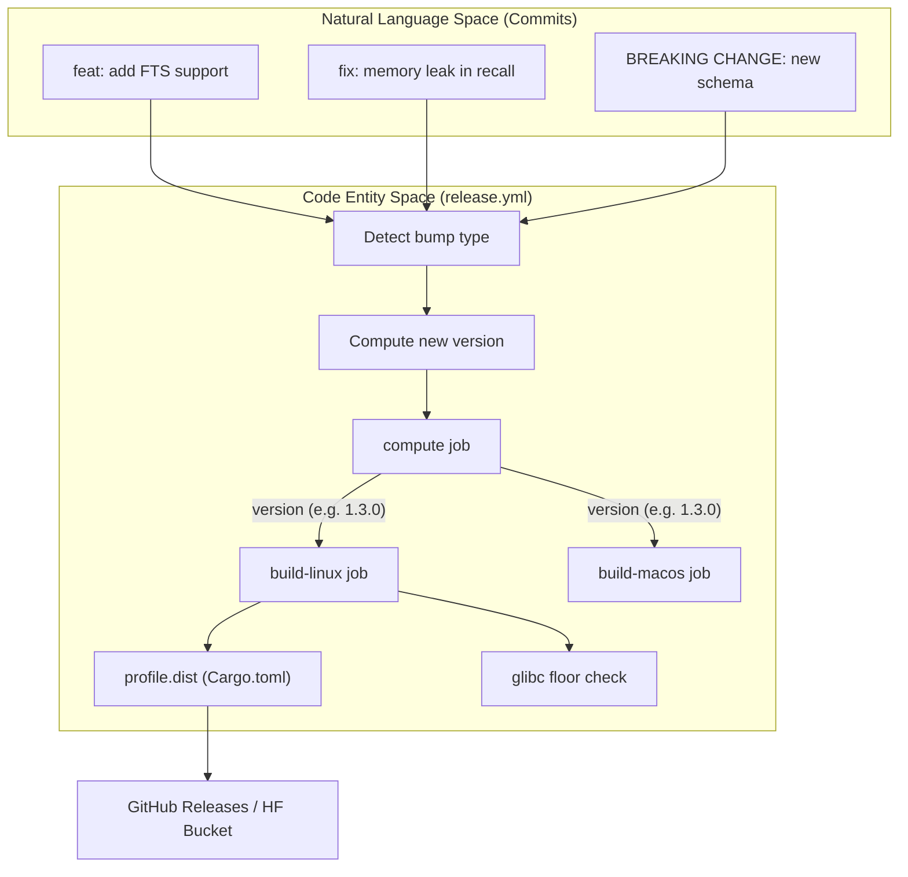
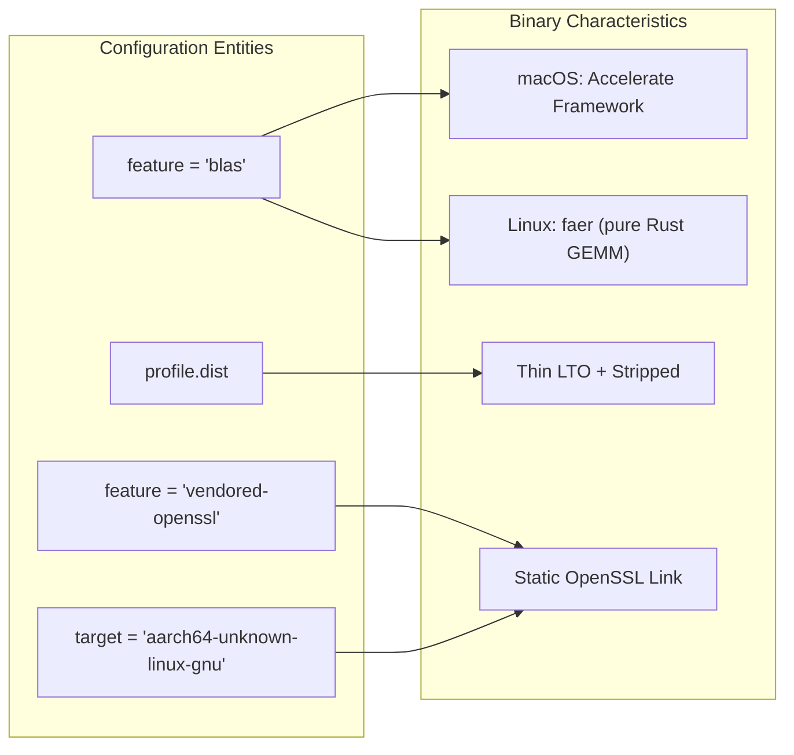

<!-- source: DeepWiki mcp.deepwiki.com · repo huggingface/funes · page 9.2 Release Pipeline and Cross-Compilation · fetched 2026-10-26 -->

# Release Pipeline and Cross-Compilation

Relevant source files

The following files were used as context for generating this wiki page:

- [.github/workflows/ci.yml](.github/workflows/ci.yml)
- [.github/workflows/release.yml](.github/workflows/release.yml)
- [Cargo.lock](Cargo.lock)
- [Cargo.toml](Cargo.toml)
- [build.rs](build.rs)

The `funes` release pipeline is designed to produce high-performance, portable binaries for multiple architectures while maintaining a strict compatibility floor for Linux environments. The pipeline automates versioning based on commit history, enforces binary optimization through specialized profiles, and manages distribution to both GitHub and Hugging Face.

## Release Pipeline Overview

The release process is governed by `.github/workflows/release.yml`, which splits the lifecycle into three distinct phases: version computation, cross-platform building, and artifact publication.

### Pipeline Data Flow

The following diagram illustrates the transition from commit messages in the "Natural Language Space" to the final distributed artifacts.

**Figure 1: Release Pipeline Data Flow**

**Sources:** [.github/workflows/release.yml:49-100](), [Cargo.toml:102-106]()

## Versioning Strategy

`funes` uses a semantic versioning scheme with a `+dev` suffix for development builds [Cargo.toml:3](). The release pipeline automatically determines the next version by analyzing the commit range since the last tag [.github/workflows/release.yml:61-75]():

| Commit Prefix | Bump Type |
| :--- | :--- |
| `feat(...):!` or `BREAKING CHANGE` | **Major** |
| `feat:` | **Minor** |
| `fix:` or `perf:` | **Patch** |

The `compute` job strips the `+dev` metadata, increments the version, and outputs a clean tag (e.g., `v1.3.0`) for use in the subsequent build steps [.github/workflows/release.yml:85-98]().

## Cross-Compilation and Target Environments

The pipeline targets three primary platforms. Linux builds are performed within a `ubuntu:22.04` container to ensure compatibility with older systems [.github/workflows/release.yml:108-112]().

### Build Targets
1.  **x86_64-unknown-linux-gnu**: Standard Linux x86_64.
2.  **aarch64-unknown-linux-gnu**: ARM64 Linux, cross-compiled using `vendored-openssl` to avoid target sysroot dependencies [.github/workflows/release.yml:126-129](), [Cargo.toml:44-46]().
3.  **aarch64-apple-darwin**: Apple Silicon (M1/M2/M3).

### glibc Floor Enforcement
To maintain a compatibility floor of **glibc 2.35** (Ubuntu 22.04), the pipeline includes a post-build check using `objdump`. It scans the binary for symbol versions and fails if it detects dependencies on `GLIBC_2.38` or higher [.github/workflows/release.yml:108-111](). This is particularly critical because the `onnx` backend (via `ort`) often binds to newer glibc versions, which is why the `blas` backend is the default for releases [.Cargo.toml:10-12]().

**Sources:** [.github/workflows/release.yml:101-130](), [Cargo.toml:58-66]()

## Build Optimization: The `dist` Profile

`funes` utilizes a specialized Cargo profile named `dist` for official releases. This profile is optimized for binary size and execution speed while respecting the resource limits of CI runners.

| Feature | Configuration | Purpose |
| :--- | :--- | :--- |
| **Optimization Level** | `opt-level = 3` | Maximum performance optimizations [Cargo.toml:94](). |
| **LTO** | `lto = "thin"` | Cross-crate dead-code elimination without the memory exhaustion of "fat" LTO [Cargo.toml:104](). |
| **Stripping** | `strip = "symbols"` | Removes symbol tables to reduce binary size for distribution [Cargo.toml:105](). |
| **Linker** | `mold` | High-speed linker used to keep the heavy `lance` and `arrow` link times within CI budgets [.github/workflows/release.yml:157-158](). |

**Sources:** [Cargo.toml:93-106](), [.github/workflows/release.yml:157-158]()

## Infrastructure and Tooling

The release pipeline relies on several specialized scripts and tools to manage the build environment:

*   **`bootstrap-protoc.sh`**: Installs a specific version of the Protocol Buffers compiler required by the `lance` storage engine, as the system-provided versions in Ubuntu 22.04 are often too old [.github/workflows/release.yml:160-164]().
*   **`build.rs`**: A custom build script that conditionally links the **Accelerate** framework when building the `blas` backend for macOS [build.rs:1-10]().
*   **`rust-cache`**: Utilizes a specific keying strategy (`release-ubuntu22.04-${{ matrix.target }}-${{ env.PROFILE }}`) to prevent cache contamination between different build profiles and glibc environments [.github/workflows/release.yml:147-153]().

### Build-to-Binary Association

The following diagram maps the build configuration entities to their resulting binary characteristics.

**Figure 2: Build Configuration to Binary Mapping**

**Sources:** [build.rs:5-9](), [Cargo.toml:52-63](), [Cargo.toml:102-106](), [.github/workflows/release.yml:128]()

## Distribution

Once builds are validated and glibc checks pass, the pipeline:
1.  Stamps the version into the `Cargo.toml`.
2.  Generates SHA256 checksums for all binaries [Cargo.toml:37]().
3.  Uploads the binaries to **GitHub Releases**.
4.  Pushes the optimized binaries to a dedicated **Hugging Face bucket** for use by the `funes update` command and the `install.sh` bootstrap script.

**Sources:** [.github/workflows/release.yml:1-30](), [Cargo.toml:37-38]()

---

