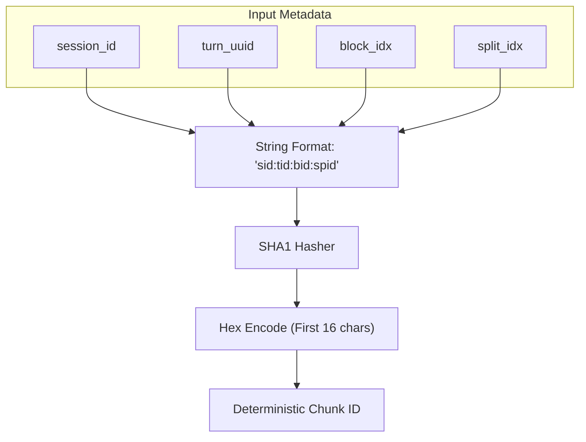
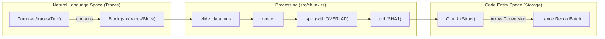

<!-- source: DeepWiki mcp.deepwiki.com · repo huggingface/funes · extra page Chunking and Text Segmentation · fetched 2026-10-26 -->

# Chunking and Text Segmentation

Relevant source files

The following files were used as context for generating this wiki page:

- [docs/index.md](docs/index.md)
- [src/chunk.rs](src/chunk.rs)

This page details the implementation of text segmentation and chunking within `funes`. The system transforms raw agent transcripts into a set of deterministic, version-stable chunks suitable for vector embedding and full-text search. The core logic resides in `src/chunk.rs`, which handles the rendering of message blocks, URI elision, overlap-based splitting, and stable ID generation.

## The Tier Model

To manage indexing performance and value density, `funes` categorizes every message block into one of three tiers. This allows the system to prioritize "high-signal" content (decisions and prose) over "high-volume" content (raw tool outputs).

| Tier | Block Types | Description |
| :--- | :--- | :--- |
| **L1: Text** | `text`, `thinking`, unknown | The core rationale and conversation. Highest value for recall. |
| **L2: ToolUse** | `tool_use` | Context for actions taken by the agent. |
| **L3: ToolResult** | `tool_result` | Often bulky (e.g., file reads, compiler output). Lowest value per byte. |

The `Tier` enum [src/chunk.rs:19-24]() defines these levels. The `of_block` function [src/chunk.rs:31-37]() maps block types to tiers, ensuring that any unrecognized block type defaults to `Tier::Text` to prevent data loss. During budgeted indexing, `funes` drains these tiers in order across all sessions [docs/index.md:92-95]().

Sources: [src/chunk.rs:16-47](), [docs/index.md:84-98]()

## Data URI Elision

Before a block is processed for secrets or segmented into chunks, it passes through `elide_data_uris` [src/chunk.rs:97-118](). This function identifies inline Base64-encoded `data:` URIs (such as pasted screenshots) and replaces their payload with the literal string `[elided]`.

This elision serves three purposes:
1. **Recall Quality**: Megabytes of Base64 noise provide no semantic value for embeddings.
2. **Performance**: Prevents the embedder and secret scanner from processing massive, irrelevant strings.
3. **Security**: Prevents false positives in secret detection, as random Base64 sequences often mimic high-entropy keys [src/chunk.rs:93-96]().

The implementation uses a `BASE64_MARKER` [src/chunk.rs:75]() and validates that the preceding text conforms to a data URI scheme via `is_data_uri_head` [src/chunk.rs:80-91]().

Sources: [src/chunk.rs:75-122](), [docs/index.md:100-102]()

## Segmentation Mechanics

The `split` function [src/chunk.rs:147-180]() is responsible for breaking a rendered block into manageable pieces for the embedding model.

### Split/Stitch and Overlap
*   **MAX_CHARS**: Set to 1200 characters [src/chunk.rs:11]().
*   **OVERLAP**: Set to 150 characters [src/chunk.rs:14]().
*   **Logic**: The splitter attempts to find a natural break point (newline `\n` or space ` `) within the `MAX_CHARS` limit [src/chunk.rs:162-168](). If no natural break is found within the second half of the window, it forces a hard break.
*   **Stitching**: Consecutive splits share the `OVERLAP` region. This allows the `recall::stitch` mechanism to reassemble blocks during retrieval by matching these shared leading/trailing segments [src/chunk.rs:12-14]().

### Rendering
Before splitting, blocks are transformed into a human-readable string via `render` [src/chunk.rs:124-136](). This adds structural markers like `[tool_use name]` or `[tool_result]` to the text, ensuring the embedding model captures the functional context of the block.

Sources: [src/chunk.rs:11-14](), [src/chunk.rs:124-180]()

## Deterministic CID Generation

A critical design goal of `funes` is that a completed turn must produce the exact same chunks regardless of when or where it is indexed [docs/index.md:73-76](). This is achieved through the `cid` (Chunk ID) function.

Sources: [src/chunk.rs:182-187](), [docs/index.md:71-76]()

The `cid` is a 16-character hex string derived from the SHA1 hash of the composite key: `session_id:turn_uuid:block_idx:split_idx` [src/chunk.rs:182-187](). This ensures that re-indexing the same session does not result in duplicate embeddings in the Lance dataset.

## Data Flow: From Turn to Chunk

The following diagram illustrates the transformation from a `Turn` (Code Entity) produced by a trace parser to the final `Chunk` stored in the database.

### The Parquet Compatibility Contract
When importing from Parquet files (the "Hugging Face agent-traces" layout), `funes` enforces a specific schema to maintain this deterministic pipeline. It requires a `session_id` and a `messages` list [docs/index.md:38-41](). Turn UUIDs are synthesized as `<session_id>-<sequence>` to maintain stability even when importing from external sources [docs/index.md:66-68]().

Sources: [src/chunk.rs:50-68](), [docs/index.md:33-70](), [src/traces/mod.rs:1-10]() (Note: Turn/Block structures are referenced via src/traces/mod.rs which was implied by context in src/chunk.rs).

## Secret Scanning and Reconstruction
For security, `funes` integrates with Trufflehog. Because secrets might be split across two chunks due to the `MAX_CHARS` limit, the system uses `reconstruct_blocks` (and related logic in the push pipeline) to ensure the scanner sees the full text of a block before it is allowed to be pushed to a remote repository [docs/index.md:100-101](). This "fail-closed" design ensures that even if a secret is fragmented during segmentation, it is caught before egress.

Sources: [docs/index.md:100-102](), [src/chunk.rs:189-190]()

---

