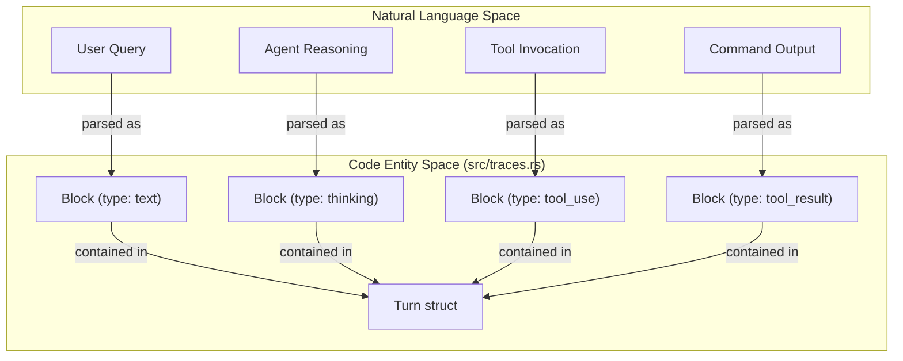

<!-- source: DeepWiki mcp.deepwiki.com · repo huggingface/funes · extra page Trace Parsers (Harness Support) · fetched 2026-10-26 -->

# Trace Parsers (Harness Support)

<details>
<summary>Relevant source files</summary>

The following files were used as context for generating this wiki page:

- [src/traces.rs](src/traces.rs)
- [src/traces/claude.rs](src/traces/claude.rs)
- [src/traces/codex.rs](src/traces/codex.rs)
- [src/traces/harness.rs](src/traces/harness.rs)
- [src/traces/hermes.rs](src/traces/hermes.rs)
- [src/traces/jsonl.rs](src/traces/jsonl.rs)
- [src/traces/pi.rs](src/traces/pi.rs)
- [tests/fixtures/claude_session.jsonl](tests/fixtures/claude_session.jsonl)
- [tests/fixtures/codex_session.jsonl](tests/fixtures/codex_session.jsonl)
- [tests/fixtures/pi_session.jsonl](tests/fixtures/pi_session.jsonl)
- [tests/parse_real_sessions.rs](tests/parse_real_sessions.rs)

</details>


The `funes` indexing pipeline relies on a suite of specialized parsers to transform raw agent transcripts into a unified internal model. Each supported harness (Claude Code, Codex, Pi, and Hermes) uses a different storage format—ranging from line-delimited JSON (JSONL) to SQLite databases—but all are normalized into the `Turn` and `Block` structures defined in `src/traces.rs`.

## Unified Trace Model

Every parser must produce a sequence of `Turn` objects. This source-agnostic model ensures that downstream components like chunking, embedding, and recall can operate without knowledge of the original harness format [src/traces.rs:1-7]().

### Data Structures
| Entity | Description | Fields |
| :--- | :--- | :--- |
| `Turn` | A single exchange in a conversation. | `session_id`, `workdir`, `turn_uuid`, `seq`, `role`, `blocks`, `harness` [src/traces.rs:25-37]() |
| `Block` | A granular unit of content within a turn. | `block_type` ("text", "thinking", "tool_use", "tool_result"), `text`, `tool_name`, `tool_use_id` [src/traces.rs:18-23]() |

### Natural Language to Code Entity Mapping
The following diagram illustrates how conceptual agent actions are mapped to the internal Rust model.

**Diagram: Trace Normalization Flow**

Sources: [src/traces.rs:18-37]()

---

## Harness Detection and Discovery

The `Harness` enum identifies the source agent and selects the appropriate parser. Discovery happens via `known_harness_roots`, which looks for standard session directories under `$HOME` [src/traces/harness.rs:12-17, 92-107]().

### Detection Logic
1.  **Known Directories**: If the path ends in a known tail (e.g., `.codex/sessions`), the harness is identified immediately [src/traces/harness.rs:77-84]().
2.  **Record Sniffing**: For unknown directories, `Harness::detect` peeks at the first JSON line. `session_meta` indicates Codex, while `session` indicates Pi [src/traces/harness.rs:66-75]().
3.  **Fallback**: Claude Code is the default fallback as it lacks a unique first-line marker [src/traces/harness.rs:73-74]().

**Table: Known Harness Mappings**
| Harness | CLI Name | Stored Facet | Default Path |
| :--- | :--- | :--- | :--- |
| `Claude` | `claude` | `claude_code` | `~/.claude/projects` |
| `Codex` | `codex` | `codex` | `~/.codex/sessions` |
| `Pi` | `pi` | `pi` | `~/.pi/agent/sessions` |
| `Hermes` | `hermes` | `hermes` | `~/.hermes/state.db` |

Sources: [src/traces/harness.rs:21-48, 88]()

---

## JSONL Parsers (Claude, Codex, Pi)

Most harnesses store transcripts as JSONL files. `src/traces/jsonl.rs` provides shared utilities for recursive file walking and `tool_name` back-filling [src/traces/jsonl.rs:1-3]().

### Workdir Munging
A critical facet for retrieval is the `workdir`. Funes uses a deterministic "munge" where non-alphanumeric characters are replaced with `-`. This ensures that a session's directory context is stable and searchable across different hosts [src/traces/jsonl.rs:37-49]().

### Parser Implementations

#### Claude Code (`src/traces/claude.rs`)
*   **Format**: One JSONL file per session.
*   **Turn Logic**: Only records of type `user` or `assistant` become turns [src/traces/claude.rs:148-150]().
*   **Tool Correlation**: Uses `jsonl::backfill_tool_names` to link `tool_result` blocks to their original `tool_use` name via `tool_use_id` [src/traces/claude.rs:177]().

#### Codex (`src/traces/codex.rs`)
*   **Format**: OpenAI Rollout format (`response_item` envelopes) [src/traces/codex.rs:2-4]().
*   **ID Stability**: Synthesizes `turn_uuid` as `<session_id>-<seq>` to ensure stability across grown logs [src/traces/codex.rs:5-6, 56]().
*   **Reasoning**: Recovers human-readable `summary_text` as `thinking` blocks, as the raw reasoning is often encrypted [src/traces/codex.rs:130-132]().

#### Pi (`src/traces/pi.rs`)
*   **Format**: Linked events per line.
*   **Self-Contained**: Pi carries `toolName` inline with `toolResult`, so no back-fill is required [src/traces/pi.rs:4-5]().
*   **Timestamps**: Handles both epoch milliseconds (numbers) and strings [src/traces/pi.rs:74-82]().

---

## Hermes Parser (SQLite)

Unlike JSONL-based agents, Hermes stores all sessions in a single SQLite database at `~/.hermes/state.db` [src/traces/hermes.rs:1-5, src/traces/harness.rs:88]().

**Diagram: Hermes SQLite to Turn Mapping**
```mermaid
graph LR
    subgraph "SQLite: state.db"
        S["sessions table"]
        M["messages table"]
    end

    subgraph "src/traces/hermes.rs"
        SU["SessionUnit struct"]
        R["Row struct"]
        T["Turn struct"]
    end

    S -->|cwd column| SU
    M -->|MAX(id) as watermark| SU
    M -->|SELECT id, role, content...| R
    R -->|normalized into| T
    SU -->|drives incremental indexing| T
```
Sources: [src/traces/hermes.rs:28-32, 78-82, 110-127, 137-148]()

### Key Implementation Details
*   **Incremental Indexing**: The `watermark` (maximum `messages.id`) is used to skip sessions that haven't changed since the last index pass [src/traces/hermes.rs:65-67, 79]().
*   **Monotonicity**: Records are ordered strictly by `id`, not `timestamp`, because Hermes timestamps (from `time.time()`) can be non-monotonic [src/traces/hermes.rs:10-11]().
*   **Concurrency**: The DB is opened with `SQLITE_OPEN_READ_ONLY` and uses WAL mode, allowing `funes` to index while Hermes is actively writing [src/traces/hermes.rs:34-39]().

---

## Parquet and Repository Sources

Beyond local agent directories, `funes` supports importing traces from external formats and remote repositories.

*   **Parquet (`src/traces/parquet.rs`)**: Provides a path for importing large-scale datasets (e.g., from Hugging Face Hub) that already conform to the `Turn` schema.
*   **Repo Source (`src/traces/repo.rs`)**: Handles the enumeration of sessions within a version-controlled or remote repository, feeding them into the appropriate harness parser.

## Verification and Stability
The parsers are guarded by `tests/parse_real_sessions.rs`, which runs the parsing logic against trimmed, real-world fixtures (`claude_session.jsonl`, `codex_session.jsonl`, `pi_session.jsonl`) [tests/parse_real_sessions.rs:1-6](). These tests ensure:
*   **`turn_uuid` Stability**: Re-parsing a grown log must yield identical UUIDs for existing turns to prevent duplicate chunks [tests/parse_real_sessions.rs:56-64]().
*   **Tool Correlation**: Verifies that `tool_result` blocks correctly inherit names from their parent `tool_use` [tests/parse_real_sessions.rs:31-33]().

Sources: [tests/parse_real_sessions.rs:1-6, 31-33, 56-64]()

---

