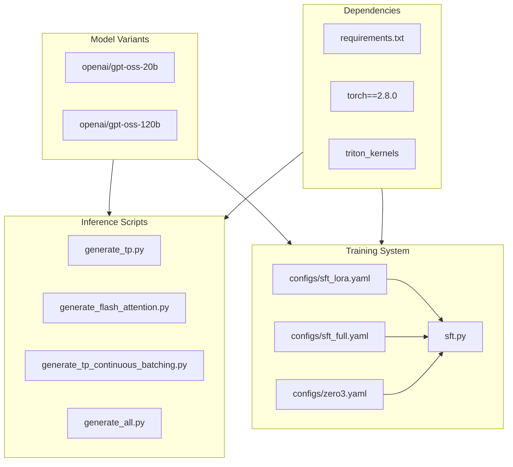
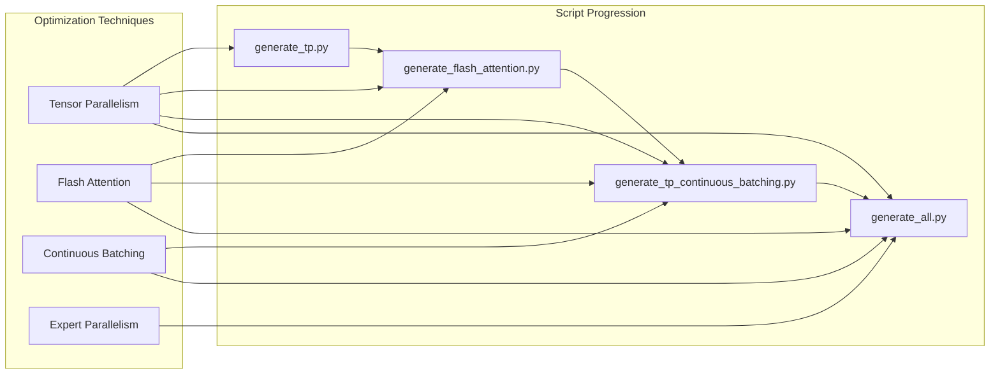
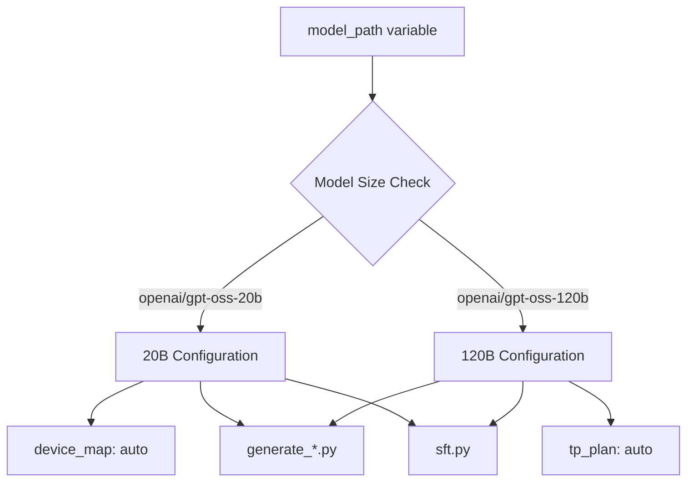
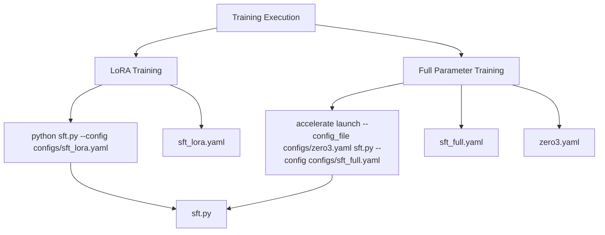

<!-- source: DeepWiki mcp.deepwiki.com · repo huggingface/gpt-oss-recipes · page 1 Overview · fetched 2026-10-26 -->

# Overview

Relevant source files

The following files were used as context for generating this wiki page:

- [README.md](README.md)

This document provides an overview of the GPT-OSS Recipes repository, a comprehensive collection of inference and training scripts designed to demonstrate progressive optimization techniques for OpenAI's GPT-OSS models. The repository serves as both an educational resource and a practical toolkit for working with large language models at scale.

For detailed installation procedures, see [Setup and Dependencies](#2). For specific inference techniques, see [Model Inference](#3). For training configurations, see [Model Training](#4).

## Repository Purpose and Scope

The GPT-OSS Recipes repository provides scripts and configurations for two primary workflows:

1. **Model Inference**: Progressive optimization techniques from basic tensor parallelism to advanced multi-optimization approaches
2. **Model Training**: Supervised fine-tuning with support for both parameter-efficient (LoRA) and full-parameter training methods

The repository supports both 20B and 120B parameter variants of OpenAI's GPT-OSS models, with automatic configuration adaptation based on model size.

Sources: [README.md:1-24]()

## Repository Architecture

The following diagram illustrates the overall system architecture and the relationship between different components:

### System Components and Code Mapping

This architecture demonstrates the dual-purpose nature of the repository, supporting both inference and training workflows with shared model configurations and dependencies.

Sources: [README.md:5-11](), [README.md:15-24]()

## Optimization Progression Pipeline

The inference scripts follow a progressive optimization strategy, where each script builds upon previous techniques:

### Script Progression and Optimization Techniques

Each script represents a specific combination of optimization techniques, allowing users to understand the incremental benefits of each approach.

Sources: [README.md:7-10]()

## Model Configuration System

The repository uses a unified model configuration approach across all scripts:

| Configuration Element | Code Location | Purpose |
|----------------------|---------------|---------|
| `model_path` variable | Top of each script | Controls 20B vs 120B model selection |
| `device_map` | Auto-configured | Handles device allocation based on model size |
| `tp_plan` | Auto-configured | Tensor parallelism strategy for distributed inference |

### Model Path Configuration Pattern

The system automatically adapts resource allocation and parallelization strategies based on the selected model size.

Sources: [README.md:15-24]()

## Execution Patterns

The repository supports multiple execution patterns depending on the use case:

| Execution Type | Command Pattern | Use Case |
|----------------|----------------|----------|
| Single Process | `python script.py` | Basic inference, LoRA training |
| Distributed | `torchrun --nproc_per_node=x script.py` | Multi-GPU inference |
| Accelerate | `accelerate launch --config_file configs/zero3.yaml sft.py` | Full-parameter training |

### Training Configuration Ecosystem

This execution pattern provides flexibility for different training scenarios, from lightweight parameter-efficient fine-tuning to full-scale distributed training.

Sources: [README.md:72-94]()

## Key Dependencies and Integration Points

The repository integrates several key libraries to provide its functionality:

- **transformers**: Model loading and tokenization
- **peft**: Parameter-efficient fine-tuning capabilities  
- **trl**: Supervised fine-tuning trainer implementation
- **kernels**: Optimized computation kernels for performance
- **torch**: Core PyTorch framework with specific version requirements

These dependencies are managed through [requirements.txt:1-10]() and require specific installation procedures detailed in [Setup and Dependencies](#2).

Sources: [README.md:25-49]()

---

