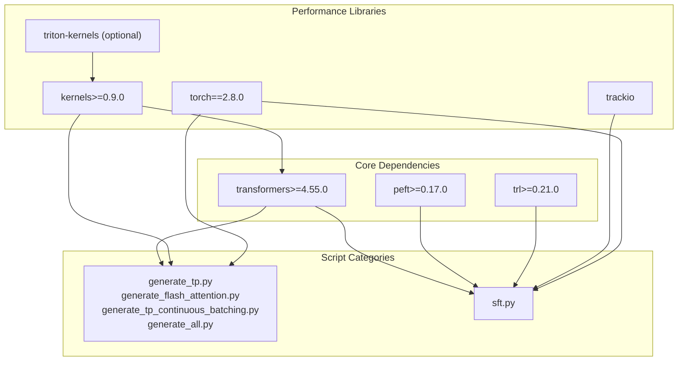
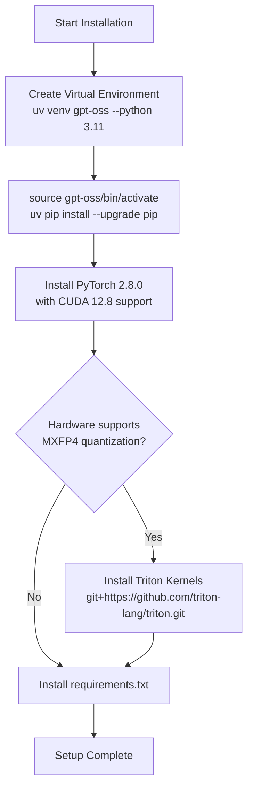
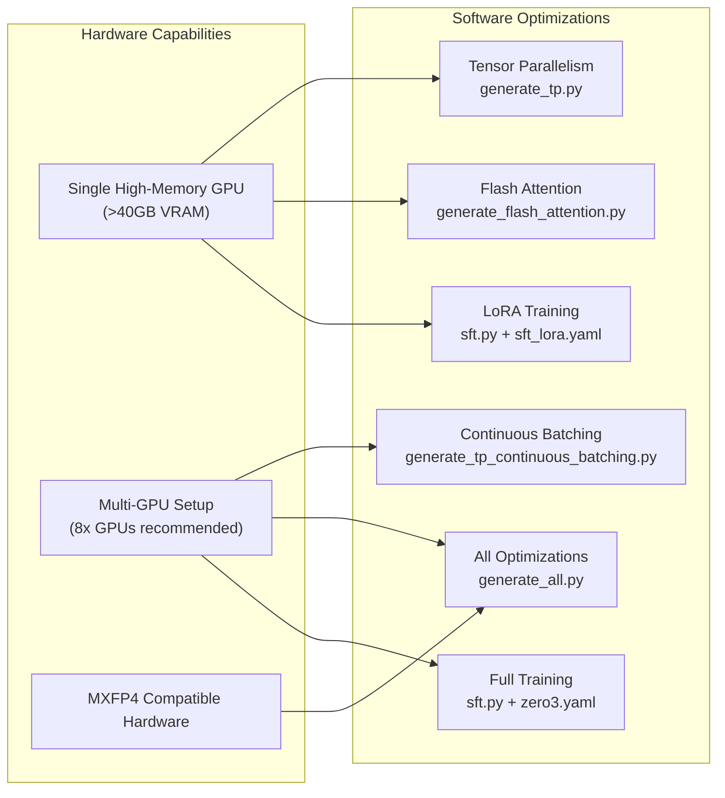

<!-- source: DeepWiki mcp.deepwiki.com · repo huggingface/gpt-oss-recipes · page 2 Setup and Dependencies · fetched 2026-10-26 -->

# Setup and Dependencies

<details>
<summary>Relevant source files</summary>

The following files were used as context for generating this wiki page:

- [README.md](README.md)
- [requirements.txt](requirements.txt)

</details>


This page covers the installation requirements, dependencies, and environment setup needed to run the GPT-OSS recipes repository. It provides step-by-step instructions for setting up the development environment and explains the purpose of each dependency in the context of inference and training workflows.

For information about running inference scripts, see [Model Inference](#3). For training configuration details, see [Model Training](#4).

## System Requirements

The GPT-OSS recipes repository requires specific system configurations depending on the intended use case and model size. The system supports both 20B and 120B parameter models with different hardware requirements.

### Hardware Requirements by Model Size

| Model Size | Memory Requirements | Recommended Setup | Inference Scripts | Training Support |
|------------|-------------------|------------------|------------------|------------------|
| 20B | ~40GB VRAM | Single high-memory GPU | All `generate_*.py` scripts | LoRA training on single GPU |
| 120B | ~240GB VRAM | Multi-GPU setup | Distributed execution required | Full parameter training with ZeRO-3 |

### Python Environment

The repository requires Python 3.11 and uses `uv` for package management and virtual environment creation as specified in [README.md:27-31]().

Sources: README.md:15-24, README.md:27-31

## Dependency Overview

The repository's dependencies are organized into core ML libraries and performance optimization libraries, each serving specific roles in the inference and training pipelines.

### Dependency Architecture



### Core Library Functions

| Library | Version | Purpose | Used By |
|---------|---------|---------|---------|
| `transformers` | >=4.55.0 | Model loading, tokenization, base inference | All scripts |
| `peft` | >=0.17.0 | Parameter-efficient fine-tuning (LoRA) | `sft.py` |
| `trl` | >=0.21.0 | Supervised fine-tuning framework | `sft.py` |
| `kernels` | >=0.9.0 | Optimized CUDA kernels for attention | All scripts |
| `trackio` | latest | Experiment tracking and logging | `sft.py` |

Sources: requirements.txt:1-5, README.md:6-11

## Installation Process

The installation follows a multi-stage process to ensure compatibility between PyTorch, CUDA, and optimization libraries.

### Installation Flow Diagram



### Step-by-Step Installation

#### 1. Environment Creation
Create an isolated Python 3.11 environment using `uv`:

```bash
uv venv gpt-oss --python 3.11 && source gpt-oss/bin/activate && uv pip install --upgrade pip
```

#### 2. PyTorch Installation
Install PyTorch with CUDA 12.8 support for GPU acceleration:

```bash
uv pip install torch==2.8.0 torchvision torchaudio --index-url https://download.pytorch.org/whl/test/cu128
```

#### 3. Optional Triton Kernels
For hardware supporting MXFP4 quantization, install optimized Triton kernels:

```bash
uv pip install git+https://github.com/triton-lang/triton.git@main#subdirectory=python/triton_kernels
```

#### 4. Core Dependencies
Install the remaining required packages:

```bash
uv pip install -r requirements.txt
```

Sources: README.md:27-49

## Hardware Considerations

Different optimization techniques require specific hardware capabilities and configurations. The repository automatically adapts to available hardware through the `device_map` and tensor parallelism configurations.

### Hardware-Software Compatibility Matrix



### Model Size Configuration

The model size is configured through the `model_path` variable in each script as shown in [README.md:17-21]():

```python
# Model configuration - uncomment the model size you want to use
model_path = "openai/gpt-oss-120b"  # 120B model (default)
# model_path = "openai/gpt-oss-20b"  # 20B model
```

The scripts automatically configure appropriate device mapping and parallelization settings based on the selected model size as mentioned in [README.md:23]().

Sources: README.md:15-24, README.md:39-43

## Verification

After installation, verify the setup by checking that all dependencies are correctly installed and the environment can load the required models.

### Basic Verification Commands

Test the installation by importing key libraries:

```python
import torch
import transformers
import peft
import trl
```

Check CUDA availability:

```python
print(f"CUDA available: {torch.cuda.is_available()}")
print(f"CUDA devices: {torch.cuda.device_count()}")
```

### Next Steps

Once the environment is set up, you can proceed to:
- Run inference scripts as described in [Model Inference](#3)
- Configure and run training jobs as outlined in [Model Training](#4)
- Select appropriate optimization techniques based on your hardware configuration

Sources: README.md:51-95

---

