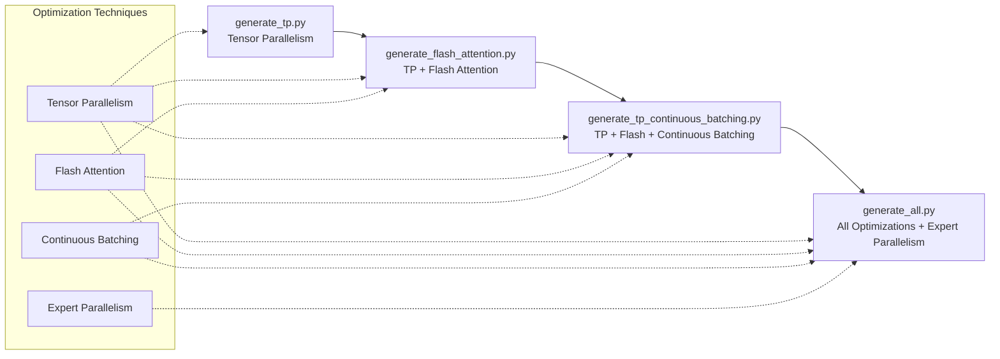
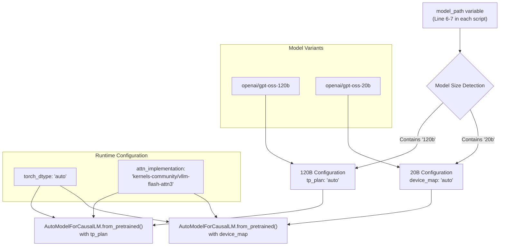
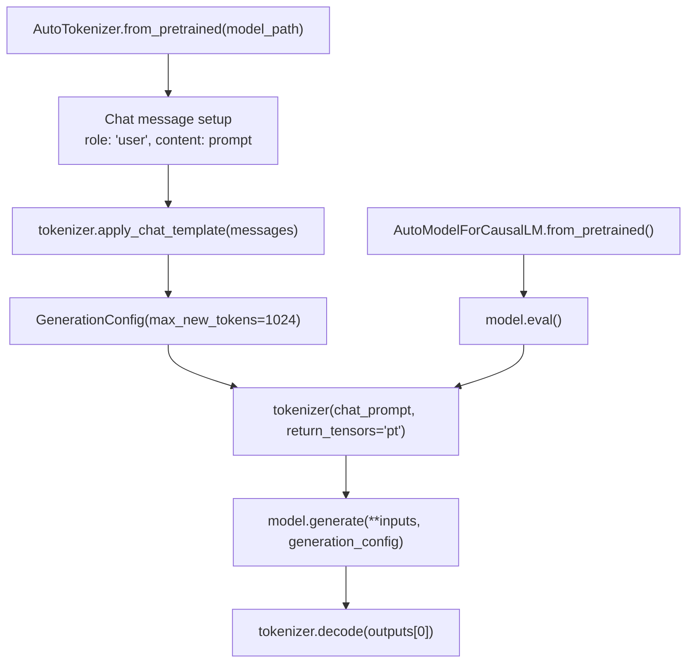

<!-- source: DeepWiki mcp.deepwiki.com · repo huggingface/gpt-oss-recipes · page 3 Model Inference · fetched 2026-10-26 -->

# Model Inference

<details>
<summary>Relevant source files</summary>

The following files were used as context for generating this wiki page:

- [README.md](README.md)
- [generate_all.py](generate_all.py)

</details>


## Purpose and Scope

This document provides an overview of the inference capabilities in the GPT-OSS recipes repository. The system offers four progressive inference scripts that demonstrate different optimization techniques for running OpenAI's GPT-OSS models (20B and 120B parameters). Each script builds upon the previous one, adding increasingly sophisticated optimizations for memory efficiency and throughput.

For detailed implementation of each optimization technique, see [Basic Tensor Parallelism](#3.1), [Flash Attention Optimization](#3.2), [Continuous Batching](#3.3), and [Advanced Inference Optimizations](#3.4). For training capabilities, see [Model Training](#4).

## Inference Script Progression

The repository provides four inference scripts that represent a progressive enhancement of optimization techniques:

**Optimization Progression Diagram**


Sources: [README.md:7-10](), [generate_all.py:1-49]()

## Model Configuration System

All inference scripts support both 20B and 120B model variants through a unified configuration system. The `model_path` variable controls both model selection and automatic device mapping configuration:

**Model Configuration Flow**


Sources: [generate_all.py:5-7](), [generate_all.py:24-30](), [generate_all.py:33-38]()

## Script Selection Guide

Choose the appropriate inference script based on your performance requirements and available hardware:

| Script | Optimizations | Use Case | Resource Requirements |
|--------|---------------|----------|----------------------|
| `generate_tp.py` | Tensor Parallelism | Basic distributed inference | Multiple GPUs |
| `generate_flash_attention.py` | TP + Flash Attention | Memory-efficient inference | Multiple GPUs with flash attention support |
| `generate_tp_continuous_batching.py` | TP + Flash + Continuous Batching | High-throughput serving | Multiple GPUs with batching optimization |
| `generate_all.py` | All optimizations + Expert Parallelism | Maximum performance | Multiple GPUs with full optimization stack |

Sources: [README.md:7-10]()

## Execution Modes

The inference scripts support both single-node and distributed execution patterns:

### Single Node Execution
```bash
python generate_<script_name>.py
```

### Distributed Execution
```bash
torchrun --nproc_per_node=x generate_<script_name>.py
```

### Configuration Variables

Each script contains standard configuration variables:

| Variable | Purpose | Example Values |
|----------|---------|----------------|
| `model_path` | Model selection | `"openai/gpt-oss-120b"`, `"openai/gpt-oss-20b"` |
| `GenerationConfig.max_new_tokens` | Output length control | `1024` |
| `attn_implementation` | Attention mechanism | `"kernels-community/vllm-flash-attn3"` |
| `torch_dtype` | Precision control | `"auto"` |

Sources: [README.md:58-67](), [generate_all.py:20-22](), [generate_all.py:36]()

## Common Generation Pattern

All inference scripts follow a consistent pattern:

**Inference Execution Flow**


Sources: [generate_all.py:9-48]()

---

