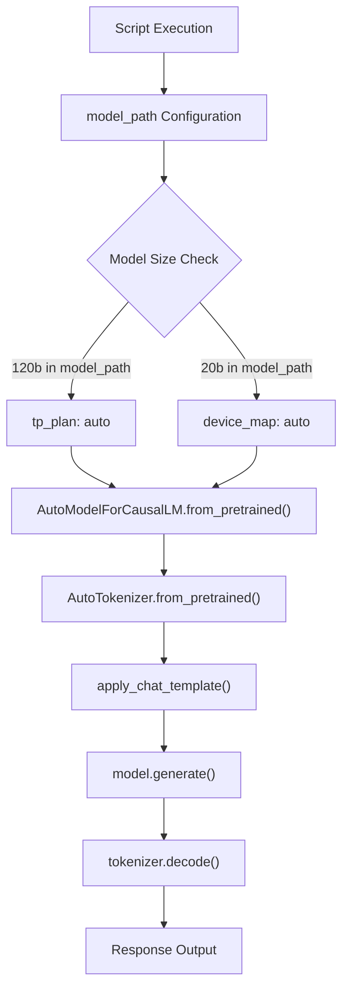
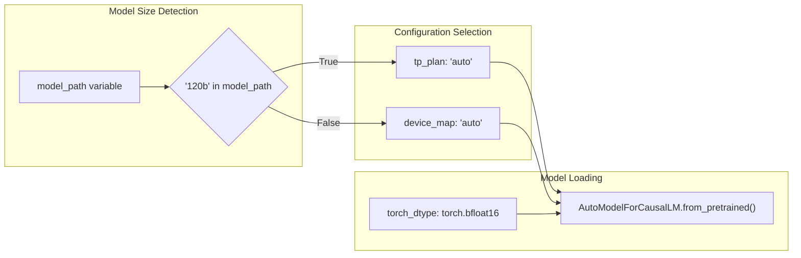

<!-- source: DeepWiki mcp.deepwiki.com · repo huggingface/gpt-oss-recipes · page 3.1 Basic Tensor Parallelism · fetched 2026-10-26 -->

# Basic Tensor Parallelism

<details>
<summary>Relevant source files</summary>

The following files were used as context for generating this wiki page:

- [README.md](README.md)
- [generate_tp.py](generate_tp.py)

</details>


## Purpose and Scope

This document covers the fundamental tensor parallelism implementation for GPT-OSS model inference using the `generate_tp.py` script. This represents the simplest optimization technique in the repository's progression, providing automatic tensor parallelization for distributed inference across multiple GPUs.

For advanced inference optimizations that build upon tensor parallelism, see [Flash Attention Optimization](#3.2), [Continuous Batching](#3.3), and [Advanced Inference Optimizations](#3.4). For training configurations, see [Model Training](#4).

## Tensor Parallelism Overview

Tensor parallelism is a model parallelization technique that distributes individual tensor operations across multiple devices. In the context of transformer models, this typically involves splitting attention heads, feed-forward layers, and embedding matrices across GPUs, allowing larger models to fit in distributed memory while maintaining computational efficiency.

The `generate_tp.py` script provides the foundation for tensor parallelism in this repository, automatically configuring parallelization strategies based on model size and available hardware.

Sources: [README.md:7-7](), [generate_tp.py:1-41]()

## Script Architecture

The tensor parallelism implementation follows a straightforward workflow that adapts its configuration based on the target model size:

### Basic Execution Flow



Sources: [generate_tp.py:4-6](), [generate_tp.py:18-24](), [generate_tp.py:26-30]()

### Model Configuration Logic

The script implements conditional device mapping based on model size, automatically selecting the appropriate parallelization strategy:



Sources: [generate_tp.py:18-24](), [generate_tp.py:26-30]()

## Key Components

### Model Path Configuration

The script uses a simple variable-based configuration system for model selection:

| Configuration | Model | Strategy |
|---------------|-------|----------|
| `"openai/gpt-oss-120b"` | 120B parameters | Tensor parallelism with `tp_plan: "auto"` |
| `"openai/gpt-oss-20b"` | 20B parameters | Standard device mapping with `device_map: "auto"` |

The conditional logic at [generate_tp.py:18-24]() determines the appropriate parallelization approach based on the presence of `"120b"` in the model path string.

Sources: [generate_tp.py:4-6](), [README.md:15-23]()

### Tensor Parallelism Configuration

For large models (120B), the script applies tensor parallelism through the `tp_plan: "auto"` parameter. This instructs the transformers library to automatically distribute tensor operations across available GPUs, enabling the model to fit in distributed memory.

For smaller models (20B), standard device mapping (`device_map: "auto"`) is sufficient, allowing the transformers library to automatically place model components across available devices without explicit tensor parallelization.

Sources: [generate_tp.py:19-21](), [generate_tp.py:23]()

### Generation Pipeline

The generation process follows the standard transformers workflow:

1. **Tokenizer Setup**: [generate_tp.py:8]() initializes the tokenizer with left padding
2. **Chat Template**: [generate_tp.py:10-11]() applies the chat template to format user input
3. **Generation Configuration**: [generate_tp.py:13-16]() sets parameters for text generation
4. **Model Inference**: [generate_tp.py:36]() performs the actual generation
5. **Response Decoding**: [generate_tp.py:39-40]() extracts and formats the model response

Sources: [generate_tp.py:8](), [generate_tp.py:10-11](), [generate_tp.py:13-16](), [generate_tp.py:36](), [generate_tp.py:39-40]()

## Execution Requirements

### Single Node Execution

For basic tensor parallelism, the script can be executed directly:

```bash
python generate_tp.py
```

### Distributed Execution

For multi-GPU setups, use `torchrun` for distributed execution:

```bash
torchrun --nproc_per_node=x generate_tp.py
```

The number of processes (`x`) should match the number of available GPUs for optimal tensor parallelization.

Sources: [README.md:60-68]()

## Technical Specifications

### Memory and Precision

The script uses `torch.bfloat16` precision for memory efficiency while maintaining numerical stability. This is particularly important for large models where memory usage is a primary constraint.

### Generation Parameters

The default `GenerationConfig` includes:
- `max_new_tokens=1024`: Limits response length
- `do_sample=True`: Enables sampling-based generation for more diverse outputs

Sources: [generate_tp.py:28](), [generate_tp.py:13-16]()

---

