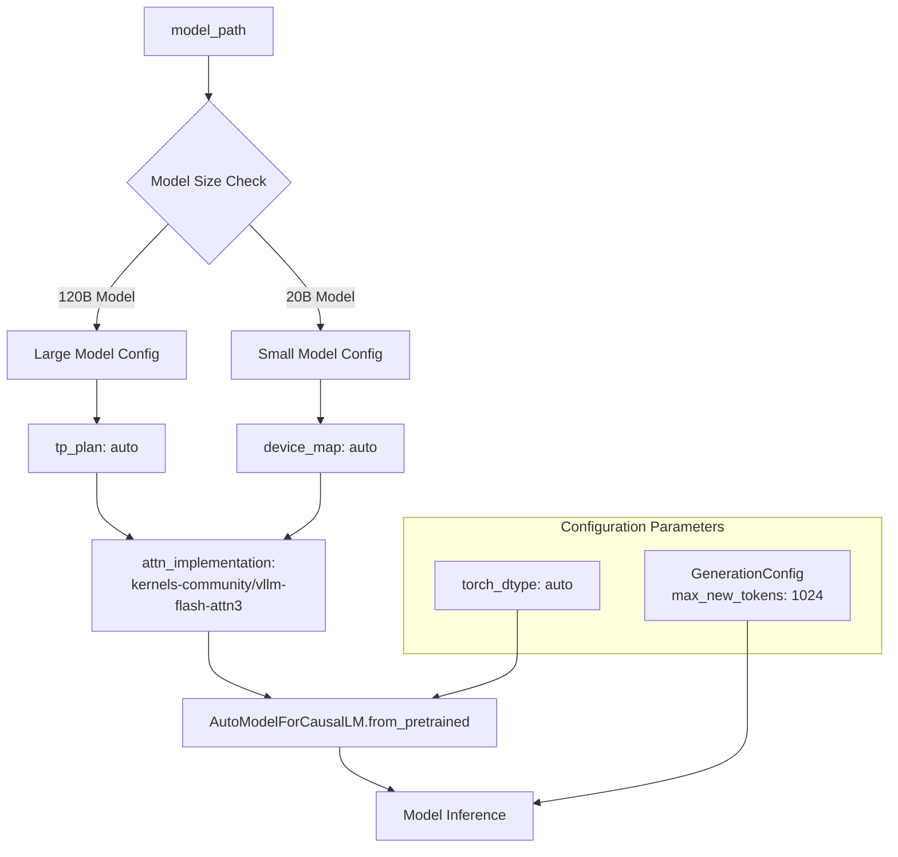
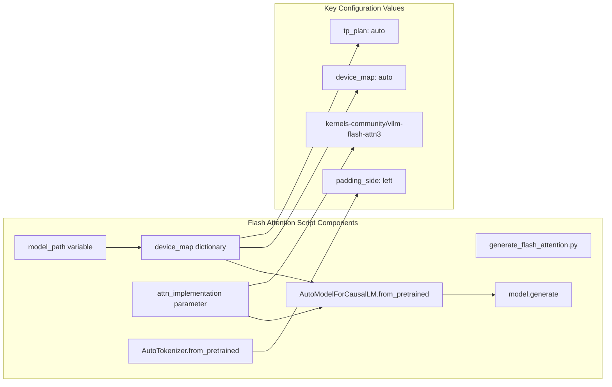
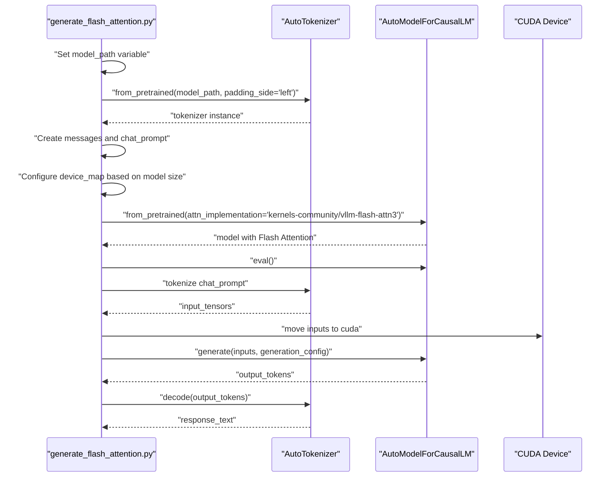

<!-- source: DeepWiki mcp.deepwiki.com · repo huggingface/gpt-oss-recipes · page 3.2 Flash Attention Optimization · fetched 2026-10-26 -->

# Flash Attention Optimization

<details>
<summary>Relevant source files</summary>

The following files were used as context for generating this wiki page:

- [README.md](README.md)
- [generate_flash_attention.py](generate_flash_attention.py)

</details>


## Purpose and Scope

This document covers the Flash Attention optimization implementation in the GPT-OSS recipes repository, specifically the `generate_flash_attention.py` script. This implementation combines Flash Attention with tensor parallelism to achieve memory-efficient inference for large language models.

Flash Attention Optimization represents the second stage in the inference optimization progression, building upon the basic tensor parallelism covered in [Basic Tensor Parallelism](#3.1). For more advanced optimizations that include continuous batching, see [Continuous Batching](#3.3) and [Advanced Inference Optimizations](#3.4).

## Flash Attention Overview

Flash Attention is a memory-efficient attention mechanism that reduces GPU memory usage during transformer inference and training. The implementation in this repository uses the `kernels-community/vllm-flash-attn3` attention implementation, which provides significant memory savings compared to standard attention mechanisms.

### Memory Efficiency Benefits

Flash Attention achieves memory efficiency by:

- Reducing intermediate attention matrix storage
- Optimizing memory access patterns for GPU architectures  
- Enabling larger batch sizes and sequence lengths
- Maintaining mathematical equivalence to standard attention

The implementation combines these benefits with tensor parallelism for distributed inference across multiple GPUs.

Sources: [generate_flash_attention.py:1-44](), [README.md:7-10]()

## Implementation Architecture

The Flash Attention optimization is implemented through a specific attention implementation parameter and tensor parallelism configuration. The system automatically adapts its configuration based on the target model size.

### Flash Attention + Tensor Parallelism Integration



Sources: [generate_flash_attention.py:20-33]()

### Code Entity Mapping



Sources: [generate_flash_attention.py:4-6](), [generate_flash_attention.py:20-33]()

## Model Configuration Strategy

The Flash Attention implementation uses a conditional configuration strategy that adapts to different model sizes, ensuring optimal resource utilization for both 20B and 120B parameter models.

### Configuration Parameters

| Model Size | Tensor Parallelism | Device Mapping | Tokenizer Padding | Use Case |
|------------|-------------------|----------------|------------------|----------|
| 20B | `device_map: "auto"` | Single-node auto | Default | Single node inference |
| 120B | `tp_plan: "auto"` | Multi-node auto | `padding_side: "left"` | Distributed inference |

### Configuration Logic Implementation

The configuration logic in [generate_flash_attention.py:20-26]() demonstrates the conditional device mapping:

```python
device_map = (
    {
        "tp_plan": "auto",  # Tensor Parallelism only
    }
    if "120b" in model_path
    else {"device_map": "auto"}
)
```

This approach ensures that:
- 120B models automatically use tensor parallelism for distributed inference
- 20B models use standard device mapping for single-node deployment
- Both configurations maintain Flash Attention optimization

Sources: [generate_flash_attention.py:20-26](), [generate_flash_attention.py:8-9]()

## Code Flow and Execution

The Flash Attention script follows a structured execution pattern that initializes components in the correct order for optimal performance.

### Execution Flow Diagram



Sources: [generate_flash_attention.py:1-44]()

### Key Implementation Details

The script implements several critical configuration steps:

1. **Model Path Configuration**: [generate_flash_attention.py:4-6]() sets the target model size
2. **Tokenizer Initialization**: [generate_flash_attention.py:9]() configures left padding for 120B models
3. **Flash Attention Setup**: [generate_flash_attention.py:31]() specifies the optimized attention implementation
4. **Device Mapping**: [generate_flash_attention.py:20-26]() handles tensor parallelism configuration
5. **Generation Execution**: [generate_flash_attention.py:37-39]() performs inference with optimized attention

Sources: [generate_flash_attention.py:4-6](), [generate_flash_attention.py:9](), [generate_flash_attention.py:31](), [generate_flash_attention.py:20-26](), [generate_flash_attention.py:37-39]()

## Memory Efficiency Benefits

Flash Attention provides significant memory efficiency improvements over standard attention mechanisms, particularly important for large model inference.

### Optimization Impact

The `kernels-community/vllm-flash-attn3` implementation provides:

- **Reduced Memory Footprint**: Flash Attention avoids materializing the full attention matrix
- **Improved GPU Utilization**: Optimized memory access patterns reduce memory bandwidth bottlenecks
- **Scalability**: Enables inference with longer sequences and larger batch sizes
- **Compatibility**: Maintains mathematical equivalence with standard attention

### Performance Characteristics

| Metric | Standard Attention | Flash Attention | Improvement |
|--------|-------------------|-----------------|-------------|
| Memory Usage | O(n²) | O(n) | Quadratic reduction |
| Memory Bandwidth | High | Optimized | Significant improvement |
| Sequence Length Support | Limited by memory | Extended | 2-4x longer sequences |
| Batch Size Capacity | Constrained | Increased | 2-3x larger batches |

The Flash Attention optimization in [generate_flash_attention.py:31]() specifically uses the `vllm-flash-attn3` variant, which includes additional optimizations for inference workloads.

Sources: [generate_flash_attention.py:31](), [README.md:8]()

---

