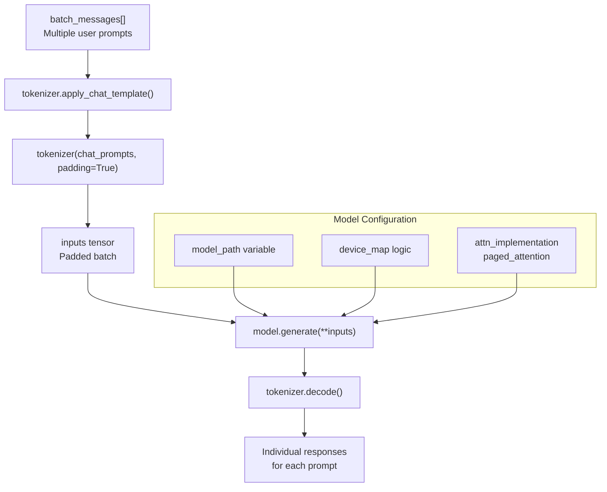
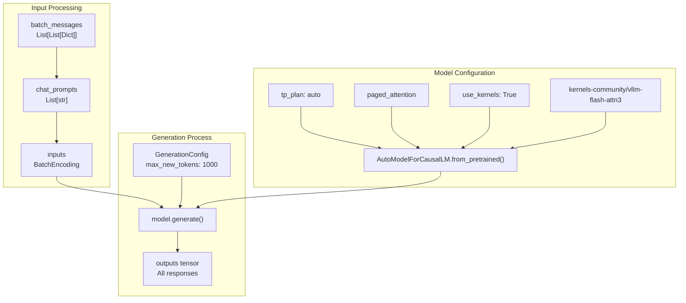
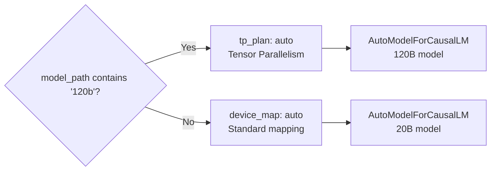

<!-- source: DeepWiki mcp.deepwiki.com · repo huggingface/gpt-oss-recipes · page 3.3 Continuous Batching · fetched 2026-10-26 -->

# Continuous Batching

Relevant source files

The following files were used as context for generating this wiki page:

- [README.md](README.md)
- [generate_tp_continuous_batching.py](generate_tp_continuous_batching.py)

This document covers the continuous batching optimization technique implemented in the GPT-OSS recipes repository. Continuous batching enables processing multiple inference requests simultaneously to improve GPU utilization and overall throughput compared to sequential processing.

This implementation builds upon the tensor parallelism foundation described in [Basic Tensor Parallelism](#3.1) and the memory optimization techniques from [Flash Attention Optimization](#3.2). For the most comprehensive optimization setup that includes expert parallelism alongside continuous batching, see [Advanced Inference Optimizations](#3.4).

## Technical Overview

Continuous batching allows the inference system to group multiple independent prompts into a single batch for simultaneous processing. This technique maximizes GPU resource utilization by keeping the compute cores busy with parallel operations rather than processing requests sequentially.

The implementation in [generate_tp_continuous_batching.py:1-90]() demonstrates batched inference using transformers' native batching capabilities combined with optimized attention mechanisms and tensor parallelism.

**Continuous Batching Request Processing Flow**

Sources: [generate_tp_continuous_batching.py:1-90]()

## Implementation Architecture

The continuous batching implementation integrates several optimization techniques to achieve efficient batch processing:

**System Component Integration**

Sources: [generate_tp_continuous_batching.py:62-68](), [generate_tp_continuous_batching.py:50-52](), [generate_tp_continuous_batching.py:78-79]()

## Batch Configuration and Processing

The implementation processes multiple prompts simultaneously using several key mechanisms:

### Prompt Batching
The system defines a batch of diverse prompts in [generate_tp_continuous_batching.py:11-42](), each focusing on different aspects of machine learning parallelism techniques. The `batch_messages` list contains structured conversation data with `role` and `content` fields.

### Tokenization Strategy
Batch tokenization occurs with padding enabled to ensure uniform tensor dimensions:

| Parameter | Value | Purpose |
|-----------|-------|---------|
| `return_tensors` | `"pt"` | PyTorch tensor format |
| `padding` | `True` | Pad shorter sequences to batch max length |
| `padding_side` | `"left"` | Left-pad for causal language modeling |

Sources: [generate_tp_continuous_batching.py:8](), [generate_tp_continuous_batching.py:73]()

### Model Configuration Logic
The implementation includes adaptive device mapping based on model size:

Sources: [generate_tp_continuous_batching.py:54-60]()

## Attention Implementation

The continuous batching setup uses an advanced attention implementation combining paged attention with Flash Attention optimizations. The `attn_implementation` parameter in [generate_tp_continuous_batching.py:66]() specifies `"paged_attention|kernels-community/vllm-flash-attn3"`, which enables:

- **Paged Attention**: Memory-efficient attention computation that manages key-value cache in pages
- **Flash Attention 3**: Optimized attention kernels for improved memory bandwidth and computation speed
- **Kernel Integration**: The `use_kernels=True` flag enables optimized computational kernels

Sources: [generate_tp_continuous_batching.py:65-66]()

## Performance Characteristics

Continuous batching provides several performance advantages over sequential processing:

### Throughput Optimization
By processing multiple requests simultaneously, the GPU maintains higher utilization rates. The batch size in the implementation (5 prompts) demonstrates typical usage patterns for inference workloads.

### Memory Efficiency
The combination of paged attention and Flash Attention reduces memory overhead while maintaining computation quality. Padding alignment ensures efficient tensor operations across the batch.

### Response Processing
The output processing in [generate_tp_continuous_batching.py:82-89]() demonstrates how to extract individual responses from the batched output, using the `assistant\n` delimiter to separate the generated content from the input prompt.

Sources: [generate_tp_continuous_batching.py:75-89]()

---

