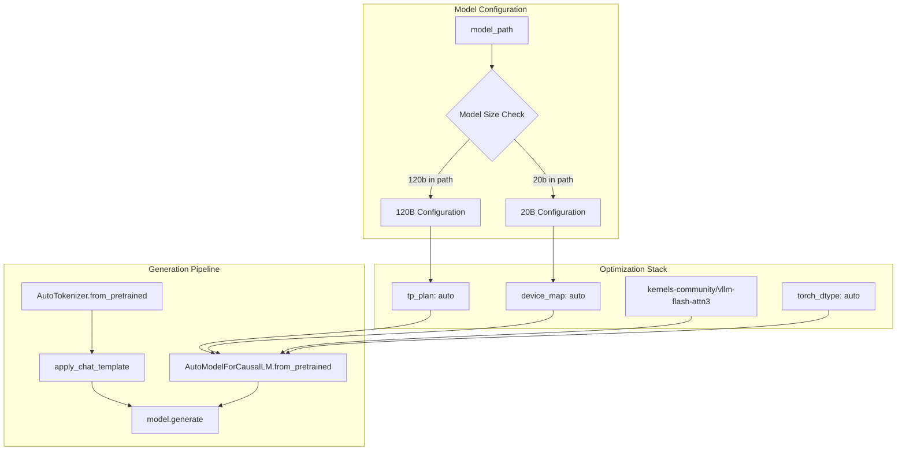
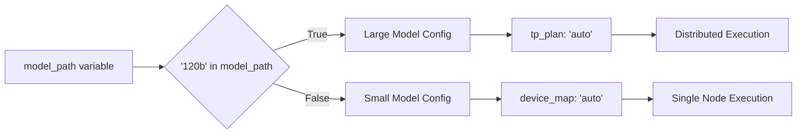
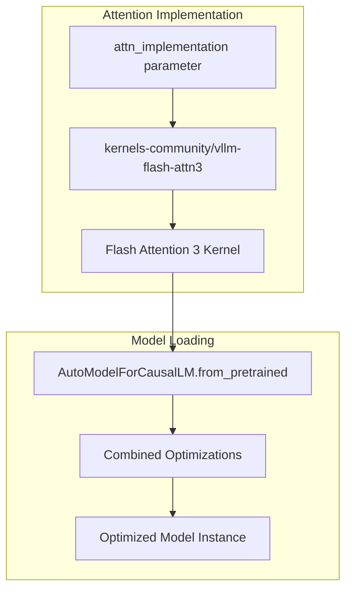
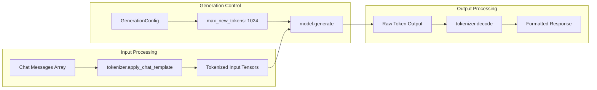

<!-- source: DeepWiki mcp.deepwiki.com · repo huggingface/gpt-oss-recipes · page 3.4 Advanced Inference Optimizations · fetched 2026-10-26 -->

# Advanced Inference Optimizations

<details>
<summary>Relevant source files</summary>

The following files were used as context for generating this wiki page:

- [README.md](README.md)
- [generate_all.py](generate_all.py)

</details>


This document covers the most comprehensive inference optimization script in the GPT-OSS recipes repository. The `generate_all.py` script combines all available optimization techniques to provide maximum performance for both 20B and 120B model inference. This represents the culmination of the progressive optimization approach demonstrated in the inference pipeline.

For basic tensor parallelism setup, see [3.1](#3.1). For Flash Attention implementation, see [3.2](#3.2). For continuous batching techniques, see [3.3](#3.3).

## Optimization Techniques Overview

The `generate_all.py` script integrates multiple optimization strategies to achieve optimal inference performance:

| Optimization | Implementation | Benefit |
|--------------|----------------|---------|
| Tensor Parallelism | `tp_plan: "auto"` | Distribute computation across multiple GPUs |
| Flash Attention 3 | `attn_implementation="kernels-community/vllm-flash-attn3"` | Memory-efficient attention computation |
| Expert Parallelism | Automatic model sharding | Specialized processing for MoE architectures |
| Automatic Device Mapping | Size-adaptive configuration | Optimal resource utilization |

Sources: [generate_all.py:24-38](), [README.md:10]()

## Script Architecture



Sources: [generate_all.py:5-7](), [generate_all.py:24-38](), [generate_all.py:42-44]()

## Configuration System

The script implements an adaptive configuration system that automatically selects optimization parameters based on model size:

### Model Size Detection

The configuration logic uses string matching to determine the appropriate settings:



Sources: [generate_all.py:24-30]()

### Optimization Parameter Mapping

| Model Size | Tensor Parallelism | Device Mapping | Execution Mode |
|------------|-------------------|----------------|----------------|
| 120B | `tp_plan: "auto"` | Not used | Multi-GPU distributed |
| 20B | Not used | `device_map: "auto"` | Single node auto-placement |

Sources: [generate_all.py:24-30]()

## Advanced Features Implementation

### Flash Attention 3 Integration

The script uses the latest Flash Attention implementation for optimal memory efficiency:



Sources: [generate_all.py:36]()

### Generation Configuration

The script uses a structured approach to generation parameters:



Sources: [generate_all.py:11-18](), [generate_all.py:20-22](), [generate_all.py:42-48]()

## Execution Flow

### Initialization Sequence

The script follows a specific initialization order to ensure all optimizations are properly configured:

1. **Model Path Configuration** - [generate_all.py:5-7]()
2. **Tokenizer Loading** - [generate_all.py:9]()
3. **Chat Template Setup** - [generate_all.py:11-18]()
4. **Generation Config Creation** - [generate_all.py:20-22]()
5. **Device Mapping Selection** - [generate_all.py:24-30]()
6. **Model Loading with Optimizations** - [generate_all.py:33-38]()
7. **Inference Execution** - [generate_all.py:42-48]()

### Performance Considerations

The script is designed for maximum performance through:

- **Automatic Tensor Parallelism**: Distributes large models across available GPUs
- **Flash Attention 3**: Reduces memory footprint and increases throughput
- **Expert Parallelism**: Optimizes MoE model execution
- **Adaptive Configuration**: Selects optimal settings based on model size

Sources: [generate_all.py:24-38](), [README.md:10]()

## Usage Patterns

The script supports both single-node and distributed execution modes:

### Single Node Execution
```bash
python generate_all.py
```

### Distributed Execution
```bash
torchrun --nproc_per_node=x generate_all.py
```

The execution mode is automatically determined by the model size configuration and available hardware resources.

Sources: [README.md:60-68]()

---

