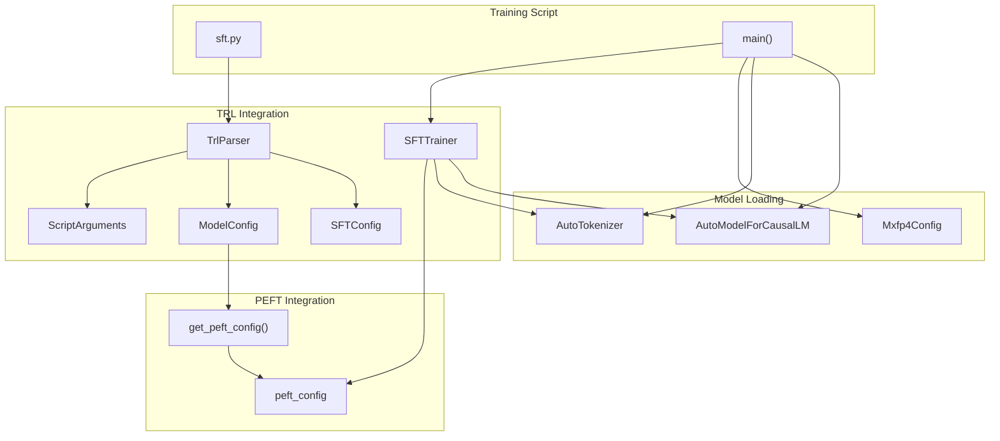
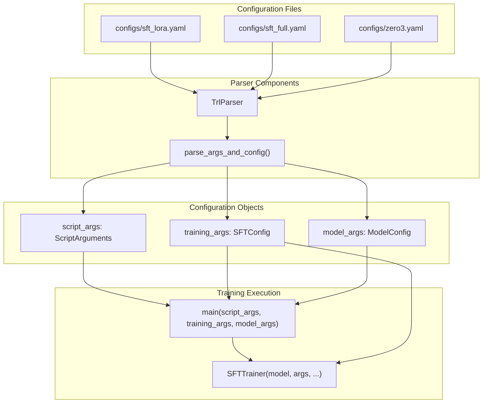

<!-- source: DeepWiki mcp.deepwiki.com · repo huggingface/gpt-oss-recipes · page 4 Model Training · fetched 2026-10-26 -->

# Model Training

<details>
<summary>Relevant source files</summary>

The following files were used as context for generating this wiki page:

- [README.md](README.md)
- [sft.py](sft.py)

</details>


This document covers the supervised fine-tuning capabilities provided by the GPT-OSS recipes repository. The training system supports both parameter-efficient fine-tuning using LoRA and full parameter training with distributed training support for large models.

For detailed information about the core training script implementation, see [Supervised Fine-tuning Script](#4.1). For parameter-efficient training configurations, see [LoRA Training Configuration](#4.2). For distributed full parameter training setups, see [Full Parameter Training](#4.3).

## Training System Architecture

The training system is built around the `sft.py` script which leverages the TRL (Transformers Reinforcement Learning) library for supervised fine-tuning. The system provides a unified interface that adapts to different training modes based on configuration.

### Core Training Components



Sources: [sft.py:26-91](), [README.md:11]()

## Training Modes Overview

The system supports two primary training approaches that balance computational efficiency with training effectiveness:

| Training Mode | Parameter Updates | Memory Usage | GPU Requirements | Configuration File |
|---------------|-------------------|--------------|------------------|-------------------|
| LoRA | Adapter layers only | Low | Single GPU | `configs/sft_lora.yaml` |
| Full Parameter | All model parameters | High | Multi-GPU | `configs/sft_full.yaml` |

### LoRA Training
Parameter-efficient fine-tuning that updates only small adapter layers while keeping the base model frozen. Suitable for single GPU setups and faster iteration cycles.

### Full Parameter Training  
Updates all model parameters for maximum training flexibility. Requires distributed training setup with DeepSpeed ZeRO-3 for memory efficiency on large models.

Sources: [README.md:72-86](), [sft.py:77]()

## Configuration Management System

The training system uses a hierarchical configuration approach with YAML files for training parameters and command-line arguments for runtime overrides.

### Configuration Flow



Sources: [sft.py:87-91](), [README.md:82-94]()

## Execution Workflows

The training system provides different execution patterns optimized for various hardware configurations and training requirements.

### Single GPU LoRA Execution
```bash
python sft.py --config configs/sft_lora.yaml
```

The `python` command directly executes the script with LoRA configuration, suitable for parameter-efficient training on a single GPU.

### Multi-GPU Full Parameter Execution
```bash
accelerate launch --config_file configs/zero3.yaml sft.py --config configs/sft_full.yaml
```

The `accelerate launch` command enables distributed training with DeepSpeed ZeRO-3 configuration for memory-efficient full parameter training across multiple GPUs.

### FlashAttention3 Integration
```bash
accelerate launch --config_file configs/zero3.yaml sft.py --config configs/sft_full.yaml --attn_implementation kernels-community/vllm-flash-attn3
```

The `attn_implementation` parameter enables optimized attention computation using FlashAttention3 kernels for improved training performance.

Sources: [README.md:72-86](), [sft.py:16-24]()

## Model and Dataset Integration

The training script integrates with the Hugging Face ecosystem for model loading and dataset management:

### Model Loading Configuration
- `model_name_or_path`: Specifies the base model (e.g., `openai/gpt-oss-20b`, `openai/gpt-oss-120b`)
- `torch_dtype`: Data type configuration for memory optimization
- `quantization_config`: Uses `Mxfp4Config` for quantized training
- `attn_implementation`: Configurable attention mechanism implementation

### Dataset Integration
- `dataset_name`: Dataset identifier for training data
- `dataset_train_split`: Training data split selection
- `dataset_test_split`: Evaluation data split selection

The system uses the `datasets` library for data loading and the tokenizer for text processing within the `SFTTrainer` framework.

Sources: [sft.py:39-84]()

---

