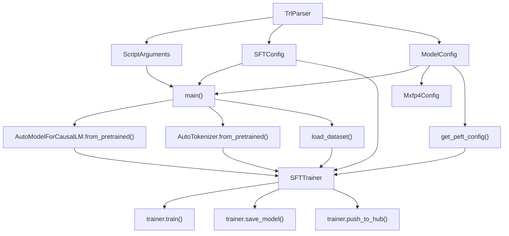
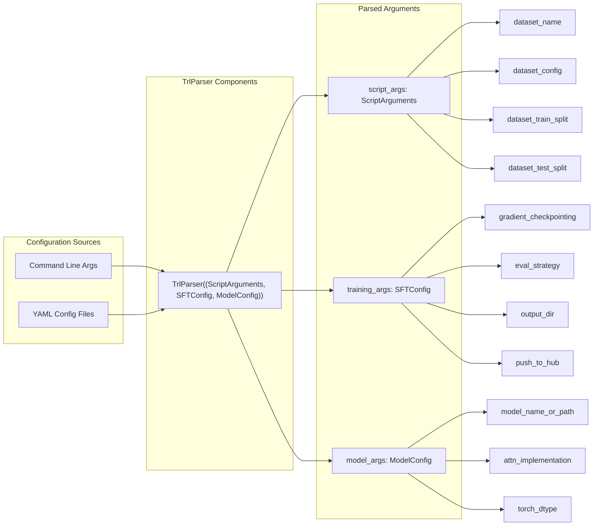
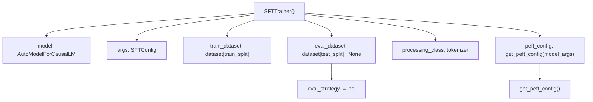

<!-- source: DeepWiki mcp.deepwiki.com · repo huggingface/gpt-oss-recipes · page 4.1 Supervised Fine-tuning Script · fetched 2026-10-26 -->

# Supervised Fine-tuning Script

<details>
<summary>Relevant source files</summary>

The following files were used as context for generating this wiki page:

- [requirements.txt](requirements.txt)
- [sft.py](sft.py)

</details>


## Purpose and Scope

This document covers the `sft.py` script, which provides supervised fine-tuning capabilities for GPT-OSS models using the TRL (Transformer Reinforcement Learning) library. The script supports both parameter-efficient fine-tuning via LoRA and full parameter training with distributed computing capabilities. For specific configuration details about LoRA training, see [LoRA Training Configuration](#4.2). For information about full parameter training setups including DeepSpeed configurations, see [Full Parameter Training](#4.3).

## Script Architecture and Core Components

The `sft.py` script follows a modular architecture built around TRL's training framework, with clear separation between configuration parsing, model setup, and training execution.

### Core Component Flow



Sources: [sft.py:1-92]()

## Configuration and Argument Parsing

The script uses TRL's unified parsing system to handle three distinct configuration categories, enabling flexible training setups through both command-line arguments and YAML configuration files.

### Configuration Architecture



The parsing occurs in the entry point where `TrlParser` processes the three configuration classes simultaneously: [sft.py:87-91]().

Sources: [sft.py:87-91]()

## Model Loading and Setup

The script implements a comprehensive model loading strategy that supports quantization, attention implementations, and memory optimization configurations.

### Model Configuration Parameters

| Parameter | Purpose | Configuration Location |
|-----------|---------|----------------------|
| `revision` | Model revision/branch | [sft.py:45]() |
| `trust_remote_code` | Enable custom model code | [sft.py:46]() |
| `attn_implementation` | Attention mechanism | [sft.py:47]() |
| `torch_dtype` | Model precision | [sft.py:48]() |
| `use_cache` | Cache configuration | [sft.py:49]() |
| `quantization_config` | Quantization settings | [sft.py:50]() |

The model loading process uses `Mxfp4Config` for quantization with dequantization enabled [sft.py:43](). The `use_cache` parameter is dynamically set based on gradient checkpointing configuration to optimize memory usage [sft.py:49]().

### Model and Tokenizer Instantiation

The script loads both model and tokenizer from the same path specified in `model_args.model_name_or_path`:

- Model: `AutoModelForCausalLM.from_pretrained()` [sft.py:53-55]()
- Tokenizer: `AutoTokenizer.from_pretrained()` [sft.py:57-59]()

Sources: [sft.py:39-60]()

## Training Process

The training process centers around TRL's `SFTTrainer` class, which handles both supervised fine-tuning and PEFT integration seamlessly.

### SFTTrainer Configuration

The `SFTTrainer` instantiation includes the following key parameters:



The evaluation dataset is conditionally included based on the `eval_strategy` configuration [sft.py:73-75](). The PEFT configuration is obtained through `get_peft_config(model_args)` [sft.py:77](), which determines whether to use LoRA or full parameter training.

### Training Execution Flow

The training process follows a standard sequence:

1. **Training**: `trainer.train()` [sft.py:80]()
2. **Model Saving**: `trainer.save_model(training_args.output_dir)` [sft.py:81]()
3. **Hub Upload** (optional): `trainer.push_to_hub(dataset_name=script_args.dataset_name)` [sft.py:82-83]()

Sources: [sft.py:69-84]()

## Execution Examples

The script supports multiple execution modes depending on the training configuration and resource requirements.

### Command Line Usage

The script header provides an example command for distributed training with DeepSpeed ZeRO-3:

```bash
accelerate launch \
    --config_file configs/zero3.yaml \
    sft.py \
    --config configs/sft_full.yaml \
    --model_name_or_path openai/gpt-oss-20b \
    --packing true packing_strategy wrapped \
    --run_name 20b-full-eager \
    --attn_implementation kernels-community/vllm-flash-attn3
```

This example demonstrates:
- **Distributed execution**: `accelerate launch` with ZeRO-3 configuration
- **Model specification**: `openai/gpt-oss-20b` model path
- **Attention optimization**: `kernels-community/vllm-flash-attn3` implementation
- **Training configuration**: `configs/sft_full.yaml` for full parameter training

Sources: [sft.py:15-24]()

## Dependencies and Requirements

The script relies on several key libraries as specified in the requirements:

| Library | Version | Purpose |
|---------|---------|---------|
| `trl` | >=0.21.0 | SFT training framework |
| `transformers` | >=4.55.0 | Model and tokenizer loading |
| `peft` | >=0.17.0 | Parameter-efficient fine-tuning |
| `kernels` | >=0.9.0 | Optimized attention implementations |

The `datasets` library is imported for dataset loading functionality [sft.py:26]().

Sources: [requirements.txt:1-5](), [sft.py:26-36]()

---

