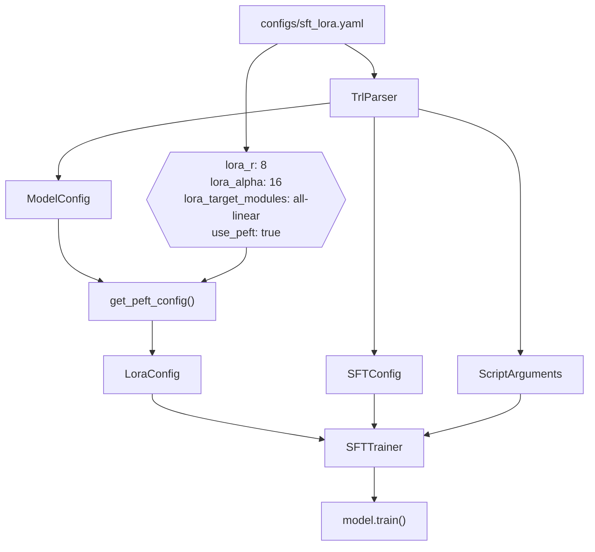
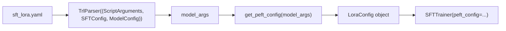

<!-- source: DeepWiki mcp.deepwiki.com · repo huggingface/gpt-oss-recipes · page 4.2 LoRA Training Configuration · fetched 2026-10-26 -->

# LoRA Training Configuration

<details>
<summary>Relevant source files</summary>

The following files were used as context for generating this wiki page:

- [configs/sft_lora.yaml](configs/sft_lora.yaml)
- [sft.py](sft.py)

</details>


This document covers the Low-Rank Adaptation (LoRA) training configuration for parameter-efficient fine-tuning of GPT-OSS models. LoRA enables fine-tuning large language models with significantly reduced memory requirements and training time by only updating a small subset of parameters through low-rank decomposition.

For details about the main supervised fine-tuning script implementation, see [Supervised Fine-tuning Script](#4.1). For full parameter training configurations, see [Full Parameter Training](#4.3).

## Overview

LoRA training in this repository is implemented through the Parameter-Efficient Fine-Tuning (PEFT) library integration within the TRL framework. The configuration is managed through YAML files that specify LoRA-specific hyperparameters while leveraging the same training infrastructure as full parameter fine-tuning.

## Configuration Architecture

The LoRA training system follows a configuration-driven approach where YAML files define both standard training parameters and LoRA-specific settings.

### LoRA Configuration Flow



Sources: [sft.py:77](), [sft.py:87-90](), [configs/sft_lora.yaml:17-21]()

## LoRA Parameters

The LoRA configuration in [configs/sft_lora.yaml]() defines several key parameters that control the low-rank adaptation behavior:

| Parameter | Value | Purpose |
|-----------|-------|---------|
| `use_peft` | `true` | Enables PEFT/LoRA training mode |
| `lora_r` | `8` | Rank of the low-rank decomposition matrices |
| `lora_alpha` | `16` | Scaling factor for LoRA weights |
| `lora_dropout` | `0.0` | Dropout rate applied to LoRA layers |
| `lora_target_modules` | `all-linear` | Target modules for LoRA adaptation |

### Parameter Details

**Rank (`lora_r`)**: Controls the dimensionality of the low-rank matrices. Lower values reduce memory usage and training parameters but may limit adaptation capability. The default value of `8` provides a balance between efficiency and performance.

**Alpha (`lora_alpha`)**: Scaling factor that controls the magnitude of LoRA weight updates. The ratio `lora_alpha/lora_r` determines the effective learning rate for LoRA parameters. With `alpha=16` and `r=8`, the scaling factor is `2.0`.

**Target Modules (`lora_target_modules`)**: Specifies which model components receive LoRA adaptation. The `all-linear` setting applies LoRA to all linear layers in the transformer architecture, including attention projections and feed-forward networks.

Sources: [configs/sft_lora.yaml:17-21]()

## Training Configuration

### Base Training Settings

The LoRA configuration inherits standard training parameters while optimizing for parameter-efficient training:

```yaml
learning_rate: 2.0e-4
per_device_train_batch_size: 4
gradient_accumulation_steps: 4
gradient_checkpointing: true
num_train_epochs: 1.0
```

**Learning Rate**: Set to `2.0e-4`, which is typically higher than full parameter training due to the reduced parameter space being updated.

**Batch Configuration**: Uses smaller per-device batch sizes (`4`) with gradient accumulation (`4` steps) to maintain effective batch size while conserving memory.

**Gradient Checkpointing**: Enabled to further reduce memory usage during training, trading computation time for memory efficiency.

Sources: [configs/sft_lora.yaml:11-16]()

### Model and Dataset Configuration

```yaml
model_name_or_path: openai/gpt-oss-20b
attn_implementation: eager
torch_dtype: bfloat16
dataset_name: HuggingFaceH4/Multilingual-Thinking
max_length: 4096
```

The configuration targets the 20B parameter GPT-OSS model with `bfloat16` precision and uses the eager attention implementation for compatibility with LoRA training.

Sources: [configs/sft_lora.yaml:2-4](), [configs/sft_lora.yaml:7](), [configs/sft_lora.yaml:22]()

## Code Integration

### PEFT Configuration Resolution

The LoRA parameters are processed through the TRL library's configuration system:



The `get_peft_config()` function in the TRL library converts the model arguments containing LoRA parameters into a `LoraConfig` object that the `SFTTrainer` uses to apply parameter-efficient fine-tuning.

Sources: [sft.py:77](), [sft.py:87]()

### Trainer Initialization

The `SFTTrainer` receives the PEFT configuration and automatically applies LoRA to the specified target modules:

```python
trainer = SFTTrainer(
    model=model,
    args=training_args,
    train_dataset=dataset[script_args.dataset_train_split],
    peft_config=get_peft_config(model_args),
    # ... other parameters
)
```

When `peft_config` is provided, the trainer wraps the base model with LoRA adapters, freezes the original model parameters, and only trains the low-rank adaptation matrices.

Sources: [sft.py:69-78]()

## Resource Requirements

LoRA training significantly reduces memory requirements compared to full parameter training:

- **Memory Usage**: Approximately 10-20% of full parameter training memory
- **Training Speed**: Faster iteration due to fewer parameters being updated
- **Storage**: Adapter weights are much smaller than full model checkpoints

## Usage Examples

### Single GPU Training

```bash
python sft.py --config configs/sft_lora.yaml --model_name_or_path openai/gpt-oss-20b
```

### Multi-GPU Training

```bash
torchrun --nproc_per_node=4 sft.py --config configs/sft_lora.yaml
```

The LoRA configuration is compatible with multi-GPU training through standard PyTorch distributed training mechanisms.

Sources: [sft.py:15-24]()

## Learning Rate Scheduling

The configuration includes cosine learning rate scheduling with minimum learning rate:

```yaml
lr_scheduler_type: cosine_with_min_lr
lr_scheduler_kwargs:
  min_lr_rate: 0.1
warmup_ratio: 0.03
```

This schedule warms up to the peak learning rate over 3% of training steps, then follows a cosine decay to 10% of the peak rate.

Sources: [configs/sft_lora.yaml:24-26]()

---

