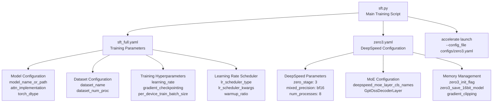
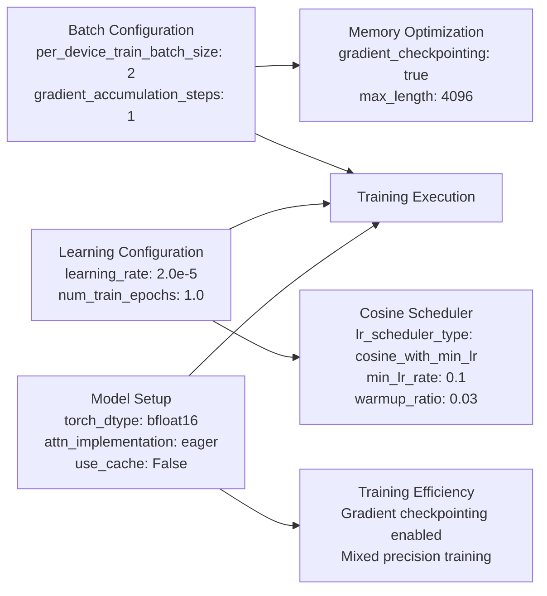
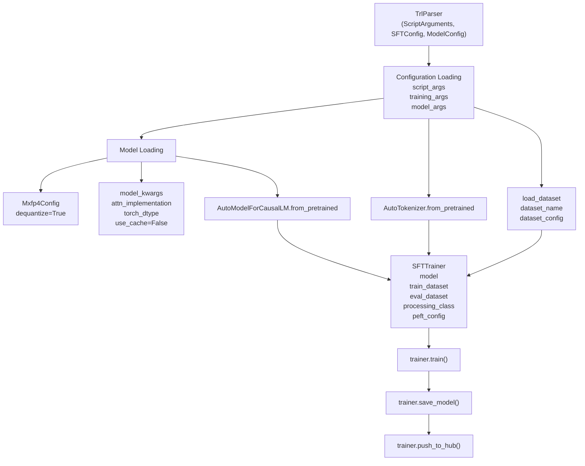

<!-- source: DeepWiki mcp.deepwiki.com · repo huggingface/gpt-oss-recipes · page 4.3 Full Parameter Training · fetched 2026-10-26 -->

# Full Parameter Training

<details>
<summary>Relevant source files</summary>

The following files were used as context for generating this wiki page:

- [configs/sft_full.yaml](configs/sft_full.yaml)
- [configs/zero3.yaml](configs/zero3.yaml)
- [sft.py](sft.py)

</details>


## Purpose and Scope

Full parameter training involves updating all model parameters during supervised fine-tuning, in contrast to parameter-efficient methods that only train a subset of parameters. This approach typically requires more computational resources but can achieve better adaptation to the target domain or task. This page covers the configuration, setup, and execution of full parameter training for GPT-OSS models using the repository's training infrastructure.

For parameter-efficient training using LoRA, see [LoRA Training Configuration](#4.2). For the core training script architecture, see [Supervised Fine-tuning Script](#4.1).

## Configuration Architecture

Full parameter training is configured through a combination of training configuration files and DeepSpeed settings for distributed execution. The system uses two primary configuration files that work together to enable efficient training of large models.

### Training Configuration Structure



Sources: [configs/sft_full.yaml:1-25](), [configs/zero3.yaml:1-26](), [sft.py:15-24]()

## DeepSpeed ZeRO-3 Configuration

The repository uses DeepSpeed ZeRO-3 for efficient distributed training of large models. ZeRO-3 partitions model parameters, gradients, and optimizer states across multiple GPUs to reduce memory usage per device.

### ZeRO-3 Configuration Parameters

| Parameter | Value | Purpose |
|-----------|-------|---------|
| `zero_stage` | 3 | Enables parameter, gradient, and optimizer state partitioning |
| `mixed_precision` | bf16 | Uses bfloat16 for forward/backward passes |
| `zero3_init_flag` | true | Initializes model parameters in ZeRO-3 partitioned state |
| `zero3_save_16bit_model` | true | Saves model checkpoints in 16-bit precision |
| `gradient_clipping` | 1.0 | Clips gradients to prevent training instability |
| `num_processes` | 8 | Number of GPU processes for distributed training |

The configuration specifically includes `deepspeed_moe_layer_cls_names: GptOssDecoderLayer` to handle the Mixture of Experts (MoE) layers present in GPT-OSS models.

Sources: [configs/zero3.yaml:3-11](), [configs/zero3.yaml:19]()

## Training Parameters and Optimization

The full parameter training configuration emphasizes memory efficiency and stable convergence through several key settings:

### Core Training Settings



Sources: [configs/sft_full.yaml:11-22](), [sft.py:49]()

The configuration uses gradient checkpointing (`gradient_checkpointing: true`) to trade computation for memory, allowing training of larger models on available hardware. The cosine learning rate scheduler with minimum learning rate ensures stable convergence throughout training.

## Model Loading and Training Pipeline

The training process follows a structured pipeline that handles model instantiation, dataset loading, and trainer setup for full parameter fine-tuning.

### Training Execution Flow



Sources: [sft.py:39-84](), [sft.py:87-91]()

The script uses `get_peft_config(model_args)` to determine the training configuration. For full parameter training, this returns `None`, indicating that no parameter-efficient fine-tuning should be applied.

## Execution Commands and Resource Requirements

Full parameter training requires distributed execution using Accelerate with DeepSpeed integration:

### Standard Execution Command

```bash
accelerate launch \
    --config_file configs/zero3.yaml \
    sft.py \
    --config configs/sft_full.yaml \
    --model_name_or_path openai/gpt-oss-20b \
    --packing true \
    --packing_strategy wrapped \
    --run_name 20b-full-eager \
    --attn_implementation kernels-community/vllm-flash-attn3
```

### Resource Requirements

| Model Size | Recommended Setup | Memory Requirements |
|------------|------------------|-------------------|
| GPT-OSS 20B | 8 GPUs with ZeRO-3 | ~40GB VRAM per GPU |
| GPT-OSS 120B | 8+ GPUs with ZeRO-3 | ~80GB VRAM per GPU |

The configuration supports experiment tracking through TrackIO (`report_to: trackio`) and includes comprehensive logging with `logging_steps: 1` for detailed monitoring of training progress.

Sources: [sft.py:15-24](), [configs/sft_full.yaml:23-24](), [configs/zero3.yaml:19]()

---

