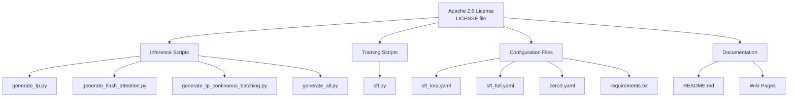
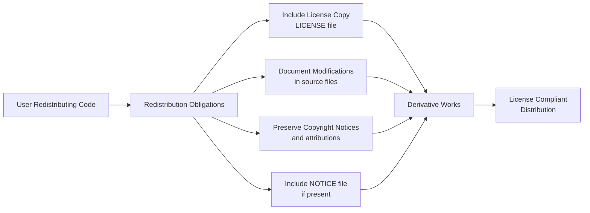

<!-- source: DeepWiki mcp.deepwiki.com · repo huggingface/gpt-oss-recipes · page 5 License · fetched 2026-10-26 -->

# License

<details>
<summary>Relevant source files</summary>

The following files were used as context for generating this wiki page:

- [LICENSE](LICENSE)

</details>


This document explains the licensing terms and conditions that govern the use, modification, and distribution of the GPT-OSS recipes repository. The repository is licensed under the Apache License Version 2.0, which provides clear guidance on permitted uses, user obligations, and liability limitations.

For information about setting up the repository and installing dependencies, see [Setup and Dependencies](#2). For details about using the inference and training scripts covered by this license, see [Model Inference](#3) and [Model Training](#4).

## License Overview

The GPT-OSS recipes repository is distributed under the Apache License Version 2.0, as specified in [LICENSE:1-202](). This is a permissive open-source license that allows both commercial and non-commercial use while providing clear terms for redistribution and modification.

### Key License Characteristics

| Aspect | Details |
|--------|---------|
| **License Type** | Apache License 2.0 |
| **Permissions** | Commercial use, modification, distribution, private use |
| **Requirements** | Include license and copyright notice, state changes |
| **Limitations** | No liability, no warranty, no trademark use |

The license applies to all components of the repository including:
- Inference scripts (`generate_tp.py`, `generate_flash_attention.py`, `generate_tp_continuous_batching.py`, `generate_all.py`)
- Training scripts (`sft.py`)
- Configuration files (`sft_lora.yaml`, `sft_full.yaml`, `zero3.yaml`)
- Documentation and supporting files

Sources: [LICENSE:1-202]()

## Rights Granted to Users

### Licensed Components Coverage



The Apache 2.0 license grants users comprehensive rights as defined in [LICENSE:66-71]():

### Copyright License
- **Reproduction**: Copy and use the code in any form
- **Derivative Works**: Create modified versions and new works based on the code
- **Public Display/Performance**: Use the code in public-facing applications
- **Sublicensing**: Grant licenses to others for your derivative works
- **Distribution**: Share the original or modified code

### Patent License
As specified in [LICENSE:73-87](), contributors grant users patent rights for any patents that would be infringed by using the contributed code. This protection terminates if users initiate patent litigation against the project.

Sources: [LICENSE:66-87]()

## User Obligations and Requirements

### Redistribution Requirements



When redistributing the code or derivative works, users must fulfill specific obligations outlined in [LICENSE:89-128]():

### Required Actions

| Requirement | Description | Reference |
|-------------|-------------|-----------|
| **Include License** | Provide copy of Apache 2.0 license with distribution | [LICENSE:94-95]() |
| **Mark Changes** | Add prominent notices to modified files indicating changes | [LICENSE:97-98]() |
| **Preserve Notices** | Retain copyright, patent, trademark notices from original | [LICENSE:100-104]() |
| **NOTICE File** | Include NOTICE file contents if present in original | [LICENSE:106-121]() |

### File Modification Example
When modifying files like `generate_tp.py` or `sft.py`, users must add notices such as:
```
# Modified by [Your Name] on [Date]
# Changes: [Description of modifications]
```

Sources: [LICENSE:89-128]()

## Restrictions and Disclaimers

### Trademark Limitations
The license explicitly does not grant rights to use trade names, trademarks, or product names except as needed for attribution, as stated in [LICENSE:138-141]().

### Warranty Disclaimer
The code is provided "AS IS" without warranties of any kind ([LICENSE:143-151]()):
- No warranty of MERCHANTABILITY
- No warranty of FITNESS FOR PARTICULAR PURPOSE
- No warranty of NON-INFRINGEMENT
- Users assume all risks of use

### Liability Limitations
Contributors are not liable for damages arising from use of the code ([LICENSE:153-163]()):
- No liability for direct or indirect damages
- No liability for commercial losses
- No liability for computer failure or malfunction
- Protection applies even if contributors were advised of potential damages

Sources: [LICENSE:138-163]()

## Practical Application

### Compliance Checklist

When using the GPT-OSS recipes in your projects:

**For Direct Use:**
- [ ] Include `LICENSE` file in your project
- [ ] Preserve copyright notices in source files
- [ ] Credit the original repository in documentation

**For Modifications:**
- [ ] Mark modified files with change notices
- [ ] Include original license with your distribution
- [ ] Document your modifications clearly
- [ ] Ensure derivative works comply with license terms

**For Commercial Applications:**
- [ ] Commercial use is explicitly permitted
- [ ] No additional licensing fees required
- [ ] Standard attribution requirements apply
- [ ] Consider trademark restrictions for naming

### Integration with Other Licenses
The Apache 2.0 license is compatible with many other open-source licenses, making it safe to integrate GPT-OSS recipes with other open-source projects. However, users should verify compatibility when combining with copyleft licenses like GPL.

Sources: [LICENSE:1-202]()