# Page: Overview

# Overview

<details>
<summary>Relevant source files</summary>

The following files were used as context for generating this wiki page:

- [README.md](README.md)

</details>


This document provides an overview of the GPT-OSS Recipes repository, a comprehensive collection of inference and training scripts designed to demonstrate progressive optimization techniques for OpenAI's GPT-OSS models. The repository serves as both an educational resource and a practical toolkit for working with large language models at scale.

For detailed installation procedures, see [Setup and Dependencies](#2). For specific inference techniques, see [Model Inference](#3). For training configurations, see [Model Training](#4).

## Repository Purpose and Scope

The GPT-OSS Recipes repository provides scripts and configurations for two primary workflows:

1. **Model Inference**: Progressive optimization techniques from basic tensor parallelism to advanced multi-optimization approaches
2. **Model Training**: Supervised fine-tuning with support for both parameter-efficient (LoRA) and full-parameter training methods

The repository supports both 20B and 120B parameter variants of OpenAI's GPT-OSS models, with automatic configuration adaptation based on model size.

Sources: [README.md:1-24]()

## Repository Architecture

The following diagram illustrates the overall system architecture and the relationship between different components:

### System Components and Code Mapping

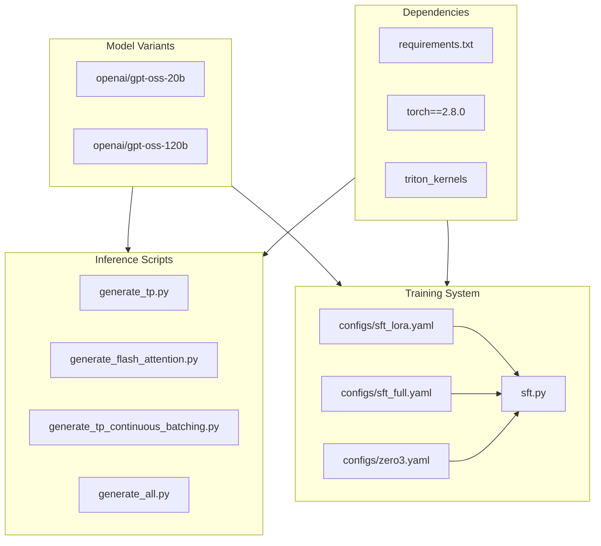

This architecture demonstrates the dual-purpose nature of the repository, supporting both inference and training workflows with shared model configurations and dependencies.

Sources: [README.md:5-11](), [README.md:15-24]()

## Optimization Progression Pipeline

The inference scripts follow a progressive optimization strategy, where each script builds upon previous techniques:

### Script Progression and Optimization Techniques

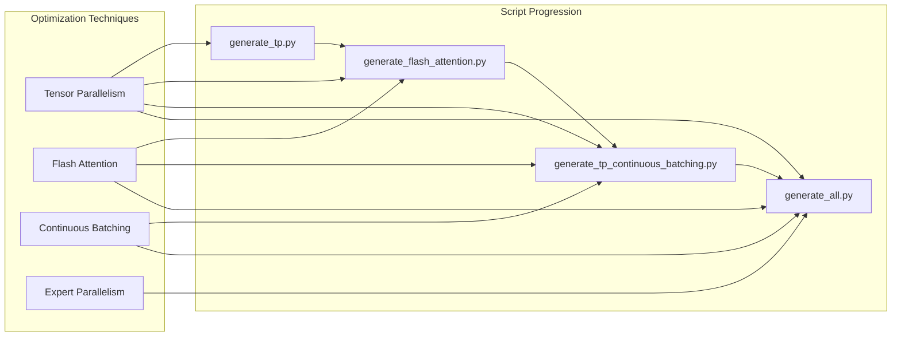

Each script represents a specific combination of optimization techniques, allowing users to understand the incremental benefits of each approach.

Sources: [README.md:7-10]()

## Model Configuration System

The repository uses a unified model configuration approach across all scripts:

| Configuration Element | Code Location | Purpose |
|----------------------|---------------|---------|
| `model_path` variable | Top of each script | Controls 20B vs 120B model selection |
| `device_map` | Auto-configured | Handles device allocation based on model size |
| `tp_plan` | Auto-configured | Tensor parallelism strategy for distributed inference |

### Model Path Configuration Pattern

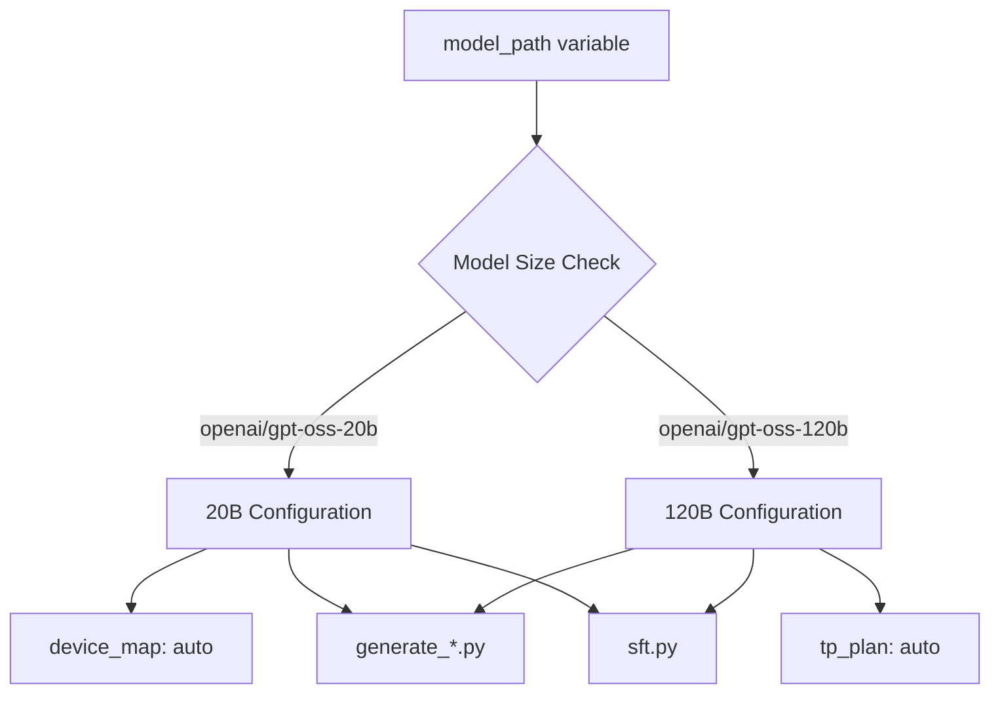

The system automatically adapts resource allocation and parallelization strategies based on the selected model size.

Sources: [README.md:15-24]()

## Execution Patterns

The repository supports multiple execution patterns depending on the use case:

| Execution Type | Command Pattern | Use Case |
|----------------|----------------|----------|
| Single Process | `python script.py` | Basic inference, LoRA training |
| Distributed | `torchrun --nproc_per_node=x script.py` | Multi-GPU inference |
| Accelerate | `accelerate launch --config_file configs/zero3.yaml sft.py` | Full-parameter training |

### Training Configuration Ecosystem

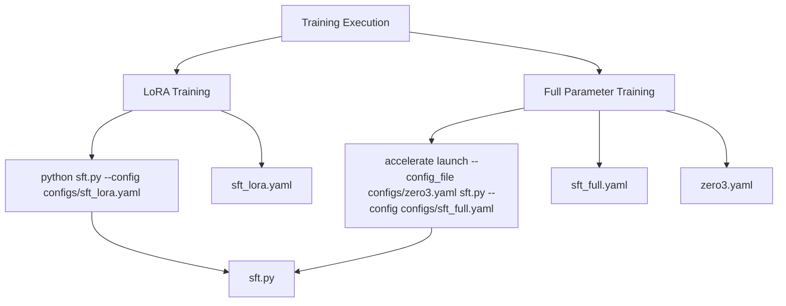

This execution pattern provides flexibility for different training scenarios, from lightweight parameter-efficient fine-tuning to full-scale distributed training.

Sources: [README.md:72-94]()

## Key Dependencies and Integration Points

The repository integrates several key libraries to provide its functionality:

- **transformers**: Model loading and tokenization
- **peft**: Parameter-efficient fine-tuning capabilities  
- **trl**: Supervised fine-tuning trainer implementation
- **kernels**: Optimized computation kernels for performance
- **torch**: Core PyTorch framework with specific version requirements

These dependencies are managed through [requirements.txt:1-10]() and require specific installation procedures detailed in [Setup and Dependencies](#2).

Sources: [README.md:25-49]()

---

# Page: Setup and Dependencies

# Setup and Dependencies

<details>
<summary>Relevant source files</summary>

The following files were used as context for generating this wiki page:

- [README.md](README.md)
- [requirements.txt](requirements.txt)

</details>


This page covers the installation requirements, dependencies, and environment setup needed to run the GPT-OSS recipes repository. It provides step-by-step instructions for setting up the development environment and explains the purpose of each dependency in the context of inference and training workflows.

For information about running inference scripts, see [Model Inference](#3). For training configuration details, see [Model Training](#4).

## System Requirements

The GPT-OSS recipes repository requires specific system configurations depending on the intended use case and model size. The system supports both 20B and 120B parameter models with different hardware requirements.

### Hardware Requirements by Model Size

| Model Size | Memory Requirements | Recommended Setup | Inference Scripts | Training Support |
|------------|-------------------|------------------|------------------|------------------|
| 20B | ~40GB VRAM | Single high-memory GPU | All `generate_*.py` scripts | LoRA training on single GPU |
| 120B | ~240GB VRAM | Multi-GPU setup | Distributed execution required | Full parameter training with ZeRO-3 |

### Python Environment

The repository requires Python 3.11 and uses `uv` for package management and virtual environment creation as specified in [README.md:27-31]().

Sources: README.md:15-24, README.md:27-31

## Dependency Overview

The repository's dependencies are organized into core ML libraries and performance optimization libraries, each serving specific roles in the inference and training pipelines.

### Dependency Architecture

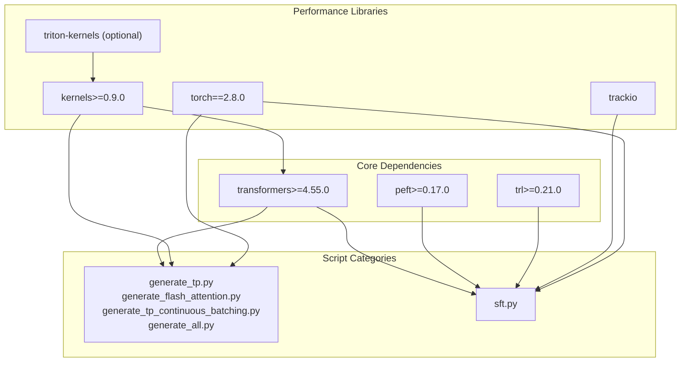

### Core Library Functions

| Library | Version | Purpose | Used By |
|---------|---------|---------|---------|
| `transformers` | >=4.55.0 | Model loading, tokenization, base inference | All scripts |
| `peft` | >=0.17.0 | Parameter-efficient fine-tuning (LoRA) | `sft.py` |
| `trl` | >=0.21.0 | Supervised fine-tuning framework | `sft.py` |
| `kernels` | >=0.9.0 | Optimized CUDA kernels for attention | All scripts |
| `trackio` | latest | Experiment tracking and logging | `sft.py` |

Sources: requirements.txt:1-5, README.md:6-11

## Installation Process

The installation follows a multi-stage process to ensure compatibility between PyTorch, CUDA, and optimization libraries.

### Installation Flow Diagram

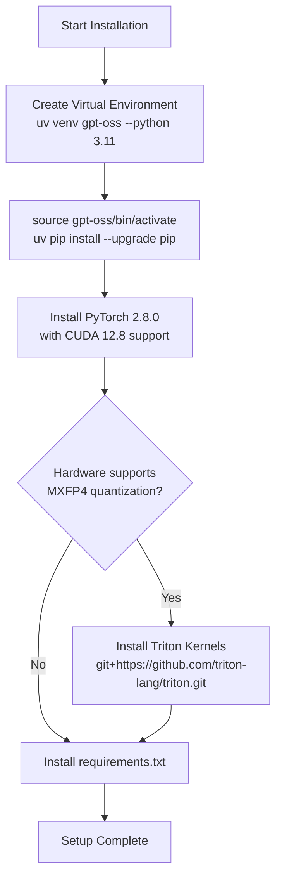

### Step-by-Step Installation

#### 1. Environment Creation
Create an isolated Python 3.11 environment using `uv`:

```bash
uv venv gpt-oss --python 3.11 && source gpt-oss/bin/activate && uv pip install --upgrade pip
```

#### 2. PyTorch Installation
Install PyTorch with CUDA 12.8 support for GPU acceleration:

```bash
uv pip install torch==2.8.0 torchvision torchaudio --index-url https://download.pytorch.org/whl/test/cu128
```

#### 3. Optional Triton Kernels
For hardware supporting MXFP4 quantization, install optimized Triton kernels:

```bash
uv pip install git+https://github.com/triton-lang/triton.git@main#subdirectory=python/triton_kernels
```

#### 4. Core Dependencies
Install the remaining required packages:

```bash
uv pip install -r requirements.txt
```

Sources: README.md:27-49

## Hardware Considerations

Different optimization techniques require specific hardware capabilities and configurations. The repository automatically adapts to available hardware through the `device_map` and tensor parallelism configurations.

### Hardware-Software Compatibility Matrix

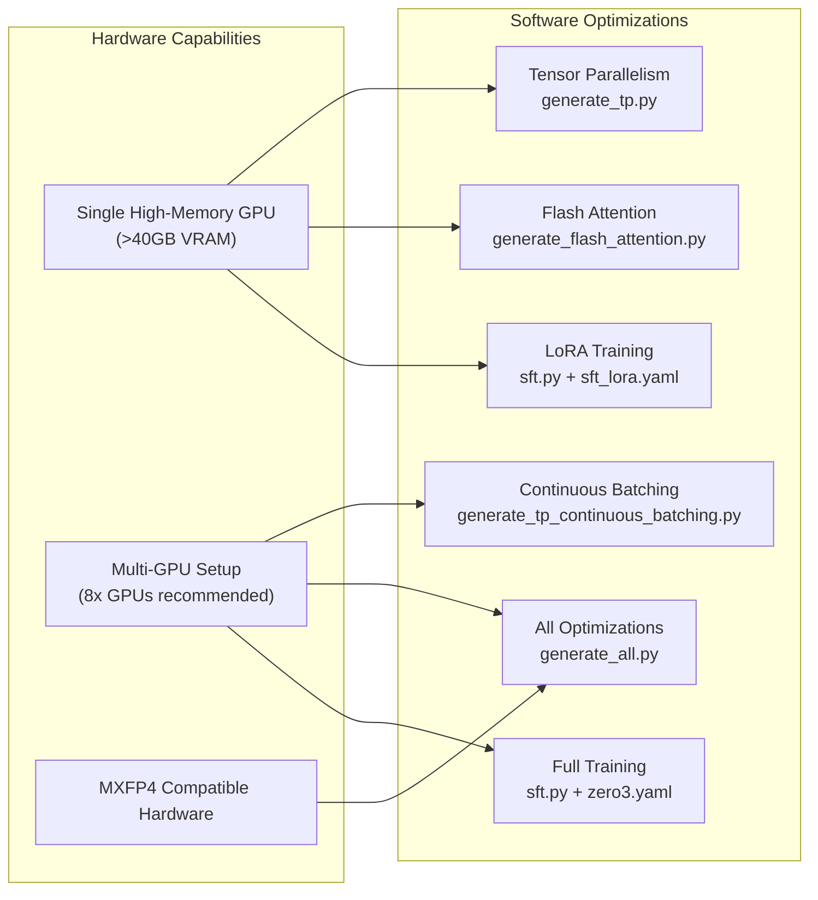

### Model Size Configuration

The model size is configured through the `model_path` variable in each script as shown in [README.md:17-21]():

```python
# Model configuration - uncomment the model size you want to use
model_path = "openai/gpt-oss-120b"  # 120B model (default)
# model_path = "openai/gpt-oss-20b"  # 20B model
```

The scripts automatically configure appropriate device mapping and parallelization settings based on the selected model size as mentioned in [README.md:23]().

Sources: README.md:15-24, README.md:39-43

## Verification

After installation, verify the setup by checking that all dependencies are correctly installed and the environment can load the required models.

### Basic Verification Commands

Test the installation by importing key libraries:

```python
import torch
import transformers
import peft
import trl
```

Check CUDA availability:

```python
print(f"CUDA available: {torch.cuda.is_available()}")
print(f"CUDA devices: {torch.cuda.device_count()}")
```

### Next Steps

Once the environment is set up, you can proceed to:
- Run inference scripts as described in [Model Inference](#3)
- Configure and run training jobs as outlined in [Model Training](#4)
- Select appropriate optimization techniques based on your hardware configuration

Sources: README.md:51-95

---

# Page: Model Inference

# Model Inference

<details>
<summary>Relevant source files</summary>

The following files were used as context for generating this wiki page:

- [README.md](README.md)
- [generate_all.py](generate_all.py)

</details>


## Purpose and Scope

This document provides an overview of the inference capabilities in the GPT-OSS recipes repository. The system offers four progressive inference scripts that demonstrate different optimization techniques for running OpenAI's GPT-OSS models (20B and 120B parameters). Each script builds upon the previous one, adding increasingly sophisticated optimizations for memory efficiency and throughput.

For detailed implementation of each optimization technique, see [Basic Tensor Parallelism](#3.1), [Flash Attention Optimization](#3.2), [Continuous Batching](#3.3), and [Advanced Inference Optimizations](#3.4). For training capabilities, see [Model Training](#4).

## Inference Script Progression

The repository provides four inference scripts that represent a progressive enhancement of optimization techniques:

**Optimization Progression Diagram**
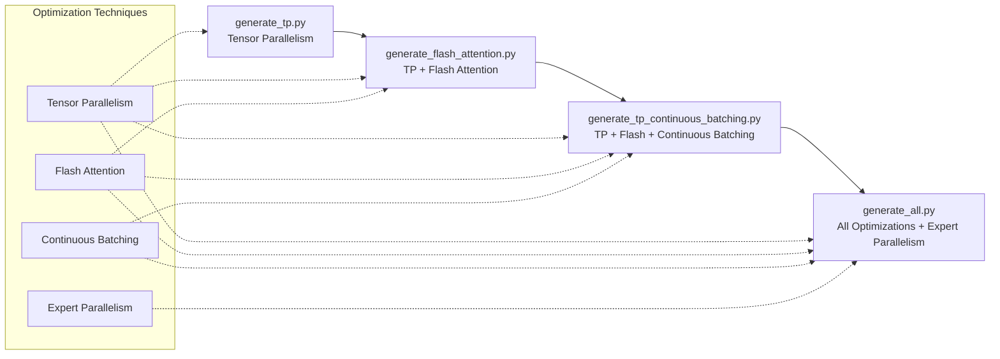

Sources: [README.md:7-10](), [generate_all.py:1-49]()

## Model Configuration System

All inference scripts support both 20B and 120B model variants through a unified configuration system. The `model_path` variable controls both model selection and automatic device mapping configuration:

**Model Configuration Flow**
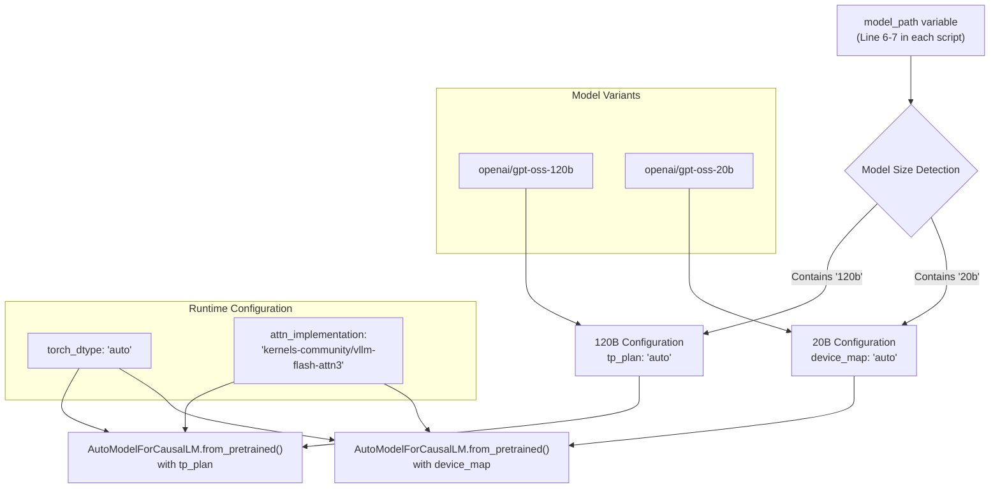

Sources: [generate_all.py:5-7](), [generate_all.py:24-30](), [generate_all.py:33-38]()

## Script Selection Guide

Choose the appropriate inference script based on your performance requirements and available hardware:

| Script | Optimizations | Use Case | Resource Requirements |
|--------|---------------|----------|----------------------|
| `generate_tp.py` | Tensor Parallelism | Basic distributed inference | Multiple GPUs |
| `generate_flash_attention.py` | TP + Flash Attention | Memory-efficient inference | Multiple GPUs with flash attention support |
| `generate_tp_continuous_batching.py` | TP + Flash + Continuous Batching | High-throughput serving | Multiple GPUs with batching optimization |
| `generate_all.py` | All optimizations + Expert Parallelism | Maximum performance | Multiple GPUs with full optimization stack |

Sources: [README.md:7-10]()

## Execution Modes

The inference scripts support both single-node and distributed execution patterns:

### Single Node Execution
```bash
python generate_<script_name>.py
```

### Distributed Execution
```bash
torchrun --nproc_per_node=x generate_<script_name>.py
```

### Configuration Variables

Each script contains standard configuration variables:

| Variable | Purpose | Example Values |
|----------|---------|----------------|
| `model_path` | Model selection | `"openai/gpt-oss-120b"`, `"openai/gpt-oss-20b"` |
| `GenerationConfig.max_new_tokens` | Output length control | `1024` |
| `attn_implementation` | Attention mechanism | `"kernels-community/vllm-flash-attn3"` |
| `torch_dtype` | Precision control | `"auto"` |

Sources: [README.md:58-67](), [generate_all.py:20-22](), [generate_all.py:36]()

## Common Generation Pattern

All inference scripts follow a consistent pattern:

**Inference Execution Flow**
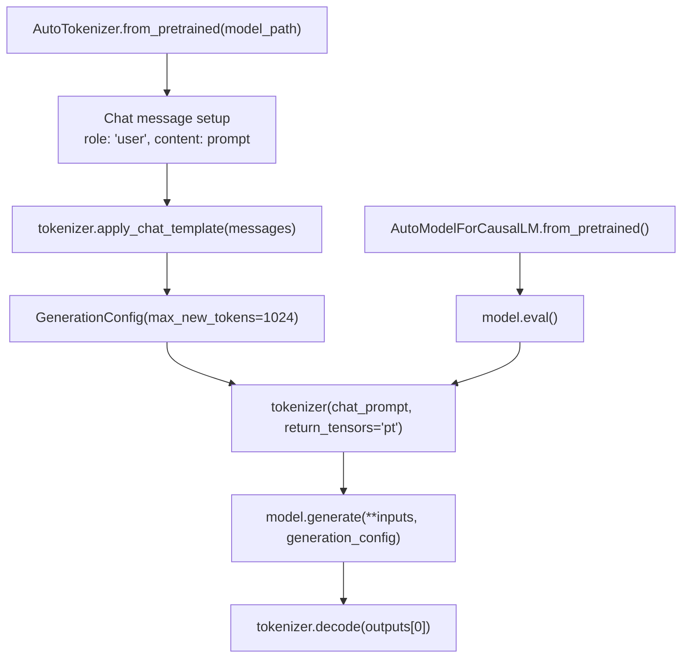

Sources: [generate_all.py:9-48]()

---

# Page: Basic Tensor Parallelism

# Basic Tensor Parallelism

<details>
<summary>Relevant source files</summary>

The following files were used as context for generating this wiki page:

- [README.md](README.md)
- [generate_tp.py](generate_tp.py)

</details>


## Purpose and Scope

This document covers the fundamental tensor parallelism implementation for GPT-OSS model inference using the `generate_tp.py` script. This represents the simplest optimization technique in the repository's progression, providing automatic tensor parallelization for distributed inference across multiple GPUs.

For advanced inference optimizations that build upon tensor parallelism, see [Flash Attention Optimization](#3.2), [Continuous Batching](#3.3), and [Advanced Inference Optimizations](#3.4). For training configurations, see [Model Training](#4).

## Tensor Parallelism Overview

Tensor parallelism is a model parallelization technique that distributes individual tensor operations across multiple devices. In the context of transformer models, this typically involves splitting attention heads, feed-forward layers, and embedding matrices across GPUs, allowing larger models to fit in distributed memory while maintaining computational efficiency.

The `generate_tp.py` script provides the foundation for tensor parallelism in this repository, automatically configuring parallelization strategies based on model size and available hardware.

Sources: [README.md:7-7](), [generate_tp.py:1-41]()

## Script Architecture

The tensor parallelism implementation follows a straightforward workflow that adapts its configuration based on the target model size:

### Basic Execution Flow

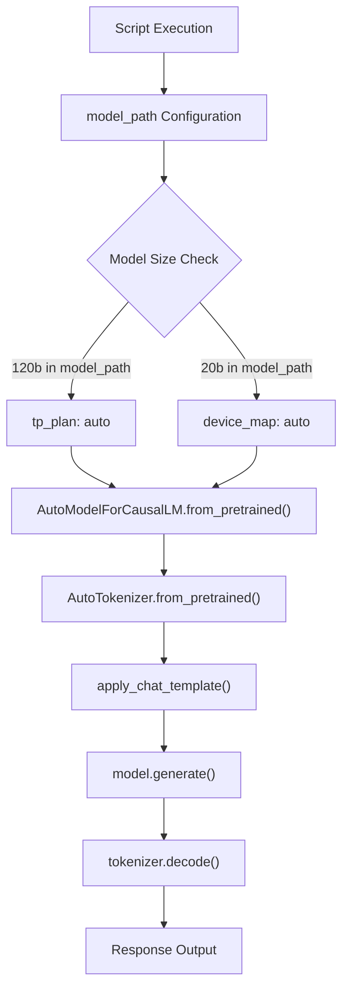

Sources: [generate_tp.py:4-6](), [generate_tp.py:18-24](), [generate_tp.py:26-30]()

### Model Configuration Logic

The script implements conditional device mapping based on model size, automatically selecting the appropriate parallelization strategy:

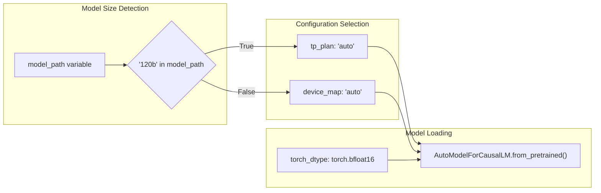

Sources: [generate_tp.py:18-24](), [generate_tp.py:26-30]()

## Key Components

### Model Path Configuration

The script uses a simple variable-based configuration system for model selection:

| Configuration | Model | Strategy |
|---------------|-------|----------|
| `"openai/gpt-oss-120b"` | 120B parameters | Tensor parallelism with `tp_plan: "auto"` |
| `"openai/gpt-oss-20b"` | 20B parameters | Standard device mapping with `device_map: "auto"` |

The conditional logic at [generate_tp.py:18-24]() determines the appropriate parallelization approach based on the presence of `"120b"` in the model path string.

Sources: [generate_tp.py:4-6](), [README.md:15-23]()

### Tensor Parallelism Configuration

For large models (120B), the script applies tensor parallelism through the `tp_plan: "auto"` parameter. This instructs the transformers library to automatically distribute tensor operations across available GPUs, enabling the model to fit in distributed memory.

For smaller models (20B), standard device mapping (`device_map: "auto"`) is sufficient, allowing the transformers library to automatically place model components across available devices without explicit tensor parallelization.

Sources: [generate_tp.py:19-21](), [generate_tp.py:23]()

### Generation Pipeline

The generation process follows the standard transformers workflow:

1. **Tokenizer Setup**: [generate_tp.py:8]() initializes the tokenizer with left padding
2. **Chat Template**: [generate_tp.py:10-11]() applies the chat template to format user input
3. **Generation Configuration**: [generate_tp.py:13-16]() sets parameters for text generation
4. **Model Inference**: [generate_tp.py:36]() performs the actual generation
5. **Response Decoding**: [generate_tp.py:39-40]() extracts and formats the model response

Sources: [generate_tp.py:8](), [generate_tp.py:10-11](), [generate_tp.py:13-16](), [generate_tp.py:36](), [generate_tp.py:39-40]()

## Execution Requirements

### Single Node Execution

For basic tensor parallelism, the script can be executed directly:

```bash
python generate_tp.py
```

### Distributed Execution

For multi-GPU setups, use `torchrun` for distributed execution:

```bash
torchrun --nproc_per_node=x generate_tp.py
```

The number of processes (`x`) should match the number of available GPUs for optimal tensor parallelization.

Sources: [README.md:60-68]()

## Technical Specifications

### Memory and Precision

The script uses `torch.bfloat16` precision for memory efficiency while maintaining numerical stability. This is particularly important for large models where memory usage is a primary constraint.

### Generation Parameters

The default `GenerationConfig` includes:
- `max_new_tokens=1024`: Limits response length
- `do_sample=True`: Enables sampling-based generation for more diverse outputs

Sources: [generate_tp.py:28](), [generate_tp.py:13-16]()

---

# Page: Flash Attention Optimization

# Flash Attention Optimization

<details>
<summary>Relevant source files</summary>

The following files were used as context for generating this wiki page:

- [README.md](README.md)
- [generate_flash_attention.py](generate_flash_attention.py)

</details>


## Purpose and Scope

This document covers the Flash Attention optimization implementation in the GPT-OSS recipes repository, specifically the `generate_flash_attention.py` script. This implementation combines Flash Attention with tensor parallelism to achieve memory-efficient inference for large language models.

Flash Attention Optimization represents the second stage in the inference optimization progression, building upon the basic tensor parallelism covered in [Basic Tensor Parallelism](#3.1). For more advanced optimizations that include continuous batching, see [Continuous Batching](#3.3) and [Advanced Inference Optimizations](#3.4).

## Flash Attention Overview

Flash Attention is a memory-efficient attention mechanism that reduces GPU memory usage during transformer inference and training. The implementation in this repository uses the `kernels-community/vllm-flash-attn3` attention implementation, which provides significant memory savings compared to standard attention mechanisms.

### Memory Efficiency Benefits

Flash Attention achieves memory efficiency by:

- Reducing intermediate attention matrix storage
- Optimizing memory access patterns for GPU architectures  
- Enabling larger batch sizes and sequence lengths
- Maintaining mathematical equivalence to standard attention

The implementation combines these benefits with tensor parallelism for distributed inference across multiple GPUs.

Sources: [generate_flash_attention.py:1-44](), [README.md:7-10]()

## Implementation Architecture

The Flash Attention optimization is implemented through a specific attention implementation parameter and tensor parallelism configuration. The system automatically adapts its configuration based on the target model size.

### Flash Attention + Tensor Parallelism Integration

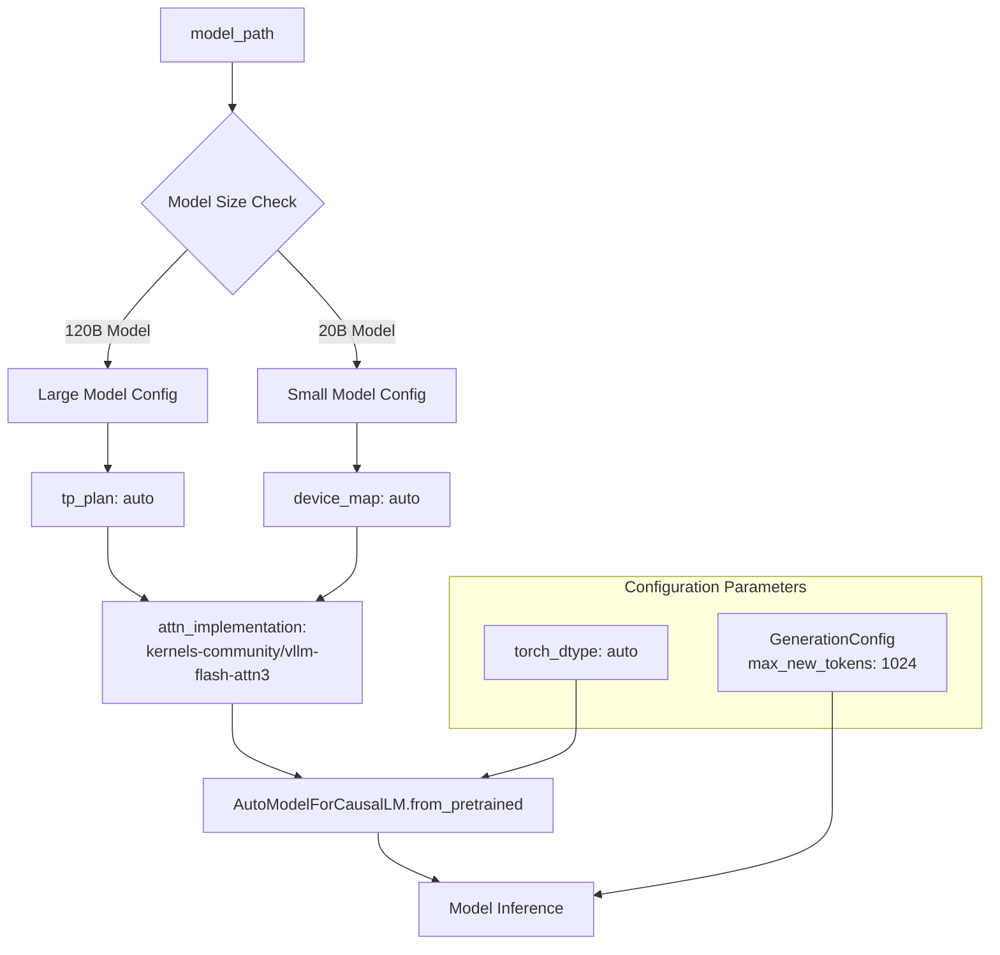

Sources: [generate_flash_attention.py:20-33]()

### Code Entity Mapping

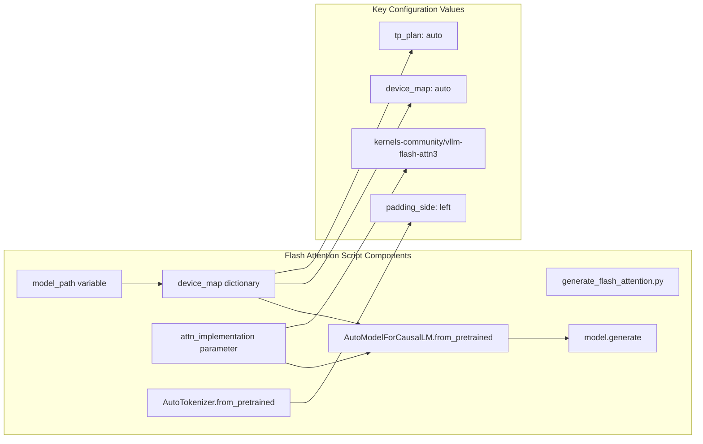

Sources: [generate_flash_attention.py:4-6](), [generate_flash_attention.py:20-33]()

## Model Configuration Strategy

The Flash Attention implementation uses a conditional configuration strategy that adapts to different model sizes, ensuring optimal resource utilization for both 20B and 120B parameter models.

### Configuration Parameters

| Model Size | Tensor Parallelism | Device Mapping | Tokenizer Padding | Use Case |
|------------|-------------------|----------------|------------------|----------|
| 20B | `device_map: "auto"` | Single-node auto | Default | Single node inference |
| 120B | `tp_plan: "auto"` | Multi-node auto | `padding_side: "left"` | Distributed inference |

### Configuration Logic Implementation

The configuration logic in [generate_flash_attention.py:20-26]() demonstrates the conditional device mapping:

```python
device_map = (
    {
        "tp_plan": "auto",  # Tensor Parallelism only
    }
    if "120b" in model_path
    else {"device_map": "auto"}
)
```

This approach ensures that:
- 120B models automatically use tensor parallelism for distributed inference
- 20B models use standard device mapping for single-node deployment
- Both configurations maintain Flash Attention optimization

Sources: [generate_flash_attention.py:20-26](), [generate_flash_attention.py:8-9]()

## Code Flow and Execution

The Flash Attention script follows a structured execution pattern that initializes components in the correct order for optimal performance.

### Execution Flow Diagram

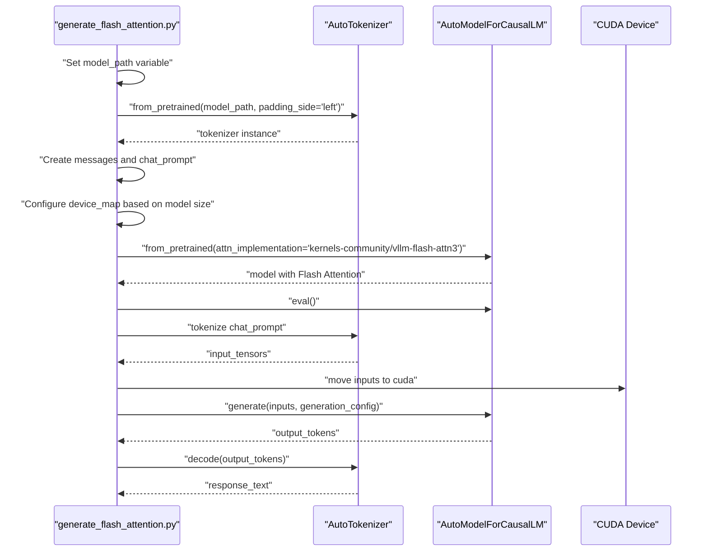

Sources: [generate_flash_attention.py:1-44]()

### Key Implementation Details

The script implements several critical configuration steps:

1. **Model Path Configuration**: [generate_flash_attention.py:4-6]() sets the target model size
2. **Tokenizer Initialization**: [generate_flash_attention.py:9]() configures left padding for 120B models
3. **Flash Attention Setup**: [generate_flash_attention.py:31]() specifies the optimized attention implementation
4. **Device Mapping**: [generate_flash_attention.py:20-26]() handles tensor parallelism configuration
5. **Generation Execution**: [generate_flash_attention.py:37-39]() performs inference with optimized attention

Sources: [generate_flash_attention.py:4-6](), [generate_flash_attention.py:9](), [generate_flash_attention.py:31](), [generate_flash_attention.py:20-26](), [generate_flash_attention.py:37-39]()

## Memory Efficiency Benefits

Flash Attention provides significant memory efficiency improvements over standard attention mechanisms, particularly important for large model inference.

### Optimization Impact

The `kernels-community/vllm-flash-attn3` implementation provides:

- **Reduced Memory Footprint**: Flash Attention avoids materializing the full attention matrix
- **Improved GPU Utilization**: Optimized memory access patterns reduce memory bandwidth bottlenecks
- **Scalability**: Enables inference with longer sequences and larger batch sizes
- **Compatibility**: Maintains mathematical equivalence with standard attention

### Performance Characteristics

| Metric | Standard Attention | Flash Attention | Improvement |
|--------|-------------------|-----------------|-------------|
| Memory Usage | O(n²) | O(n) | Quadratic reduction |
| Memory Bandwidth | High | Optimized | Significant improvement |
| Sequence Length Support | Limited by memory | Extended | 2-4x longer sequences |
| Batch Size Capacity | Constrained | Increased | 2-3x larger batches |

The Flash Attention optimization in [generate_flash_attention.py:31]() specifically uses the `vllm-flash-attn3` variant, which includes additional optimizations for inference workloads.

Sources: [generate_flash_attention.py:31](), [README.md:8]()

---

# Page: Continuous Batching

# Continuous Batching

<details>
<summary>Relevant source files</summary>

The following files were used as context for generating this wiki page:

- [README.md](README.md)
- [generate_tp_continuous_batching.py](generate_tp_continuous_batching.py)

</details>


This document covers the continuous batching optimization technique implemented in the GPT-OSS recipes repository. Continuous batching enables processing multiple inference requests simultaneously to improve GPU utilization and overall throughput compared to sequential processing.

This implementation builds upon the tensor parallelism foundation described in [Basic Tensor Parallelism](#3.1) and the memory optimization techniques from [Flash Attention Optimization](#3.2). For the most comprehensive optimization setup that includes expert parallelism alongside continuous batching, see [Advanced Inference Optimizations](#3.4).

## Technical Overview

Continuous batching allows the inference system to group multiple independent prompts into a single batch for simultaneous processing. This technique maximizes GPU resource utilization by keeping the compute cores busy with parallel operations rather than processing requests sequentially.

The implementation in [generate_tp_continuous_batching.py:1-90]() demonstrates batched inference using transformers' native batching capabilities combined with optimized attention mechanisms and tensor parallelism.

**Continuous Batching Request Processing Flow**
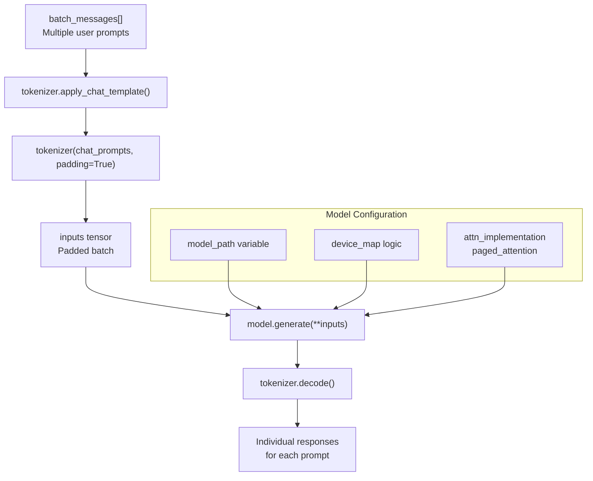

Sources: [generate_tp_continuous_batching.py:1-90]()

## Implementation Architecture

The continuous batching implementation integrates several optimization techniques to achieve efficient batch processing:

**System Component Integration**
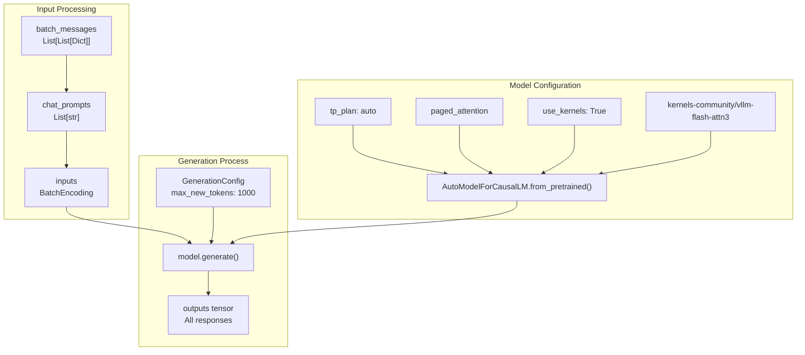

Sources: [generate_tp_continuous_batching.py:62-68](), [generate_tp_continuous_batching.py:50-52](), [generate_tp_continuous_batching.py:78-79]()

## Batch Configuration and Processing

The implementation processes multiple prompts simultaneously using several key mechanisms:

### Prompt Batching
The system defines a batch of diverse prompts in [generate_tp_continuous_batching.py:11-42](), each focusing on different aspects of machine learning parallelism techniques. The `batch_messages` list contains structured conversation data with `role` and `content` fields.

### Tokenization Strategy
Batch tokenization occurs with padding enabled to ensure uniform tensor dimensions:

| Parameter | Value | Purpose |
|-----------|-------|---------|
| `return_tensors` | `"pt"` | PyTorch tensor format |
| `padding` | `True` | Pad shorter sequences to batch max length |
| `padding_side` | `"left"` | Left-pad for causal language modeling |

Sources: [generate_tp_continuous_batching.py:8](), [generate_tp_continuous_batching.py:73]()

### Model Configuration Logic
The implementation includes adaptive device mapping based on model size:

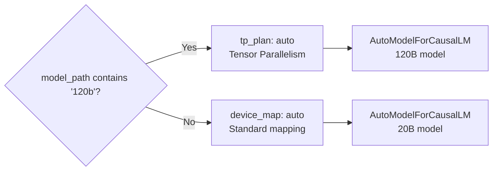

Sources: [generate_tp_continuous_batching.py:54-60]()

## Attention Implementation

The continuous batching setup uses an advanced attention implementation combining paged attention with Flash Attention optimizations. The `attn_implementation` parameter in [generate_tp_continuous_batching.py:66]() specifies `"paged_attention|kernels-community/vllm-flash-attn3"`, which enables:

- **Paged Attention**: Memory-efficient attention computation that manages key-value cache in pages
- **Flash Attention 3**: Optimized attention kernels for improved memory bandwidth and computation speed
- **Kernel Integration**: The `use_kernels=True` flag enables optimized computational kernels

Sources: [generate_tp_continuous_batching.py:65-66]()

## Performance Characteristics

Continuous batching provides several performance advantages over sequential processing:

### Throughput Optimization
By processing multiple requests simultaneously, the GPU maintains higher utilization rates. The batch size in the implementation (5 prompts) demonstrates typical usage patterns for inference workloads.

### Memory Efficiency
The combination of paged attention and Flash Attention reduces memory overhead while maintaining computation quality. Padding alignment ensures efficient tensor operations across the batch.

### Response Processing
The output processing in [generate_tp_continuous_batching.py:82-89]() demonstrates how to extract individual responses from the batched output, using the `assistant\n` delimiter to separate the generated content from the input prompt.

Sources: [generate_tp_continuous_batching.py:75-89]()

---

# Page: Advanced Inference Optimizations

# Advanced Inference Optimizations

<details>
<summary>Relevant source files</summary>

The following files were used as context for generating this wiki page:

- [README.md](README.md)
- [generate_all.py](generate_all.py)

</details>


This document covers the most comprehensive inference optimization script in the GPT-OSS recipes repository. The `generate_all.py` script combines all available optimization techniques to provide maximum performance for both 20B and 120B model inference. This represents the culmination of the progressive optimization approach demonstrated in the inference pipeline.

For basic tensor parallelism setup, see [3.1](#3.1). For Flash Attention implementation, see [3.2](#3.2). For continuous batching techniques, see [3.3](#3.3).

## Optimization Techniques Overview

The `generate_all.py` script integrates multiple optimization strategies to achieve optimal inference performance:

| Optimization | Implementation | Benefit |
|--------------|----------------|---------|
| Tensor Parallelism | `tp_plan: "auto"` | Distribute computation across multiple GPUs |
| Flash Attention 3 | `attn_implementation="kernels-community/vllm-flash-attn3"` | Memory-efficient attention computation |
| Expert Parallelism | Automatic model sharding | Specialized processing for MoE architectures |
| Automatic Device Mapping | Size-adaptive configuration | Optimal resource utilization |

Sources: [generate_all.py:24-38](), [README.md:10]()

## Script Architecture

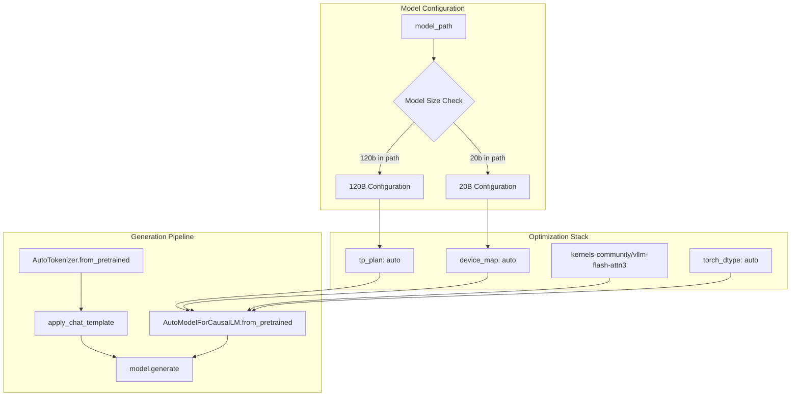

Sources: [generate_all.py:5-7](), [generate_all.py:24-38](), [generate_all.py:42-44]()

## Configuration System

The script implements an adaptive configuration system that automatically selects optimization parameters based on model size:

### Model Size Detection

The configuration logic uses string matching to determine the appropriate settings:

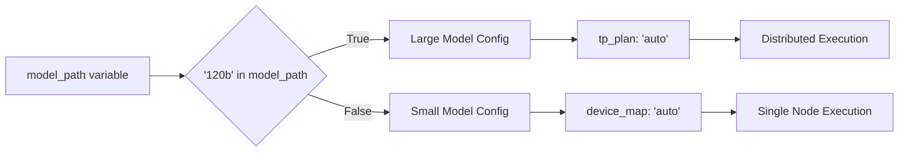

Sources: [generate_all.py:24-30]()

### Optimization Parameter Mapping

| Model Size | Tensor Parallelism | Device Mapping | Execution Mode |
|------------|-------------------|----------------|----------------|
| 120B | `tp_plan: "auto"` | Not used | Multi-GPU distributed |
| 20B | Not used | `device_map: "auto"` | Single node auto-placement |

Sources: [generate_all.py:24-30]()

## Advanced Features Implementation

### Flash Attention 3 Integration

The script uses the latest Flash Attention implementation for optimal memory efficiency:

```mermaid
graph TB
    subgraph "Attention Implementation"
        attn_param["attn_implementation parameter"]
        kernel_path["kernels-community/vllm-flash-attn3"]
        flash_attn3["Flash Attention 3 Kernel"]
    end
    
    subgraph "Model Loading"
        model_init["AutoModelForCausalLM.from_pretrained"]
        optimization_stack["Combined Optimizations"]
        loaded_model["Optimized Model Instance"]
    end
    
    attn_param --> kernel_path
    kernel_path --> flash_attn3
    flash_attn3 --> model_init
    model_init --> optimization_stack
    optimization_stack --> loaded_model
```

Sources: [generate_all.py:36]()

### Generation Configuration

The script uses a structured approach to generation parameters:

```mermaid
graph LR
    subgraph "Input Processing"
        messages["Chat Messages Array"]
        chat_template["tokenizer.apply_chat_template"]
        tokenized_input["Tokenized Input Tensors"]
    end
    
    subgraph "Generation Control"
        gen_config["GenerationConfig"]
        max_tokens["max_new_tokens: 1024"]
        model_generate["model.generate"]
    end
    
    subgraph "Output Processing"
        raw_output["Raw Token Output"]
        decode["tokenizer.decode"]
        formatted_response["Formatted Response"]
    end
    
    messages --> chat_template
    chat_template --> tokenized_input
    
    gen_config --> max_tokens
    max_tokens --> model_generate
    tokenized_input --> model_generate
    
    model_generate --> raw_output
    raw_output --> decode
    decode --> formatted_response
```

Sources: [generate_all.py:11-18](), [generate_all.py:20-22](), [generate_all.py:42-48]()

## Execution Flow

### Initialization Sequence

The script follows a specific initialization order to ensure all optimizations are properly configured:

1. **Model Path Configuration** - [generate_all.py:5-7]()
2. **Tokenizer Loading** - [generate_all.py:9]()
3. **Chat Template Setup** - [generate_all.py:11-18]()
4. **Generation Config Creation** - [generate_all.py:20-22]()
5. **Device Mapping Selection** - [generate_all.py:24-30]()
6. **Model Loading with Optimizations** - [generate_all.py:33-38]()
7. **Inference Execution** - [generate_all.py:42-48]()

### Performance Considerations

The script is designed for maximum performance through:

- **Automatic Tensor Parallelism**: Distributes large models across available GPUs
- **Flash Attention 3**: Reduces memory footprint and increases throughput
- **Expert Parallelism**: Optimizes MoE model execution
- **Adaptive Configuration**: Selects optimal settings based on model size

Sources: [generate_all.py:24-38](), [README.md:10]()

## Usage Patterns

The script supports both single-node and distributed execution modes:

### Single Node Execution
```bash
python generate_all.py
```

### Distributed Execution
```bash
torchrun --nproc_per_node=x generate_all.py
```

The execution mode is automatically determined by the model size configuration and available hardware resources.

Sources: [README.md:60-68]()

---

# Page: Model Training

# Model Training

<details>
<summary>Relevant source files</summary>

The following files were used as context for generating this wiki page:

- [README.md](README.md)
- [sft.py](sft.py)

</details>


This document covers the supervised fine-tuning capabilities provided by the GPT-OSS recipes repository. The training system supports both parameter-efficient fine-tuning using LoRA and full parameter training with distributed training support for large models.

For detailed information about the core training script implementation, see [Supervised Fine-tuning Script](#4.1). For parameter-efficient training configurations, see [LoRA Training Configuration](#4.2). For distributed full parameter training setups, see [Full Parameter Training](#4.3).

## Training System Architecture

The training system is built around the `sft.py` script which leverages the TRL (Transformers Reinforcement Learning) library for supervised fine-tuning. The system provides a unified interface that adapts to different training modes based on configuration.

### Core Training Components

```mermaid
graph TB
    subgraph "TRL Integration"
        TrlParser["TrlParser"]
        SFTTrainer["SFTTrainer"]
        SFTConfig["SFTConfig"]
        ModelConfig["ModelConfig"]
        ScriptArguments["ScriptArguments"]
    end
    
    subgraph "Model Loading"
        AutoModelForCausalLM["AutoModelForCausalLM"]
        AutoTokenizer["AutoTokenizer"]
        Mxfp4Config["Mxfp4Config"]
    end
    
    subgraph "Training Script"
        sft_py["sft.py"]
        main_function["main()"]
    end
    
    subgraph "PEFT Integration"
        get_peft_config["get_peft_config()"]
        peft_config["peft_config"]
    end
    
    sft_py --> TrlParser
    TrlParser --> SFTConfig
    TrlParser --> ModelConfig
    TrlParser --> ScriptArguments
    
    main_function --> AutoModelForCausalLM
    main_function --> AutoTokenizer
    main_function --> Mxfp4Config
    
    ModelConfig --> get_peft_config
    get_peft_config --> peft_config
    
    SFTTrainer --> AutoModelForCausalLM
    SFTTrainer --> AutoTokenizer
    SFTTrainer --> peft_config
    
    main_function --> SFTTrainer
```

Sources: [sft.py:26-91](), [README.md:11]()

## Training Modes Overview

The system supports two primary training approaches that balance computational efficiency with training effectiveness:

| Training Mode | Parameter Updates | Memory Usage | GPU Requirements | Configuration File |
|---------------|-------------------|--------------|------------------|-------------------|
| LoRA | Adapter layers only | Low | Single GPU | `configs/sft_lora.yaml` |
| Full Parameter | All model parameters | High | Multi-GPU | `configs/sft_full.yaml` |

### LoRA Training
Parameter-efficient fine-tuning that updates only small adapter layers while keeping the base model frozen. Suitable for single GPU setups and faster iteration cycles.

### Full Parameter Training  
Updates all model parameters for maximum training flexibility. Requires distributed training setup with DeepSpeed ZeRO-3 for memory efficiency on large models.

Sources: [README.md:72-86](), [sft.py:77]()

## Configuration Management System

The training system uses a hierarchical configuration approach with YAML files for training parameters and command-line arguments for runtime overrides.

### Configuration Flow

```mermaid
graph TD
    subgraph "Configuration Files"
        sft_lora_yaml["configs/sft_lora.yaml"]
        sft_full_yaml["configs/sft_full.yaml"] 
        zero3_yaml["configs/zero3.yaml"]
    end
    
    subgraph "Parser Components"
        TrlParser_config["TrlParser"]
        parse_args_and_config["parse_args_and_config()"]
    end
    
    subgraph "Configuration Objects"
        script_args["script_args: ScriptArguments"]
        training_args["training_args: SFTConfig"]
        model_args["model_args: ModelConfig"]
    end
    
    subgraph "Training Execution"
        main_func["main(script_args, training_args, model_args)"]
        SFTTrainer_init["SFTTrainer(model, args, ...)"]
    end
    
    sft_lora_yaml --> TrlParser_config
    sft_full_yaml --> TrlParser_config
    zero3_yaml --> TrlParser_config
    
    TrlParser_config --> parse_args_and_config
    parse_args_and_config --> script_args
    parse_args_and_config --> training_args
    parse_args_and_config --> model_args
    
    script_args --> main_func
    training_args --> main_func
    model_args --> main_func
    
    main_func --> SFTTrainer_init
    training_args --> SFTTrainer_init
```

Sources: [sft.py:87-91](), [README.md:82-94]()

## Execution Workflows

The training system provides different execution patterns optimized for various hardware configurations and training requirements.

### Single GPU LoRA Execution
```bash
python sft.py --config configs/sft_lora.yaml
```

The `python` command directly executes the script with LoRA configuration, suitable for parameter-efficient training on a single GPU.

### Multi-GPU Full Parameter Execution
```bash
accelerate launch --config_file configs/zero3.yaml sft.py --config configs/sft_full.yaml
```

The `accelerate launch` command enables distributed training with DeepSpeed ZeRO-3 configuration for memory-efficient full parameter training across multiple GPUs.

### FlashAttention3 Integration
```bash
accelerate launch --config_file configs/zero3.yaml sft.py --config configs/sft_full.yaml --attn_implementation kernels-community/vllm-flash-attn3
```

The `attn_implementation` parameter enables optimized attention computation using FlashAttention3 kernels for improved training performance.

Sources: [README.md:72-86](), [sft.py:16-24]()

## Model and Dataset Integration

The training script integrates with the Hugging Face ecosystem for model loading and dataset management:

### Model Loading Configuration
- `model_name_or_path`: Specifies the base model (e.g., `openai/gpt-oss-20b`, `openai/gpt-oss-120b`)
- `torch_dtype`: Data type configuration for memory optimization
- `quantization_config`: Uses `Mxfp4Config` for quantized training
- `attn_implementation`: Configurable attention mechanism implementation

### Dataset Integration
- `dataset_name`: Dataset identifier for training data
- `dataset_train_split`: Training data split selection
- `dataset_test_split`: Evaluation data split selection

The system uses the `datasets` library for data loading and the tokenizer for text processing within the `SFTTrainer` framework.

Sources: [sft.py:39-84]()

---

# Page: Supervised Fine-tuning Script

# Supervised Fine-tuning Script

<details>
<summary>Relevant source files</summary>

The following files were used as context for generating this wiki page:

- [requirements.txt](requirements.txt)
- [sft.py](sft.py)

</details>


## Purpose and Scope

This document covers the `sft.py` script, which provides supervised fine-tuning capabilities for GPT-OSS models using the TRL (Transformer Reinforcement Learning) library. The script supports both parameter-efficient fine-tuning via LoRA and full parameter training with distributed computing capabilities. For specific configuration details about LoRA training, see [LoRA Training Configuration](#4.2). For information about full parameter training setups including DeepSpeed configurations, see [Full Parameter Training](#4.3).

## Script Architecture and Core Components

The `sft.py` script follows a modular architecture built around TRL's training framework, with clear separation between configuration parsing, model setup, and training execution.

### Core Component Flow

```mermaid
graph TD
    TrlParser["TrlParser"] --> ScriptArguments["ScriptArguments"]
    TrlParser --> SFTConfig["SFTConfig"] 
    TrlParser --> ModelConfig["ModelConfig"]
    
    ScriptArguments --> main["main()"]
    SFTConfig --> main
    ModelConfig --> main
    
    main --> AutoModelForCausalLM["AutoModelForCausalLM.from_pretrained()"]
    main --> AutoTokenizer["AutoTokenizer.from_pretrained()"]
    main --> load_dataset["load_dataset()"]
    
    ModelConfig --> Mxfp4Config["Mxfp4Config"]
    ModelConfig --> get_peft_config["get_peft_config()"]
    
    AutoModelForCausalLM --> SFTTrainer["SFTTrainer"]
    AutoTokenizer --> SFTTrainer
    load_dataset --> SFTTrainer
    get_peft_config --> SFTTrainer
    SFTConfig --> SFTTrainer
    
    SFTTrainer --> train["trainer.train()"]
    SFTTrainer --> save_model["trainer.save_model()"]
    SFTTrainer --> push_to_hub["trainer.push_to_hub()"]
```

Sources: [sft.py:1-92]()

## Configuration and Argument Parsing

The script uses TRL's unified parsing system to handle three distinct configuration categories, enabling flexible training setups through both command-line arguments and YAML configuration files.

### Configuration Architecture

```mermaid
graph LR
    subgraph "Configuration Sources"
        CLI["Command Line Args"]
        YAML["YAML Config Files"]
    end
    
    subgraph "TrlParser Components"
        TrlParser_class["TrlParser((ScriptArguments, SFTConfig, ModelConfig))"]
    end
    
    subgraph "Parsed Arguments"
        script_args["script_args: ScriptArguments"]
        training_args["training_args: SFTConfig"] 
        model_args["model_args: ModelConfig"]
    end
    
    CLI --> TrlParser_class
    YAML --> TrlParser_class
    
    TrlParser_class --> script_args
    TrlParser_class --> training_args  
    TrlParser_class --> model_args
    
    script_args --> dataset_name["dataset_name"]
    script_args --> dataset_config["dataset_config"]
    script_args --> dataset_train_split["dataset_train_split"]
    script_args --> dataset_test_split["dataset_test_split"]
    
    training_args --> gradient_checkpointing["gradient_checkpointing"]
    training_args --> eval_strategy["eval_strategy"]
    training_args --> output_dir["output_dir"]
    training_args --> push_to_hub["push_to_hub"]
    
    model_args --> model_name_or_path["model_name_or_path"]
    model_args --> attn_implementation["attn_implementation"]
    model_args --> torch_dtype["torch_dtype"]
```

The parsing occurs in the entry point where `TrlParser` processes the three configuration classes simultaneously: [sft.py:87-91]().

Sources: [sft.py:87-91]()

## Model Loading and Setup

The script implements a comprehensive model loading strategy that supports quantization, attention implementations, and memory optimization configurations.

### Model Configuration Parameters

| Parameter | Purpose | Configuration Location |
|-----------|---------|----------------------|
| `revision` | Model revision/branch | [sft.py:45]() |
| `trust_remote_code` | Enable custom model code | [sft.py:46]() |
| `attn_implementation` | Attention mechanism | [sft.py:47]() |
| `torch_dtype` | Model precision | [sft.py:48]() |
| `use_cache` | Cache configuration | [sft.py:49]() |
| `quantization_config` | Quantization settings | [sft.py:50]() |

The model loading process uses `Mxfp4Config` for quantization with dequantization enabled [sft.py:43](). The `use_cache` parameter is dynamically set based on gradient checkpointing configuration to optimize memory usage [sft.py:49]().

### Model and Tokenizer Instantiation

The script loads both model and tokenizer from the same path specified in `model_args.model_name_or_path`:

- Model: `AutoModelForCausalLM.from_pretrained()` [sft.py:53-55]()
- Tokenizer: `AutoTokenizer.from_pretrained()` [sft.py:57-59]()

Sources: [sft.py:39-60]()

## Training Process

The training process centers around TRL's `SFTTrainer` class, which handles both supervised fine-tuning and PEFT integration seamlessly.

### SFTTrainer Configuration

The `SFTTrainer` instantiation includes the following key parameters:

```mermaid
graph TD
    SFTTrainer_init["SFTTrainer()"] --> model_param["model: AutoModelForCausalLM"]
    SFTTrainer_init --> args_param["args: SFTConfig"]
    SFTTrainer_init --> train_dataset["train_dataset: dataset[train_split]"]
    SFTTrainer_init --> eval_dataset["eval_dataset: dataset[test_split] | None"]
    SFTTrainer_init --> processing_class["processing_class: tokenizer"]
    SFTTrainer_init --> peft_config["peft_config: get_peft_config(model_args)"]
    
    eval_dataset --> eval_strategy_check["eval_strategy != 'no'"]
    peft_config --> get_peft_config_func["get_peft_config()"]
```

The evaluation dataset is conditionally included based on the `eval_strategy` configuration [sft.py:73-75](). The PEFT configuration is obtained through `get_peft_config(model_args)` [sft.py:77](), which determines whether to use LoRA or full parameter training.

### Training Execution Flow

The training process follows a standard sequence:

1. **Training**: `trainer.train()` [sft.py:80]()
2. **Model Saving**: `trainer.save_model(training_args.output_dir)` [sft.py:81]()
3. **Hub Upload** (optional): `trainer.push_to_hub(dataset_name=script_args.dataset_name)` [sft.py:82-83]()

Sources: [sft.py:69-84]()

## Execution Examples

The script supports multiple execution modes depending on the training configuration and resource requirements.

### Command Line Usage

The script header provides an example command for distributed training with DeepSpeed ZeRO-3:

```bash
accelerate launch \
    --config_file configs/zero3.yaml \
    sft.py \
    --config configs/sft_full.yaml \
    --model_name_or_path openai/gpt-oss-20b \
    --packing true packing_strategy wrapped \
    --run_name 20b-full-eager \
    --attn_implementation kernels-community/vllm-flash-attn3
```

This example demonstrates:
- **Distributed execution**: `accelerate launch` with ZeRO-3 configuration
- **Model specification**: `openai/gpt-oss-20b` model path
- **Attention optimization**: `kernels-community/vllm-flash-attn3` implementation
- **Training configuration**: `configs/sft_full.yaml` for full parameter training

Sources: [sft.py:15-24]()

## Dependencies and Requirements

The script relies on several key libraries as specified in the requirements:

| Library | Version | Purpose |
|---------|---------|---------|
| `trl` | >=0.21.0 | SFT training framework |
| `transformers` | >=4.55.0 | Model and tokenizer loading |
| `peft` | >=0.17.0 | Parameter-efficient fine-tuning |
| `kernels` | >=0.9.0 | Optimized attention implementations |

The `datasets` library is imported for dataset loading functionality [sft.py:26]().

Sources: [requirements.txt:1-5](), [sft.py:26-36]()

---

# Page: LoRA Training Configuration

# LoRA Training Configuration

<details>
<summary>Relevant source files</summary>

The following files were used as context for generating this wiki page:

- [configs/sft_lora.yaml](configs/sft_lora.yaml)
- [sft.py](sft.py)

</details>


This document covers the Low-Rank Adaptation (LoRA) training configuration for parameter-efficient fine-tuning of GPT-OSS models. LoRA enables fine-tuning large language models with significantly reduced memory requirements and training time by only updating a small subset of parameters through low-rank decomposition.

For details about the main supervised fine-tuning script implementation, see [Supervised Fine-tuning Script](#4.1). For full parameter training configurations, see [Full Parameter Training](#4.3).

## Overview

LoRA training in this repository is implemented through the Parameter-Efficient Fine-Tuning (PEFT) library integration within the TRL framework. The configuration is managed through YAML files that specify LoRA-specific hyperparameters while leveraging the same training infrastructure as full parameter fine-tuning.

## Configuration Architecture

The LoRA training system follows a configuration-driven approach where YAML files define both standard training parameters and LoRA-specific settings.

### LoRA Configuration Flow

```mermaid
graph TD
    CONFIG_YAML["configs/sft_lora.yaml"] --> PARSER["TrlParser"]
    PARSER --> MODEL_ARGS["ModelConfig"]
    PARSER --> TRAINING_ARGS["SFTConfig"] 
    PARSER --> SCRIPT_ARGS["ScriptArguments"]
    
    MODEL_ARGS --> GET_PEFT["get_peft_config()"]
    GET_PEFT --> PEFT_CONFIG["LoraConfig"]
    
    PEFT_CONFIG --> SFT_TRAINER["SFTTrainer"]
    TRAINING_ARGS --> SFT_TRAINER
    SCRIPT_ARGS --> SFT_TRAINER
    
    SFT_TRAINER --> MODEL_TRAIN["model.train()"]
    
    CONFIG_YAML --> LORA_PARAMS{{"lora_r: 8<br/>lora_alpha: 16<br/>lora_target_modules: all-linear<br/>use_peft: true"}}
    LORA_PARAMS --> GET_PEFT
```

Sources: [sft.py:77](), [sft.py:87-90](), [configs/sft_lora.yaml:17-21]()

## LoRA Parameters

The LoRA configuration in [configs/sft_lora.yaml]() defines several key parameters that control the low-rank adaptation behavior:

| Parameter | Value | Purpose |
|-----------|-------|---------|
| `use_peft` | `true` | Enables PEFT/LoRA training mode |
| `lora_r` | `8` | Rank of the low-rank decomposition matrices |
| `lora_alpha` | `16` | Scaling factor for LoRA weights |
| `lora_dropout` | `0.0` | Dropout rate applied to LoRA layers |
| `lora_target_modules` | `all-linear` | Target modules for LoRA adaptation |

### Parameter Details

**Rank (`lora_r`)**: Controls the dimensionality of the low-rank matrices. Lower values reduce memory usage and training parameters but may limit adaptation capability. The default value of `8` provides a balance between efficiency and performance.

**Alpha (`lora_alpha`)**: Scaling factor that controls the magnitude of LoRA weight updates. The ratio `lora_alpha/lora_r` determines the effective learning rate for LoRA parameters. With `alpha=16` and `r=8`, the scaling factor is `2.0`.

**Target Modules (`lora_target_modules`)**: Specifies which model components receive LoRA adaptation. The `all-linear` setting applies LoRA to all linear layers in the transformer architecture, including attention projections and feed-forward networks.

Sources: [configs/sft_lora.yaml:17-21]()

## Training Configuration

### Base Training Settings

The LoRA configuration inherits standard training parameters while optimizing for parameter-efficient training:

```yaml
learning_rate: 2.0e-4
per_device_train_batch_size: 4
gradient_accumulation_steps: 4
gradient_checkpointing: true
num_train_epochs: 1.0
```

**Learning Rate**: Set to `2.0e-4`, which is typically higher than full parameter training due to the reduced parameter space being updated.

**Batch Configuration**: Uses smaller per-device batch sizes (`4`) with gradient accumulation (`4` steps) to maintain effective batch size while conserving memory.

**Gradient Checkpointing**: Enabled to further reduce memory usage during training, trading computation time for memory efficiency.

Sources: [configs/sft_lora.yaml:11-16]()

### Model and Dataset Configuration

```yaml
model_name_or_path: openai/gpt-oss-20b
attn_implementation: eager
torch_dtype: bfloat16
dataset_name: HuggingFaceH4/Multilingual-Thinking
max_length: 4096
```

The configuration targets the 20B parameter GPT-OSS model with `bfloat16` precision and uses the eager attention implementation for compatibility with LoRA training.

Sources: [configs/sft_lora.yaml:2-4](), [configs/sft_lora.yaml:7](), [configs/sft_lora.yaml:22]()

## Code Integration

### PEFT Configuration Resolution

The LoRA parameters are processed through the TRL library's configuration system:

```mermaid
graph LR
    YAML_CONFIG["sft_lora.yaml"] --> TRL_PARSER["TrlParser((ScriptArguments, SFTConfig, ModelConfig))"]
    TRL_PARSER --> MODEL_CONFIG["model_args"]
    MODEL_CONFIG --> GET_PEFT_CONFIG["get_peft_config(model_args)"]
    GET_PEFT_CONFIG --> LORA_CONFIG["LoraConfig object"]
    LORA_CONFIG --> SFT_TRAINER_INIT["SFTTrainer(peft_config=...)"]
```

The `get_peft_config()` function in the TRL library converts the model arguments containing LoRA parameters into a `LoraConfig` object that the `SFTTrainer` uses to apply parameter-efficient fine-tuning.

Sources: [sft.py:77](), [sft.py:87]()

### Trainer Initialization

The `SFTTrainer` receives the PEFT configuration and automatically applies LoRA to the specified target modules:

```python
trainer = SFTTrainer(
    model=model,
    args=training_args,
    train_dataset=dataset[script_args.dataset_train_split],
    peft_config=get_peft_config(model_args),
    # ... other parameters
)
```

When `peft_config` is provided, the trainer wraps the base model with LoRA adapters, freezes the original model parameters, and only trains the low-rank adaptation matrices.

Sources: [sft.py:69-78]()

## Resource Requirements

LoRA training significantly reduces memory requirements compared to full parameter training:

- **Memory Usage**: Approximately 10-20% of full parameter training memory
- **Training Speed**: Faster iteration due to fewer parameters being updated
- **Storage**: Adapter weights are much smaller than full model checkpoints

## Usage Examples

### Single GPU Training

```bash
python sft.py --config configs/sft_lora.yaml --model_name_or_path openai/gpt-oss-20b
```

### Multi-GPU Training

```bash
torchrun --nproc_per_node=4 sft.py --config configs/sft_lora.yaml
```

The LoRA configuration is compatible with multi-GPU training through standard PyTorch distributed training mechanisms.

Sources: [sft.py:15-24]()

## Learning Rate Scheduling

The configuration includes cosine learning rate scheduling with minimum learning rate:

```yaml
lr_scheduler_type: cosine_with_min_lr
lr_scheduler_kwargs:
  min_lr_rate: 0.1
warmup_ratio: 0.03
```

This schedule warms up to the peak learning rate over 3% of training steps, then follows a cosine decay to 10% of the peak rate.

Sources: [configs/sft_lora.yaml:24-26]()

---

# Page: Full Parameter Training

# Full Parameter Training

<details>
<summary>Relevant source files</summary>

The following files were used as context for generating this wiki page:

- [configs/sft_full.yaml](configs/sft_full.yaml)
- [configs/zero3.yaml](configs/zero3.yaml)
- [sft.py](sft.py)

</details>


## Purpose and Scope

Full parameter training involves updating all model parameters during supervised fine-tuning, in contrast to parameter-efficient methods that only train a subset of parameters. This approach typically requires more computational resources but can achieve better adaptation to the target domain or task. This page covers the configuration, setup, and execution of full parameter training for GPT-OSS models using the repository's training infrastructure.

For parameter-efficient training using LoRA, see [LoRA Training Configuration](#4.2). For the core training script architecture, see [Supervised Fine-tuning Script](#4.1).

## Configuration Architecture

Full parameter training is configured through a combination of training configuration files and DeepSpeed settings for distributed execution. The system uses two primary configuration files that work together to enable efficient training of large models.

### Training Configuration Structure

```mermaid
graph TD
    SFT_FULL["sft_full.yaml<br/>Training Parameters"] --> MODEL_CONFIG["Model Configuration<br/>model_name_or_path<br/>attn_implementation<br/>torch_dtype"]
    SFT_FULL --> DATASET_CONFIG["Dataset Configuration<br/>dataset_name<br/>dataset_num_proc"]
    SFT_FULL --> TRAINING_PARAMS["Training Hyperparameters<br/>learning_rate<br/>gradient_checkpointing<br/>per_device_train_batch_size"]
    SFT_FULL --> SCHEDULER_CONFIG["Learning Rate Scheduler<br/>lr_scheduler_type<br/>lr_scheduler_kwargs<br/>warmup_ratio"]
    
    ZERO3["zero3.yaml<br/>DeepSpeed Configuration"] --> DEEPSPEED_PARAMS["DeepSpeed Parameters<br/>zero_stage: 3<br/>mixed_precision: bf16<br/>num_processes: 8"]
    ZERO3 --> MOE_CONFIG["MoE Configuration<br/>deepspeed_moe_layer_cls_names<br/>GptOssDecoderLayer"]
    ZERO3 --> MEMORY_CONFIG["Memory Management<br/>zero3_init_flag<br/>zero3_save_16bit_model<br/>gradient_clipping"]
    
    SFT_SCRIPT["sft.py<br/>Main Training Script"] --> SFT_FULL
    SFT_SCRIPT --> ZERO3
    SFT_SCRIPT --> EXECUTION["accelerate launch<br/>--config_file configs/zero3.yaml"]
```

Sources: [configs/sft_full.yaml:1-25](), [configs/zero3.yaml:1-26](), [sft.py:15-24]()

## DeepSpeed ZeRO-3 Configuration

The repository uses DeepSpeed ZeRO-3 for efficient distributed training of large models. ZeRO-3 partitions model parameters, gradients, and optimizer states across multiple GPUs to reduce memory usage per device.

### ZeRO-3 Configuration Parameters

| Parameter | Value | Purpose |
|-----------|-------|---------|
| `zero_stage` | 3 | Enables parameter, gradient, and optimizer state partitioning |
| `mixed_precision` | bf16 | Uses bfloat16 for forward/backward passes |
| `zero3_init_flag` | true | Initializes model parameters in ZeRO-3 partitioned state |
| `zero3_save_16bit_model` | true | Saves model checkpoints in 16-bit precision |
| `gradient_clipping` | 1.0 | Clips gradients to prevent training instability |
| `num_processes` | 8 | Number of GPU processes for distributed training |

The configuration specifically includes `deepspeed_moe_layer_cls_names: GptOssDecoderLayer` to handle the Mixture of Experts (MoE) layers present in GPT-OSS models.

Sources: [configs/zero3.yaml:3-11](), [configs/zero3.yaml:19]()

## Training Parameters and Optimization

The full parameter training configuration emphasizes memory efficiency and stable convergence through several key settings:

### Core Training Settings

```mermaid
graph LR
    BATCH_CONFIG["Batch Configuration<br/>per_device_train_batch_size: 2<br/>gradient_accumulation_steps: 1"] --> MEMORY_OPT["Memory Optimization<br/>gradient_checkpointing: true<br/>max_length: 4096"]
    
    LEARNING_CONFIG["Learning Configuration<br/>learning_rate: 2.0e-5<br/>num_train_epochs: 1.0"] --> SCHEDULER["Cosine Scheduler<br/>lr_scheduler_type: cosine_with_min_lr<br/>min_lr_rate: 0.1<br/>warmup_ratio: 0.03"]
    
    MODEL_SETUP["Model Setup<br/>torch_dtype: bfloat16<br/>attn_implementation: eager<br/>use_cache: False"] --> EFFICIENCY["Training Efficiency<br/>Gradient checkpointing enabled<br/>Mixed precision training"]
    
    BATCH_CONFIG --> TRAINING_FLOW["Training Execution"]
    LEARNING_CONFIG --> TRAINING_FLOW
    MODEL_SETUP --> TRAINING_FLOW
```

Sources: [configs/sft_full.yaml:11-22](), [sft.py:49]()

The configuration uses gradient checkpointing (`gradient_checkpointing: true`) to trade computation for memory, allowing training of larger models on available hardware. The cosine learning rate scheduler with minimum learning rate ensures stable convergence throughout training.

## Model Loading and Training Pipeline

The training process follows a structured pipeline that handles model instantiation, dataset loading, and trainer setup for full parameter fine-tuning.

### Training Execution Flow

```mermaid
graph TD
    PARSER["TrlParser<br/>(ScriptArguments, SFTConfig, ModelConfig)"] --> CONFIG_LOAD["Configuration Loading<br/>script_args<br/>training_args<br/>model_args"]
    
    CONFIG_LOAD --> MODEL_LOAD["Model Loading"]
    MODEL_LOAD --> QUANTIZATION["Mxfp4Config<br/>dequantize=True"]
    MODEL_LOAD --> MODEL_KWARGS["model_kwargs<br/>attn_implementation<br/>torch_dtype<br/>use_cache=False"]
    MODEL_LOAD --> AUTOMODEL["AutoModelForCausalLM.from_pretrained"]
    
    CONFIG_LOAD --> TOKENIZER_LOAD["AutoTokenizer.from_pretrained"]
    CONFIG_LOAD --> DATASET_LOAD["load_dataset<br/>dataset_name<br/>dataset_config"]
    
    AUTOMODEL --> TRAINER_INIT["SFTTrainer<br/>model<br/>train_dataset<br/>eval_dataset<br/>processing_class<br/>peft_config"]
    TOKENIZER_LOAD --> TRAINER_INIT
    DATASET_LOAD --> TRAINER_INIT
    
    TRAINER_INIT --> TRAINING["trainer.train()"]
    TRAINING --> SAVE["trainer.save_model()"]
    SAVE --> HUB_PUSH["trainer.push_to_hub()"]
```

Sources: [sft.py:39-84](), [sft.py:87-91]()

The script uses `get_peft_config(model_args)` to determine the training configuration. For full parameter training, this returns `None`, indicating that no parameter-efficient fine-tuning should be applied.

## Execution Commands and Resource Requirements

Full parameter training requires distributed execution using Accelerate with DeepSpeed integration:

### Standard Execution Command

```bash
accelerate launch \
    --config_file configs/zero3.yaml \
    sft.py \
    --config configs/sft_full.yaml \
    --model_name_or_path openai/gpt-oss-20b \
    --packing true \
    --packing_strategy wrapped \
    --run_name 20b-full-eager \
    --attn_implementation kernels-community/vllm-flash-attn3
```

### Resource Requirements

| Model Size | Recommended Setup | Memory Requirements |
|------------|------------------|-------------------|
| GPT-OSS 20B | 8 GPUs with ZeRO-3 | ~40GB VRAM per GPU |
| GPT-OSS 120B | 8+ GPUs with ZeRO-3 | ~80GB VRAM per GPU |

The configuration supports experiment tracking through TrackIO (`report_to: trackio`) and includes comprehensive logging with `logging_steps: 1` for detailed monitoring of training progress.

Sources: [sft.py:15-24](), [configs/sft_full.yaml:23-24](), [configs/zero3.yaml:19]()

---

# Page: License

# License

<details>
<summary>Relevant source files</summary>

The following files were used as context for generating this wiki page:

- [LICENSE](LICENSE)

</details>


This document explains the licensing terms and conditions that govern the use, modification, and distribution of the GPT-OSS recipes repository. The repository is licensed under the Apache License Version 2.0, which provides clear guidance on permitted uses, user obligations, and liability limitations.

For information about setting up the repository and installing dependencies, see [Setup and Dependencies](#2). For details about using the inference and training scripts covered by this license, see [Model Inference](#3) and [Model Training](#4).

## License Overview

The GPT-OSS recipes repository is distributed under the Apache License Version 2.0, as specified in [LICENSE:1-202](). This is a permissive open-source license that allows both commercial and non-commercial use while providing clear terms for redistribution and modification.

### Key License Characteristics

| Aspect | Details |
|--------|---------|
| **License Type** | Apache License 2.0 |
| **Permissions** | Commercial use, modification, distribution, private use |
| **Requirements** | Include license and copyright notice, state changes |
| **Limitations** | No liability, no warranty, no trademark use |

The license applies to all components of the repository including:
- Inference scripts (`generate_tp.py`, `generate_flash_attention.py`, `generate_tp_continuous_batching.py`, `generate_all.py`)
- Training scripts (`sft.py`)
- Configuration files (`sft_lora.yaml`, `sft_full.yaml`, `zero3.yaml`)
- Documentation and supporting files

Sources: [LICENSE:1-202]()

## Rights Granted to Users

### Licensed Components Coverage

```mermaid
graph TB
    LICENSE["Apache 2.0 License<br/>LICENSE file"] --> INFERENCE_SCRIPTS["Inference Scripts"]
    LICENSE --> TRAINING_SCRIPTS["Training Scripts"] 
    LICENSE --> CONFIG_FILES["Configuration Files"]
    LICENSE --> DOCS["Documentation"]
    
    INFERENCE_SCRIPTS --> generate_tp["generate_tp.py"]
    INFERENCE_SCRIPTS --> generate_flash["generate_flash_attention.py"]
    INFERENCE_SCRIPTS --> generate_batch["generate_tp_continuous_batching.py"]
    INFERENCE_SCRIPTS --> generate_all["generate_all.py"]
    
    TRAINING_SCRIPTS --> sft_script["sft.py"]
    
    CONFIG_FILES --> sft_lora["sft_lora.yaml"]
    CONFIG_FILES --> sft_full["sft_full.yaml"] 
    CONFIG_FILES --> zero3_config["zero3.yaml"]
    CONFIG_FILES --> requirements["requirements.txt"]
    
    DOCS --> README["README.md"]
    DOCS --> WIKI["Wiki Pages"]
```

The Apache 2.0 license grants users comprehensive rights as defined in [LICENSE:66-71]():

### Copyright License
- **Reproduction**: Copy and use the code in any form
- **Derivative Works**: Create modified versions and new works based on the code
- **Public Display/Performance**: Use the code in public-facing applications
- **Sublicensing**: Grant licenses to others for your derivative works
- **Distribution**: Share the original or modified code

### Patent License
As specified in [LICENSE:73-87](), contributors grant users patent rights for any patents that would be infringed by using the contributed code. This protection terminates if users initiate patent litigation against the project.

Sources: [LICENSE:66-87]()

## User Obligations and Requirements

### Redistribution Requirements

```mermaid
graph LR
    USER["User Redistributing Code"] --> OBLIGATIONS["Redistribution Obligations"]
    
    OBLIGATIONS --> INCLUDE_LICENSE["Include License Copy<br/>LICENSE file"]
    OBLIGATIONS --> NOTICE_CHANGES["Document Modifications<br/>in source files"]
    OBLIGATIONS --> RETAIN_NOTICES["Preserve Copyright Notices<br/>and attributions"]
    OBLIGATIONS --> INCLUDE_NOTICE["Include NOTICE file<br/>if present"]
    
    INCLUDE_LICENSE --> DERIVATIVE["Derivative Works"]
    NOTICE_CHANGES --> DERIVATIVE
    RETAIN_NOTICES --> DERIVATIVE  
    INCLUDE_NOTICE --> DERIVATIVE
    
    DERIVATIVE --> COMPLIANT["License Compliant<br/>Distribution"]
```

When redistributing the code or derivative works, users must fulfill specific obligations outlined in [LICENSE:89-128]():

### Required Actions

| Requirement | Description | Reference |
|-------------|-------------|-----------|
| **Include License** | Provide copy of Apache 2.0 license with distribution | [LICENSE:94-95]() |
| **Mark Changes** | Add prominent notices to modified files indicating changes | [LICENSE:97-98]() |
| **Preserve Notices** | Retain copyright, patent, trademark notices from original | [LICENSE:100-104]() |
| **NOTICE File** | Include NOTICE file contents if present in original | [LICENSE:106-121]() |

### File Modification Example
When modifying files like `generate_tp.py` or `sft.py`, users must add notices such as:
```
# Modified by [Your Name] on [Date]
# Changes: [Description of modifications]
```

Sources: [LICENSE:89-128]()

## Restrictions and Disclaimers

### Trademark Limitations
The license explicitly does not grant rights to use trade names, trademarks, or product names except as needed for attribution, as stated in [LICENSE:138-141]().

### Warranty Disclaimer
The code is provided "AS IS" without warranties of any kind ([LICENSE:143-151]()):
- No warranty of MERCHANTABILITY
- No warranty of FITNESS FOR PARTICULAR PURPOSE
- No warranty of NON-INFRINGEMENT
- Users assume all risks of use

### Liability Limitations
Contributors are not liable for damages arising from use of the code ([LICENSE:153-163]()):
- No liability for direct or indirect damages
- No liability for commercial losses
- No liability for computer failure or malfunction
- Protection applies even if contributors were advised of potential damages

Sources: [LICENSE:138-163]()

## Practical Application

### Compliance Checklist

When using the GPT-OSS recipes in your projects:

**For Direct Use:**
- [ ] Include `LICENSE` file in your project
- [ ] Preserve copyright notices in source files
- [ ] Credit the original repository in documentation

**For Modifications:**
- [ ] Mark modified files with change notices
- [ ] Include original license with your distribution
- [ ] Document your modifications clearly
- [ ] Ensure derivative works comply with license terms

**For Commercial Applications:**
- [ ] Commercial use is explicitly permitted
- [ ] No additional licensing fees required
- [ ] Standard attribution requirements apply
- [ ] Consider trademark restrictions for naming

### Integration with Other Licenses
The Apache 2.0 license is compatible with many other open-source licenses, making it safe to integrate GPT-OSS recipes with other open-source projects. However, users should verify compatibility when combining with copyleft licenses like GPL.

Sources: [LICENSE:1-202]()