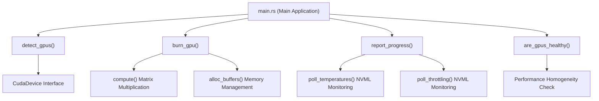
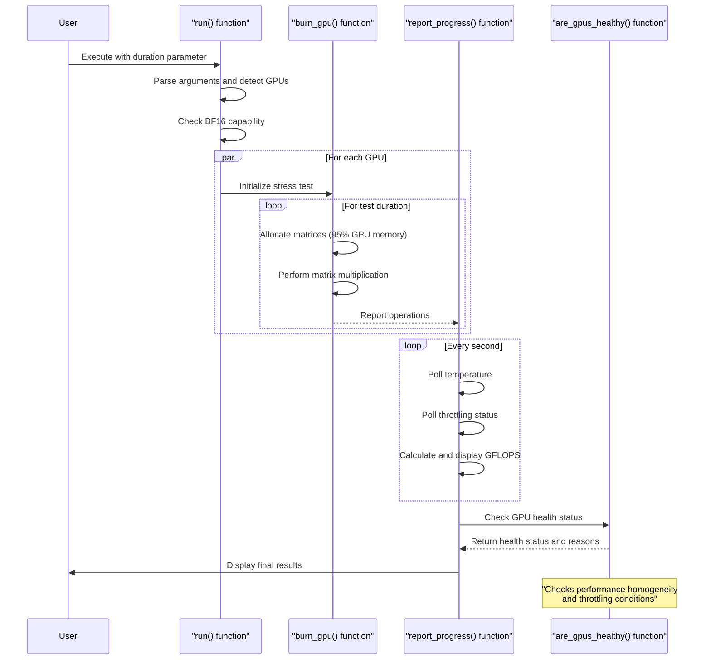

<!-- source: DeepWiki mcp.deepwiki.com · repo huggingface/gpu-fryer · page 1 Overview · fetched 2026-10-26 -->

# Overview

<details>
<summary>Relevant source files</summary>

The following files were used as context for generating this wiki page:

- [README.md](README.md)
- [src/main.rs](src/main.rs)

</details>


GPU-Fryer is a specialized tool designed to stress test NVIDIA GPUs and detect abnormal thermal throttling or performance degradation. It's particularly valuable for testing GPUs running ML inference or training workloads where overall system performance is dictated by the slowest GPU. Hugging Face uses this tool to monitor their HPC clusters and ensure all GPUs are running at peak performance.

For detailed installation instructions, see [Installation and Setup](#2).

Sources: [README.md:1-9]()

## System Architecture

GPU-Fryer is implemented in Rust and consists of several core components that work together to stress test GPUs and analyze their performance.

### Component Architecture



The codebase is centered around key functions and structures in the main application file:

- **GPU Detection**: `detect_gpus()` [src/main.rs:572-580]() identifies available NVIDIA GPUs
- **Matrix Multiplication**: `compute()` [src/main.rs:545-570]() performs CUBLAS operations
- **GPU Stress Testing**: `burn_gpu()` [src/main.rs:483-517]() runs the core stress test
- **Progress Reporting**: `report_progress()` [src/main.rs:327-448]() monitors and displays results
- **Health Checking**: `are_gpus_healthy()` [src/main.rs:450-481]() evaluates GPU health

The application leverages these critical external dependencies:

- `cudarc`: CUDA operations and CUBLAS matrix multiplication
- `nvml-wrapper`: GPU monitoring via NVIDIA Management Library
- `tokio`: Asynchronous execution for parallel GPU testing
- `clap`: Command-line argument parsing
- `half`: BF16 precision floating-point support

Sources: [src/main.rs:1-19](), [src/main.rs:572-580](), [src/main.rs:545-570](), [src/main.rs:483-517](), [src/main.rs:327-448](), [src/main.rs:450-481]()

## Workflow and Data Flow

The operational workflow of GPU-Fryer follows this sequence:



The main execution flow in `main()` [src/main.rs:143-170]() parses arguments, calls the `run()` function [src/main.rs:184-221](), which then spawns asynchronous tasks for stress testing and monitoring each GPU.

Sources: [src/main.rs:143-170](), [src/main.rs:184-221](), [src/main.rs:483-517](), [src/main.rs:327-448](), [src/main.rs:450-481]()

## Key Technical Implementation Details

### Matrix Multiplication Mechanism

GPU-Fryer creates two 8192×8192 matrices and performs matrix multiplication using CUBLAS. The key parameters are:

```
const SIZE: usize = 8192;         // Matrix dimension
const MEM_TO_USE_PCT: f64 = 0.9;  // Percentage of GPU memory to use
```

The stress test works by:
1. Creating random matrices filled with data (using `SmallRng`)
2. Allocating ~90% of GPU memory via `alloc_buffers()` [src/main.rs:529-543]()
3. Performing continuous matrix multiplication operations
4. Writing results to a ring buffer to maintain memory pressure

Matrix multiplication is implemented using the CUBLAS `gemm` function, configured in [src/main.rs:554-565]().

Sources: [src/main.rs:20-22](), [src/main.rs:529-543](), [src/main.rs:545-570](), [README.md:75-77]()

### Data Structures and Results Tracking

Performance metrics and test results are tracked in the `BurnResult` struct [src/main.rs:52-65]():

```rust
struct BurnResult {
    gpu_idx: usize,
    flops_max: usize,
    flops_min: usize,
    flops_sum: usize,
    n_iters: usize,
    temp_max: usize,
    temp_sum: usize,
    temp_min: usize,
    throttling_hw: usize,
    throttling_thermal_sw: usize,
    throttling_thermal_hw: usize,
}
```

This structure maintains statistics on:
- FLOPS (minimum, maximum, average)
- Temperature (minimum, maximum, average)
- Throttling conditions (hardware, software thermal, hardware thermal)

Sources: [src/main.rs:52-65](), [src/main.rs:67-96]()

### Precision Modes

The application supports two precision modes:

1. **FP32 (single precision)**: Default mode for all GPUs
2. **BF16 (brain floating point)**: Used when all GPUs support it (requires compute capability ≥ 8.0)

The precision selection logic [src/main.rs:200-214]() determines whether to use BF16 based on explicit configuration and GPU capabilities. The `supports_bf16()` function [src/main.rs:317-325]() checks if a GPU has the necessary compute capability.

This is implemented using the generic `run_with_precision<T>()` function [src/main.rs:223-297]() and the `VariablePrecisionFloat` trait [src/main.rs:125-129]().

Sources: [src/main.rs:125-141](), [src/main.rs:200-214](), [src/main.rs:317-325](), [README.md:78-78]()

### Performance Monitoring

GPU-Fryer collects and analyzes several critical metrics:

| Metric | Description | Implementation |
|--------|-------------|----------------|
| GFLOPS | Floating-point operations per second | `flops = nops[i] * SIZE * SIZE * SIZE * 2` [src/main.rs:349]() |
| Temperature | GPU temperature in Celsius | `poll_temperatures()` [src/main.rs:299-306]() |
| Throttling | Hardware and thermal throttling detection | `poll_throttling()` [src/main.rs:308-315]() |

The monitoring loop in `report_progress()` [src/main.rs:327-448]() polls these metrics once per second and updates the corresponding `BurnResult` structures.

Sources: [src/main.rs:299-315](), [src/main.rs:327-448]()

### Health Assessment

GPU-Fryer determines GPU health based on two primary criteria:

1. **Performance homogeneity**: All GPUs should perform within a specified tolerance (default 10%) of the best-performing GPU
2. **Throttling detection**: No throttling should be detected (with an option to tolerate software throttling)

The health check algorithm `are_gpus_healthy()` [src/main.rs:450-481]() returns both a boolean health status and a list of reasons for any unhealthy state.

Sources: [src/main.rs:450-481](), [README.md:58-60]()

## Configuration and Usage

The command-line interface is defined using the `clap` crate [src/main.rs:31-50]():

| Option | Description | Default |
|--------|-------------|---------|
| `duration_secs` | Duration in seconds to run the test | 60 |
| `nvml_lib_path` | Path to NVIDIA Management Library | /usr/lib/x86_64-linux-gnu/libnvidia-ml.so.1 |
| `tolerate_software_throttling` | Whether to tolerate software throttling | false |
| `tflops_tolerance` | Acceptable percentage deviation between GPUs | 10% |
| `use_bf16` | Whether to use BF16 precision | Auto-detect |

Example usage:
```bash
# Run test for 60 seconds
gpu-fryer 60
```

Sample output:
```
GPU #7:  51494 Gflops/s (min: 50577.53, max: 51677.05, dev: 51493.79)
         Temperature: 48.83°C (min: 47.00, max: 50.00)
         Throttling HW: false, Thermal SW: false, Thermal HW: false
All GPUs seem healthy
```

For reference, typical performance metrics:

| GPU | TFLOPS | Precision |
|-----|--------|-----------|
| NVIDIA H100 80GB HBM3 | ~51 | FP32 |
| NVIDIA H100 80GB HBM3 | ~676 | BF16 |

Sources: [src/main.rs:31-50](), [README.md:23-30](), [README.md:60-65]()

## Deployment Options

GPU-Fryer can be deployed using:

1. **Docker**: 
   ```bash
   docker run --gpus all ghcr.io/huggingface/gpu-fryer:1.0.0 60
   ```

2. **Cargo**: 
   ```bash
   cargo install gpu-fryer
   gpu-fryer 60
   ```

For additional deployment details, see [Installation and Setup](#2).

Sources: [README.md:15-19](), [README.md:67-71]()

---

