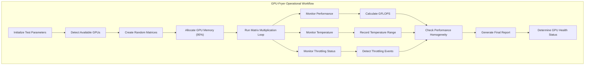
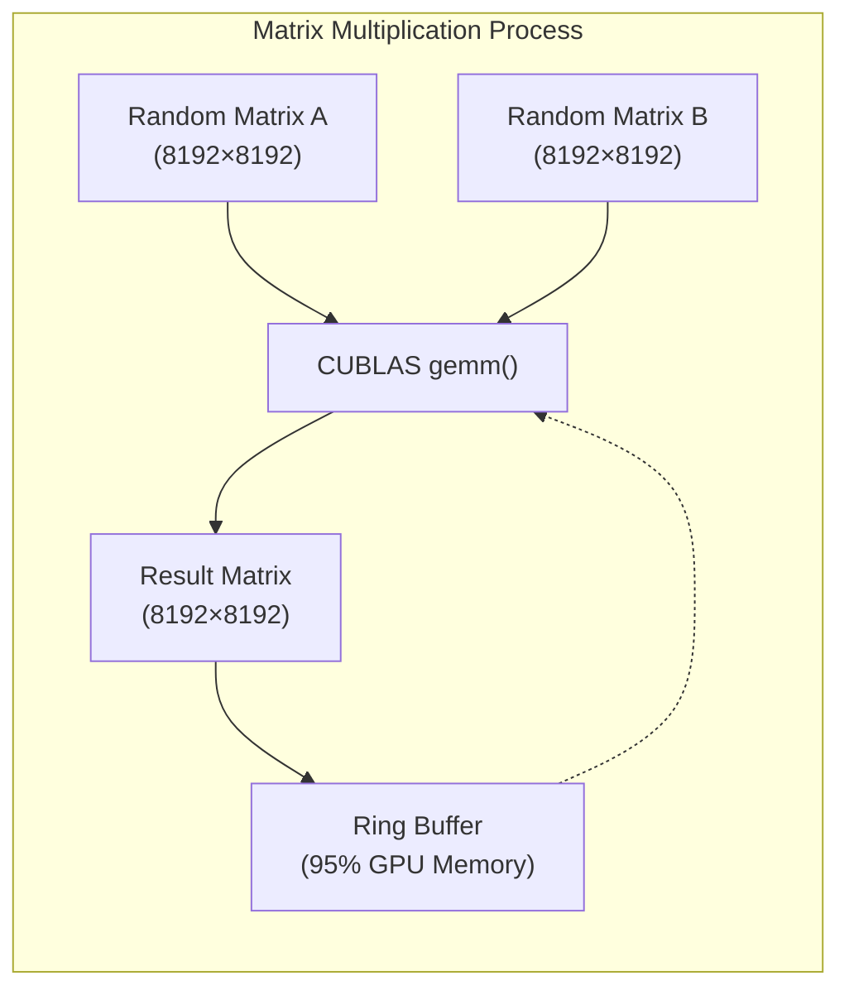
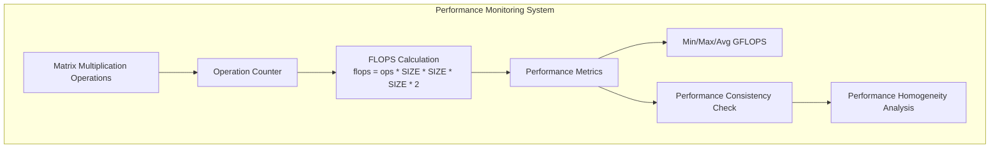
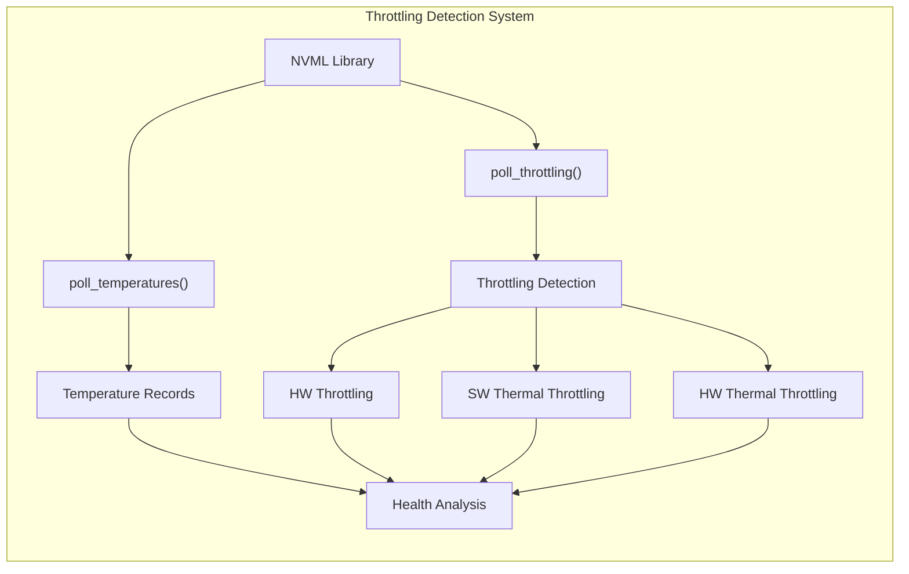
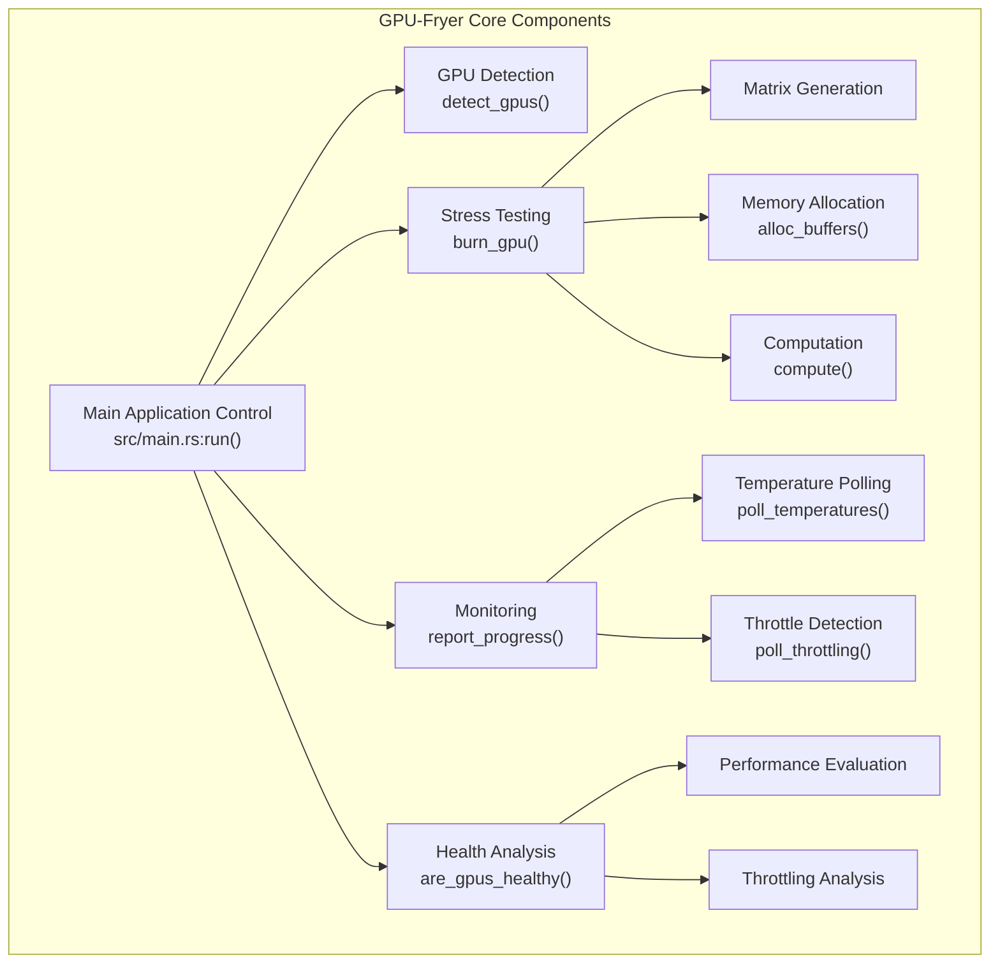

<!-- source: DeepWiki mcp.deepwiki.com · repo huggingface/gpu-fryer · page 1.1 Purpose and Capabilities · fetched 2026-10-26 -->

# Purpose and Capabilities

Relevant source files

The following files were used as context for generating this wiki page:

- [README.md](README.md)
- [assets/tensorcores.png](assets/tensorcores.png)
- [src/main.rs](src/main.rs)

This page provides an overview of the purpose, capabilities, and core functionality of GPU Fryer. It explains what problems the tool solves and outlines its key features.

## Introduction

GPU Fryer is a specialized utility designed to stress test NVIDIA GPUs by performing intensive matrix multiplication operations while simultaneously monitoring key performance metrics. The tool is particularly valuable for detecting abnormal thermal throttling or performance degradation in GPU clusters used for machine learning workloads.

Sources: [README.md:1-9]()

## Core Purpose

The primary purposes of GPU Fryer are:

1. **Stress Testing**: To apply a consistent, heavy computational load on GPUs to test their performance under pressure
2. **Performance Validation**: To verify that GPUs perform optimally and consistently under load
3. **Throttling Detection**: To identify GPUs that experience thermal throttling or other performance limitations
4. **Homogeneity Verification**: To ensure all GPUs in a multi-GPU system perform similarly, as ML workloads are often constrained by the slowest GPU

This tool is especially valuable for organizations running high-performance computing (HPC) clusters for machine learning tasks, where consistent GPU performance is critical for effective workload distribution.

Sources: [README.md:3-9](), [src/main.rs:24-27]()

## Operational Workflow

The following diagram illustrates how GPU Fryer operates from initialization to result reporting:

Sources: [src/main.rs:144-170](), [src/main.rs:184-221](), [src/main.rs:327-448]()

## Key Capabilities

### 1. GPU Stress Testing

GPU Fryer creates a consistent and intensive computational load through matrix multiplication operations:

- Creates two 8192×8192 matrices filled with random values
- Performs repeated matrix multiplication using CUBLAS
- Allocates 95% of available GPU memory to store results in a ring buffer
- Maintains high GPU utilization throughout the test duration

Sources: [README.md:75-76](), [src/main.rs:483-517](), [src/main.rs:20-22]()

### 2. Precision Options

GPU Fryer can operate in different precision modes to test various GPU capabilities:

- **FP32 (single precision)**: Standard mode for all NVIDIA GPUs
- **BF16 (brain floating point)**: For testing Tensor Cores on compatible GPUs (compute capability ≥ 8.0)

The tool automatically detects GPU capabilities and can select the appropriate precision mode:

| Precision | Data Type | Primarily Tests | GPU Requirements |
|-----------|-----------|-----------------|------------------|
| FP32      | 32-bit floating point | Standard CUDA cores | All NVIDIA GPUs |
| BF16      | 16-bit brain float | Tensor Cores | Compute capability ≥ 8.0 |

Sources: [README.md:78-78](), [src/main.rs:317-325](), [src/main.rs:200-214]()

### 3. Performance Monitoring

GPU Fryer provides comprehensive performance monitoring during testing:

- Calculates and reports GFLOPS (Giga Floating Point Operations Per Second)
- Tracks minimum, maximum, and average performance metrics
- Monitors performance consistency across multiple iterations
- Detects performance outliers or degradation

Sources: [src/main.rs:348-363](), [src/main.rs:410-418](), [src/main.rs:450-481]()

### 4. Temperature and Throttling Detection

GPU Fryer continuously monitors GPU temperature and throttling status using NVIDIA Management Library (NVML):

- Records minimum, maximum, and average GPU temperatures
- Detects different throttling conditions:
  - Hardware throttling
  - Software thermal throttling
  - Hardware thermal throttling
- Reports throttling events and their frequency

Sources: [src/main.rs:299-315](), [src/main.rs:366-407](), [src/main.rs:419-430]()

### 5. Multi-GPU Support

GPU Fryer can simultaneously test multiple GPUs in a system:

- Automatically detects all available GPUs
- Runs tests in parallel across all GPUs
- Compares performance between GPUs to ensure homogeneity
- Identifies underperforming GPUs within a configurable tolerance range

Sources: [src/main.rs:572-580](), [src/main.rs:450-481]()

## Technical Implementation Details

### Core Components

The GPU Fryer tool is built around several key components that work together:

1. **GPU Detection**: Identifies available NVIDIA GPUs in the system
2. **Matrix Operations**: Creates and manipulates matrices for stress testing
3. **CUDA Integration**: Interfaces with CUDA for GPU computations
4. **NVML Monitoring**: Uses NVIDIA Management Library for hardware metrics
5. **Performance Analysis**: Analyzes and reports on test results

Sources: [src/main.rs:144-170](), [src/main.rs:184-221](), [src/main.rs:483-517](), [src/main.rs:327-448]()

### Configuration Options

GPU Fryer offers several configuration options to customize the testing process:

| Option | Description | Default | Code Reference |
|--------|-------------|---------|----------------|
| `duration_secs` | Duration to run the test in seconds | 60 | [src/main.rs:36]() |
| `nvml_lib_path` | Path to NVIDIA Management Library | `/usr/lib/x86_64-linux-gnu/libnvidia-ml.so.1` | [src/main.rs:38-39]() |
| `tolerate_software_throttling` | Ignore software throttling if performance is acceptable | `false` | [src/main.rs:40-42]() |
| `tflops_tolerance` | Acceptable performance deviation percentage between GPUs | 10% | [src/main.rs:43-45]() |
| `use_bf16` | Use BF16 precision instead of FP32 | Auto-detect | [src/main.rs:45-47]() |

Sources: [src/main.rs:31-50](), [README.md:32-50]()

## Performance Metrics

GPU Fryer provides detailed performance metrics for each GPU tested:

1. **Computational Performance**:
   - Average GFLOPS
   - Minimum and maximum GFLOPS
   - Performance consistency

2. **Thermal Performance**:
   - Average temperature
   - Minimum and maximum temperature
   - Temperature stability

3. **Throttling Status**:
   - Hardware throttling events
   - Software thermal throttling events
   - Hardware thermal throttling events

For reference, the expected performance metrics for high-end GPUs:

| GPU Model | FP32 TFLOPS | BF16 TFLOPS |
|-----------|-------------|-------------|
| NVIDIA H100 80GB HBM3 | ~51 | ~676 |

Sources: [README.md:60-65](), [src/main.rs:410-430]()

## Use Cases

GPU Fryer is particularly valuable for:

1. **Cluster Validation**: Testing newly deployed GPU clusters to ensure optimal performance
2. **Performance Troubleshooting**: Identifying problematic GPUs in an existing cluster
3. **Thermal Management Verification**: Validating cooling solutions for GPU deployments
4. **Homogeneity Testing**: Ensuring consistent performance across multiple GPUs
5. **Hardware Quality Assurance**: Detecting manufacturing defects or degradation in GPUs

Sources: [README.md:3-9]()

## Related Pages

- For detailed installation instructions, see [Installation and Setup](#2)
- For usage examples and command-line options, see [Usage Guide](#3)
- For technical architecture details, see [Technical Architecture](#4)
- For understanding how the stress testing mechanism works, see [GPU Stress Testing Mechanism](#4.2)

---

