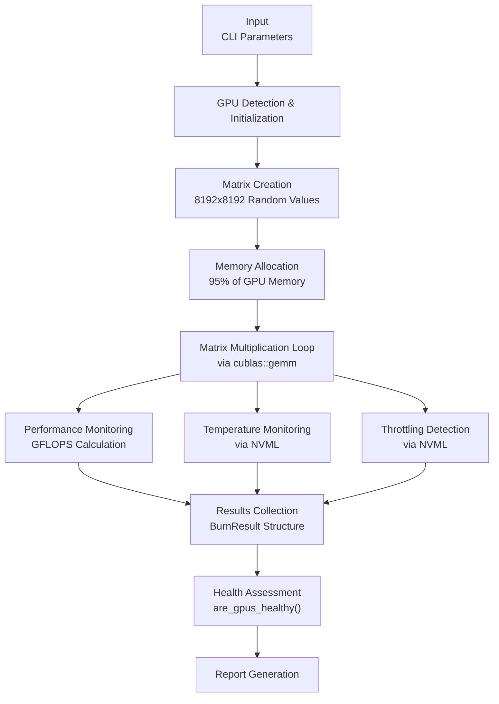
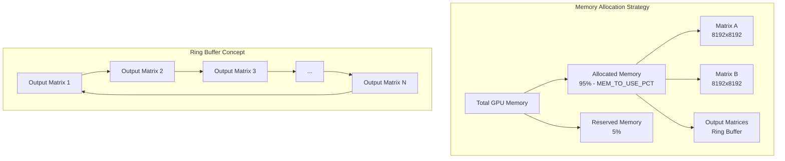
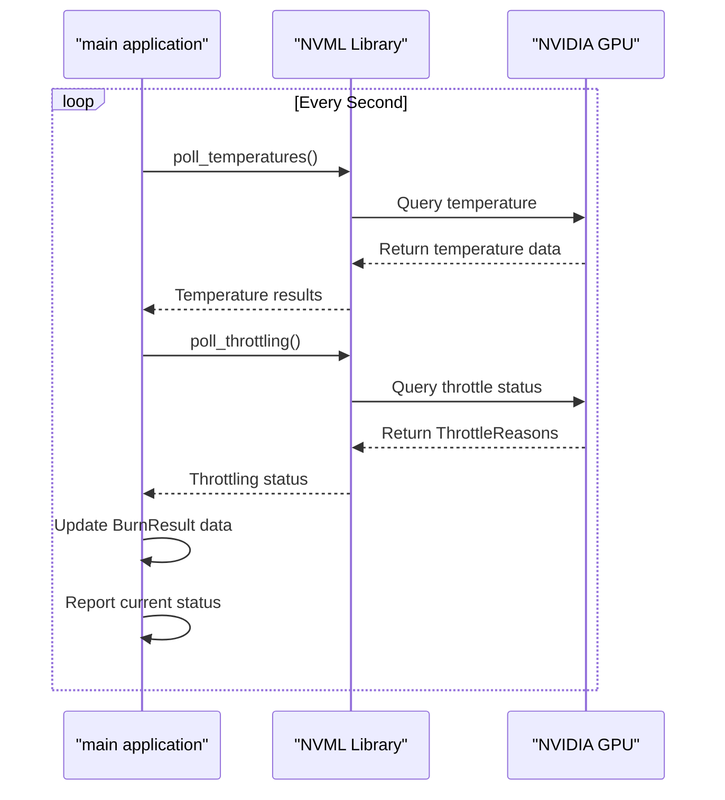
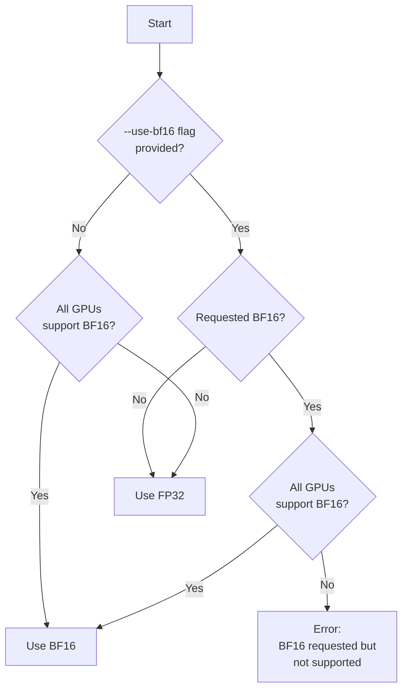
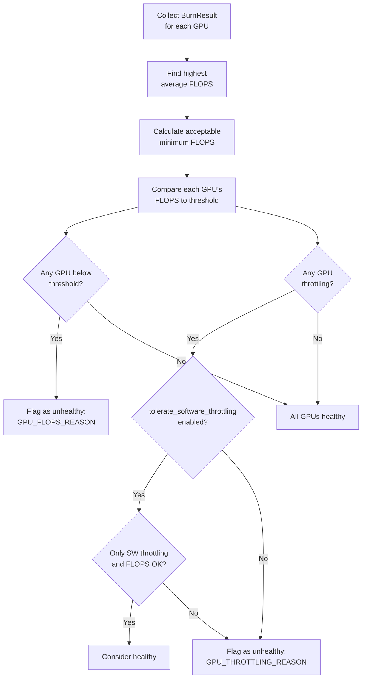
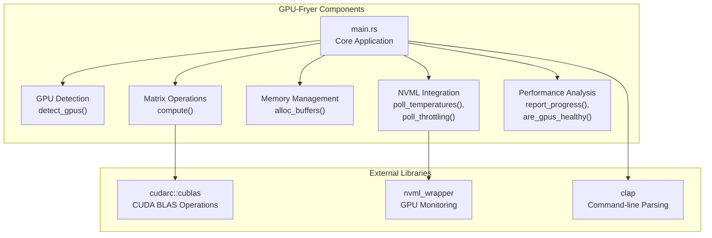

<!-- source: DeepWiki mcp.deepwiki.com · repo huggingface/gpu-fryer · page 1.2 Key Concepts · fetched 2026-10-26 -->

# Key Concepts

<details>
<summary>Relevant source files</summary>

The following files were used as context for generating this wiki page:

- [README.md](README.md)
- [assets/utilization.png](assets/utilization.png)
- [src/main.rs](src/main.rs)

</details>


This document explains the core concepts and terminology related to GPU stress testing and performance monitoring in the GPU-fryer tool. Understanding these concepts is essential for effectively using the tool and interpreting its results.

For detailed usage instructions, see [Usage Guide](#3) and [Command-Line Interface](#3.1).

## GPU Stress Testing Fundamentals

GPU-fryer performs intensive matrix multiplication operations to stress test NVIDIA GPUs. This approach helps detect performance inconsistencies, thermal throttling issues, and other problems that might affect GPU performance in production environments, particularly for machine learning workloads.



Sources: [src/main.rs:483-517](), [README.md:73-79]()

## Matrix Multiplication Operations

The core stress mechanism is matrix multiplication using CUBLAS (CUDA Basic Linear Algebra Subroutines). The tool creates two random 8192x8192 matrices and repeatedly multiplies them.

### Matrix Operation Details

- **Matrix Size**: 8192×8192 (defined in [src/main.rs:20]())
- **Operation**: General Matrix Multiplication (GEMM) using CUBLAS
- **Computational Intensity**: Approximately 2 × N³ floating-point operations per multiplication (where N=8192)
- **Implementation**: The `compute()` function in [src/main.rs:545-570]()

Matrix multiplication is particularly effective for stress testing because:
1. It's compute-intensive, maximizing utilization of GPU cores
2. It has predictable performance characteristics
3. It efficiently uses memory bandwidth
4. It leverages specialized hardware like Tensor Cores (when using BF16 precision)

Sources: [src/main.rs:545-570](), [README.md:75]()

## Memory Management

GPU-fryer intentionally consumes a large portion of available GPU memory to create realistic stress conditions. This simulates memory-intensive workloads like those found in machine learning applications.



Key aspects of memory management:
- **Memory Usage**: 95% of available GPU memory (defined by `MEM_TO_USE_PCT` in [src/main.rs:22]())
- **Ring Buffer**: Results are written to a ring buffer to maintain continuous operation without new allocations
- **Buffer Allocation**: Implementation in `alloc_buffers()` function [src/main.rs:529-543]()
- **Memory Calculation**: The number of output matrices is determined dynamically based on available memory [src/main.rs:493-505]()

Sources: [src/main.rs:22](), [src/main.rs:529-543](), [README.md:76-77]()

## Performance Metrics and Monitoring

### GFLOPS Calculation

The primary performance metric in GPU-fryer is GFLOPS (Giga Floating Point Operations Per Second), which measures computational throughput.

For an 8192×8192 matrix multiplication:
- **Operations per multiplication**: 2 × 8192³ ≈ 1.1 trillion operations
- **GFLOPS calculation**: Operations ÷ Time (seconds) ÷ 10⁹

Expected performance varies by GPU model and precision mode:

| GPU | TFLOPS (FP32) | TFLOPS (BF16) |
|-----|--------------|---------------|
| NVIDIA H100 80GB HBM3 | ~51 | ~676 |

The reporting logic collects and processes this data in the `report_progress()` function [src/main.rs:327-448]().

Sources: [src/main.rs:327-448](), [README.md:60-66]()

## Temperature and Throttling Detection

GPU-fryer uses NVML (NVIDIA Management Library) to monitor GPU temperatures and detect throttling conditions during the stress test.

### Throttling Types

The tool monitors three types of GPU throttling:

1. **Hardware Throttling (HW)**: General hardware-level performance reduction
2. **Thermal Software Throttling (Thermal SW)**: Software-initiated throttling at lower temperature thresholds
3. **Thermal Hardware Throttling (Thermal HW)**: Hardware-initiated throttling at higher temperature thresholds to prevent damage



Implementation details:
- **Temperature Polling**: `poll_temperatures()` function [src/main.rs:299-306]()
- **Throttling Detection**: `poll_throttling()` function [src/main.rs:308-315]()
- **Throttling Analysis**: Throttling status analysis in [src/main.rs:383-407]()

Sources: [src/main.rs:299-315](), [src/main.rs:383-407]()

## Precision Modes

GPU-fryer supports two floating-point precision modes for matrix multiplication:

1. **FP32 (32-bit Floating Point)**: Standard single-precision floating-point
2. **BF16 (Brain Floating Point 16-bit)**: Reduced-precision format optimized for machine learning

### Precision Selection Logic



Important details:
- **BF16 Support Detection**: `supports_bf16()` function [src/main.rs:317-325]()
- **Precision Selection**: Logic in [src/main.rs:200-214]()
- **Implementation**: Type-parametrized code using `VariablePrecisionFloat` trait [src/main.rs:125-141]()
- **Performance Impact**: BF16 significantly increases throughput on GPUs with Tensor Cores

Sources: [src/main.rs:200-214](), [src/main.rs:317-325](), [README.md:78-79]()

## Performance Homogeneity

A key feature of GPU-fryer is its ability to assess performance consistency across multiple GPUs in a system. This is critical for machine learning workloads where overall system performance is limited by the slowest GPU.

### Homogeneity Assessment Process



Key implementation details:
- **Health Assessment**: `are_gpus_healthy()` function [src/main.rs:450-481]()
- **Tolerance Configuration**: `--tflops-tolerance` parameter (default: 10%)
- **Software Throttling Handling**: `--tolerate-software-throttling` flag

Sources: [src/main.rs:450-481](), [src/main.rs:31-50](), [README.md:58-59]()

## Key Data Structures

### BurnResult Structure

The central data structure for collecting and analyzing GPU performance metrics:

```
struct BurnResult {
    gpu_idx: usize,              // GPU index
    flops_max: usize,            // Maximum FLOPS recorded
    flops_min: usize,            // Minimum FLOPS recorded
    flops_sum: usize,            // Sum of all FLOPS measurements
    n_iters: usize,              // Number of iterations
    temp_max: usize,             // Maximum temperature
    temp_sum: usize,             // Sum of all temperature measurements
    temp_min: usize,             // Minimum temperature
    throttling_hw: usize,        // Hardware throttling count
    throttling_thermal_sw: usize, // Thermal software throttling count
    throttling_thermal_hw: usize, // Thermal hardware throttling count
}
```

This structure tracks all essential metrics for each GPU during the stress test and provides methods to calculate averages and determine throttling status.

### Configuration Structure

```
struct Config {
    duration_secs: u64,              // Test duration in seconds
    nvml_lib_path: String,           // Path to NVML library
    tflops_tolerance: f64,           // Allowable performance variation
    tolerate_software_throttling: bool, // Whether to tolerate SW throttling
    use_bf16: Option<bool>,          // Precision mode selection
}
```

Sources: [src/main.rs:52-96](), [src/main.rs:116-123]()

## System Architecture



Sources: [src/main.rs:1-18](), [README.md:53-56]()

## Conclusion

Understanding these key concepts provides the foundation for effectively using GPU-fryer and interpreting its results. The tool combines intensive matrix multiplication operations with comprehensive monitoring to detect thermal issues and performance inconsistencies across GPUs, making it valuable for qualifying and maintaining GPU systems for machine learning and other high-performance workloads.

For specific usage guidelines, refer to the [Usage Guide](#3) section.

---

