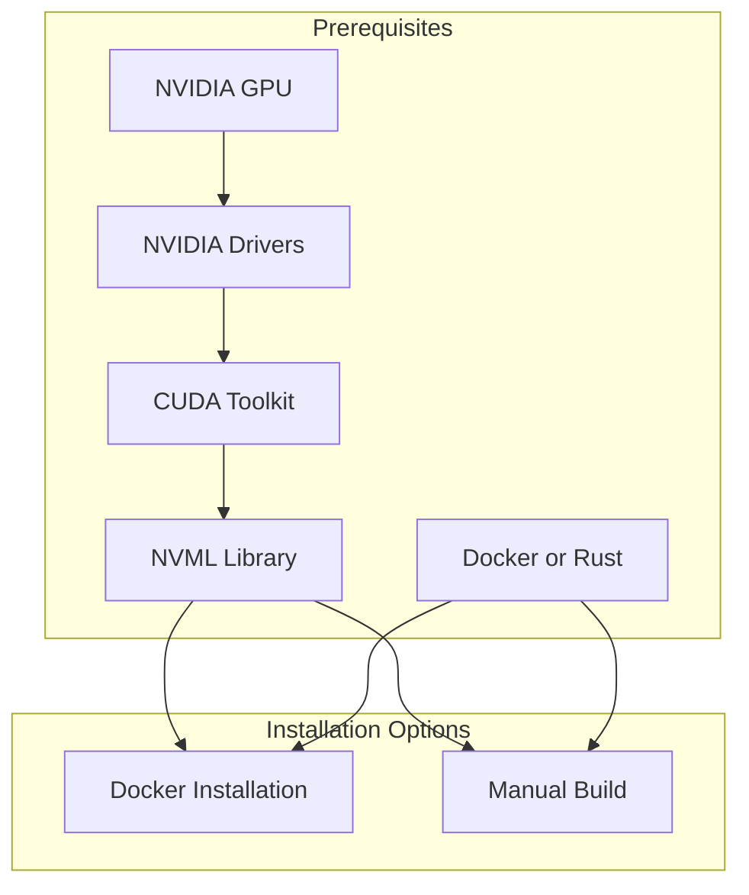
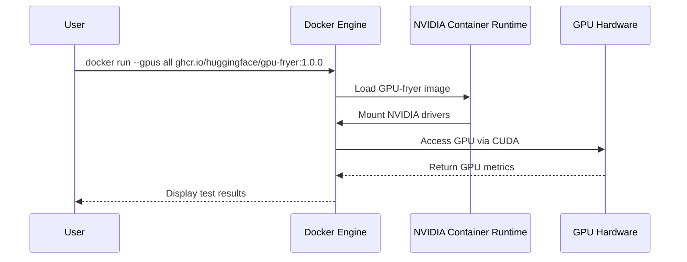
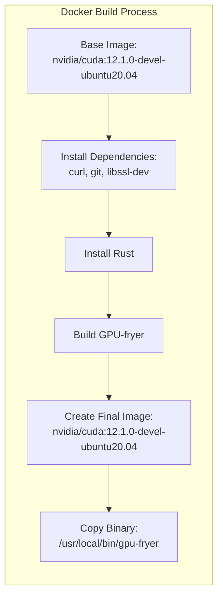
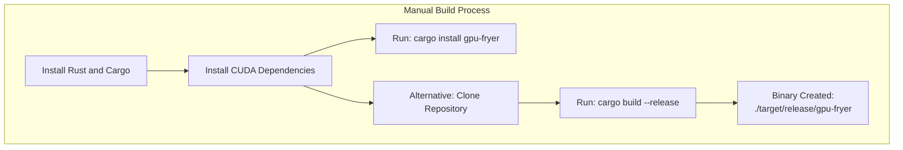
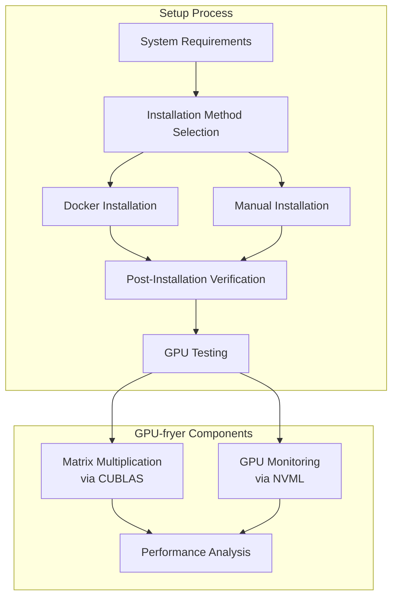

<!-- source: DeepWiki mcp.deepwiki.com · repo huggingface/gpu-fryer · page 2 Installation and Setup · fetched 2026-10-26 -->

# Installation and Setup

<details>
<summary>Relevant source files</summary>

The following files were used as context for generating this wiki page:

- [Dockerfile](Dockerfile)
- [README.md](README.md)

</details>


This document provides comprehensive instructions for installing and configuring GPU-fryer, a tool designed to stress test GPUs and detect anomalies in performance or thermal behavior. For specific details about how to use the tool after installation, please refer to the [Usage Guide](#3).

## System Requirements

Before installing GPU-fryer, ensure your system meets the following requirements:

- NVIDIA GPU hardware
- NVIDIA driver installed (compatible with CUDA 12.1.0 or later recommended)
- CUDA toolkit installed (the tool relies on CUDA for stress testing operations)
- NVIDIA Management Library (NVML) for GPU monitoring
- Docker (for container-based installation) or Rust toolchain (for building from source)



Sources: [README.md:53-56]()

## Installation Methods

GPU-fryer can be installed using one of two methods:

1. **Docker Installation**: Quick and easy deployment with minimal setup
2. **Manual Installation**: Building the tool from source using Cargo

### Docker Installation

The Docker installation method is the quickest way to get started with GPU-fryer, requiring minimal configuration.

#### Steps:

1. Ensure Docker is installed on your system
2. Verify the NVIDIA Container Toolkit is installed and configured
3. Run GPU-fryer using the provided Docker image

```bash
docker run --gpus all ghcr.io/huggingface/gpu-fryer:1.0.0 60
```

This command runs the GPU-fryer tool for 60 seconds on all available GPUs. You can adjust the duration as needed.



Sources: [README.md:15-19](), [Dockerfile:1-17]()

#### Docker Image Architecture

The Docker image is built in two stages:

1. **Builder stage**: Compiles the GPU-fryer application from source
2. **Final stage**: Creates a minimal runtime image with just the compiled binary



Sources: [Dockerfile:1-17]()

### Manual Installation

For users who prefer to build the tool from source or need customization options, the manual installation method using Cargo (Rust's package manager) is available.

#### Prerequisites:

- Rust programming language and Cargo package manager installed
- CUDA toolkit and development libraries
- Git (to clone the repository if not downloading directly)

#### Installation Steps:

```bash
# Install using Cargo directly from crates.io
cargo install gpu-fryer

# OR clone the repository and build locally
git clone https://github.com/huggingface/gpu-fryer
cd gpu-fryer
cargo build --release
```

After building locally, the binary will be available at `./target/release/gpu-fryer`



Sources: [README.md:67-71]()

## Post-Installation Verification

After installation, verify that GPU-fryer is working correctly by running a short test:

```bash
# For Docker installation
docker run --gpus all ghcr.io/huggingface/gpu-fryer:1.0.0 10

# For manual installation
gpu-fryer 10
```

You should see output similar to:

```
GPU #0:  51494 Gflops/s (min: 50577.53, max: 51677.05, dev: 51493.79)
         Temperature: 48.83°C (min: 47.00, max: 50.00)
         Throttling HW: false, Thermal SW: false, Thermal HW: false
All GPUs seem healthy
```

If you encounter any issues with NVML library detection, you may need to specify the path to the NVML library:

```bash
gpu-fryer --nvml-lib-path /path/to/libnvidia-ml.so 10
```

Sources: [README.md:23-30](), [README.md:53-56]()

## Configuration Considerations

### NVML Library Path

GPU-fryer uses NVML to monitor GPU temperature and throttling. By default, it looks for `libnvidia-ml.so` at:
- `/usr/lib/x86_64-linux-gnu/libnvidia-ml.so.1`

If your NVML library is installed at a different location, you'll need to specify the path using the `--nvml-lib-path` option.

### GPU Precision Mode

GPU-fryer can operate in two precision modes:
- FP32 (single precision): Default mode
- BF16 (brain floating point): Used if GPUs support it, provides higher stress on Tensor Cores

The precision mode affects both the stress level and reported performance metrics.

| GPU | TFLOPS | Precision |
|-----|--------|-----------|
| NVIDIA H100 80GB HBM3 | ~51 | FP32 |
| NVIDIA H100 80GB HBM3 | ~676 | BF16 |

Sources: [README.md:60-66](), [README.md:75-78]()

## Installation Workflow Overview

The following diagram shows the complete installation workflow and where GPU-fryer fits into your GPU testing infrastructure:



Sources: [README.md:73-84]()

For detailed information on using GPU-fryer after installation, including command-line options and interpreting results, please refer to the [Usage Guide](#3) and [Command-Line Interface](#3.1) documentation.

---

