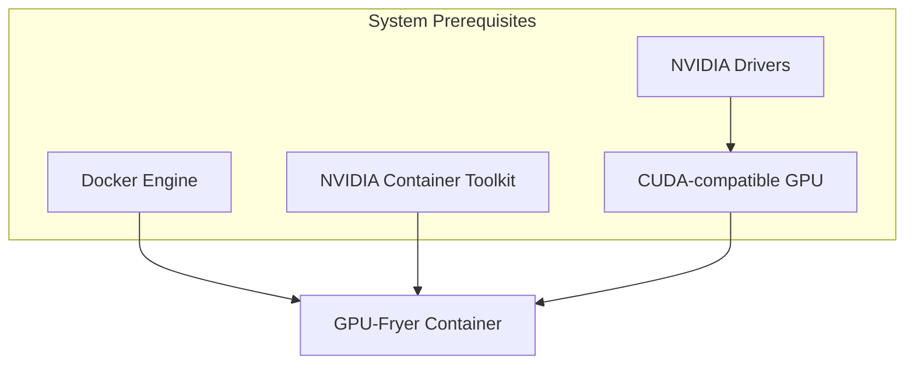
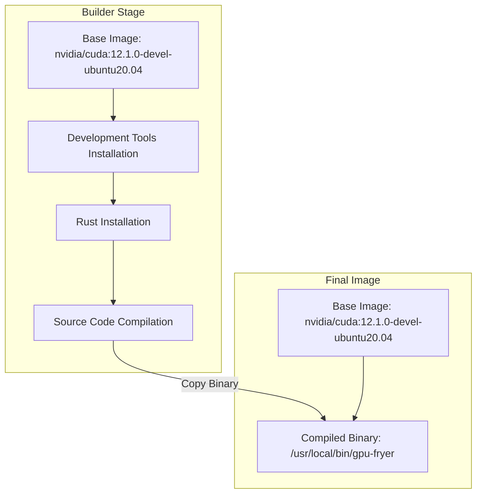
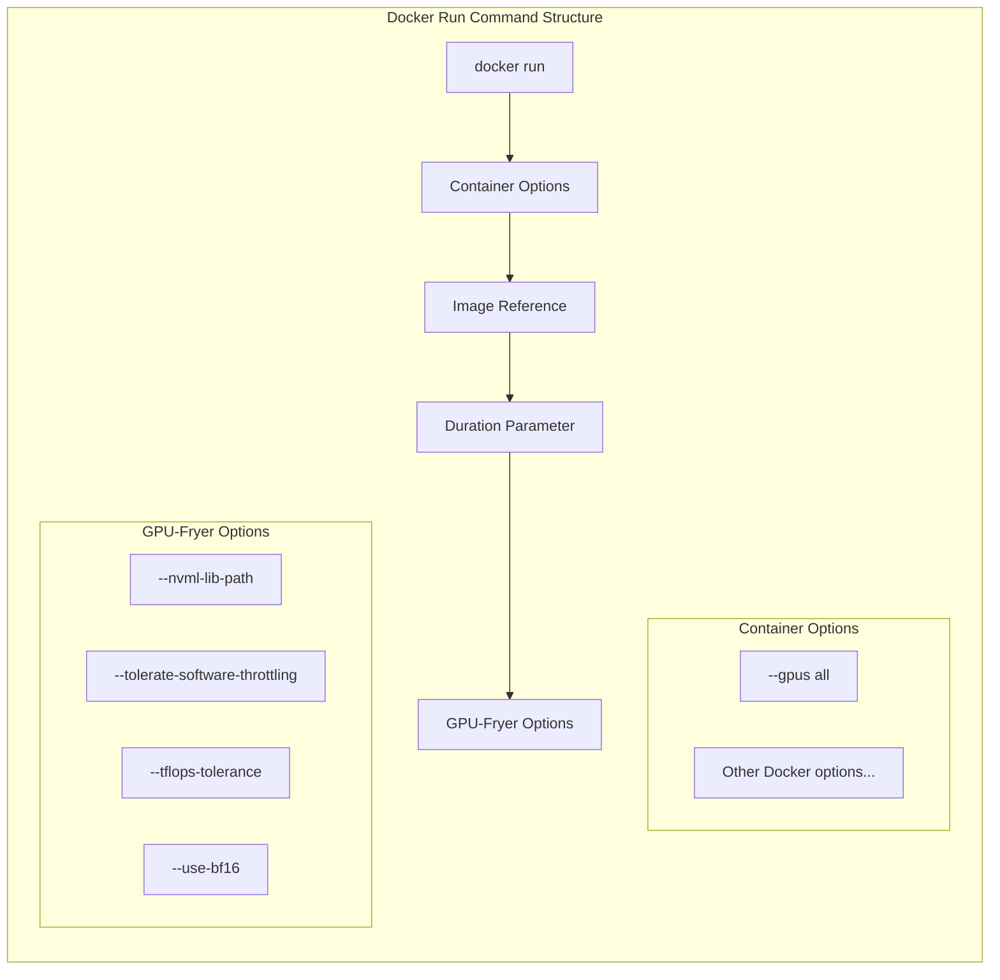
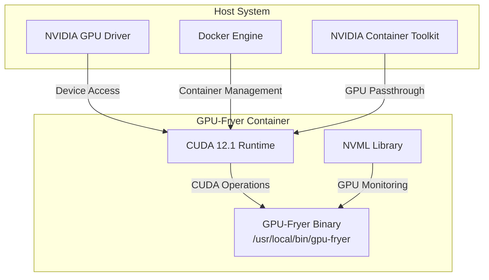

<!-- source: DeepWiki mcp.deepwiki.com · repo huggingface/gpu-fryer · page 2.1 Docker Installation · fetched 2026-10-26 -->

# Docker Installation

<details>
<summary>Relevant source files</summary>

The following files were used as context for generating this wiki page:

- [.dockerignore](.dockerignore)
- [Dockerfile](Dockerfile)
- [README.md](README.md)

</details>


This document provides instructions for installing and running GPU-Fryer using Docker. For instructions on building and installing the tool from source, see [Manual Installation](#2.2).

## Prerequisites

Before using the GPU-Fryer Docker image, ensure that your system meets these requirements:

- Docker Engine installed (version 19.03 or newer)
- NVIDIA GPU with compatible drivers installed
- NVIDIA Container Toolkit (nvidia-docker) installed
- At least one CUDA-compatible GPU available



Sources: [Dockerfile:15-16](), [README.md:15-19]()

## Docker Image Structure

The GPU-Fryer Docker image is built in two stages to minimize the final image size while maintaining all required functionality.



Sources: [Dockerfile:1-16]()

## Running GPU-Fryer with Docker

To run GPU-Fryer using the pre-built Docker image, use the following command:

```bash
docker run --gpus all ghcr.io/huggingface/gpu-fryer:1.0.0 60
```

This command:
- `--gpus all`: Grants the container access to all available GPUs
- `ghcr.io/huggingface/gpu-fryer:1.0.0`: Specifies the image to use (version 1.0.0)
- `60`: Runs the test for 60 seconds (default duration if not specified)

Sources: [README.md:15-19](), [README.md:24-29]()

## Command-Line Options

When running GPU-Fryer through Docker, you can pass the same command-line options as you would with the native executable. Append these options after the Docker run command:

```bash
docker run --gpus all ghcr.io/huggingface/gpu-fryer:1.0.0 [DURATION_SECS] [OPTIONS]
```

Available options include:

| Option | Description | Default |
|--------|-------------|---------|
| `--nvml-lib-path <PATH>` | Path to NVIDIA Management Library | `/usr/lib/x86_64-linux-gnu/libnvidia-ml.so.1` |
| `--tolerate-software-throttling` | Tolerate SW throttling if TFLOPS are acceptable | Disabled |
| `--tflops-tolerance <PERCENTAGE>` | TFLOPS tolerance (%) compared to best GPU | 10% |
| `--use-bf16 <BOOLEAN>` | Use BF16 precision instead of FP32 | Auto-detect |



Sources: [README.md:32-51]()

## Example Output

When running GPU-Fryer, you'll see output similar to this:

```
GPU #7:  51494 Gflops/s (min: 50577.53, max: 51677.05, dev: 51493.79)
         Temperature: 48.83°C (min: 47.00, max: 50.00)
         Throttling HW: false, Thermal SW: false, Thermal HW: false
All GPUs seem healthy
```

For detailed information about interpreting the output results, see [Output Interpretation](#3.3).

Sources: [README.md:24-30]()

## Docker Image Internals

The Docker image contains:

1. Base CUDA runtime (CUDA 12.1.0 on Ubuntu 20.04)
2. The GPU-Fryer compiled binary at `/usr/local/bin/gpu-fryer`
3. All necessary CUDA and NVML runtime libraries

The image is configured to run GPU-Fryer as its entry point, making it possible to pass arguments directly.



Sources: [Dockerfile:15-17](), [README.md:53-56]()

## Troubleshooting

### Common Issues

1. **Missing GPU Access**
   - Error: "No CUDA GPUs are visible"
   - Solution: Ensure you're using the `--gpus all` flag and have the NVIDIA Container Toolkit installed

2. **NVML Library Not Found**
   - Error: "Cannot load NVML library"
   - Solution: The default NVML path in the container may differ from your host. Use `--nvml-lib-path` to specify the correct path.

3. **Docker Pull Failures**
   - Error: "Unable to pull image"
   - Solution: Verify network connectivity and that you have access to the GitHub Container Registry (ghcr.io)

Sources: [README.md:53-56]()

## Version Compatibility

The GPU-Fryer Docker image is built with CUDA 12.1.0, but it should be compatible with systems running different NVIDIA driver versions, as long as they support the required CUDA version.

| Component | Minimum Version |
|-----------|----------------|
| NVIDIA Driver | 530.30.02+ |
| CUDA Compatibility | 12.1+ |
| Docker | 19.03+ |
| NVIDIA Container Toolkit | 1.13.0+ |

Sources: [Dockerfile:1-15]()

---

