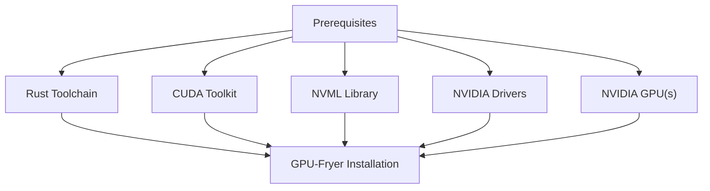
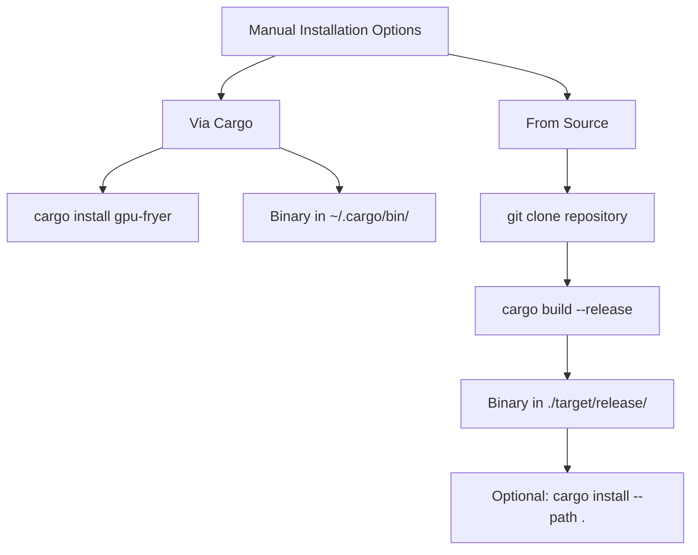
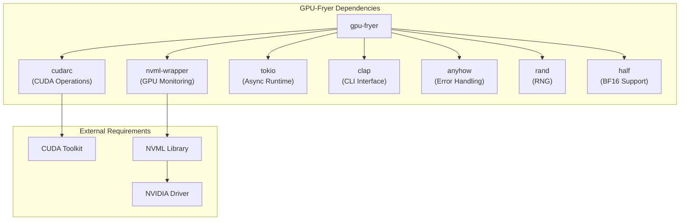
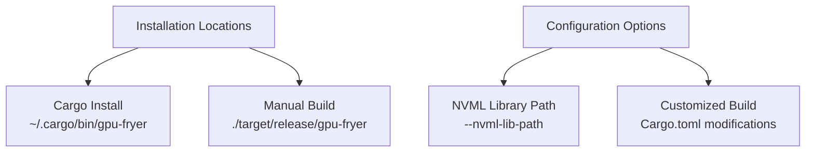

<!-- source: DeepWiki mcp.deepwiki.com · repo huggingface/gpu-fryer · page 2.2 Manual Installation · fetched 2026-10-26 -->

# Manual Installation

<details>
<summary>Relevant source files</summary>

The following files were used as context for generating this wiki page:

- [.gitignore](.gitignore)
- [Cargo.toml](Cargo.toml)
- [README.md](README.md)

</details>


This page provides detailed instructions for building and installing the GPU-Fryer tool from source code. If you prefer to use the pre-built Docker container instead, see [Docker Installation](#2.1).

## Prerequisites

Before manually installing GPU-Fryer, ensure your system meets the following requirements:

- **Rust toolchain** (latest stable version recommended)
- **NVIDIA CUDA toolkit** (CUDA 12.0 or later recommended)
- **NVIDIA Management Library (NVML)**
- **NVIDIA GPU(s)** with appropriate drivers installed
- **Git** (for cloning the repository)



Sources: [README.md:53-56](), [Cargo.toml:6-13]()

## Installation Methods

There are two primary methods for manual installation:

### Method 1: Installing via Cargo

The simplest way to install GPU-Fryer is using Cargo, Rust's package manager:

1. Ensure Rust and Cargo are installed (if not, install from [https://rustup.rs/](https://rustup.rs/))
2. Run the following command:

```bash
cargo install gpu-fryer
```

This command will download, compile, and install the GPU-Fryer binary to your Cargo bin directory (typically `~/.cargo/bin/`).

Sources: [README.md:67-71]()

### Method 2: Building from Source

For more control over the build process or to make modifications:

1. Clone the repository:
   ```bash
   git clone https://github.com/huggingface/gpu-fryer.git
   cd gpu-fryer
   ```

2. Build the project:
   ```bash
   cargo build --release
   ```

3. The compiled binary will be available at `./target/release/gpu-fryer`

4. (Optional) Install the binary to your PATH:
   ```bash
   cargo install --path .
   ```



Sources: [README.md:67-71]()

## Dependency Structure

GPU-Fryer relies on several Rust crates to function properly:

| Dependency | Version | Purpose |
|------------|---------|---------|
| cudarc | 0.13.0 | CUDA runtime API wrapper with CUDA 12.0.6 and F16 support |
| nvml-wrapper | 0.10.0 | Interface to NVIDIA Management Library |
| tokio | 1.42 | Asynchronous runtime for parallel operations |
| clap | 4.5.26 | Command-line argument parsing |
| anyhow | 1.0.95 | Error handling |
| rand | 0.8.5 | Random number generation |
| half | 2.4.1 | Half-precision floating point support |



Sources: [Cargo.toml:6-13]()

## System Requirements

GPU-Fryer is designed to work with NVIDIA GPUs. The computational requirements depend on the size of the matrices being multiplied during the stress test (by default 8192×8192).

- **Memory**: GPU-Fryer will use approximately 95% of available GPU memory
- **Storage**: Minimal (~10MB for the binary)
- **CPU**: Minimal requirements (primarily used for coordination)

## Post-Installation Configuration

After installation, you may need to configure GPU-Fryer for your specific environment:

### NVML Library Path

If your NVML library is not in the default location (`/usr/lib/x86_64-linux-gnu/libnvidia-ml.so.1`), you'll need to specify its path when running GPU-Fryer:

```bash
gpu-fryer --nvml-lib-path /path/to/libnvidia-ml.so 60
```

### Custom Build Configurations

When building from source, you can modify the `Cargo.toml` file to adjust features or dependency versions if needed.



Sources: [README.md:53-56](), [Cargo.toml:1-13]()

## Verifying the Installation

After installing GPU-Fryer, verify the installation by running a short test:

```bash
gpu-fryer --version  # Should display the version number
gpu-fryer 5  # Run a quick 5-second test
```

A successful run will display GPU performance metrics and temperature information for all detected GPUs.

## Troubleshooting

### Common Issues

1. **CUDA not found**: Ensure CUDA toolkit is installed and in your PATH
   ```bash
   # Check CUDA installation
   nvcc --version
   ```

2. **NVML library not found**: Specify the correct path using `--nvml-lib-path`
   ```bash
   # Find NVML library location
   find /usr -name "libnvidia-ml.so*"
   ```

3. **Permission issues**: Ensure you have permissions to access the GPU
   ```bash
   # Check GPU access
   nvidia-smi
   ```

4. **Rust toolchain errors**: Update Rust to the latest stable version
   ```bash
   rustup update stable
   ```

5. **Build fails with dependency errors**: Try updating dependencies in Cargo.toml if building from source

### Cleaning Up

If you need to uninstall GPU-Fryer:

```bash
# If installed via cargo
cargo uninstall gpu-fryer

# If built from source
# Simply remove the binary or the cloned repository
```

Sources: [README.md:53-56](), [.gitignore:38-48]()

## Compatibility Notes

- GPU-Fryer is primarily tested on Linux systems with NVIDIA GPUs
- For optimal performance, ensure your GPU drivers are up to date
- Performance metrics will vary significantly between different GPU models
- BF16 precision is only used if the GPU supports it, otherwise FP32 is used

---

