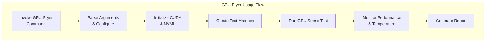
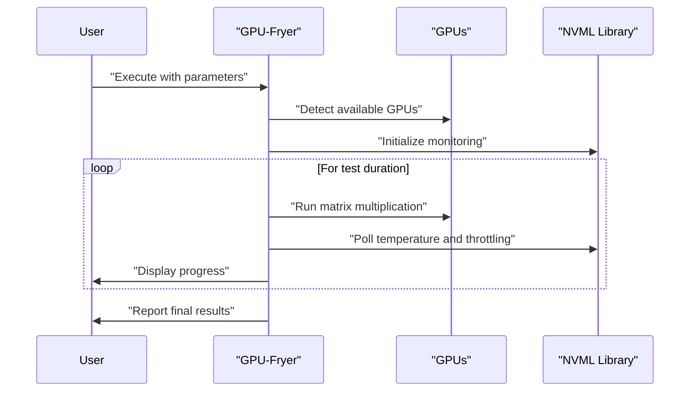
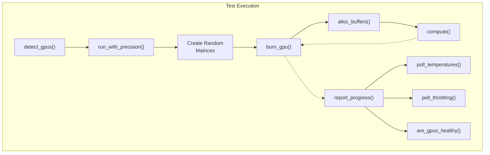
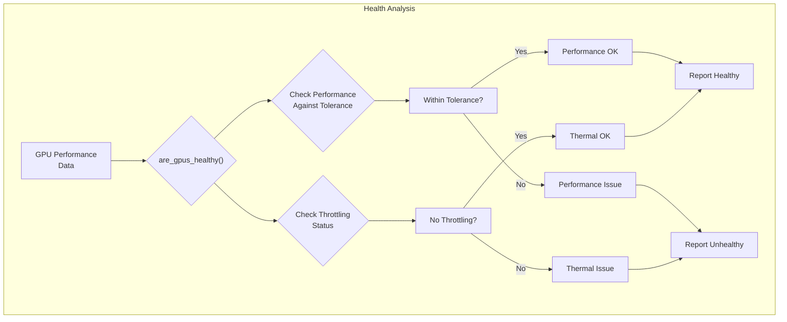
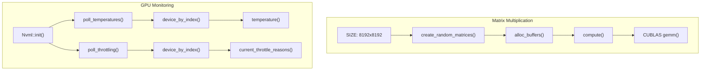

<!-- source: DeepWiki mcp.deepwiki.com · repo huggingface/gpu-fryer · page 3 Usage Guide · fetched 2026-10-26 -->

# Usage Guide

<details>
<summary>Relevant source files</summary>

The following files were used as context for generating this wiki page:

- [README.md](README.md)
- [src/main.rs](src/main.rs)

</details>


This guide provides comprehensive instructions for using GPU-Fryer, a tool designed to stress test GPUs and detect abnormal thermal throttling or performance degradation. For installation instructions, see [Installation and Setup](#2).

## Overview

GPU-Fryer tests the performance of NVIDIA GPUs by running intensive matrix multiplication operations that utilize the full computational capacity of the GPUs. The tool is particularly useful for systems running ML inference or training workloads where overall performance is limited by the slowest GPU.



Sources: [README.md:3-5](), [src/main.rs:143-170]()

## Basic Usage

The most basic way to run GPU-Fryer is with the default settings, which will test all detected GPUs for 60 seconds:

```
gpu-fryer
```

Alternatively, you can specify a custom duration in seconds:

```
gpu-fryer 120  # Run for 120 seconds
```

When running, GPU-Fryer will display real-time performance metrics and, upon completion, provide a summary of results for each GPU.



Sources: [README.md:20-30](), [src/main.rs:143-170](), [src/main.rs:184-221]()

## Command-Line Interface

GPU-Fryer supports several command-line options to customize the test:

| Option | Description | Default |
|--------|-------------|---------|
| `DURATION_SECS` | Duration in seconds to run the test | 60 |
| `--nvml-lib-path` | Path to NVIDIA Management Library | `/usr/lib/x86_64-linux-gnu/libnvidia-ml.so.1` |
| `--tolerate-software-throttling` | Allow software throttling if TFLOPS are acceptable | `false` |
| `--tflops-tolerance` | Percentage tolerance compared to best GPU | 10 |
| `--use-bf16` | Use BF16 precision instead of FP32 | Auto-detect |
| `-h, --help` | Display help information | - |
| `-V, --version` | Display version information | - |

### Example Commands

```
# Run for 300 seconds with increased tolerance
gpu-fryer 300 --tflops-tolerance 15

# Use BF16 precision explicitly
gpu-fryer --use-bf16 true

# Specify a custom NVML library path
gpu-fryer --nvml-lib-path /path/to/libnvidia-ml.so
```

Sources: [README.md:32-50](), [src/main.rs:31-50]()

## Test Execution Process

When you run GPU-Fryer, it performs the following operations:

1. **Detection**: Identifies all available NVIDIA GPUs in the system
2. **Initialization**: Sets up CUDA environment and NVML monitoring
3. **Matrix Creation**: Generates two 8192×8192 matrices with random values
4. **Memory Allocation**: Allocates approximately 90% of available GPU memory
5. **Execution**: Performs continuous matrix multiplication operations
6. **Monitoring**: Tracks GFLOPS, temperature, and throttling status
7. **Analysis**: Evaluates performance homogeneity across GPUs
8. **Reporting**: Provides detailed results for each GPU



Sources: [src/main.rs:172-297](), [src/main.rs:483-517](), [src/main.rs:327-448]()

## Understanding Output

During test execution, GPU-Fryer displays real-time metrics for each GPU:

1. **Operations count and GFLOPS/s**: Shows computational performance
2. **Temperature**: Current temperature in degrees Celsius
3. **Throttling status**: Indicates if any throttling is occurring

After completion, a summary is displayed for each GPU:

```
GPU #0: 51494 Gflops/s (min: 50577.53, max: 51677.05, dev: 51493.79)
        Temperature: 48.83°C (min: 47.00, max: 50.00)
        Throttling HW: false, Thermal SW: false, Thermal HW: false
```

This summary shows:
- Average, minimum, and maximum GFLOPS performance
- Average, minimum, and maximum temperature 
- Three types of throttling indicators:
  - HW: Hardware throttling
  - Thermal SW: Software thermal throttling
  - Thermal HW: Hardware thermal throttling

The test concludes with an overall health assessment:
```
All GPUs seem healthy
```
or
```
Some GPUs are not healthy. Reasons:
  - GPU 2 - GPU is throttled. Check the throttling reasons and temperatures
```

Sources: [README.md:23-29](), [src/main.rs:410-445]()

## Performance Analysis

GPU-Fryer evaluates GPU health based on two main criteria:

1. **Performance Homogeneity**: All GPUs should deliver similar computational performance
2. **Thermal Management**: GPUs should not exhibit thermal throttling



Sources: [src/main.rs:450-481]()

### Understanding Throttling

Three types of throttling can be reported:

1. **Hardware (HW) Throttling**: General hardware throttling
2. **Software Thermal (Thermal SW)**: Operating system-level thermal throttling
3. **Hardware Thermal (Thermal HW)**: GPU hardware thermal protection

The presence of any throttling typically indicates a problem, although software thermal throttling can be tolerated with the `--tolerate-software-throttling` flag if performance remains acceptable.

Sources: [src/main.rs:383-401](), [src/main.rs:463-477]()

## Advanced Configuration

### Precision Settings

GPU-Fryer supports both FP32 (single precision) and BF16 (Brain Floating Point) precision modes:

- By default, it will use BF16 if all detected GPUs support it, otherwise FP32
- You can explicitly set the precision mode with `--use-bf16 true` or `--use-bf16 false`
- BF16 is only available on NVIDIA GPUs with compute capability 8.0 or higher

### Performance Tolerance

The `--tflops-tolerance` parameter controls how much performance variation is acceptable between GPUs:

- Default is 10%, meaning all GPUs must perform within 10% of the best GPU
- Increase this value if you expect some performance variation
- Decrease for stricter homogeneity requirements

Sources: [src/main.rs:197-214](), [src/main.rs:456-462]()

## Docker Usage

For containerized environments, use the Docker image:

```bash
docker run --gpus all ghcr.io/huggingface/gpu-fryer:1.0.0 60
```

This runs GPU-Fryer for 60 seconds on all available GPUs. You can add command-line options after the duration:

```bash
docker run --gpus all ghcr.io/huggingface/gpu-fryer:1.0.0 120 --tflops-tolerance 15
```

Sources: [README.md:15-19]()

## Troubleshooting

### Common Issues

1. **NVML Library Not Found**: If you encounter errors about NVML initialization:
   - Verify NVIDIA drivers are installed
   - Check if the NVML library exists at the default path
   - Use `--nvml-lib-path` to specify the correct path

2. **BF16 Not Supported**: If you explicitly request BF16 but your GPUs don't support it:
   - Remove the `--use-bf16` flag to let GPU-Fryer auto-detect the best precision
   - Or use `--use-bf16 false` to force FP32 mode

3. **Test Duration Too Short**: Tests shorter than 10 seconds are not accepted:
   - Always use a minimum of 10 seconds for meaningful results

4. **Docker GPU Access**: If Docker can't access GPUs:
   - Ensure the NVIDIA Container Toolkit is installed
   - Verify the `--gpus all` flag is included in your Docker run command

Sources: [src/main.rs:145-153](), [src/main.rs:204-207](), [src/main.rs:262-264]()

## Test Internals

GPU-Fryer uses CUBLAS for matrix multiplication and NVML for GPU monitoring:



The test creates two 8192×8192 matrices filled with random values and performs continuous matrix multiplication. Results are written to a ring buffer that uses approximately 90% of available GPU memory. This approach:

1. Maximizes computational load
2. Efficiently utilizes GPU memory
3. Exercises the GPU's thermal management systems

Sources: [src/main.rs:20-22](), [src/main.rs:483-570](), [src/main.rs:299-315]()

---

