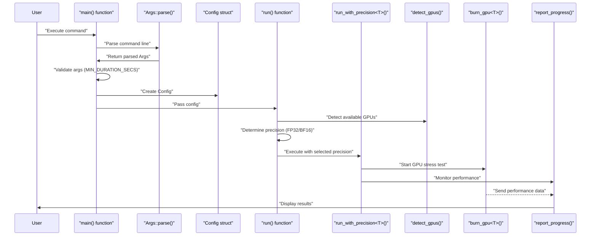
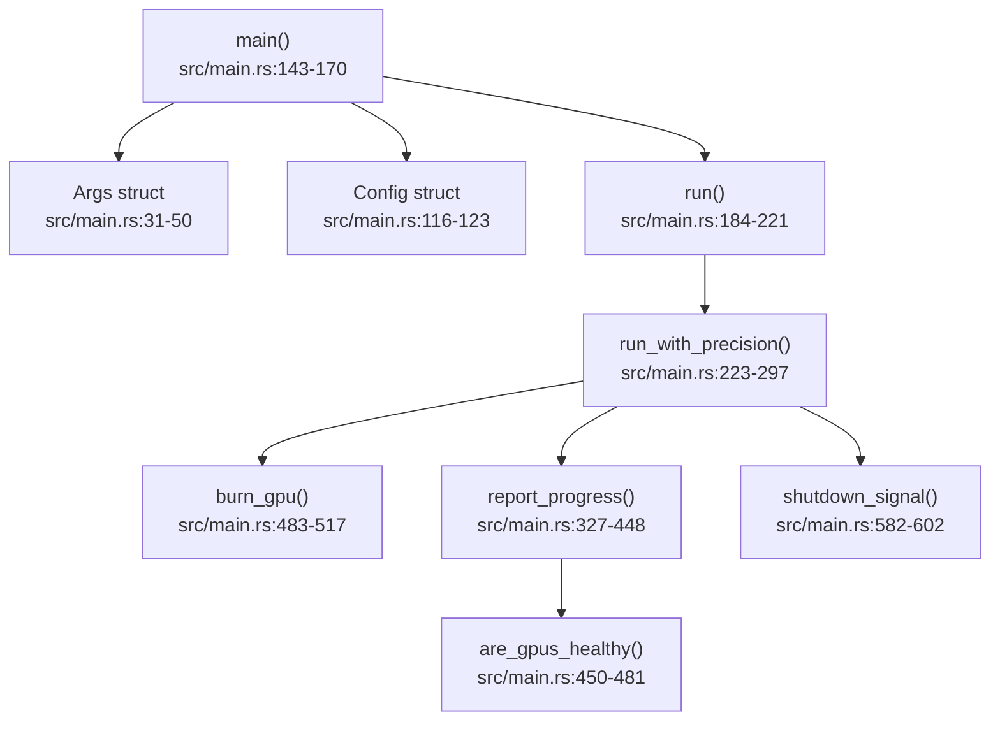
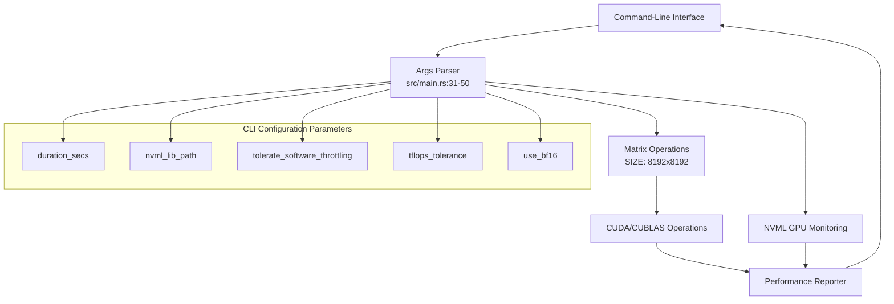

<!-- source: DeepWiki mcp.deepwiki.com · repo huggingface/gpu-fryer · page 3.1 Command-Line Interface · fetched 2026-10-26 -->

# Command-Line Interface

<details>
<summary>Relevant source files</summary>

The following files were used as context for generating this wiki page:

- [README.md](README.md)
- [src/main.rs](src/main.rs)

</details>


This document describes the command-line interface of GPU-Fryer, a tool for stress testing GPUs and detecting thermal throttling or performance degradation. The CLI provides a user-friendly way to initiate, configure, and monitor GPU stress tests.

For information about the configuration options and their effects, see [Configuration Options](#3.2). For detailed explanation of the output, see [Output Interpretation](#3.3).

## Basic Usage

GPU-Fryer provides a simple command-line interface designed to be easy to use while offering extensive configuration options:

```
$ gpu-fryer [OPTIONS] [DURATION_SECS]
```

At its simplest, you can run a GPU stress test for 60 seconds (the default duration) with:

```
$ gpu-fryer
```

Or specify a custom duration:

```
$ gpu-fryer 120  # Run for 120 seconds
```

Sources: [README.md:23-30](), [src/main.rs:32-50]()

## Command-Line Arguments

The following table lists all available arguments and options:

| Argument/Option | Type | Default | Description |
|-----------------|------|---------|-------------|
| `DURATION_SECS` | u64 | 60 | Duration in seconds to burn the GPUs |
| `--nvml-lib-path <PATH>` | String | /usr/lib/x86_64-linux-gnu/libnvidia-ml.so.1 | Path to NVIDIA Management Library |
| `--tolerate-software-throttling` | bool | false | Tolerate software throttling if TFLOPS are acceptable |
| `--tflops-tolerance <PCT>` | f64 | 10 | TFLOPS tolerance (%) compared to best GPU |
| `--use-bf16 <BOOL>` | Optional<bool> | auto | Use BF16 precision instead of FP32 |
| `-h`, `--help` | - | - | Print help information |
| `-V`, `--version` | - | - | Print version information |

Sources: [README.md:32-50](), [src/main.rs:31-50]()

## Arguments and Options in Detail

### DURATION_SECS

This positional argument sets the test duration in seconds. The minimum allowed value is 10 seconds, which is enforced by the `MIN_DURATION_SECS` constant:

```rust
const MIN_DURATION_SECS: u64 = 10;
```

If a value less than 10 is specified, the program will exit with an error message.

Sources: [src/main.rs:22](), [src/main.rs:146-149]()

### --nvml-lib-path

Path to the NVIDIA Management Library (libnvidia-ml.so), which is used for monitoring GPU temperature and throttling states. This option is useful if your NVIDIA drivers are installed in a non-standard location.

Sources: [src/main.rs:37-39]()

### --tolerate-software-throttling

When set to `true`, the test will pass even if software throttling is detected, as long as the TFLOPS are within the acceptable range specified by `--tflops-tolerance`. By default, any throttling is considered a failure.

Sources: [src/main.rs:41-42](), [src/main.rs:471-476]()

### --tflops-tolerance

Specifies the maximum allowed percentage deviation in performance (measured in TFLOPS) between the tested GPUs and the best-performing GPU. Must be between 0 and 100. Default is 10%.

Sources: [src/main.rs:44-46](), [src/main.rs:150-153]()

### --use-bf16

Controls whether to use BF16 (Brain Float 16) precision instead of FP32 (32-bit floating point):
- If not specified: Automatically uses BF16 if all detected GPUs support it
- If `true`: Uses BF16 (fails if any GPU doesn't support it)
- If `false`: Uses FP32 for all GPUs

Sources: [src/main.rs:47-49](), [src/main.rs:200-214]()

## CLI Architecture

The following diagram illustrates how the CLI components interact:

**CLI Command Processing Flow**


Sources: [src/main.rs:143-170](), [src/main.rs:184-221](), [src/main.rs:223-297]()

## CLI Components and Their Relationships

**CLI Components Diagram**


Sources: [src/main.rs:143-170](), [src/main.rs:223-297](), [src/main.rs:327-448]()

## Implementation Details

The CLI is built using the `clap` crate, which provides a declarative way to define command-line arguments:

```rust
#[derive(Parser, Debug)]
#[clap(author, version, about, long_about = None)]
struct Args {
    // CLI arguments defined here
}
```

When executed, the CLI follows these steps:

1. Parse command-line arguments using `Args::parse()`
2. Validate the arguments (e.g., duration must be at least 10 seconds)
3. Create a `Config` struct from the validated arguments
4. Call the `run()` function with the configuration
5. Detect available GPUs
6. Determine precision mode (BF16 or FP32)
7. Execute the stress test with the selected precision
8. Monitor and report progress during the test
9. Evaluate test results and print a summary
10. Return appropriate exit code (0 for success, 1 for failure)

Sources: [src/main.rs:143-170](), [src/main.rs:184-221]()

## Error Handling

The CLI implements several error handling mechanisms:

1. **Argument validation**: Values outside acceptable ranges trigger error messages and exit
2. **GPU detection errors**: Handled with descriptive error messages
3. **Signal handling**: Gracefully handles Ctrl+C and termination signals
4. **Runtime errors**: Propagated up and displayed to the user

Example error messages:

```
Duration must be at least 10 seconds
```

```
TFLOPS tolerance must be between 0 and 100
```

```
BF16 was explicitly requested but not all GPUs support it. Remove the --use-bf16 flag
```

Sources: [src/main.rs:146-153](), [src/main.rs:163-169](), [src/main.rs:202-207]()

## Integration with Core Components

**CLI and Core Component Integration**


Sources: [src/main.rs:31-50](), [src/main.rs:116-123](), [src/main.rs:327-448]()

## Usage Examples

### Basic Usage

Run a stress test for the default duration (60 seconds):

```bash
$ gpu-fryer
```

Run a stress test for 5 minutes:

```bash
$ gpu-fryer 300
```

### Advanced Usage

Run with custom NVML library path:

```bash
$ gpu-fryer --nvml-lib-path /opt/nvidia/lib64/libnvidia-ml.so.1 120
```

Run with increased tolerance for performance differences:

```bash
$ gpu-fryer --tflops-tolerance 15 60
```

Force FP32 precision even if BF16 is supported:

```bash
$ gpu-fryer --use-bf16 false 60
```

Tolerate software throttling if performance is acceptable:

```bash
$ gpu-fryer --tolerate-software-throttling 60
```

Combine multiple options:

```bash
$ gpu-fryer --tflops-tolerance 20 --use-bf16 true --tolerate-software-throttling 120
```

Sources: [README.md:23-30](), [README.md:32-50]()

## Docker Usage

GPU-Fryer can also be executed using Docker with the same command-line interface:

```bash
docker run --gpus all ghcr.io/huggingface/gpu-fryer:1.0.0 60
```

Additional options can be passed to the Docker command:

```bash
docker run --gpus all ghcr.io/huggingface/gpu-fryer:1.0.0 --tflops-tolerance 15 120
```

For more information about Docker installation and usage, see [Docker Installation](#2.1).

Sources: [README.md:15-19]()

---

